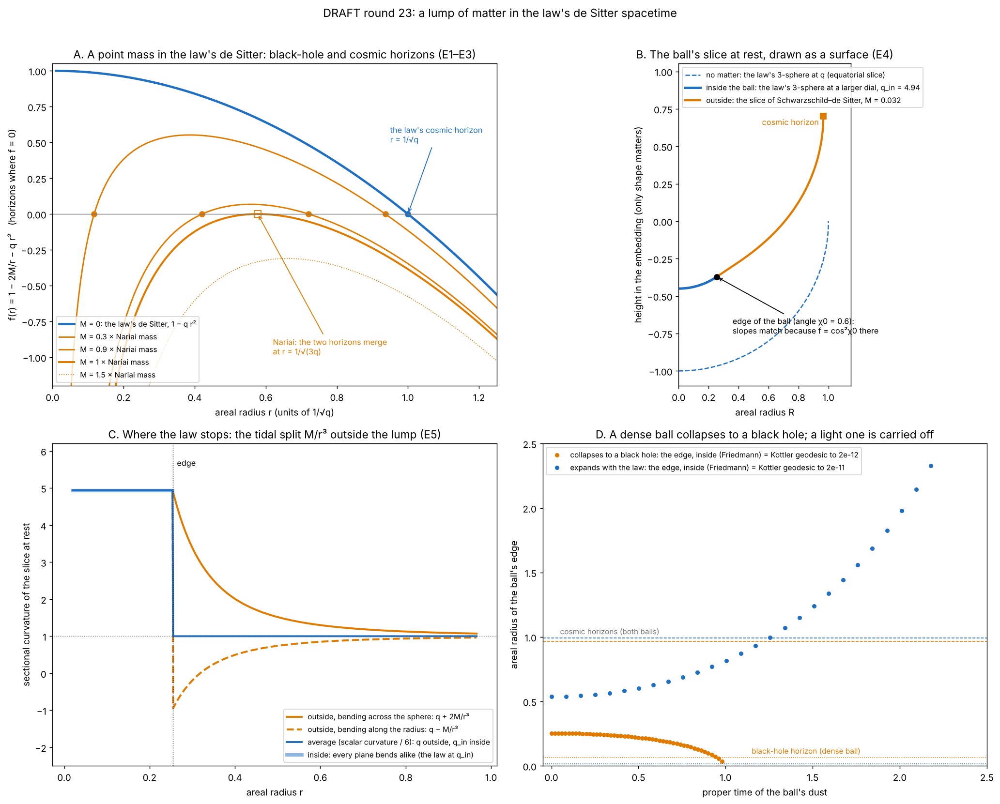

# Round 23: a lump of matter in the law's de Sitter spacetime

*DRAFT, Nov 27 2026. Not versioned, not proved in Lean. Follows round 22 (`../round22/`), which put light and free matter into the law's de Sitter spacetime with no pull back on the geometry. Here matter is allowed to curve the law's spacetime back. Checks: `checks.py` → `checks_output.txt` (**5 / 5 pass**, about 6 seconds; numpy, scipy, sympy), numbers in `results.json`. Picture: `figures.py` → `figures/f30`. Colour key: **blue = the law's own geometry, orange = what the mass adds, grey = reference**.*

## Verdict first

**Matter bends the law's spacetime into Schwarzschild–de Sitter, but only part of the bent geometry is still the law's.**
- The inside of a lump stays the law's geometry, at a larger dial.
- The outside keeps the law's Λ and its average curvature.
- The tidal pull of the lump on the space around it isn't the law's: it is the one kind of curvature the law's geometry doesn't have.

1. **A point mass gives Schwarzschild–de Sitter (E1, textbook).**
   - f(r) = 1 − 2M/r − q r² solves Einstein's equations outside the mass with the law's Λ = 3q, for every mass M (Kottler 1918).
   - Its total curvature is 24q² + 48M²/r⁶. The 24q² is the law's de Sitter, untouched by the mass. All of the mass's part, 48M²/r⁶, is tidal (Weyl) curvature.
2. **With no mass, it is exactly the law's spacetime (E2).**
   - Place the law's chart in 5D (round 20), then read static time and radius. The law's metric 4η/(1 + qη)² becomes −(1 − qr²)dt² + dr²/(1 − qr²) + r²dΩ², to 3e-9 or better at 600 points and three values of q.
   - So M is the one new number. The horizon r = 1/√q is the pole's view of round 22's horizon.
3. **Two horizons, and a largest black hole (E3, textbook).**
   - A mass makes a black-hole horizon (about 2M) inside the law's cosmic horizon (about 1/√q).
   - They exist together only while 27qM² < 1. They merge at r = 1/√(3q) at the Nariai mass M = 1/√(27q). So the law's dial sets the largest black hole its spacetime can hold.
4. **A ball of dust is the law's slices with matter in them (E4).**
   - Inside the ball, the slices stay the law's round 3-spheres. Einstein gives a′² = C/a + qa² − 1 (closed Friedmann with dust and Λ = 3q), with no tidal curvature.
   - At its moment of rest, each inside slice is the law's 3-sphere at a larger dial: **q_in = q + 8πρ/3**.
   - The ball's mass seen from outside is M = (q_in − q)R³/2, with R the edge's areal radius. That is (4π/3)ρR³ (textbook).
   - The edge falls exactly like a free particle of energy cos χ0 in Schwarzschild–de Sitter of that mass, to 2e-11 or better (Oppenheimer–Snyder with Λ).
   - A dense ball collapses through the black-hole horizon. A light one is carried off by the law's expansion past the cosmic horizon.
5. **Where the law stops: tidal curvature (E5).**
   - The law's spacetime has no Weyl curvature at all (Weyl² = 0, symbolic; textbook for de Sitter), and neither do the ball's insides.
   - On a slice at rest, the law's 3-sphere bends the same way in every plane (curvature q).
   - Outside a mass, the slice bends q + 2M/r³ across the sphere and q − M/r³ along the radius. The average is still the law's q (scalar curvature 6q). The split, falling as M/r³, is what stretches and squeezes an object near the mass, and the law doesn't have it.

**Does this open a lead?**
- **No new lead from the physics itself.** Schwarzschild–de Sitter, the Nariai limit and the dust ball are all textbook.
- **What it settles:** the law accounts for exactly the Ricci part of curvature: Λ, matter inside a lump, and the average bending outside. It doesn't account for the Weyl part.
  - In general relativity, the Weyl part is the tidal field of a lump and also carries gravitational waves.
  - So "gravity from the law" now has a sharp missing piece. Any extension has to make curvature that bends differently in different directions, which a single dial can't do.
- **The one reading that is ours:** matter inside a lump is the law running at a larger dial, q_in − q = 8πρ/3. The mass seen outside is half the dial excess times the edge's radius cubed. This is a restatement of textbook equations in the law's terms, not a new prediction.
- **A question this raises, not tested here:** the law does have a direction-dependent ingredient, its twist (the Thomas–Wigner turn, rounds 10, 18 and 19). Whether a dial that varies from place to place, together with that twist, could supply tidal curvature is an open question.

*f30. A: f(r) for a growing point mass. With no mass (blue) it is the law's de Sitter with its one horizon at r = 1/√q. A mass (orange) adds a black-hole horizon, and the two merge at the Nariai mass; past it there is no horizon pair. B: the slice of a dense dust ball at its moment of rest, drawn as a surface. Inside (thick blue) it is a tighter law 3-sphere. Outside (orange) it is the slice of Schwarzschild–de Sitter, and the two join with matching slope. The dashed curve is the law's 3-sphere with no matter. C: how that slice bends. Inside, every plane alike (the law at q_in). Outside, across and along split by the tide M/r³, while their average stays the law's q. D: the ball's edge, inside (Friedmann) and outside (a free fall in Schwarzschild–de Sitter), for a dense ball that collapses through its black-hole horizon and a light one carried past the cosmic horizon.*

## What the checks show

| Check | What it tests | Result |
|---|---|---|
| E1 (exact, symbolic) | Schwarzschild–de Sitter solves Einstein with Λ = 3q; its curvature splits into the law's part and the tidal part | Ricci = 3q g; Kretschmann 24q² + 48M²/r⁶; Weyl² 48M²/r⁶; scalar 12q |
| E2 (exact) | with no mass it is the law's spacetime | pulled-back metric vs the law's: 1e-9, 3e-9, 5e-10 (q = 1, 0.37, 2.5; 200 points each, finite differences) |
| E3 (exact) | two horizons up to the Nariai limit | two roots for M below 1/√(27q), none above; tiny M: 2M and 1/√q; near the limit: both near 1/√(3q) |
| E4 (exact) | the dust ball | Friedmann from Einstein (symbolic); no Weyl inside; q_in = q + 8πρ/3 to 1e-15; edge vs Schwarzschild–de Sitter free fall 2e-12 and 2e-11; dense ball crosses its black-hole horizon, light ball passes the cosmic horizon |
| E5 (exact, symbolic) | where the law stops | Weyl² of the law's spacetime 0; outside slice bends q + 2M/r³ and q − M/r³ (scalar 6q); the law's slice bends q and q |

## How it's computed

- **Curvature.** A symbolic routine (sympy) for diagonal metrics gives Christoffel symbols, Riemann, Ricci, scalar, Kretschmann and Weyl². It is applied to:
  - Schwarzschild–de Sitter in (t, r, θ, φ);
  - closed Friedmann with a(t) in (t, χ, θ, φ);
  - the law's metric 4η/(1 + qη)² in its chart (x0, x1, x2, x3).
- **E2.** Round 20's placement into 5D. Static time is t_s = artanh(T/W)/√q, and the static radius r is |(X, Y, Z)|. The Jacobian comes from central differences (step 1e-6), and the law's metric is compared with the static form at random points of the pole's static patch (W > |T|).
- **E3.** Roots of −qr³ + r − 2M for M from 0.0001 to 1.5 times the Nariai mass, at q = 1 and q = 0.25.
- **E4.**
  - Inside: a″ = −C/(2a²) + qa from rest at a0, in the dust's proper time.
  - Outside: the radial free fall R″ = −f′(R)/2 in Schwarzschild–de Sitter from rest at R = a0 sin χ0, with M = C sin³χ0/2. Integrated separately and compared.
  - Two balls at q = 1, both with χ0 = 0.6: a0 = 0.45 collapses, and a0 = 0.95 expands.
- **E5.** For a static slice dr²/f + r²dΩ², the curvature across the sphere is (1 − f)/r² and along the radius is −f′/(2r). The law's slice is written in the same form through its areal radius.

## What is textbook and what is ours

| Item | Status | Source |
|---|---|---|
| Schwarzschild–de Sitter (Kottler) metric, its horizons, the Nariai limit | **Textbook** | Kottler 1918; Nariai 1950; Gibbons & Hawking 1977 |
| de Sitter is conformally flat (no Weyl curvature) | **Textbook** | Hawking & Ellis (1973) |
| Dust ball with Λ: Friedmann inside, Schwarzschild–de Sitter outside, edge in free fall | **Textbook** | Oppenheimer & Snyder 1939; with Λ, Nakao 1992, Markovic & Shapiro 2000 |
| Time-symmetric constraint (scalar curvature = 16πρ + 2Λ); mass (4π/3)ρR³ | **Textbook** | any GR text (Misner–Sharp mass) |
| Static form = the law's chart placed in 5D | **Ours** (a check of rounds 20–22) | E2 |
| Matter as the law at a larger dial, q_in − q = 8πρ/3; M = (q_in − q)R³/2 | **Ours** (a restatement) | E4 |
| The law gives the Ricci part and not the Weyl part; the missing piece is tidal curvature | **Ours** (stated in the law's terms; the facts are textbook) | E1, E5 |

## What is still open

- Whether anything in the law (a dial that varies from place to place, or its twist) can make tidal curvature.
- Charge as a source of light on the law's mesh (round 10's charge ½), the next round if it fits.
- The other forces (round 17's non-abelian twist) on the expanding slices.
- What fixes the number of refinements (round 16).
- Lean proofs, deferred to a machine that has Lean.
