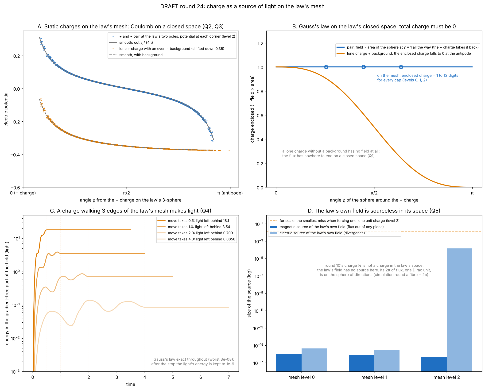

# Round 24: charge as a source of light on the law's mesh

> **Names:** some words or symbols on this page (twist) also mean something else in standard math, physics or computing, or inside this project. [NAMING-COLLISIONS.md](../../../NAMING-COLLISIONS.md) says which meaning is in play.

*DRAFT, Nov 27 2026. Not versioned, not proved in Lean. Follows round 23 (`../round23/`). The question is the one Brennan was offered: can round 10's charge ½ act as a source of light on the law's mesh? Light on the law's 3-sphere is from round 17, and the law's own field there is from round 18. Checks: `checks.py` → `checks_output.txt` (**5 / 5 pass**, about 90 seconds; numpy, scipy), numbers in `results.json`. Picture: `figures.py` → `figures/f31`. Colour key: **blue = the law's mesh and field, orange = charges and their light, grey = smooth reference**.*

## Verdict first

**Charges on the law's mesh make light exactly as Maxwell says, but round 10's charge ½ is not one of them.** The law's own field has no source in the law's space. Its one unit of flux lives on the sphere of directions instead.

1. **On the law's closed space, total charge must be zero (Q1).**
   - The discrete Gauss law gives the charge of any field as −d0ᵀME. Since d0 of a constant is exactly 0, the charges of every field add up to 0.
   - So a lone charge has no field at all. Forcing one misses by at least 1/√(number of corners), and the best attempt hits that bound exactly at all three mesh levels.
   - Charges on the law's space come in neutral sets. This is textbook for any closed universe: the flux of a charge has nowhere to end except on another charge.
2. **A + and − pair gives Coulomb on the 3-sphere (Q2).**
   - Put + at the law's rest point and − at its antipode, both corners the law grew. The potential is cot χ/(4π).
   - The same flux, 1, passes through every sphere around the + charge. Those spheres grow to the equator and shrink again, so the field focuses onto the − charge.
   - On the mesh, the enclosed charge is 1 to 12 digits for every cap. The potential approaches the smooth one with refinement: worst error 0.57, 0.39 and 0.045 at levels 0, 1 and 2.
3. **A lone charge needs an even background of the opposite sign (Q3).**
   - Then its field dies to zero at the far pole instead of focusing there: (1 − (χ − sin χ cos χ)/π)/(4π sin²χ).
   - The mesh reproduces it: worst error 0.62, 0.45 and 0.052 at levels 0, 1 and 2.
4. **A moving charge makes light (Q4).**
   - A + charge walks three edges of the law's mesh, about 1 radian, while its partner stays put. Its current is the source in Maxwell's equations.
   - Gauss's law holds at every moment, to 3e-8 (integration error).
   - After the charge stops, the gradient part of the field is the new pair's static field. The rest is gradient-free light that keeps circling the closed space with fixed energy.
   - Quicker moves leave more light: 18.1, 3.54, 0.71 and 0.086 for moves taking 0.5, 1, 2 and 4. Radiation grows with acceleration (Larmor, textbook).
5. **Round 10's charge ½ is not a source in the law's space (Q5).**
   - The law's own field (round 18) has no magnetic source anywhere in the law's 3-space: the flux out of every piece of the mesh is exactly 0.
   - It has no electric source either. Smoothly it is X → JX with J antisymmetric, a rotation of the 3-sphere, so it is exactly divergence-free. On the mesh its divergence is 0 to rounding at levels 0 and 1 and 1.5e-4 at level 2.
   - Its 2π of flux, one Dirac unit, appears only on the sphere of directions it projects to (the Hopf base). The circulation round each fibre is 2π.
   - So charge ½ measures how matter couples to the law's twist: a charge on the sphere of directions, not a charge sitting in space. Q1 would forbid a lone charge on the law's closed space in any case.

**Does this open a lead?**
- **No new lead.** Neutrality on a closed space, Coulomb on the 3-sphere and light from accelerated charges are all textbook. Discrete Gauss's law holding exactly with Whitney forms is textbook too.
- **What it settles:**
  - The law's mesh carries electrostatics and radiation correctly, so it is a sound stage for charged matter.
  - Round 10's charge ½ is a coupling (how matter feels the twist), not a source of light. A charged particle in the law's space is something extra the law doesn't supply.
- **What this means for "all forces from the law":** the law supplies light's stage (the closed 3-sphere, its modes, one photon of its own) and the rule for how matter couples (charge ½ on the sphere of directions). Real charges and currents, which make light, still have to be put in, and on the law's closed space they must add up to zero.

*f31. A: the potential of a + and − pair at the law's two poles, at every corner of the level 2 mesh (blue dots), against cot χ/(4π). Below it: a lone charge with an even background of the opposite sign, against its smooth form. B: the charge enclosed by the sphere at angle χ. For the pair it is 1 all the way, because the − charge at the antipode takes the flux back; on the mesh it is 1 to 12 digits. With a background it falls to 0 at the antipode. With neither, there is no field. C: the energy in the gradient-free part of the field (light) while a charge walks three edges and after it stops, for four move times. Quicker moves leave more light, and after the stop its energy stays fixed. D: the size of the law's own field's sources at each mesh level, against the smallest miss when forcing one lone unit charge.*

## What the checks show

| Check | What it tests | Result |
|---|---|---|
| Q1 (exact) | total charge is zero on the law's closed mesh | d0(constant) = 0 exactly; total charge of a random field 4e-15 or less; lone charge misses by 0.091, 0.035, 0.012 (= 1/√corners) |
| Q2 | + and − pair, Coulomb on S³ | enclosed charge 1 to 12 digits for caps at χ = 0.8, 1.4, 2.0; potential worst 0.57 → 0.39 → 0.045, average 0.45 → 0.24 → 0.025 |
| Q3 | lone charge with background | total 0 to 5e-16; potential worst 0.62 → 0.45 → 0.052, average 0.48 → 0.26 → 0.027 |
| Q4 | moving charge makes light | Gauss to 3e-8 throughout; light's energy after the stop kept to 1e-9; static part = new pair's field to 5e-9; light 18.1, 3.54, 0.71, 0.086 for moves of 0.5, 1, 2, 4 |
| Q5 | the law's own field has no source in space | magnetic source 1e-16 or less at every level (exact); electric source 4e-16, 3e-16, 1.5e-4; smooth J antisymmetric; fibre circulation 2π |

## How it's computed

- **Mesh.** Round 18's levels 0–2 (corners grown and cut by the law, 120 / 840 / 6,480 corners) and Whitney forms, code copied unchanged.
  - d0: corners → edges. d1: edges → faces. d2: faces → pieces.
  - M is the Whitney mass matrix and K the curl-curl matrix. L0 = d0ᵀMd0 is the scalar Laplacian.
- **Q1.** Least squares on L0 φ = (one unit charge at the rest corner). The best possible miss is the charge's projection onto constants, 1/√(corners).
- **Q2, Q3.** Solve L0 φ = ρ with one corner pinned, then compare with the smooth potential after removing a constant, for χ in [0.6, π − 0.6] (pair) or χ > 0.6 (background). The "average" error weights each corner by its share of volume. Enclosed charge is the sum of L0 φ over corners with χ below the cap angle.
- **Q4.**
  - Level 1, temporal gauge (E = −dA/dt), M d²A/dt² = −KA + j.
  - The charge moves one edge after another along the shortest edge path from the rest corner to a corner at χ = 0.987, with a smooth sin² profile on each edge. Its current j is exactly the rate of that move, so charge is conserved by construction.
  - The field starts as the pair's static field. Light's energy is the energy of the gradient-free part of the field (M-orthogonal projection).
- **Q5.** The law's own field (round 18's "mirror" Hopf field), integrated exactly along each edge. Magnetic source: d2 d1 a. Electric source: d0ᵀMa, relative to its size.

## What is textbook and what is ours

| Item | Status | Source |
|---|---|---|
| Total charge zero on a closed universe | **Textbook** | Gauss's law on a closed space (the divergence theorem with no boundary) |
| Coulomb field on S³ (cot χ potential); background-neutralised charge | **Textbook** | standard Green's function on the 3-sphere |
| Radiation from accelerated charges grows with acceleration | **Textbook** | Larmor 1897 |
| Exact discrete Gauss law and charge conservation with Whitney forms | **Textbook** | Whitney 1957; Bossavit (1998) |
| The law's mesh carries all of these | **Ours** (a check) | Q1–Q4 |
| Round 10's charge ½ is a coupling on the sphere of directions, not a source in the law's space | **Ours** (a reading of rounds 10, 17 and 18, checked here) | Q5 |

## What is still open

- Whether anything in the law could supply charged matter itself (a source), rather than only its coupling.
- Whether anything in the law can make tidal curvature (round 23).
- The other forces (round 17's non-abelian twist) on the expanding slices.
- What fixes the number of refinements (round 16).
- Lean proofs, deferred to a machine that has Lean.
