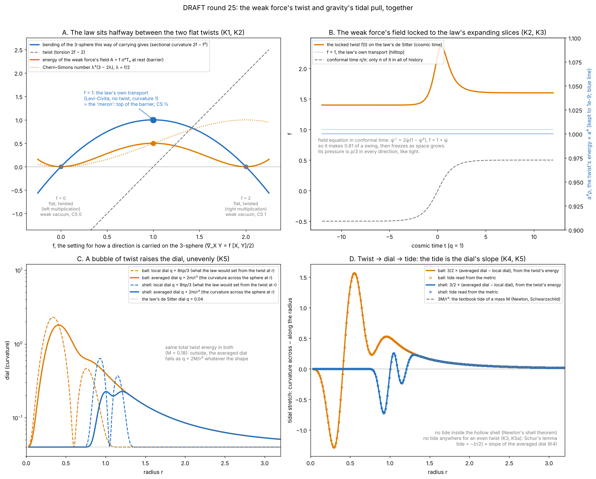

# Round 25: the weak force's twist and gravity's tidal pull, together

*DRAFT, Nov 27 2026. Not versioned, not proved in Lean. Follows round 24 (`../round24/`) and joins two open threads: round 23's missing tidal pull (`../round23/`) and the weak and strong forces' hidden spaces from rounds 4–5 (`../` §6d, `../round5/`), now put on the law's expanding 3-sphere slices (rounds 18–22). Checks: `checks.py` → `checks_output.txt` (**5 / 5 pass**, about 16 s; numpy, scipy, sympy), numbers in `results.json`. Picture: `figures.py` → `figures/f32`. Colour key: **blue = the law, orange = the weak force's twist and its energy, grey = reference**.*

Brennan asked to merge the two threads because he expected them to depend on each other: "Merge the work streams because I think these will be interdependent". This is part of his standing goal to "keep pushing until we are able to build them all in spacetime". The questions: what does the weak and strong forces' twist look like on the law's expanding slices, can a dial that varies from place to place, together with that twist, make the tidal pull, and where do the two meet?

## Verdict first

1. **The law's own way of carrying a direction is the 3-sphere's bending, halfway between two flat twists (K1).**
   - Moving a direction with the law's sum matches Levi-Civita transport along great circles to 1e-9. Plain left or right quaternion multiplication misses by order 1.
   - The law's twist gyr[a, b] is that bending's loop rotation (holonomy): its angle equals the spherical excess of the triangle 0, a, a ⊕ b to 1e-12.
   - On the 3-sphere there is a one-parameter family of ways to carry a direction, ∇_X Y = f[X, Y]/2. Its twist (torsion) is 2f − 2 and its bending (sectional curvature) is 2f − f², exactly.
   - f = 0 and f = 2 are flat but twisted: left and right multiplication. **The law sits at f = 1**, with no twist and curvature 1.
2. **In the weak force's language, f = 1 is a known field: the "meron" (K2).**
   - Because the slice is SU(2) itself (round 18), the weak force's field can be locked to it, colour a along direction a: A = f σᵃTₐ. f = 0 and f = 2 are the weak force's empty vacua. **The law's f = 1 is the top of the energy barrier between them, with Chern–Simons number ½.**
   - On the law's expanding slices, the full Yang–Mills equations reduce exactly to one: ψ'' = 2ψ(1 − ψ²) in conformal time, with f = 1 + ψ. That is a ball rolling in a double well.
   - The field's pressure is exactly ρ/3 in every direction, like light.
   - In the law's de Sitter, all of history holds only π of conformal time (round 22). So the field makes under one full swing (0.81 of one here) and then freezes as space grows.
   - The strong force's SU(3) carries the same field through its SU(2) pieces, at 1 or 4 times the energy.
3. **An even twist changes the dial q, not the tide (K3).**
   - Let the locked field pull back on a closed universe with the law's Λ = 3q. The slices stay round 3-spheres (Weyl² = 0 exactly, whatever the expansion), so there is no tidal pull.
   - At the moment of rest, the slices are the law's 3-sphere at **q_in = q + 8πGρ/3**, the same rule round 23 found for dust. Einstein's equations hold to 1e-13 with the field and the expansion driving each other.
4. **A dial that varies must make a tide, and the tide is its slope (K4, exact).**
   - Take any round lump at a moment of rest. Its slice bends by **q̄ = q + 2m/r³** across the sphere through r. That is q averaged over everything inside r.
   - Write **q_loc = q + 8πρ/3** for the q the law would set from the matter at r. Then the tide (bending across minus bending along the radius) is exactly **3/2 (q̄ − q_loc) = −(r/2) dq̄/dr**.
   - The tide vanishes everywhere only when q̄ is one constant: the law's own case. This is Schur's lemma: a space that bends the same in every direction at each point bends the same everywhere. So a dial that varies cannot stay law-like anywhere it varies.
   - Outside a lump, the tide is 3M/r³, and the tidal (Weyl) curvature is 48M²/r⁶, round 23's value.
5. **Where they meet: a bubble of the weak force's twist (K5).**
   - Spread over a whole 3-sphere, the field shape w = cos χ has exactly even energy, equal to the law's f = 1 field. The slice is the law's at a larger q, with no tide anywhere.
   - Gathered into a bubble, as a ball or a hollow shell, Einstein's constraint is solved. The tide read from the metric equals 3/2 (q̄ − q_loc) from the field's energy to 5e-7 at every radius.
   - There is no tide inside the hollow shell (Newton's shell theorem), a varying tide within the field, and 3M/r³ outside, with M the field's total energy. Both shapes give the same tide outside when M is the same.
   - **So the chain runs one way: twist → q → tide.** The twist sets q through its energy. Only a q that varies from place to place makes a tide, and the tide outside remembers only the total.

**Does this open a lead?**
- **No new lead.** Every result is textbook once recognised: Levi-Civita and the Cartan–Schouten connections on a group, the meron, Yang–Mills on the 3-sphere, Friedmann, Schur's lemma, the time-symmetric constraint and Einstein–Yang–Mills initial data.
- **Brennan's hunch holds, in one direction.** The twist and the tide are linked, but only through q. The twist feeds q, and q's slope is the tide. A tide doesn't feed back into the twist.
- **What this settles about the gap round 23 found.** The law's rules are local: each place gets its q from what is there. The tide is the part that isn't local. It is the gap between q averaged over the ball inside and q here, and Einstein's constraint is what does the averaging. So to make the tide, the law needs one more ingredient, and that ingredient is Einstein's equation itself, not more twist.
- **What is ours:**
  - Reading round 10's twist (the law's half kick) as the f = 1 meron, the hilltop between the weak force's vacua.
  - Writing the tide as 3/2 (q̄ − q_loc), the gap between the averaged and local q.
  - The chain twist → q → tide.
- The meron's place atop the barrier is suggestive for the weak force, whose barrier crossings (sphalerons) change the number of matter particles. That is a reading, not a test, and nothing here checks it.

*f32. A: the one-parameter family of ways to carry a direction on the 3-sphere. Blue: bending 2f − f². Grey dashed: twist 2f − 2. Orange: the weak force's field energy and its Chern–Simons number. The law (f = 1) is torsion-free, curved and at the top of the barrier, halfway between the two flat twists. B: the locked weak-force field on the law's de Sitter. It swings once and freezes, because all of history holds only π of conformal time (grey dashed). Its energy × a⁴ stays fixed (blue, right axis). C: two bubbles of twist with the same total energy, a ball (orange) and a hollow shell (blue). Dashed: q set locally by the field's energy. Solid: q averaged over the ball inside r, which is the slice's bending across the sphere. D: the tide, from the twist's energy (lines) and read from the metric (circles). It is zero inside the hollow shell and 3M/r³ outside (grey), whatever the shape.*

## What the checks show

| Check | What it tests | Result |
|---|---|---|
| K1 | law's transport vs Levi-Civita; twist as holonomy; the f family | 2.5e-10 (left/right: 2.6, 2.5); gyration = excess to 2.4e-13; torsion 2f − 2, curvature 2f − f² (exact) |
| K2 | weak force's field locked to the slices | YM → ψ'' = 2ψ(1 − ψ²) exact; Gauss exact; stress isotropic, traceless (exact); SU(3) energy ×1, ×4; Chern–Simons λ²(3 − 2λ); de Sitter: a⁴ρ drift 3.5e-9, conformal time π, 0.81 swing |
| K3 | the twist pulling back on the law's spacetime | Weyl² = 0 (exact); Friedmann residual ≤ 3e-13; q_in = q + κC/a⁴ to 1e-15 (three settings) |
| K4 | what a varying q does to a slice (exact) | K⊥ = q̄; K∥ = q + m′/r² − m/r³; total 6q + 16πρ; tide = 3/2 (q̄ − q_loc) = −(r/2)q̄′; Schur; outside 8E·E = 48M²/r⁶ |
| K5 | a bubble of twist | even field: q̄ − 1/a² 7e-14; bubbles: constraint 2e-6, tide metric vs energy 5e-7, outside vs 3M/r³ 2e-10, hollow interior tide 2e-11 |

## How it's computed

- **K1.**
  - Law's transport: d/dε to_s3(x ⊕ εv) at ε = 0, by central differences. This is compared with Levi-Civita transport of the image of v along the great circle from the pole to to_s3(x), and with left and right quaternion multiplication. 300 random x with |x| up to 3, so χ up to 143°.
  - Holonomy: the rotation angle of gyr[a, b] = ⊖(a ⊕ b) ⊕ (a ⊕ (b ⊕ ·)) against L'Huilier's spherical excess of the triangle 0, a, a ⊕ b, using the law's distance 2 atan|⊖a ⊕ b|. 500 triangles with sides up to 0.6.
  - The f family: exact torsion and curvature from the left-invariant frame, with [X_a, X_b] = 2ε_abc X_c.
- **K2.**
  - Orthonormal frame e₀ = ∂_t, e_a = X_a/a(t) on −dt² + a(t)² (unit 3-sphere), with Levi-Civita coefficients from the Koszul formula.
  - A = f(t) σᵃTₐ with frame components f/a. The field strength, the full Yang–Mills equations, and the stress tensor with inner product −2 tr are computed symbolically for any a(t).
  - SU(3) uses (λ₁, λ₂, λ₃) and (λ₇, −λ₅, λ₂).
  - Chern–Simons number: tr(A dA + ⅔A³) over the unit 3-sphere, normalised so the pure-gauge λ = 1 counts 1.
  - De Sitter run: a = cosh(√q t)/√q, q = 1, t from −12 to 12, starting at rest at f = 1.4. It is compared with the same equation integrated directly in conformal time.
- **K3.** Closed Friedmann with Λ = 3q and the field's energy, 8πGρ/3 = κC/a⁴ with κ = 4πG/g², where C = a²f′² + (f² − 2f)² is the field's conformal energy. It starts at the bounce and is integrated with a″/a = q − κC/a⁴ and K2's field equation. Einstein's first equation is checked along the way.
- **K4.** Symbolic curvature of dr²/N + r²dΩ² with N = 1 − 2m(r)/r − qr², for a general m(r). The electric part of the Weyl tensor outside is the trace-free 3D Ricci tensor, because a slice at rest has no extrinsic curvature and no matter outside.
- **K5.**
  - The standard round, purely magnetic SU(2) field shape A ∝ (1 − w(r)) at a moment of rest (Witten; Bartnik–McKinnon). Its energy is m′ = κ[N w′² + (1 − w²)²/(2r²)].
  - Both shapes use the profile w = cos(2π s²(3 − 2s)), with s running across [0, 1.2] for the ball and [0.7, 1.4] for the shell. κ is tuned so both have total energy M = 0.18, in the law's de Sitter at q = 0.04.
  - The tide is read from the solved metric (K⊥ = (1 − N)/r², K∥ = −N′/(2r) by finite differences) and compared with 3/2 (q̄ − q_loc) from the field's energy density.
  - Even case: w = cos χ on a 3-sphere of radius a, with q = 0.3, κ = 0.05 and 1/a² = q + κ/a⁴.
- **Units.** G = 1 and κ = 4πG/g², as in Bartnik–McKinnon. Only the energy, through 8πρ/3, enters the geometry.

## Textbook and ours

| Claim | Status | Source |
|---|---|---|
| On a group with a two-sided-invariant metric, the (−), (0), (+) connections; (0) is Levi-Civita, (±) are flat with torsion | **Textbook** | Cartan and Schouten 1926 |
| Möbius gyration = holonomy; its angle = triangle defect or excess | **Textbook** | Ungar, *Analytic Hyperbolic Geometry* (2005) and later |
| A = ½ g⁻¹dg (meron), Chern–Simons ½, top of the barrier between vacua on the 3-sphere | **Textbook** | de Alfaro, Fubini and Furlan 1976; Lüscher 1977; Schechter 1977 |
| Yang–Mills on ℝ × S³ reduces to ψ'' = 2ψ(1 − ψ²); homogeneous isotropic Yang–Mills cosmology, p = ρ/3 | **Textbook** | Lüscher 1977; Cervero and Jacobs 1978; Gal'tsov and Volkov 1991 |
| Isotropic SU(N) fields via SU(2) embeddings; embedding index 1 or 4 | **Textbook** | Dynkin index |
| Schur's lemma: pointwise isotropic curvature in dimension ≥ 3 is constant | **Textbook** | Schur 1886 |
| Moment-of-rest constraint ³R = 16πρ + 2Λ; Misner–Sharp mass; Birkhoff | **Textbook** | ADM; Misner and Sharp 1964; Birkhoff 1923 |
| Spherical tidal (Weyl) part ∝ m/r³ − (4π/3)ρ | **Textbook** | standard spherical symmetry (e.g. Ψ₂ in the Newman–Penrose formalism) |
| Purely magnetic round SU(2) field and its energy | **Textbook** | Witten 1977; Bartnik and McKinnon 1988 |
| The law's transport is Levi-Civita on its 3-sphere; its f = 1 is the meron | **Ours** (a reading of textbook facts; round 18 gave the identification) | |
| Tide = 3/2 (averaged q − local q); chain twist → q → tide | **Ours** (a rewriting of the textbook relation in the law's terms) | |

## What this doesn't do

- **It doesn't make a tide from the law alone.** The tide needs Einstein's constraint, which averages q over the ball inside.
- **The locked field is one special field shape.** The bubble uses the standard round shape, not the law's own locking, so the two are matched only by their energies (K5a), not shown to be the same field.
- **It gives the tidal curvature on a slice at rest, and the full 4D Weyl curvature only outside matter.** Inside the twist, the field's own uneven stress adds to the 4D tide, and that part isn't computed here.
- **Nothing here bears on the weak force's left-handedness.** Round 7's no-go stands.

## Next steps

1. **Make the tide move.** A slice at rest has only the "electric" tide. The next test is a moving or spinning bubble of twist, to see the magnetic part and gravitational waves, the other half of the Weyl curvature that round 23 named.
2. **The meron as a barrier crossing.** Whether the law's f = 1 hilltop has anything to say about weak-force barrier crossings (sphalerons). That needs the Higgs field, which none of these rounds has.
3. **Lean.** Round 25's exact identities (the f family, tide = 3/2 (q̄ − q_loc), Schur in the round case) are good candidates once a machine with Lean is available.

## References

Cartan and Schouten, Proc. Akad. Amsterdam 29, 803 (1926). Ungar, *Analytic Hyperbolic Geometry* (World Scientific, 2005). de Alfaro, Fubini and Furlan, Phys. Lett. B 65, 163 (1976). Lüscher, Phys. Lett. B 70, 321 (1977). Schechter, Phys. Rev. D 16, 3015 (1977) (citation to confirm). Cervero and Jacobs, Phys. Lett. B 78, 427 (1978). Gal'tsov and Volkov, Phys. Lett. B 256, 17 (1991) (citation to confirm). Witten, PRL 38, 121 (1977). Bartnik and McKinnon, PRL 61, 141 (1988). Schur, Math. Ann. 27, 537 (1886). Misner and Sharp, Phys. Rev. 136, B571 (1964). Birkhoff, *Relativity and Modern Physics* (1923). Arnowitt, Deser and Misner, in *Gravitation: An Introduction to Current Research* (1962). Kottler, Ann. Phys. 361, 401 (1918).
