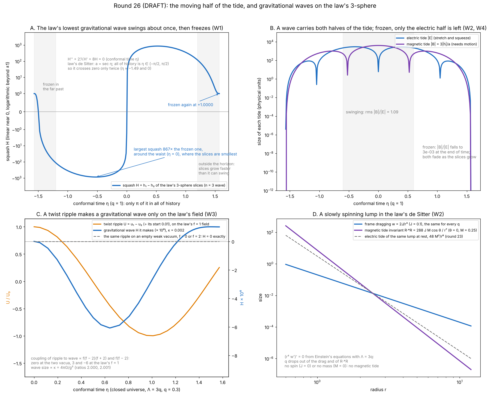

# Round 26: the moving half of the tide, and gravitational waves on the law's 3-sphere

*DRAFT, Nov 27 2026. Not versioned, not proved in Lean. Follows round 25 (`../round25/`) on the same merged stream: the weak force's twist and gravity's tide. Checks: `checks.py` → `checks_output.txt` (**4 / 4 pass**, about 80 s; numpy, scipy, sympy), numbers in `results.json`. Picture: `figures.py` → `figures/f33`. Colour key: **blue = the law and its gravity, purple = the magnetic tide, orange = the weak force's twist, grey = reference**.*

> **Prior-art note (DRAFT, added Nov 27 from the [prior-art audit](../prior-art-audit/), section 8):** the n = 3 wave on closed de Sitter is solved exactly for every n by Abbassi, Khodagholizadeh and Abbassi, Eur. Phys. J. C 73:2592 (2013), arXiv:1207.0876 (audit check K4).

Brennan merged the two threads because he expected them to depend on each other: "Merge the work streams because I think these will be interdependent". This round takes round 25's first next step, as part of his standing goal to "keep pushing until we are able to build them all in spacetime". Round 25 only had slices at rest, which carry the "electric" half of the tide (stretch and squeeze). The question here: what makes the other, "magnetic" half, and how do gravitational waves and the weak force's twist fit on the law's 3-sphere?

## Verdict first

1. **The law's lowest gravitational wave swings about once, then freezes (W1).**
   - Squash the law's 3-sphere slices along its own three directions, a_b = a(1 + h_b) with Σh_b = 0. Linearising Einstein's equations, for any expansion a(t) and any locked twist f(t), gives exactly **H'' + 2ℋH' + 8H = 0** in conformal time, with H = h₁ − h₂.
   - That is the lowest (n = 3) gravitational wave of a closed universe: n² − 1 = 8.
   - On the law's de Sitter, all of history holds only π of conformal time (round 22). So the wave is frozen in the far past, swings through the waist, crossing zero only twice, and freezes again at +1.0000 of where it started. It is largest around the waist, 867 times its frozen size.
2. **The magnetic tide comes only from motion (W2, exact).**
   - On the squashing slices, the magnetic tide is **B_bb = 3ḣ_b/a**: three times how fast each direction's squash changes. Slices at rest, like all of round 25's, have none.
   - The electric tide is E_bb = −ḧ_b/2 − (ȧ/a)ḣ_b/2 + 4h_b/a². The round law has neither.
   - Spin a lump slowly in the law's de Sitter. Einstein's equations with Λ = 3q force the frame dragging to obey **(r⁴w′)′ = 0**, so w = 2J/r³ plus the frame at infinity. **q drops out.**
   - Its magnetic tidal invariant is **R·*R = 288 J M cos θ / r⁷**, also free of q. The magnetic tide needs a lump that both has mass and spins.
3. **A wave carries both halves; once frozen, only the electric half is left (W4).**
   - A lump at rest has only the electric tide (round 25). A spinning lump adds the magnetic tide.
   - While the law's lowest wave swings, its two halves are about the same size (rms |B|/|E| = 1.09).
   - Once it freezes, the magnetic half fades, down to 0.003 of the electric half at the end of time, leaving a fixed squash. Both fade in absolute size as the slices grow.
4. **A ripple in the weak force's twist makes a gravitational wave only on the law's own field (W3).**
   - Let the locked twist ripple with the same squash shape, f_b = f + u_b. Linearised Einstein and Yang–Mills equations couple the ripple U to the wave H only through **f(f − 2)(f + 2)** and **f(f − 2)**, plus f′ when the twist moves.
   - Both couplings vanish at the weak force's two empty vacua, f = 0 and f = 2. At the law's f = 1 (round 25's meron) they are **3 and −6**.
   - In a closed universe with Λ = 3q holding the law's f = 1 field (q = 0.3), a ripple of 0.01 makes a wave that ends frozen. Its size is proportional to κ = 4πG/g²: doubling κ doubles it (ratios 2.000 and 2.001). On f = 0 or f = 2 the same ripple makes exactly none.

**Does this open a lead?**
- **No new lead.** Every result is textbook in kind: tensor modes of a closed universe, the electric and magnetic parts of the Weyl tensor, Lense–Thirring frame dragging in Kerr–de Sitter, and Einstein–Yang–Mills in anisotropic cosmologies.
- **What it adds to the merged stream.** The chain from round 25, twist → q → tide, gets its moving half. The twist moves the wave only when it carries energy, so the coupling again runs through q's source. The empty vacua are gravitationally silent, and the law's meron isn't.
- **What is ours:**
  - Reading the n = 3 wave on the law's de Sitter as "swings once, then freezes", tied to round 22's π of conformal time.
  - The couplings (3, −6) at the law's f = 1, and the statement that the law's field is the one point on the twist line where a ripple makes a wave while the two vacua stay silent.
- **The magnetic tide is still built from Einstein's equations, not from the law.** Like round 25's electric tide, nothing here derives it from the law's sum alone.

*f33. A: the law's lowest gravitational wave on its de Sitter, on a scale that is linear near zero and logarithmic beyond ±1. It is frozen in the far past, grows around the waist, crosses zero twice and freezes again at +1.0000. Grey bands: outside the horizon, where the slices change faster than the wave can swing. B: the same wave's electric (blue) and magnetic (purple) tides. They are comparable while it swings, and the magnetic half dies away once it freezes. C: a ripple in the law's f = 1 twist (orange, left axis) drives a gravitational wave (blue, right axis, × 10⁶, κ = 0.002). The same ripple on an empty weak vacuum makes none (grey dashed). D: a slowly spinning lump in the law's de Sitter. Frame dragging 2J/r³ (blue) and the magnetic tidal invariant 288JM cos θ/r⁷ (purple), both free of q, beside the electric tide 48M²/r⁶ of the same lump at rest (grey dashed).*

## What the checks show

| Check | What it tests | Result |
|---|---|---|
| W1 | squashed law slices; the lowest wave on the law's de Sitter | Einstein traceless part = H'' + 2ℋH' + 8H + coupling (exact); Yang–Mills ripple equation (exact); depends only on H and U; 2 zero crossings; frozen +1.0000; final slope 8e-6 |
| W2 | magnetic and electric tide; slow spin | B = 3ḣ/a, E formula (exact); slices at rest E = B = 0; drag r f (r w″ + 4w′)/2 = 0, solved by 2J/r³ + const (exact); R·*R = 288 J M cos θ/r⁷ (exact) |
| W3 | twist ripple → wave | couplings −f(f − 2)(f + 2) on U, 6f(f − 2) on H; 0 at f = 0, 2; (3, −6) at f = 1; max \|H\| 1.52e-6, 3.04e-6, 6.08e-6 for κ = 0.0005, 0.001, 0.002; ratios 2.000, 2.001; H = 0 exactly at f = 0 and 2 |
| W4 | electric and magnetic sizes along the wave | rms \|B\|/\|E\| 1.09 while swinging (\|η\| < 0.6); 0.33 after η > 1.45; 3.0e-3 at the end of time |

## How it's computed

- **Frame setup (all checks).** Orthonormal frame e₀ = ∂_t, e_b = X_b/a_b(t) on the law's 3-sphere (round 18's left-invariant frame, [X_a, X_b] = 2ε_abc X_c), with Levi-Civita coefficients from the Koszul formula and the frame Riemann tensor computed symbolically. Yang–Mills uses T = −iσ/2 with inner product −2 tr, as in round 25. Einstein's equation is G + 3q g = 2κT with κ = 4πG/g².
- **W1.**
  - Squash a_b = a(1 + εh_b), Σh_b = 0, and locked twist f_b = f + εu_b. The first-order term is taken as d/dε at ε = 0. The traceless spatial Einstein equation and the Yang–Mills equation are then compared with the stated forms, for general a(t), f(t).
  - Numeric: a = sec η, ℋ = tan η (the law's de Sitter at q = 1), H = 1 and H′ = 0 near η = −π/2, integrated to η = π/2 with rtol 1e-11.
- **W2.**
  - E and B from the frame Weyl tensor of the squashed metric, symbolically.
  - Slow spin: the metric −N dt² + dr²/N + r²[dθ² + sin²θ (dφ − w(r) dt)²] with N = 1 − 2M/r − qr², to first order in w. The tφ Einstein equation gives the drag equation. R·*R is computed for Kerr–de Sitter to first order in J.
- **W3.**
  - The coupled H and U equations in conformal time on a closed background with a′² = κC + qa⁴ − a², C = (f² − 2f)², holding f = 1, q = 0.3.
  - Start U = 0.01, H = 0, both at rest, at the bounce (η = 0). Run to η ≈ π/2 for κ = 0.0005, 0.001 and 0.002, and repeat with f = 0 and f = 2.
- **W4.** Along W1's wave, take h₁ = −h₂ = H/2 and h₃ = 0. Get ḣ = cos η · H′ and ḧ from the wave equation in cosmic time, then E and B from W2's formulas. The ratios are rms over the stated windows, plus the last point.
- **Units.** G = 1. Only the energy, through 8πρ/3, enters the background. κ sets how strongly the twist pulls on the geometry.

## Textbook and ours

| Claim | Status | Source |
|---|---|---|
| Tensor modes of a closed universe; the lowest has n² − 1 = 8 | **Textbook** | Lifshitz 1946; Abbott and Schaefer 1986 |
| Electric and magnetic parts of the Weyl tensor; B is built from the shear's rate of change | **Textbook** | Maartens and Bassett 1998 |
| Slow frame dragging w = 2J/r³, also with Λ (Kerr–de Sitter to first order) | **Textbook** | Lense and Thirring 1918; Carter 1968 |
| Chern–Pontryagin invariant of a rotating hole ∝ J M cos θ / r⁷ at first order | **Textbook** | Cherubini, Bini, Capozziello and Ruffini 2002 |
| Einstein–Yang–Mills in anisotropic (Bianchi) cosmologies | **Textbook** in kind | Darian and Künzle 1996 (Bianchi I); Jin and Maeda 2005 (class A, including IX) |
| A pure-gauge field (f = 0, 2) has no stress, so its ripples source nothing at first order | **Textbook** | |
| The lowest wave on the law's de Sitter swings once, then freezes, because of round 22's π of conformal time | **Ours** as a reading only; the mode is solved for every n by Abbassi, Khodagholizadeh and Abbassi 2013 (prior-art audit) (a reading of the textbook mode in the law's terms) | |
| The couplings (3, −6) at the law's f = 1; the law's meron as the point on the twist line that radiates | **Ours** (computed here) | |

## Corrections to round 25

- Round 25's README marks two citations "(citation to confirm)". Both check out as cited:
  - Schechter, "Yang-Mills theory on the hypertorus", Phys. Rev. D 16, 3015 (1977).
  - Gal'tsov and Volkov, "Yang-Mills cosmology: cold matter for a hot universe", Phys. Lett. B 256, 17 (1991).
- Round 25 is frozen, so its README is left unchanged. The confirmation is recorded here.

## What this doesn't do

- **It doesn't derive the magnetic tide from the law alone.** As in round 25, Einstein's equations do the work. The law supplies the slices, q and the twist's field.
- **Only first order.** The wave is linear. A squash frozen at 1e-3 in the far past would reach about 0.87 around the waist, where linear theory stops being reliable.
- **Only the lowest mode, and only along the law's own three directions.** Higher modes, n ≥ 4, swing more often in the same π of conformal time and aren't computed here.
- **The spinning lump is slow and has no twist inside.** A spinning bubble of the weak force's field (rotating Einstein–Yang–Mills) isn't solved. Only the outside, which remembers M and J, is used.
- **Nothing here bears on the weak force's left-handedness.** Round 7's no-go stands.

## Next steps

1. **A spinning twist bubble.** Solve slow rotation inside round 25's bubble of twist, to see whether the twist's own field shape changes J's frame dragging inside, or only M and J matter, as outside.
2. **Higher waves and the law's dial.** Whether n ≥ 4 waves, which do swing many times, leave any trace on q when averaged. That is the moving analogue of round 25's averaged q̄.
3. **Lean.** The exact identities here (B = 3ḣ/a, (r⁴w′)′ = 0, the couplings vanishing at f = 0 and 2) are good candidates once a machine with Lean is available.

## References

Lifshitz, J. Phys. (USSR) 10, 116 (1946). Abbott and Schaefer, Astrophys. J. 308, 546 (1986). Lense and Thirring, Phys. Z. 19, 156 (1918). Carter, Commun. Math. Phys. 10, 280 (1968). Maartens and Bassett, "Gravito-electromagnetism", Class. Quantum Grav. 15, 705 (1998). Cherubini, Bini, Capozziello and Ruffini, "Second order scalar invariants of the Riemann tensor: applications to black hole spacetimes", Int. J. Mod. Phys. D 11, 827 (2002). Darian and Künzle, "Axially symmetric Bianchi I Yang-Mills cosmology as a dynamical system", Class. Quantum Grav. 13, 2651 (1996). Jin and Maeda, "Chaos of Yang-Mills field in class A Bianchi spacetimes", arXiv:gr-qc/0412060 (2005). Schechter, Phys. Rev. D 16, 3015 (1977). Gal'tsov and Volkov, Phys. Lett. B 256, 17 (1991).
