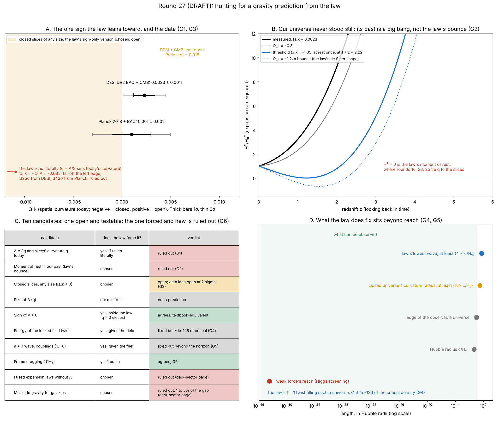

# Round 27: hunting for a gravity prediction from the law

*DRAFT, Nov 27 2026. Not versioned, not proved in Lean. Follows round 26 (`../round26/`). Runs alongside the prior-art audit (not yet in this repository), whose Predictions section points here. Checks: `checks.py` → `checks_output.txt` (**6 / 6 pass**, under a second; numpy, scipy), numbers in `results.json`. Picture: `figures.py` → `figures/f34`. Colour key: **blue = the law, red = ruled out, green = agrees, amber = open, grey = reference**.*

Brennan chose this over settling the 1997 dispute about spinning twist bubbles, asking to fold it into the audit: "Please merge this work as well". The audit keeps the novelty sort for the whole theory. This round tests gravity candidates: places where the law fixes a number that textbook physics leaves free, or where the two give different numbers. For each: does the law force it or is it only chosen, is it already known or measured, and what data would decide it.

## Verdict first

1. **Read literally, the law makes one clear gravity prediction, and it is ruled out (G1).**
   - The law ties its one dial q to both the cosmological constant (Λ = 3q, round 20) and the curvature of space's slices (curvature q, rounds 16 and 18).
   - If both held today, space's curvature would be Ω_k = −Λ/(3H₀²) = −Ω_Λ = **−0.685**.
   - Measured: **0.0023 ± 0.0011** (DESI DR2 BAO + CMB) and **0.001 ± 0.002** (Planck 2018 + BAO). The literal reading is 625σ and 343σ away.
2. **The tie holds only at a moment of rest, and our universe never had one (G2).**
   - Rounds 16, 23 and 25 found the tie exactly where the expansion stops for an instant (H = 0). That is the law's de Sitter bounce.
   - With Planck's matter and Λ, a moment of rest anywhere in our past needs Ω_k below **−1.05**. The measured value is far above that, even 5σ toward closed. Our past is a big bang, not the law's bounce.
   - So the rounds that matched the law to Einstein's equations matched it at an instant that our universe doesn't contain.
3. **What's left is a sign, and the data lean against it (G3).**
   - If the slices that matter sits still in must be the law's 3-spheres (q > 0, as Λ > 0 requires), of whatever size, then space is closed: **Ω_k < 0**.
   - This is **chosen, not forced**. De Sitter can be sliced flat or open too, and nothing in the law makes matter's rest frame follow its slicing.
   - **DESI DR2 + CMB lean open at 2.1σ**: P(closed) = 0.018. Planck + BAO are consistent with either sign (P(closed) = 0.31). Planck's CMB data on their own have leaned closed (Di Valentino, Melchiorri and Silk 2020), so the question is live.
   - What decides it: DESI's final data, Euclid, and the next CMB experiments. If they confirm Ω_k > 0, the closed reading is out.
4. **What the law does fix sits far out of reach (G4, G5).**
   - The law's own f = 1 twist filling a closed universe carries a definite energy, ρ = 3/(2g²) ħc/a₀⁴ (from round 25). With a curvature radius a₀ of at least 18 Hubble radii, that is at most **4e-126** of the critical density. The real weak force is also screened by the Higgs beyond about 2.5e-18 m, so no such field can span space.
   - Round 26's lowest gravitational wave and its (3, −6) couplings have a wavelength of at least **41 Hubble radii**. The observable universe reaches about 3.3.
5. **Ten candidates in all (G6).**
   - Two are ruled out here (G1, G2), and two by the earlier dark-sector page: fused expansion laws without Λ, and mult-add gravity for galaxies.
   - Two agree with data but are textbook: Λ's sign, and frame dragging with γ = 1 put in.
   - One is not a prediction: Λ's size, because q is free.
   - Two are fixed but untestable (G4, G5).
   - **One is open and testable: closed slices.**

**Does this open a lead?**
- **No new lead.** The one number that the law, read literally, forces differently from textbook physics is ruled out by a wide margin.
- **One live, decidable question:** whether space is closed. The law leans that way only if one adds the choice that matter's rest slices are the law's 3-spheres. The best current data lean the other way at 2σ.
- **Worth knowing for the whole stream.** Every match between the law and Einstein's equations in rounds 16 to 25 sat at a moment of rest, or in pure de Sitter. Our universe has neither. That is why the law reproduces textbook gravity without predicting anything new about our sky.

*f34. A: spatial curvature today. Amber band: closed slices of any size, the law's sign-only reading. Black: DESI DR2 + CMB and Planck + BAO, with thick 1σ and thin 2σ bars. The literal reading, Ω_k = −0.685, is far off the left edge (red). B: the expansion rate squared looking back. The measured universe (black) never reaches H² = 0, the law's moment of rest. Space would need Ω_k ≤ −1.05 (blue) to have stood still once since z = 0. C: the ledger of ten candidates, coloured by verdict. D: the lengths involved. What the law fixes (blue, amber) lies beyond the observable universe, and the weak force's reach (red) is 44 orders of magnitude shorter than the Hubble radius.*

## What the checks show

| Check | What it tests | Result |
|---|---|---|
| G1 | literal reading: today's curvature = q = Λ/3 | Ω_k = −0.685; 625σ (DESI DR2 + CMB), 343σ (Planck + BAO) away: ruled out |
| G2 | a moment of rest (H = 0) in our past | needs Ω_k ≤ −1.052 (rest at 1 + z = 2.22); the 5σ closed edges −0.0032, −0.0090 give min H²/H₀² = 1.000: none |
| G3 | sign only: closed slices | P(Ω_k < 0) = 0.018 (DESI DR2 + CMB, 2.1σ open), 0.31 (Planck + BAO): open |
| G4 | energy of the law's f = 1 twist filling space | a₀ ≥ 18.3 Hubble radii; ρ ≤ 2.9e-135 J/m³; Ω ≤ 3.7e-126 |
| G5 | the n = 3 wave today | wavelength ≥ 41 Hubble radii |
| G6 | ledger | 10 candidates; 1 open and testable |

## How it's computed

- **Data, typed into `checks.py`:**
  - H₀ = 67.4 km/s/Mpc, Ω_m = 0.315, Ω_Λ = 0.685 (Planck 2018 base ΛCDM), Ω_r = 9.1e-5.
  - Ω_k = 0.0023 ± 0.0011 (DESI DR2 BAO + CMB) and 0.001 ± 0.002 (Planck 2018 + BAO). Positive Ω_k means open.
  - g² = 0.42, the SU(2) coupling at the Z mass.
- **G1.** Ω_k = −kc²/(a₀H₀)². With k = +1 and 1/a₀² = q = Λ/3, this gives Ω_k = −Ω_Λ. The distances are in units of each measurement's σ.
- **G2.** H²/H₀² = Ω_r x⁴ + Ω_m x³ + Ω_k x² + Ω_Λ with x = 1 + z and Ω_Λ = 1 − Ω_m − Ω_r − Ω_k. The threshold is the Ω_k where the minimum over z from 0 to 49 first reaches 0, found by root-finding.
- **G3.** Gaussian probability that Ω_k < 0 for each measurement.
- **G4.** Round 25's 8πGρ/3 = κC/a⁴ with κ = 4πG/g² and C = 1 at f = 1, so ρ = 3/(2g²a⁴) in natural units, times ħc. a₀ is the smallest curvature radius allowed on the closed side at 2σ by Planck + BAO (Ω_k ≥ −0.003): a₀ = (c/H₀)/√0.003.
- **G5.** The n = 3 mode's wavenumber is √(n² − 1) = √8 per curvature radius, so its wavelength is 2πa₀/√8.
- **G6.** The ledger is in `results.json`. Each row states the candidate, whether the law forces it, the verdict and what test decides it.

## Textbook and ours

| Claim | Status | Source |
|---|---|---|
| Friedmann's equation; moment-of-rest constraint; closed de Sitter bounce | **Textbook** | de Sitter 1917; ADM; prior-art audit A5, B7 |
| Measured Ω_k | **Measured** | DESI DR2 Results II (2025); Planck 2018 VI |
| Λ = 3q and the law on de Sitter | **In print** | Nesterov and Sabinin 2000 (audit A4) |
| Yang–Mills cosmology energy ∝ 1/a⁴; GW mixing with an SU(2) background | **In print** | Gal'tsov and Volkov 1991; Maleknejad and Komatsu (audit B5) |
| The ledger: which of the law's numbers are forced, chosen, ruled out or untestable | **Ours** | |
| The literal reading Ω_k = −Ω_Λ, and its exclusion | **Ours** (one line from textbook relations, but nobody had written it for this law) | |

## What this doesn't do

- **It doesn't search the whole theory.** The audit (not yet in this repository) does that and will pass on any candidates it finds outside gravity. This round covers gravity and cosmology.
- **The DESI value is read from a secondary source.** I couldn't open DESI's own table. The value 0.0023 ± 0.0011 is quoted, with its sign convention, by arXiv:2505.00659 citing DESI DR2 Results II (arXiv:2503.14738). Planck's 0.001 ± 0.002 is from the Planck abstract.
- **The closed-slices test depends on a choice.** If one doesn't require matter's rest slices to be the law's 3-spheres, the law says nothing about Ω_k's sign.
- **Gaussian errors only.** The real likelihoods aren't exactly Gaussian. That could move the 2.1σ somewhat, but not the 343σ.

## Next steps

1. **Ask whether anything in the law forces the slicing.** If some step forced matter's rest frame to follow the law's 3-spheres, the closed-slices reading would become a real, forced prediction, decidable by the next surveys. As it stands, it's a choice.
2. **Take the audit's candidates as they come.** The audit's A and B sections (read for this round) list no predictions. Its D section covers applied work outside gravity.
3. **Lean.** Deferred, as before.

## References

Planck Collaboration, "Planck 2018 results. VI. Cosmological parameters", A&A 641, A6 (2020), arXiv:1807.06209. DESI Collaboration (Abdul-Karim et al.), "DESI DR2 Results II: Measurements of baryon acoustic oscillations and cosmological constraints", arXiv:2503.14738 (2025). "It's All Ok: Curvature in light of BAO from DESI DR2", arXiv:2505.00659 (2025). Di Valentino, Melchiorri and Silk, "Planck evidence for a closed Universe and a possible crisis for cosmology", Nature Astronomy 4, 196 (2020) (not opened). Nesterov and Sabinin, Phys. Rev. D 62, 081501(R) (2000). Gal'tsov and Volkov, Phys. Lett. B 256, 17 (1991). Maleknejad and Komatsu, arXiv:1808.09076. de Sitter, Proc. Akad. Amsterdam 19, 1217 (1917).
