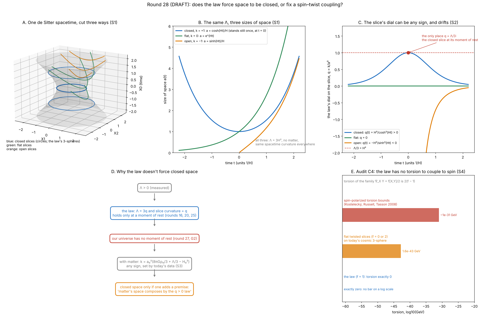

# Round 28: does the law force space to be closed, or fix a spin–twist coupling?

> **Names:** some words or symbols on this page (twist) also mean something else in standard math, physics or computing, or inside this project. [NAMING-COLLISIONS.md](../../../NAMING-COLLISIONS.md) says which meaning is in play.

*DRAFT, Nov 27 2026. Not versioned, not proved in Lean. Follows round 27 (`../round27/`), on the stream Brennan merged with the prior-art audit ("Please merge this work as well"). Checks: `checks.py` → `checks_output.txt` (**4 / 4 pass**, exact, sympy, plus one number check), results in `results.json`. Picture: `figures.py` → `figures/f35`. Colour key: **blue = closed slices (the law's 3-spheres), green = flat, orange = open, red = where q = Λ/3, grey = reference**.*

Round 27 left one open, testable item: if matter's resting slices must be the law's 3-spheres, space is closed (Ω_k < 0), which the next surveys can decide. This round asks whether anything in the law forces that, which would make closed space a real prediction. It also takes the audit's candidate C4: does the law fix a spin–twist coupling different from Einstein–Cartan's, testable against the 10⁻³¹ GeV torsion bounds?

## Verdict first

1. **One de Sitter spacetime carries closed, flat and open slices with the same Λ (S1, exact).**
   - With Λ = 3H² and no matter, a = cosh(Ht)/H (closed, k = +1), a = e^(Ht) (flat, k = 0) and a = sinh(Ht)/H (open, k = −1) all solve Friedmann's equation.
   - All three lie on the same hyperboloid. They are one spacetime cut three ways, picked by a timelike, null or spacelike direction.
2. **The law's dial on a slice can have any sign, and it drifts (S2, exact).**
   - Each slicing's slices are spaces of constant curvature, so the law's dial on them is **q(t) = k/a(t)²**:
     - positive on the law's turning 3-spheres (round 18);
     - zero, plain vector addition;
     - negative, velocity-like boosts (round 19).
   - Only the closed slice at its moment of rest has q = Λ/3 (round 20). Everywhere else the slice's dial changes with time and differs from Λ/3.
3. **With matter, space's sign is free (S3, exact).**
   - Friedmann's equation gives k = a₀²(8πGρ₀/3 + Λ/3 − H₀²), set by today's density and expansion rate. With the same positive Λ, it can be positive, zero or negative.
   - The law's step "only q > 0 closes, so Λ > 0" (round 20, audit B7) ties space's sign to Λ's only at a moment of rest, and round 27 showed our universe never had one.
4. **The law has no torsion, so it has no spin–twist coupling to fix (S4, exact; audit C4).**
   - The law's way of carrying directions is the f = 1 member of the family ∇_X Y = f[X,Y]/2. Its torsion is 2(f − 1), which is **zero** at the law.
   - So the law's "twist" gyr is curvature (the holonomy of the Levi-Civita connection, round 25), not torsion. Einstein–Cartan's spin–torsion coupling is set by its own action, and the law adds no number to it.
   - Outside matter the law agrees with both GR and Einstein–Cartan, whose torsion vanishes there. Even the flat twisted members f = 0 and 2, the weak force's vacua, would give torsion of only 2ħc/a₀ ≈ 1.6 × 10⁻⁴³ GeV on today's cosmic slices, about twelve orders of magnitude below the 10⁻³¹ GeV bounds.

**Does this open a lead?**
- **No, on both questions.**
- **The law doesn't force closed space.** Closed space follows only if one adds a premise: that the space matter sits still in composes by the q > 0 law. Then the dial must drift as q(t) = 1/a(t)², so it can't also be a fixed constant equal to Λ/3.
- **The decidable question stays, as a test of that premise rather than of the law.** If the next surveys find Ω_k > 0, the premise is out. If they find Ω_k < 0, it survives, but so does ordinary closed ΛCDM, so it wouldn't single the law out.
- **C4 isn't a prediction.** The law's connection is torsion-free, so there is no coupling to compare with Einstein–Cartan's, and the twisted members give torsion far too small to see.
- **All of it is textbook.** De Sitter's three slicings go back to de Sitter, Lemaître and Schrödinger, and Friedmann's k is free initial data. Torsion of the Cartan–Schouten family is textbook too. What is ours is only the bookkeeping: what the law's dial becomes on each slicing, the conclusion that the closed reading is a premise, not a consequence, and the reading of the law's twist as curvature rather than torsion.

*f35. A: two-dimensional de Sitter spacetime drawn as a hyperboloid, sliced three ways: closed circles (blue, the law's 3-spheres), flat slices (green) and open slices (orange). B: the size of space in each slicing, all with the same Λ and no matter. Only the closed one stands still, once. C: the law's dial on each slice, q = k/a². It equals Λ/3 (red dashed) at one point only, the closed slice at its moment of rest. D: the chain of reasoning. Closed space needs an added premise. E: audit C4 on a log scale of energy. The law's torsion is exactly zero, so it has no bar. The flat twisted members on today's cosmic slices (orange) sit about twelve orders of magnitude below the experimental bounds (red).*

## What the checks show

| Check | What it tests | Result |
|---|---|---|
| S1 | three slicings of one de Sitter | Friedmann and acceleration residuals 0 for k = +1, 0, −1; all three on the hyperboloid −X₀² + X₁² + X₂² = 1/H² (exact) |
| S2 | the law's dial on each slicing | q = H²/cosh²(Ht), 0, −H²/sinh²(Ht); q = Λ/3 only for the closed slice at t = 0 |
| S3 | with matter, k vs Λ | k = a₀²(8πGρ₀ − 3H₀² + Λ)/3; with Λ > 0, examples give k = 2, 0, −1/4 |
| S4 | the law's torsion (audit C4) | T = 2(f − 1), zero at f = 1 (exact); f = 0 or 2 on a₀ ≥ 2.51 × 10²⁷ m gives 1.6 × 10⁻⁴³ GeV vs bounds ~10⁻³¹ GeV |

## How it's computed

- **S1.** Symbolic substitution of each a(t) into (ȧ/a)² + k/a² − H² and ä/a − H². The embeddings into ℝ^{2,1} are the standard global, flat and open charts of two-dimensional de Sitter, checked to satisfy −X₀² + X₁² + X₂² = 1/H².
- **S2.** On a slice of constant curvature k/a², the law with dial q composes points on that slice (round 18 for q > 0, round 19 for q < 0, vector addition for q = 0). So q = k/a(t)².
- **S3.** Friedmann's equation today, solved for k, then evaluated at three sample sets of (ρ₀, Λ, H₀) with Λ > 0.
- **S4.** Torsion T(X,Y) = ∇_X Y − ∇_Y X − [X,Y] computed from the bracket [e_a, e_b] = 2ε_abc e_c of the 3-sphere's frame. The cosmic size a₀ ≥ 2.51 × 10²⁷ m is round 27's lower bound on the radius of curvature, and ħc = 1.973 × 10⁻¹⁶ GeV·m.

## Textbook and ours

| Claim | Status | Source |
|---|---|---|
| de Sitter's closed, flat and open slicings | **Textbook** | de Sitter 1917; Lemaître 1925; Schrödinger, *Expanding Universes* (1956) |
| Friedmann's k is free initial data, independent of Λ | **Textbook** | Friedmann 1922, 1924 |
| Einstein–Cartan's spin–torsion coupling | **Textbook** | Kibble 1961; Sciama 1962; Hehl, von der Heyde, Kerlick and Nester, Rev. Mod. Phys. 48, 393 (1976) |
| Torsion of the Cartan–Schouten family; f = 0, 2 flat, f = 1 Levi-Civita | **Textbook** | Cartan and Schouten 1926 |
| Laboratory torsion bounds of order 10⁻³¹ GeV | **Textbook** (measured) | Kostelecký, Russell and Tasson, Phys. Rev. Lett. 100, 111102 (2008) |
| The law's dial on each slicing is q = k/a², any sign; closed space needs an added premise | **Ours** (bookkeeping) | |
| The law's twist is curvature, not torsion, so C4 has no coupling to fix | **Ours** (bookkeeping) | |

## What this doesn't do

- **It doesn't rule out a deeper reason for the premise.** Something outside these rounds, such as a quantum rule for the law's composition, might pick the closed slicing. Nothing in rounds 1 to 28 does.
- **It doesn't change round 27's data verdict.** DESI DR2 + CMB still lean open at 2.1σ.

## Next steps

1. **Back to the audit.** C2 and C4 are now settled (no lead). The remaining candidates worth testing are ones that data could decide soon, such as C6, the dial as rolling dark energy, which DESI DR3 and Euclid would decide.
2. **Lean.** Deferred, as before.

## References

de Sitter, Proc. Akad. Amsterdam 19, 1217 (1917). Lemaître, J. Math. Phys. (MIT) 4, 188 (1925). Schrödinger, *Expanding Universes* (Cambridge, 1956). Friedmann, Z. Phys. 10, 377 (1922); 21, 326 (1924). Cartan and Schouten, Proc. Akad. Amsterdam 29, 803 (1926). Kibble, J. Math. Phys. 2, 212 (1961). Sciama, in *Recent Developments in General Relativity* (Pergamon, 1962). Hehl, von der Heyde, Kerlick and Nester, Rev. Mod. Phys. 48, 393 (1976). Kostelecký, Russell and Tasson, Phys. Rev. Lett. 100, 111102 (2008). Round 27 for the data and a₀.
