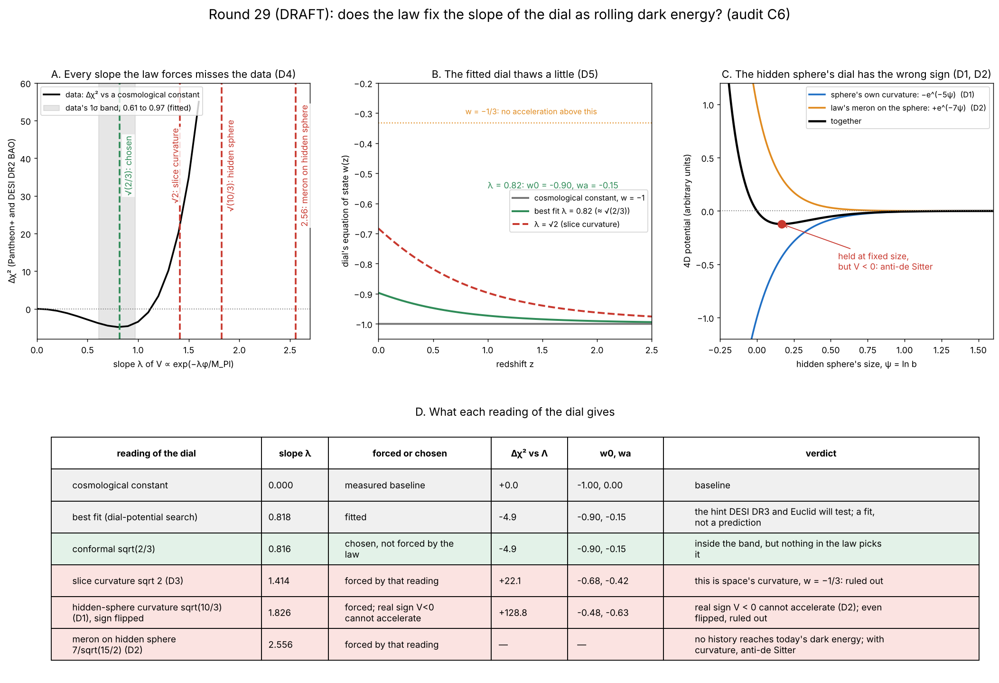

# Round 29: does the law fix the slope of the dial as rolling dark energy?

*DRAFT, Nov 27 2026. Not versioned, not proved in Lean. Follows round 28 (`../round28/`), on the stream Brennan merged with the prior-art audit ("Please merge this work as well"). This tests the audit's candidate C6. Checks: `checks.py` → `checks_output.txt` (**5 / 5 pass**: D1–D3 exact in sympy, D4–D5 numbers against data), results in `results.json`. Picture: `figures.py` → `figures/f36`. Colour key: **red = slopes a reading of the law forces, green = a slope that is only chosen, grey = data and the cosmological constant, blue and orange = the two parts of the hidden sphere's potential**.*

The dial-potential search (`../../dial-potential/`) found one live lead. If the mult-add dial k rolls slowly today, rescaling forces its potential to be an exponential, V ∝ exp(−λφ/M_Pl). With the slope fitted, it beats a cosmological constant by Δχ² ≈ 4.85 on Pantheon+ supernovae and DESI DR2 BAO, but the slope λ = 0.82 was fitted, not predicted. A slope only becomes a number once the dial is a piece of geometry, because geometry fixes how its kinetic energy is normalized. Our gravity rounds give the dial three such readings. This round works out the slope each one forces and tests it against the same data with the same fitter.

## Verdict first

1. **The dial as the size of the law's hidden 3-sphere forces λ = √(10/3) ≈ 1.83, with the wrong sign (D1, exact).**
   - Shrinking 7 = 4 + 3 dimensional gravity down to 4D on the hidden 3-sphere that carries the weak force in round 1 and round 7 gives ordinary 4D gravity plus one field, the sphere's size. Its potential is V = −3e^(−5ψ)/r₀², which is an exponential with λ = 5/√(15/2) = √(10/3).
   - V is **negative**, because the sphere's own curvature enters with a minus sign. A field with V ≤ 0 always slows the expansion, since ρ + 3p = 2φ̇² − 2V ≥ 0, so this can't be dark energy.
2. **Adding the law's own field on the hidden sphere holds the sphere still, but at negative energy (D2, exact).**
   - The meron (the law's f = 1 field, round 27) on the hidden sphere adds positive energy ∝ e^(−7ψ), slope 7/√(15/2) ≈ 2.56.
   - Together with the curvature term, the potential has a minimum. The sphere stops rolling, but the vacuum energy there is **negative**, 2/7 of the curvature term: anti-de Sitter, the wrong sign for our universe. (This is the standard Freund–Rubin outcome.)
3. **The dial as the slice's own curvature, q = k/a² (round 28), forces λ = √2, and that is just space's curvature (D3, exact).**
   - It dilutes as a⁻², so w = −1/3. That is exactly the field-dominated solution of an exponential with λ = √2, and it never accelerates.
4. **Against the data, every forced slope fails (D4).**
   - √2 fits worse than a cosmological constant by Δχ² = +22.1 (about 4.7σ).
   - √(10/3), even with its sign flipped by hand, is worse by +128.8.
   - 2.56 can't reach today's dark-energy fraction at all.
   - All three are at or above √2, where the field's own late-time solution stops accelerating.
   - The only simple value inside the data's band (0.61 to 0.97) is **√(2/3) ≈ 0.816**, the conformal value. It sits almost on the best fit (0.818), but nothing in the law picks it. As the dial-potential search showed, 14 of 43 simple values √(p/q) also fall in the band, so the match means nothing yet.
5. **What decides the rest (D5).** The fitted dial thaws a little: w₀ = −0.90 and w_a = −0.15, in the same direction as DESI's 2025 hint. DESI DR3 and Euclid will test whether w₀–w_a stays away from (−1, 0). If a cosmological constant comes back inside 3σ, the rolling dial isn't needed. If it's excluded, the dial survives, but as a fit.

**Does this open a lead?**
- **No.** Each reading of the dial that our rounds make geometric fixes the slope, and every fixed slope is either the wrong sign or ruled out by today's data. The slope that fits is chosen, not forced.
- **C6 stays what it was:** a fitted thawing field that matches DESI's hint. It's worth watching because data will decide it, but a positive result would confirm rolling dark energy in general, not our law.
- **Almost all of it is textbook.** Sphere reductions and their breathing modes, Freund–Rubin's negative vacuum, and exponential quintessence are standard. What is ours is the bookkeeping: which geometric readings our rounds allow for the dial, the slope each forces, and the test of each against the same data.

*f36. A: how well each slope fits Pantheon+ and DESI DR2 BAO, compared with a cosmological constant (black; below zero is better). Grey band: the data's 1σ range. Dashed red: the slopes forced by the three geometric readings of the dial. Dashed green: √(2/3), inside the band but only chosen. B: the dial's equation of state with redshift for the best fit and for λ = √2. Above the orange line, nothing accelerates. C: the hidden sphere's potential. Its own curvature (blue) pulls it down. The law's meron on it (orange) pushes back. Together (black) they hold the sphere at a fixed size, but below zero, which is anti-de Sitter. D: the ledger. Red rows are forced by a reading of the law, green is chosen, grey is fitted or measured.*

## What the checks show

| Check | What it tests | Result |
|---|---|---|
| D1 | 7D gravity on the hidden 3-sphere, reduced to 4D | The Euler–Lagrange equations of (reduced action − Einstein-frame action) vanish identically. Field φ = √(15/2)·ψ, V = −3e^(−5ψ), λ = √(10/3) = 1.826, V < 0 |
| D2 | negative V; the meron on the sphere | ρ + 3p = 2φ̇² − 2V. Meron slope 2.556. Combined minimum V_min = (2/7)·(curvature term) < 0 |
| D3 | dial = slice curvature k/a² | w = −1/3, equal to the exponential's field-dominated solution at λ = √2 |
| D4 | each slope against Pantheon+ + DESI DR2 BAO | Δχ² vs Λ: 0.818 → −4.85; √(2/3) → −4.85; √2 → +22.1; √(10/3) (sign flipped) → +128.8; 2.56 → no history reaches today's dark energy. Acceleration needs λ < √2 (exact) |
| D5 | the fitted dial's w₀, w_a | w₀ = −0.897, w_a = −0.149 (CPL fit to the field's w(a) out to z = 2) |

## How it's computed

- **D1.** The 7D metric is −N²dt² + a²dx⃗² + b²dΩ₃². The Ricci scalar comes from Christoffel symbols in sympy. Substituting a = A·e^(−3ψ/2), N = n·e^(−3ψ/2), b = e^ψ (the Einstein frame) leaves an action whose difference from −6AȦ²/n + (15/2)A³ψ̇²/n + 6nA³e^(−5ψ) has identically vanishing Euler–Lagrange equations, so the two agree up to a total derivative. The slope follows from normalizing the kinetic term.
- **D2.** The meron's energy on a sphere of radius b scales as b⁻⁴ per unit internal volume. In the Einstein frame that becomes e^(−(3+4)ψ). The minimum of −A·e^(−5ψ) + B·e^(−7ψ) is found exactly.
- **D3.** w = −1 − (1/3)·d ln ρ/d ln a with ρ ∝ k/a², and the exponential's field-dominated solution has w = λ²/3 − 1.
- **D4, D5.** These reuse `../../dial-potential/quintessence.py` unchanged: a thawing field from z = 10, Ω_m fitted, supernova magnitude and H₀ marginalized, one BAO nuisance number. w₀ and w_a are a least-squares fit of w = w₀ + w_a(1 − a) out to z = 2.

## Textbook and ours

| Claim | Status | Source |
|---|---|---|
| Breathing mode of a sphere reduction: exponential potential, negative from the sphere's curvature | **Textbook** | Carroll, Geddes, Hoffman and Wald, Phys. Rev. D 66, 024036 (2002) |
| Flux on a sphere stabilizes it at negative vacuum energy | **Textbook** | Freund and Rubin, Phys. Lett. B 97, 233 (1980) |
| Exponential quintessence; field-dominated solution w = λ²/3 − 1, accelerating only for λ² < 2 | **Textbook** | Wetterich, Nucl. Phys. B 302, 668 (1988); Ratra and Peebles, Phys. Rev. D 37, 3406 (1988); Copeland, Liddle and Wands, Phys. Rev. D 57, 4686 (1998) |
| A thawing field matching DESI's 2025 hint | **Known** | dial-potential search (ours); the hint itself is DESI's |
| Our rounds allow three geometric readings of the dial; their slopes are √(10/3) (V < 0), 7/√(15/2) and √2; all fail; the fitting slope is only chosen | **Ours** (bookkeeping) | |

## What this doesn't do

- **It doesn't cover readings outside these rounds.** A dial coupled to matter in some other way, such as through a conformal factor with screening, could pick √(2/3). Nothing in rounds 1 to 29 does.
- **It doesn't redo the fit.** The data, fitter and band are the dial-potential search's, used unchanged.

## Next steps

1. **The audit's other candidates.** C2, C4 and C6 are now settled with no lead. What remains either needs a choice the law doesn't make (C5, C9) or tests standard physics rather than the law (C10, C12). None is a prediction of the law as it stands.
2. **Lean.** Deferred, as before.

## References

Carroll, Geddes, Hoffman and Wald, Phys. Rev. D 66, 024036 (2002). Freund and Rubin, Phys. Lett. B 97, 233 (1980). Wetterich, Nucl. Phys. B 302, 668 (1988). Ratra and Peebles, Phys. Rev. D 37, 3406 (1988). Copeland, Liddle and Wands, Phys. Rev. D 57, 4686 (1998). Data: Pantheon+ and DESI DR2 BAO as in `../../dark-sector/data/SOURCES.md`. Rounds 1 and 7 for the hidden sphere, round 27 for the meron, round 28 for the slice curvature.
