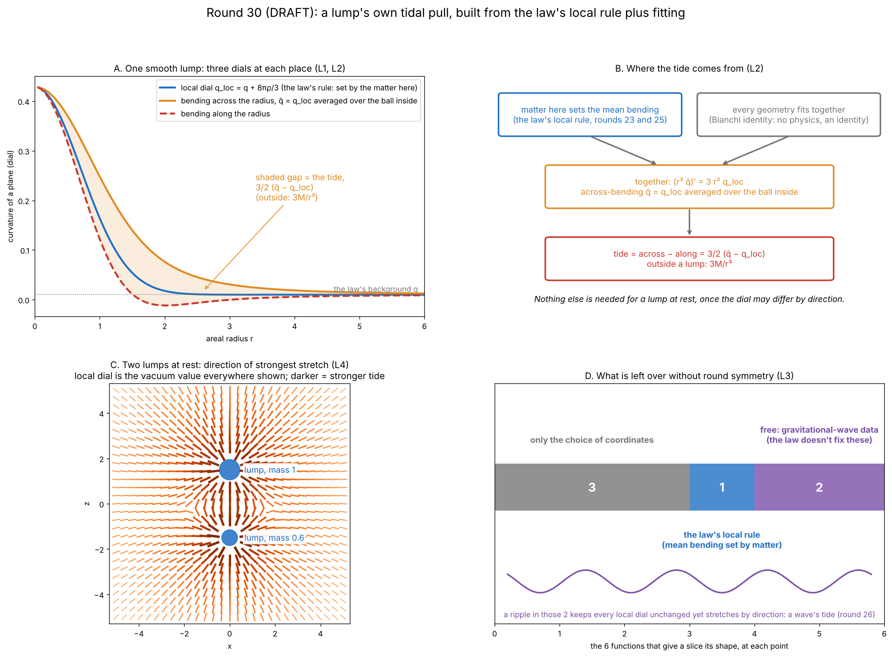

# Round 30: a lump's own tidal pull, built from the law

*DRAFT, Nov 27 2026. Not versioned, not proved in Lean. Follows round 29 (`../round29/`). Brennan chose this round ("Lump's tidal pull"): it takes up the gap round 23 left (`../round23/`) and round 25's tide formula (`../round25/`). Checks: `checks.py` → `checks_output.txt` (**4 / 4 pass**: L1–L3 exact in sympy, L2 and L4 also checked with numbers), results in `results.json`. Picture: `figures.py` → `figures/f37`. Colour key: **blue = the law's local dial (set by the matter here), orange = bending across the radius and the tide, red = bending along the radius, purple = what is left free, grey = reference**.*

Round 23 found that the law accounts for the direction-blind part of a lump's curvature but not its tidal pull. Round 25 wrote the tide as 3/2 (q̄ − q_loc), the gap between the dial averaged over the ball inside and the dial set by the matter here. It concluded that the law needs "Einstein's equation itself" to do the averaging. This round asks what exactly that missing ingredient is, for a lump at rest.

## Verdict first

1. **A lump's space is the law in every plane, but with a dial that depends on direction (L1, exact).**
   - At each place on the slice of any round lump at rest, planes across the radius bend like the law at q̄, and planes along it bend like the law at q̄ + r q̄′/2.
   - The mean of the three bendings is the local dial q_loc, which matter sets by the rule rounds 23 and 25 read as the law at a larger dial: q_loc = q + 8πρ/3.
   - The difference, across minus along, is the tide: −r q̄′/2 = 3/2 (q̄ − q_loc).
   - In three dimensions this set of plane bendings is all the curvature there is, so nothing else is hiding.
2. **The averaging is not new physics. It is the fitting every geometry obeys (L2, exact plus numbers).**
   - The contracted Bianchi identity holds for every shape of space, whatever the matter. Here it says q̄′ = −(2/r)(across − along): wherever the across-dial changes with radius, the along-dial has to split from it.
   - Add the law's local rule and it becomes (r³q̄)′ = 3r²q_loc. So q̄ is q_loc averaged over the ball inside, and the tide follows.
   - For a smooth lump, q̄ built this way matches Einstein's mass function to 4e-12, and the tide outside is 3M/r³ to 8e-8.
   - **So round 25's missing ingredient is not Einstein's equation as a whole.** For a lump at rest, Einstein's equation says only the local rule. The rest comes from letting the dial differ by direction, plus the Bianchi identity, which is automatic.
3. **Without round symmetry, two functions per point stay free, and they are gravitational waves (L3, exact, linearized).**
   - A slice's shape has 6 functions at each point. 3 of them are only the choice of coordinates, and the law's local rule fixes 1, which leaves 2.
   - A ripple in those 2 leaves every local dial at its law value, yet stretches by direction: it is a tide carried by a gravitational wave (round 26). The law doesn't fix these.
4. **Two lumps at rest: the pair's tide, built with no wave data (L4, exact plus numbers).**
   - With masses 1 and 0.6, the local dial stays at its vacuum value everywhere between them (scalar curvature below 1e-15 at 398 points), while the strongest-stretch directions bend around both lumps.
   - Far away it becomes the tide of one lump of the total mass: Ricci eigenvalues (−2, 1, 1)M/R³, to 0.9%.

**Does this open a lead?**
- **No new physics, and no prediction.** The split of the constraint into a local trace rule plus the Bianchi identity is textbook. So are York's count of the free wave data and Brill–Lindquist's two-lump slice.
- **It does close round 23's gap for matter at rest.** A lump's tidal pull doesn't need anything beyond what the law already supplies (each place's mean bending set by its own matter), once the dial may differ by direction. Fitting the pieces together does the averaging.
- **What it leaves open:**
  - The 2 wave functions per point, which the law doesn't fix.
  - The moving half of the tide, which round 26 found comes only from motion or spin.
  - The local rule itself. Round 23 read it from Einstein's equations as "the law at a larger dial". It is not derived from the law alone.
- **What is ours:** the reading of a lump's slice as the law with a direction-dependent dial (across q̄, along q̄ + r q̄′/2), and the statement that round 25's averaging is the Bianchi identity, not an extra law.

*f37. A: one smooth lump on the law's background. Blue is the local dial that matter sets. Orange is the bending across the radius, which is the local dial averaged over the ball inside. Dashed red is the bending along the radius. The shaded gap is the tide, which outside the lump falls as 3M/r³. B: where the tide comes from. The law's local rule and the fitting every geometry obeys together give the average, and the average gives the tide. C: two lumps at rest (Λ set to zero, since it is negligible at a lump's scale), showing the direction of strongest stretch at each place. Darker means a stronger tide. The local dial is at its vacuum value everywhere shown. D: the 6 functions that give a slice its shape at each point. 3 are coordinates, 1 is the law's local rule, and 2 are free gravitational-wave data.*

## What the checks show

| Check | What it tests | Result |
|---|---|---|
| L1 | plane bendings of any round lump's slice | across q̄, along q̄ + r q̄′/2 (both along-planes equal); scalar/6 = (2·along + across)/3; tide −r q̄′/2 = 3/2 (q̄ − q_loc) (exact, symbolic in q̄(r)) |
| L2 | Bianchi identity plus the local rule | ∇ᵢGⁱ_r = 0 identically; G^r_r = −q̄, G^θ_θ = −along; (r³q̄)′ = 3r²q_loc. Gaussian lump: q̄ vs q + 2m(r)/r³ to 3.8e-12; tide outside vs 3M/r³ to 7.8e-8 |
| L3 | what's left without round symmetry | transverse ripple (both polarizations): δR = 0, δRic = (A, B)k²cos(kz)/2, traceless; free functions 6 − 3 − 1 = 2 |
| L4 | two lumps at rest (Brill–Lindquist) | max |R| outside the lumps 1.0e-16; far field Ricci eigenvalues vs (−2, 1, 1)M/R³ at R = 202: 0.9% |

## How it's computed

- **L1, L2.** The slice metric is dr²/(1 − q̄(r) r²) + r²dΩ², with q̄ an arbitrary function. A symbolic routine gives the Christoffel symbols, Riemann tensor, Ricci tensor, scalar curvature and the mixed Einstein tensor. Sectional curvatures are taken in the coordinate planes, and the divergence ∇ᵢGⁱ_r is computed directly. For the numbers, the lump is ρ = 0.05·e^(−r²) on the law's background q = 0.01. q̄ comes from integrating the ODE from the centre (q̄(0) = q_loc(0)), and is compared with q + 2m(r)/r³ with m(r) = ∫4πρr²dr.
- **L3.** The curvature of δ + εh is taken to first order for the transverse ripple h_xx = −h_yy = A cos kz, h_xy = B cos kz.
- **L4.** The slice is ψ⁴ times flat space with ψ = 1 + m₁/2r₁ + m₂/2r₂, separation 3. Its Ricci tensor comes from the exact formula for a conformally flat metric, evaluated at random points outside the lumps and on a grid in the plane y = 0 for the picture.

## Textbook and ours

| Claim | Status | Source |
|---|---|---|
| Constraint at rest: scalar curvature = 16πρ + 2Λ; contracted Bianchi identity | **Textbook** | Einstein 1915; Bianchi 1902; any GR text (e.g. Wald 1984, ch. 10) |
| In 3D the curvature is fixed by Ricci; the mass function m(r) and the tide 3M/r³ | **Textbook** | Misner, Thorne and Wheeler, *Gravitation* (1973) |
| 2 free functions per point on a slice = gravitational-wave data | **Textbook** | York, J. Math. Phys. 14, 456 (1973) |
| Two lumps at rest | **Textbook** | Brill and Lindquist, Phys. Rev. 131, 471 (1963) |
| A lump's slice as the law with a direction-dependent dial; round 25's averaging = the Bianchi identity | **Ours** (reading) | |

## What this doesn't do

- **It covers lumps at rest only.** The tide's moving half and the waves' evolution belong to the other half of Einstein's equations (round 26).
- **It doesn't derive the local rule.** q_loc = q + 8πρ/3 is round 23's reading of Einstein's constraint in the law's terms.
- **It doesn't fix the 2 wave functions per point.**

## Next steps

1. **Left-handed matter** (round 7's open question): whether the law can carry a flux through the hidden space.
2. **Lean.** Deferred, as before.

## References

Brill and Lindquist, Phys. Rev. 131, 471 (1963). York, J. Math. Phys. 14, 456 (1973). Misner, Thorne and Wheeler, *Gravitation* (Freeman, 1973). Wald, *General Relativity* (Chicago, 1984). Rounds 23, 25 and 26.
