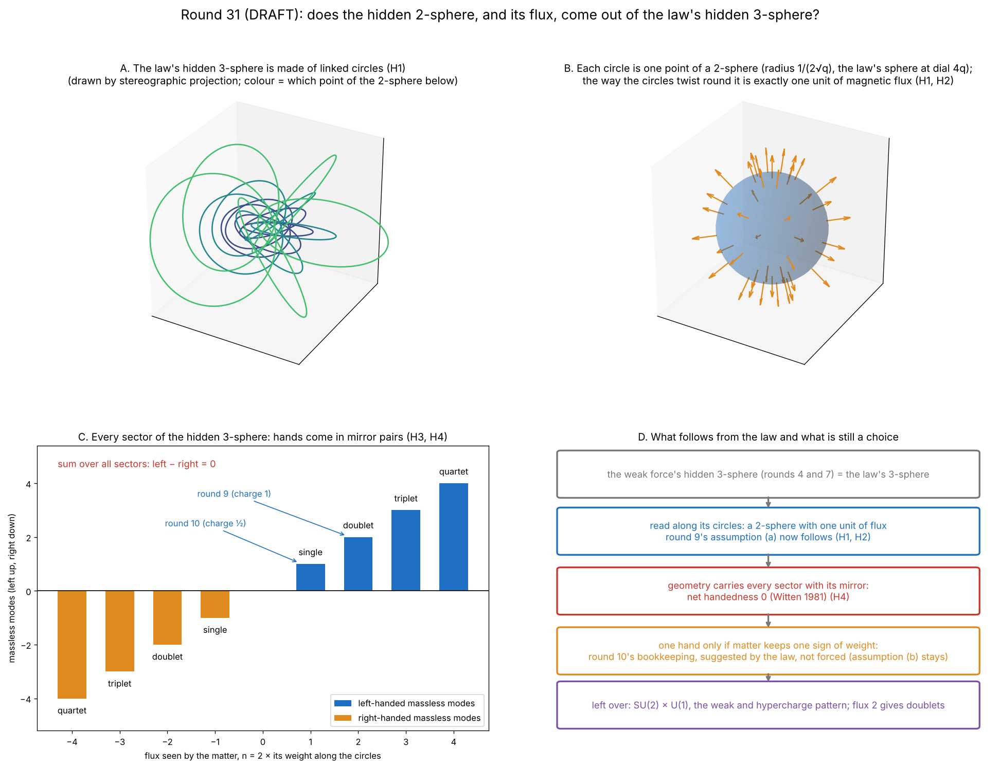

# Round 31: does the hidden 2-sphere, and its flux, come out of the law's hidden 3-sphere?

> **Names:** some words or symbols on this page (twist) also mean something else in standard math, physics or computing, or inside this project. [NAMING-COLLISIONS.md](../../../NAMING-COLLISIONS.md) says which meaning is in play.

*DRAFT, Nov 27 2026. Not versioned, not proved in Lean. Follows round 30 (`../round30/`) and takes up left-handed matter, the next build on the standing goal. Checks: `checks.py` → `checks_output.txt` (**4 / 4 pass**: H1, H2, H4 exact; H3 exact spectra from round 7's Dirac operator, unchanged), results in `results.json`. Picture: `figures.py` → `figures/f38`. Colour key: **blue = what follows from the law's geometry, and left-handed modes; orange = flux arrows, right-handed modes, and what is still a choice; red = the no-go; purple = the leftover symmetry; grey = reference**.*

Round 7 found that twisting the hidden space can't make one-handed matter, but flux through a hidden 2-sphere can. Rounds 9 and 10 found the law's twist can act as that flux, and that the law's own bookkeeping gives matter charge ½ and one left-handed massless mode. Both rested on two assumptions:
- **(a)** a hidden 2-sphere at the closed end of the dial;
- **(b)** matter carrying one sign of charge under the twist.

This round asks whether either follows from the law's hidden 3-sphere, which the weak force already uses (rounds 4 and 7).

## Verdict first

1. **The hidden 2-sphere and its flux come out of the law's hidden 3-sphere (H1, exact).**
   - The law's 3-sphere of dial q splits exactly into circles over a 2-sphere. The circles are the paths of one of its own rotations, z → z·e^(is/2). The 2-sphere has radius 1/(2√q), which makes it the law's 2-sphere at dial 4q.
   - The way the circles twist round the 2-sphere is a magnetic monopole with **exactly one unit of flux**.
   - So assumption (a) is no longer an assumption: it is the weak force's hidden 3-sphere, read along its circles.
2. **Rounds 9 and 10 fit this exactly (H2, exact).**
   - The law's twist round the closed velocity sphere is the 2-sphere's own frame-turning, which is flux 2 (its Euler number, round 9).
   - Round 10's charge ½ halves that to 1, which is the 3-sphere's own flux. On the 3-sphere, matter of weight m along the circles sees flux 2m. So round 10's charge ½ is weight ½, the spinor weight, and round 9's charge 1 is weight 1.
3. **Each sector gives one hand, in a multiplet (H3, exact spectra).**
   - Matter seeing flux n has |n| massless modes, all of one hand, set by the sign of n.
   - Those modes form a multiplet of the 2-sphere's rotations with spin (|n| − 1)/2. Flux 1 (round 10) gives a single mode. Flux 2 (round 9) gives a **doublet**, the same shape as the weak force's left-handed pairs.
4. **But the 3-sphere's geometry carries every sector together with its mirror, so the hands cancel (H4, exact count).**
   - The 3-sphere's functions come with both signs of weight. Sector n gives |n| left-handed modes and sector −n gives |n| right-handed ones. Summed over sectors, the net handedness is 0.
   - This is Witten's 1981 no-go: geometry alone, read this way, can't give net handedness.
   - One hand survives only if matter keeps one sign of weight. That is round 10's bookkeeping (the law's division by the complex corner), which the law suggests but doesn't force. **Assumption (b) stays.**
   - What is left after reading the 3-sphere along its circles is the symmetry SU(2) × U(1): the weak and hypercharge pattern.

**Does this open a lead?**
- **No new physics.** The Hopf fibration as a unit monopole, monopole harmonics, flux giving one-handed modes, and Witten's no-go are all textbook.
- **It does narrow the gap to one assumption.** Of the two assumptions under rounds 9 and 10, (a) now follows from the hidden 3-sphere the weak force already uses. What's left is (b): matter has to come in one sign of weight along the circles. Geometry pairs the signs, and the law only suggests picking one.
- **What is ours:** identifying round 9's 2-sphere with the base of the law's hidden 3-sphere, and round 10's charge ½ with weight ½ along its circles. Also the observation that round 9's charge 1 gives an SU(2) doublet.
- **What a real lead would need:** a reason inside the law to keep one sign of weight, something that breaks the mirror pairing. Nothing in rounds 1 to 31 does.

*f38. A: the law's hidden 3-sphere drawn as linked circles (stereographic projection). Each colour is one ring of the 2-sphere in B. B: each circle is one point of a 2-sphere, and the way the circles twist round it is one unit of magnetic flux through it. C: massless modes in each sector of the hidden 3-sphere, left-handed up and right-handed down, labelled by their multiplet. Rounds 10 and 9 sit at flux 1 and 2. Every sector has a mirror with the other hand, so the total is zero. D: what follows from the law's geometry and what is still a choice.*

## What the checks show

| Check | What it tests | Result |
|---|---|---|
| H1 | the law's 3-sphere read along its circles | pulled-back metric = (1/4q)[dθ² + sin²θ dφ² + (dψ + cos θ dφ)²] (exact); base curvature 4q; flux per circle length = 1 (sign by orientation); circles are orbits of e^(is/2) |
| H2 | rounds 9 and 10 in these terms | Euler number 2 (round 9's flux); ½ × 2 = 1 = the 3-sphere's flux |
| H3 | massless modes in each sector, flux −4 … 4 | flux n: |n| modes of hand sign(n), multiplet spin (|n| − 1)/2; flux 2 is a doublet |
| H4 | net handedness from geometry | sum over sectors: 0; with only the law's sector (flux 1): 1; leftover symmetry SU(2) × U(1) (textbook) |

## How it's computed

- **H1.** A point of the 3-sphere is written as (cos(θ/2)e^(i(ψ+φ)/2), sin(θ/2)e^(i(ψ−φ)/2)) in ℂ², and the round metric of radius 1/√q is pulled back symbolically. The base curvature uses the Gauss formula. The flux is ∫d(cos θ dφ) over the base, divided by the circle length 4π.
- **H3.** This is round 7's Dirac operator on the 2-sphere with flux n, copied unchanged and built from spin matrices with no eigenvalue formula put in. Each kernel's spin is read from the representation its vectors live in.
- **H4.** The counts are summed over sectors −4 to 4. The pairing of weights ±m is the 3-sphere's function space: each spin-j copy carries weights −j … j.

## Textbook and ours

| Claim | Status | Source |
|---|---|---|
| The 3-sphere is a circle bundle over the 2-sphere; its twist is a unit Dirac monopole | **Textbook** | Hopf, Math. Ann. 104, 637 (1931); Trautman, Int. J. Theor. Phys. 16, 561 (1977) |
| Monopole harmonics; flux n gives |n| one-handed massless modes in spin (|n| − 1)/2 | **Textbook** | Wu and Yang, Nucl. Phys. B 107, 365 (1976); Randjbar-Daemi, Salam and Strathdee, Nucl. Phys. B 214, 491 (1983) |
| Geometry alone gives no net handedness in this kind of reduction | **Textbook** | Witten, Nucl. Phys. B 186, 412 (1981) |
| Round 9's 2-sphere is the base of the law's hidden 3-sphere; round 10's charge ½ is weight ½ along its circles; round 9's charge 1 gives a doublet | **Ours** (reading) | |

## What this doesn't do

- **It doesn't remove assumption (b).** Picking one sign of weight is still a choice.
- **It doesn't make the Standard Model.** That needs two forces acting on left-handed matter, the right hypercharges, and three families. Here there is one SU(2) × U(1) and a single doublet at flux 2.
- **It doesn't say which hand is called left.** That is a convention of orientation.

## Next steps

1. **Look for a reason inside the law to keep one sign of weight.** That's the one remaining assumption under left-handed matter. If none turns up, say so plainly.
2. **Lean.** Deferred, as before.

## References

Hopf, Math. Ann. 104, 637 (1931). Trautman, Int. J. Theor. Phys. 16, 561 (1977). Wu and Yang, Nucl. Phys. B 107, 365 (1976). Witten, Nucl. Phys. B 186, 412 (1981). Randjbar-Daemi, Salam and Strathdee, Nucl. Phys. B 214, 491 (1983). Rounds 4, 7, 9 and 10.
