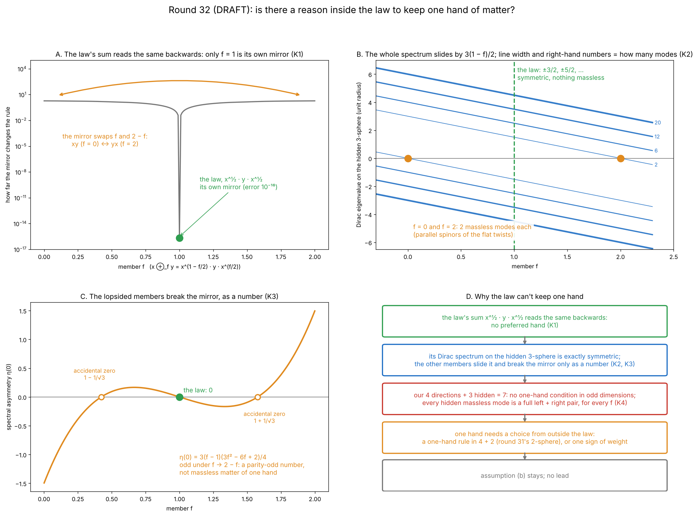

# Round 32: is there a reason inside the law to keep one hand of matter?

> **Names:** some words or symbols on this page (⊕, twist) also mean something else in standard math, physics or computing, or inside this project. [NAMING-COLLISIONS.md](../../../NAMING-COLLISIONS.md) says which meaning is in play.

*DRAFT, Nov 27 2026. Not versioned, not proved in Lean. Follows round 31 (`../round31/`), which left one assumption under rounds 9 and 10. Checks: `checks.py` → `checks_output.txt` (**4 / 4 pass**: K1 exact plus numeric, K2 exact spectra by representation theory, K3 exact with a numeric cross-check, K4 exact algebra), results in `results.json`. Picture: `figures.py` → `figures/f39`. Colour key: **green = the law (f = 1); orange = the other members of the twist family (f ≠ 1) and what is still a choice; blue = Dirac spectra; red = the no-go; grey = reference**.*

Round 31 showed that the hidden 2-sphere with flux under rounds 9 and 10 comes out of the law's own hidden 3-sphere. It left one assumption:
- **(b)** matter keeps one sign of weight along the 3-sphere's circles, because the geometry carries every sector together with its mirror, and the two hands cancel.

This round looks for anything in the law that breaks that mirror. It uses the twist family from round 7 and `../../torsion-dial/`: member f composes as x ⊕_f y = x^(1 − f/2) · y · x^(f/2). The law is f = 1, and the flat twists xy and yx are f = 0 and f = 2.

## Verdict first

1. **The law has no preferred hand (K1, exact).**
   - The law's sum x^½ · y · x^½ reads the same backwards.
   - So the mirror of the hidden 3-sphere, x → its conjugate (which flips all three hidden directions), maps the law to itself.
   - The mirror sends every other member f to 2 − f. The flat twists xy and yx are each other's mirror image, and f = 1 is the only member that is its own.
2. **On the hidden 3-sphere, the law's Dirac spectrum is exactly symmetric; the other members slide it (K2, exact spectra).**
   - For member f, the Dirac operator is the law's own Dirac operator plus the constant 3(1 − f)/2, which is −¾ × torsion.
   - The law gives the textbook spectrum ±3/2, ±5/2, … with (m+1)(m+2) modes each. It is exactly symmetric and has no massless mode.
   - The flat twists f = 0 and f = 2 each have 2 massless modes, their known parallel spinors.
   - The sign convention isn't assumed. Only one sign gives the flat twists exactly those parallel spinors and nothing else, and that same sign gives the textbook spectrum at f = 1.
3. **The other members break the mirror, but only as a number (K3, exact).**
   - The spectral asymmetry (the Atiyah–Patodi–Singer η invariant) of member f, for 0 < f < 2, is **η(0) = 3(f − 1)(3f² − 6f + 2)/4**.
   - It is odd under f → 2 − f and zero for the law. It also vanishes at two accidental points, f = 1 ± 1/√3, where the regularised sum cancels even though the spectrum stays lopsided.
   - A nonzero η is a parity-odd number: a sign in the masses, of the Chern–Simons kind. It is not massless matter of one hand.
4. **Our 4 directions plus the 3 hidden ones can't give one hand, for any member (K4, exact algebra).**
   - With 7 directions, the product of all seven gamma matrices is a plain number (i). So there is no one-hand (Weyl) condition at all.
   - A hidden mode of eigenvalue λ becomes a 4D particle of mass |λ|. A hidden massless mode becomes a full 4D Dirac particle, one left half and one right half.
   - So net handedness is zero for every f. That includes the lopsided members, and the flat twists with their massless modes.
   - With a hidden 2-sphere instead (6 directions), a one-hand condition does exist. That is round 31's setting, and there it has to be chosen.

**Does this open a lead?**
- **No.** The law is mirror-symmetric by its own form. Its lopsided relatives break the mirror only as a number. And 4 + 3 dimensions never give net one-handed massless matter (the odd-dimension form of Witten's 1981 no-go).
- **Assumption (b) stays.** One hand needs a choice from outside the law: a one-hand rule in 4 + 2 (the 2-sphere at the base of the law's 3-sphere, round 31), or matter that keeps one sign of weight.
- **Textbook:** quaternion algebra; flat Cartan–Schouten connections and their parallel spinors (1926); the Dirac spectrum of the round 3-sphere (Bär 1996); the η invariant (Atiyah, Patodi and Singer 1975); no Weyl condition in odd dimensions, and Witten's no-go (1981).
- **What is ours:** the observation that the law's sum is the one member of its family that reads the same backwards, which is why it has no preferred hand. Also the f-family's spectrum read as one slide by −¾ × torsion, and its closed-form η(0) with the two accidental zeros.
- **What a real lead would need:** something in the law that picks the even 4 + 2 reading over 4 + 3 and fixes the sign of the one-hand rule there, or a boundary or singular point in the hidden space. Nothing in rounds 1 to 32 does either.

*f39. A: how far the mirror changes each member's rule, measured over 60 random pairs. Only the law (f = 1, green) is its own mirror, at error 10⁻¹⁶. The mirror swaps f and 2 − f (orange arrow). B: the Dirac eigenvalues on the hidden 3-sphere against f. The whole spectrum slides by 3(1 − f)/2. At the law (green dashed) it is symmetric with nothing massless. At f = 0 and f = 2 (orange dots) one level reaches zero: the flat twists' 2 parallel spinors. Line width and the numbers on the right give how many modes each level has. C: the spectral asymmetry η(0). It is zero at the law, odd under f → 2 − f, and has two accidental zeros. D: why the law can't keep one hand.*

## What the checks show

| Check | What it tests | Result |
|---|---|---|
| K1 | the mirror x → x̄ acting on x^(1 − f/2) y x^(f/2) | the law maps to itself exactly; f ↔ 2 − f for the others (errors ≤ 3 × 10⁻¹⁶) |
| K2 | the Dirac operator of member f on the unit 3-sphere, by spin sectors | the law's spectrum ±(m + 3/2), (m+1)(m+2) modes, plus a shift of 3(1 − f)/2; 2 massless modes at f = 0 (sector j = 0) and at f = 2 (sector j = ½), none at f = 1 |
| K3 | η(0) by Hurwitz zeta | −c(4c² − 3)/6 with c = 3(1 − f)/2; matches a direct sum at s = 5 and the continued zeta at s = 0 to 3 × 10⁻¹⁶ |
| K4 | 4 + 3 gamma matrices | product of seven = i × 1 (no one-hand rule); mass² = k² + λ²; net left − right = 0 for f = 0, ½, 1, 3/2, 2, 8/3, −2/3; a product of six is not a number (a one-hand rule exists in 4 + 2) |

## Where this leaves the build

- Rounds 9, 10, 31 and 32 together: the law gives the hidden 3-sphere, its 2-sphere and its flux, and SU(2) × U(1). It does not choose a hand, and it can't from the 3-sphere alone.
- Next on the standing goal: either take the 4 + 2 reading as an added premise and check that the rest of the weak force's left-handed pattern then follows, or go back to the gravity side (gravitational waves, which round 30 left as free data).
