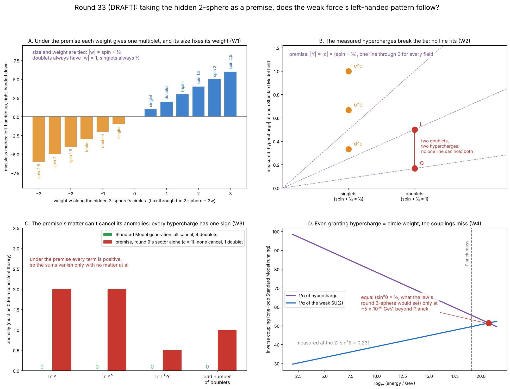

# Round 33: taking the hidden 2-sphere as a premise, does the weak force's left-handed pattern follow?

*DRAFT, Nov 27 2026. Not versioned, not proved in Lean. Brennan chose this build after round 32 (`../round32/`). Checks: `checks.py` → `checks_output.txt` (**4 / 4 pass**: W1 exact spectra from round 7's Dirac operator, copied verbatim from round 31; W2 and W3 exact; W4 exact lengths plus textbook one-loop running), results in `results.json`. Picture: `figures.py` → `figures/f40`. Colour key: **blue = left-handed modes, the weak SU(2); orange = right-handed modes, singlets; purple = the premise's tie, hypercharge; red = where the premise and the measured pattern part; green = the Standard Model; grey = reference**.*

Round 32 showed the law can't choose a hand. So this round takes one as a **stated premise**, not something the law derives:
- matter lives on our 4 directions plus the 2-sphere at the base of the law's hidden 3-sphere (round 31), as 6-dimensional spinors of one chosen hand;
- it carries a weight w along the 3-sphere's circles, which is flux 2w through the 2-sphere.

The question is whether the rest of the weak force's left-handed pattern then follows. That pattern is: left-handed doublets, right-handed singlets, the measured hypercharges, cancelled anomalies, and the measured weak mixing angle.

## Verdict first

1. **The shape follows (W1, exact spectra).**
   - Each weight w gives one multiplet of spin |w| − ½, all of one hand: left for w > 0, right for w < 0.
   - Weight ½ gives a singlet and weight 1 gives a doublet. So there are one-handed doublets and singlets under SU(2) × U(1), the shape of the weak pattern.
2. **But the premise ties each field's charge to its size, and the measured pattern doesn't (W2, exact).**
   - Under the premise, |w| = spin + ½: every doublet has weight 1 and every singlet weight ½.
   - If hypercharge is the circle weight, Y = c·w, then every doublet has the same hypercharge, and every singlet has half a doublet's.
   - Measured, the two doublets differ: Q has 1/6 and L has −½. The singlets are 2 to 4 times their doublet's: e^c is 2 × L's, and u^c and d^c are 4 × and 2 × Q's.
   - **No value of c fits**, not even for the leptons alone, and not even allowing either 6D hand for each field. A neutral singlet (a right-handed neutrino) is impossible too, because w = 0 gives no massless mode.
   - So **hypercharge is not the circle weight.** It needs a charge of its own.
3. **The premise's matter can't cancel its anomalies (W3, exact).**
   - Written as left-handed fields, every massless field under the premise has w > 0, so every hypercharge has the same sign.
   - Then Tr Y, Tr Y³ and Tr T²·Y are sums of positive terms, which vanish only if there is no matter at all. The Standard Model's generation cancels all three.
   - Round 9's flux-2 sector on its own is one doublet. An odd number of doublets also carries Witten's global SU(2) anomaly; the Standard Model has 4 doublets per generation.
4. **Even granting hypercharge = circle weight, the one number the law fixes misses (W4).**
   - On the law's round 3-sphere, the weak SU(2)'s Killing vectors and the circles' Killing vector have exactly the same length (¼ each). In a Kaluza–Klein reading that makes the two couplings equal, so **sin²θ_W = ½** where the hidden space opens up.
   - Measured, sin²θ_W = 0.231 at the Z mass. With the Standard Model's one-loop running, the two couplings become equal only at **about 5 × 10²⁰ GeV**, some 40 times the Planck mass, where that running can't be trusted. Shifting the inputs by ±0.5% moves this between 3.6 and 8.0 × 10²⁰ GeV.

**Does this open a lead?**
- **No.** The premise gives the right shape: one-handed doublets and singlets under SU(2) × U(1). But it gets the charges wrong in a specific way. It ties each field's hypercharge to its size, and the measured pattern breaks that tie. The anomalies then can't cancel, and the coupling ratio is off.
- **What the failure points to:** hypercharge has to be a separate charge, not the weight along the hidden circles. The measured pattern also needs colour (three copies of Q, u^c and d^c), which the premise doesn't supply. Nothing in rounds 1 to 33 provides either.
- **Textbook:** monopole harmonics (Wu and Yang); 6D Einstein–Maxwell on a 2-sphere with a monopole (Randjbar-Daemi, Salam and Strathdee 1983), a known route to one-handed matter that has long struggled to give the measured charges with cancelled anomalies; Standard Model hypercharges and anomaly cancellation; Witten's global SU(2) anomaly (1982); Kaluza–Klein couplings from Killing vector lengths (Weinberg 1983); one-loop running of the couplings.
- **What is ours:** the tie |w| = spin + ½ stated for the law's own 2-sphere, and the resulting fact that one 6D hand makes every hypercharge the same sign. Also sin²θ_W = ½ for the law's round 3-sphere, read with hypercharge as the circle weight, and where that equality would have to sit.

*f40. A: under the premise each weight w gives one multiplet. Left-handed modes (blue) come from w > 0 and right-handed (orange) from w < 0. The multiplet's size fixes its weight. B: the measured hypercharges of one generation, against the multiplet size. The premise needs every field on one line through 0. The two doublets Q and L (red) sit at different heights, so no line holds both, and the singlets miss as well. C: the anomalies. The Standard Model's generation cancels them all (green zeros). Under the premise every term is positive, so nothing cancels. Round 9's flux-2 sector alone is shown (red), with its single doublet. D: the inverse couplings of hypercharge and the weak SU(2) under one-loop running. The law's round 3-sphere would make them equal; they meet only around 5 × 10²⁰ GeV, beyond the Planck mass.*

## What the checks show

| Check | What it tests | Result |
|---|---|---|
| W1 | massless modes for weights −3 … 3 (round 7's operator) | weight w gives \|2w\| modes of one hand, spin \|w\| − ½; left-handed form always has w > 0 |
| W2 | Y / (spin + ½) for one generation | Q 1/6, u^c −4/3, d^c 2/3, L −1/2, e^c 2; no common c, even in absolute value or for leptons alone |
| W3 | Tr Y, Tr Y³, Tr T²Y, doublet count | Standard Model 0, 0, 0, 4; premise Tr Y = c(n₁ + 4n₂ + 9n₃ + 16n₄)/2 > 0 for any matter; round 9 alone has 1 doublet |
| W4 | Killing vector lengths on the round 3-sphere; one-loop running | ¼ for all four; sin²θ_W = ½; couplings equal at 5.4 × 10²⁰ GeV against a Planck mass of 1.2 × 10¹⁹ |

The measured inputs in W4 are approximate review values (1/α = 127.95 and sin²θ_W = 0.2312 at the Z mass). The conclusion doesn't depend on their last digits.

## Where this leaves the build

- From the law's hidden 3-sphere we have SU(2) × U(1), a 2-sphere with flux, and one-handed doublets and singlets once a hand is chosen. We don't have the measured charges. They need a second charge and colour, and the law hasn't supplied them.
- Next on the task: gravitational waves (round 34), the piece round 30 left free.
