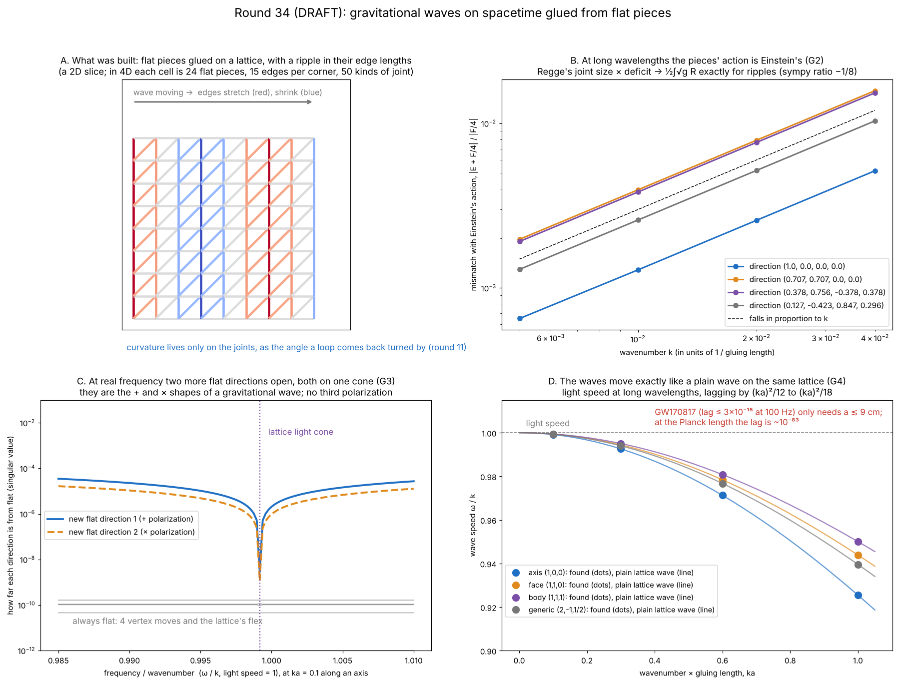

# Round 34: gravitational waves on spacetime glued from flat pieces

> **Names:** some words or symbols on this page (twist) also mean something else in standard math, physics or computing, or inside this project. [NAMING-COLLISIONS.md](../../../NAMING-COLLISIONS.md) says which meaning is in play.

*DRAFT, Nov 27 2026. Not versioned, not proved in Lean. Brennan asked for this round ("And also definitely need to figure out gravitational waves") after round 33 (`../round33/`). It takes up the piece round 30 left free (`../round30/`) and runs round 11's glued-pieces method (`../round11/`) in 4 dimensions for the first time. Checks: `checks.py` → `checks_output.txt` (**4 / 4 pass**, about 4 s: G1, G3 and G4 numbers, G2 numbers plus an exact sympy comparison), results in `results.json`. Picture: `figures.py` → `figures/f41`. Colour key: **blue = the glued pieces' own result, orange = the second polarization, purple = the light cone, red = the measured bound, grey = reference and the directions that are always flat**.*

Round 11 showed that on spacetime glued from flat pieces, all curvature sits on the joints, and it is exactly the law's loop twist: the angle a loop comes back turned by. Regge's action, joint size times that angle, tends to Einstein's. Round 30 then found that the law leaves 2 functions per point free on a slice of space, and that these are gravitational-wave data.

This round asks what the glued pieces do with those 2 functions. It builds 4D spacetime from flat pieces on a lattice (the Freudenthal triangulation: 24 flat 4-simplices per hypercube cell, 15 edges per corner, 50 kinds of joint), ripples the edge lengths, and reads off the second-order action. The questions: do the ripples move, how fast, with how many polarizations, and what does the size of the pieces change?

## Verdict first

1. **The flat gluing works, and it has one surprise (G1).**
   - Every joint's angle closes to 2e-15, so the lattice is flat.
   - Moving the corners costs nothing, 4 ways at every wavelength, as it should: that's just relabelling points.
   - There is **one more cost-free direction at every wavelength**, the lattice's own flex. At long wavelengths it is a change of edge lengths that keeps every piece flat to first order but isn't a change of metric. It is the same for every choice of axes. We hold it at zero, which is allowed because it costs nothing.
2. **At long wavelengths the pieces' action is exactly Einstein's (G2).**
   - Integrating out the 4 stiff directions leaves −F/4 on the metric, where F is the Fierz–Pauli form, the standard action of linearized gravity. The mismatch falls in proportion to the wavenumber in every direction.
   - In the continuum, sympy gives the average second-order part of √g R for a ripple as exactly −F/8. Both come to −F/16 per unit volume, so the joint-size-times-twist sum is ½∫√g R for ripples, factor and all.
3. **Gravitational waves come out, with exactly 2 polarizations at light speed (G3).**
   - Turning the fourth direction into real time (k₄ → iω), exactly 2 more cost-free directions open, and only on a light cone. At 6 random points on the cone there are 7 in all; 1% off it there are 5.
   - Their shapes are the + and × of a gravitational wave. + matches exactly; × matches up to a small lattice correction that shrinks in proportion to the wavenumber (this lattice has no y → −y mirror). Both open at the same frequency, so the two polarizations travel together.
   - There is no third polarization: a time–time ripple is not among them.
4. **The waves move exactly like the simplest wave on the same lattice (G4).**
   - The cone is exactly 4 sinh²(ω/2) = Σᵢ 4 sin²(kᵢ/2), the plain lattice wave equation, to 1e-7 at every wavelength tested up to one piece across. It isn't only a long-wavelength match.
   - So the waves move at light speed at long wavelengths and lag slightly at short ones: by (ka)²/12 along an axis and (ka)²/18 along a body diagonal, where a is the size of a piece.
   - **Is that visible?** GW170817 pinned the speed of gravitational waves to light's within 3 × 10⁻¹⁵. That only requires pieces smaller than about 9 cm. At the Planck length the lag is about 10⁻⁸³. So nothing measurable follows.

**Does this open a lead? No new physics.** The law's loop twist, used as the curvature on glued pieces, fixes *how* the free data of round 30 move: at light speed, with 2 polarizations, as in general relativity. It doesn't fix the data themselves; the 2 functions per point stay free, set by whatever made the waves. The one fact here that may be new (the exact match to the plain lattice wave equation at every wavelength) is a property of this lattice, and its effects are far too small to see. It isn't worth chasing for physics, though it would be worth a literature check before anyone calls it new.

*f41. A: what was built, shown as a 2D slice. Flat pieces are glued on a lattice, and a wave passing along it stretches (red) and shrinks (blue) the edges. In 4D each cell is 24 flat pieces. Curvature lives only on the joints, as the angle a loop comes back turned by. B: at long wavelengths the pieces' action matches Einstein's. The mismatch falls in proportion to the wavenumber (dashed) in all four directions tested. C: at real frequency, two more cost-free directions open (blue and orange dips), both at one frequency on the lattice light cone (purple). They are the + and × shapes of a gravitational wave. The grey lines are the 5 directions that are always cost-free: the 4 corner moves and the lattice's flex. D: wave speed against wavenumber in four directions. Dots are what the pieces give and lines are the plain lattice wave equation; they agree everywhere. The speed is light's at long wavelengths and lags slightly near one piece across. Red: the measured bound needs pieces under about 9 cm, and at the Planck length the lag is about 10⁻⁸³.*

## What the checks show

| Check | What it tests | Result |
|---|---|---|
| G1 | flat lattice; symmetries of the second-order action | worst deficit 1.8e-15; Hermitian to 1.5e-10; 4 corner moves plus 1 flex cost-free at every k; at k = 0, 11 soft (10 metric + flex) and 4 stiff (−8, −2, −2, −2) |
| G2 | long-wavelength action against Fierz–Pauli and √g R | mismatch 6.5e-4 to 2.0e-3 at k = 0.005, slope 1.00 in k; continuum ratio exactly −1/8, so −F/16 per unit volume on both sides |
| G3 | cost-free directions at real frequency | 7 on the cone, 5 off it, at 6 random complex points; + residual 7e-9, × residual 2.3e-2 → 5.9e-3 as k halves twice (slope 0.99), time–time 0.37 (not present) |
| G4 | the cone's shape and the speed | found speed = plain lattice wave speed to 9e-8 for ka up to 1 in 4 directions; lag coefficient within 0.14% of (1 + Σk̂⁴)/24 at ka = 0.1; pieces < 9 cm suffice for GW170817; 1e-83 at the Planck length |

## What is textbook and what is ours

- **Textbook:** Regge calculus (Regge 1961); its linearized form on a hypercubic lattice tends to linearized general relativity (Roček and Williams 1981); the Fierz–Pauli action; 2 polarizations at light speed; the plain lattice wave equation's dispersion; the GW170817 speed bound (Abbott et al. 2017, −3 × 10⁻¹⁵ ≤ Δv/c ≤ 7 × 10⁻¹⁶).
- **Ours, or at least not found by us in the literature:** the extra flex direction on the Freudenthal gluing, and the exact match of the graviton's cone to the plain lattice wave equation at every wavelength, not only at long ones. Both may well be known; we haven't searched thoroughly.
- **Ours in the build:** reading the curvature on the joints as the law's loop twist (round 11), and so tying round 30's free data to waves that the gluing makes move at light speed.

## Limits

- **Euclidean, continued.** The lattice is Euclidean and real time enters by k₄ → iω. A truly Lorentzian gluing (with timelike edges) is textbook but not run here.
- **Linear only.** The waves are small ripples. Their energy, their back-reaction and the merging of black holes need the full nonlinear action.
- **Lattice units.** The size of a piece, a, is not set by anything in the law. G4 only says how small it would have to be.
- **Finite differences.** Angle derivatives use a step of 1e-6, which leaves a noise floor near 1e-10 in the singular values. Every pass margin sits well above it.

## Where this leaves the build

- Gravity now has its waves: built from the law's loop twist on glued flat pieces, they carry round 30's 2 free functions at light speed with 2 polarizations.
- The pieces don't predict anything beyond general relativity at any scale we could measure.
- The remaining step on the task is the Lean proofs, which are on hold (no toolchain here).
