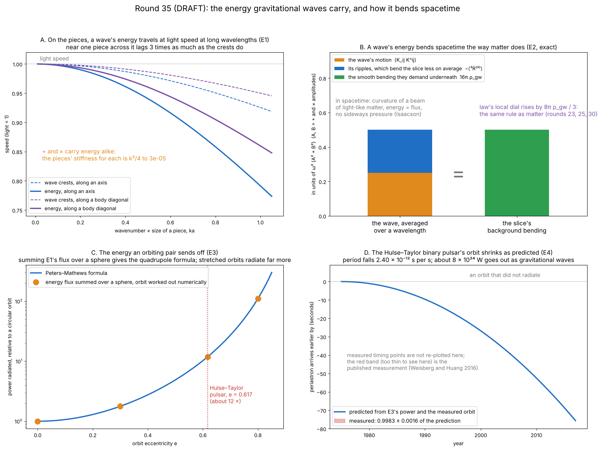

# Round 35: the energy gravitational waves carry, and how it bends spacetime

> **Names:** some words or symbols on this page (twist) also mean something else in standard math, physics or computing, or inside this project. [NAMING-COLLISIONS.md](../../../NAMING-COLLISIONS.md) says which meaning is in play.

*DRAFT, Nov 27 2026. Not versioned, not proved in Lean. Brennan chose this round ("Wave energy") after round 34 (`../round34/`), which built the waves themselves on spacetime glued from flat pieces. Checks: `checks.py` → `checks_output.txt` (**4 / 4 pass**, about 3 s: E1 numbers on round 34's lattice, whose code is copied verbatim; E2 exact sympy; E3 numbers; E4 published pulsar parameters), results in `results.json`. Picture: `figures.py` → `figures/f42`. Colour key: **blue = the waves and what they predict, orange = the second half of each balance (the × polarization, the wave's motion, numerical points), green = the smooth bending a wave demands, purple = the law's dial, red = measurement, grey = reference**.*

Round 34 found that the law's loop twist, used as curvature on glued flat pieces, carries gravitational waves: 2 shapes at light speed. Round 30 had found that the law leaves those waves' data free. This round follows the waves' energy: how much they carry, how that energy itself bends spacetime, and what it does to an orbiting pair that sends waves off.

## Verdict first

1. **On the pieces, both wave shapes carry energy alike, and it travels at light speed (E1).**
   - The pieces' action for + and × is −(k²/4)·h·h for each, with no mixing between them. That holds to 3e-5 at long wavelengths, with a lattice correction that shrinks in proportion to the wavenumber.
   - With Regge's action normalised as ½∫√g R, this is exactly linearized Einstein gravity's energy density, (1/32πG)⟨ḣᵢⱼḣᵢⱼ⟩.
   - The energy moves at the light cone's group velocity. That is light speed at long wavelengths. Near one piece across it lags 3 times as much as the crests: (ka)²/4 along an axis. At any measurable wavelength this is unmeasurably small (round 34).
2. **A wave's energy bends spacetime the way matter does (E2, exact).**
   - A + and × wave solves Einstein's equations at first order. At second order, averaged over a wavelength, its curvature is exactly that of a beam of light-like matter carrying the wave's energy (Isaacson's result). Its energy density equals its energy flux, it pushes nothing sideways, and its Ricci scalar is 0.
   - On a slice of space the energy splits exactly in half. The wave's motion supplies one half. The other half comes from its ripples, which on average bend the slice *less*: ⟨³R⁽²⁾⟩ = −ω²(A² + B²)/4. To balance both, the smooth slice underneath has to bend by 16πρ_gw.
   - **In the law's terms:** the local dial (the slice's mean bending, round 30) rises by 8πρ_gw/3. That is exactly the rule rounds 23 and 25 found for matter, q_loc = q + 8πρ/3. So a wave's energy feeds the law's dial like any other matter.
3. **Summing the energy flux over a sphere gives the energy an orbiting pair sends off (E3).**
   - The sphere sum gives the quadrupole formula, power = (G/5c⁵)⟨Q⃛ᵢⱼQ⃛ᵢⱼ⟩, for any shape of source.
   - For a pair on an orbit of any eccentricity it gives Peters and Mathews' power to 2e-10. Stretched orbits radiate far more: about 12 times as much at the Hulse–Taylor pulsar's eccentricity of 0.617, and 111 times at 0.8.
4. **The Hulse–Taylor binary pulsar's orbit shrinks as predicted (E4).**
   - With the pulsar's measured orbit and masses, E3 predicts the orbital period shrinks by 2.402 × 10⁻¹² seconds per second. That matches the published value to 0.02%.
   - Measured, after correcting for the pulsar's motion in the Galaxy: 0.9983 ± 0.0016 of the prediction (Weisberg and Huang 2016).
   - The pair radiates about 8 × 10²⁴ watts in gravitational waves. After 40 years its closest approach comes about 70 seconds earlier than it would on an orbit that didn't radiate.

**Does this open a lead? No new physics.** Everything measurable here is general relativity, which the law reproduces at long wavelengths (rounds 8, 11 and 34). What the round adds to the build is a tie, not a prediction: a wave's energy enters the law's local dial by the same rule as matter. That closes a loop in the picture: waves are curvature, they carry energy, and that energy makes more curvature, all read the same way. It doesn't give anything to test that Einstein's theory doesn't already give.

*f42. A: how fast a wave's crests (dashed) and its energy (solid) travel on the glued pieces, along an axis (blue) and a body diagonal (purple). Both are at light speed at long wavelengths. Near one piece across, the energy lags 3 times as much as the crests. The + and × shapes have the same stiffness, so they carry energy alike. B: where a wave's energy goes on a slice of space, averaged over a wavelength. The wave's motion (orange) and its ripples (blue) each supply half. Their sum is the smooth bending they demand underneath (green), which raises the law's local dial by 8πρ/3, the same rule as for matter. C: the power an orbiting pair radiates, against how stretched its orbit is. The curve is Peters and Mathews' formula and the dots are the energy flux summed over a sphere for orbits worked out numerically. The Hulse–Taylor pulsar (red) radiates about 12 times as much as a circular orbit would. D: how much earlier the Hulse–Taylor pulsar reaches its closest approach than an orbit that didn't radiate would. The curve is the prediction from E3. The published measurement is 0.9983 ± 0.0016 of it, a band too thin to see at this scale. The measured timing points themselves are not re-plotted here.*

## What the checks show

| Check | What it tests | Result |
|---|---|---|
| E1 | the pieces' action for + and ×; the speed of the energy | stiffness / (k²/4) = 1 to 3.2e-5 at k = 0.005 in 3 directions, mixing ≤ 6.6e-4; group velocity 0.997505 along an axis at ka = 0.1, against 1 − (ka)²/4 = 0.9975 |
| E2 | second-order curvature of a + and × wave, averaged | first order 0; ⟨R⁽²⁾ᵤᵥ⟩ = −8π tᵤᵥ exactly, with t = ⟨∂h∂h⟩/32π light-like and Ricci scalar 0; slice: ⟨KᵢⱼKⁱʲ⟩ = ω²(A²+B²)/4 = −⟨³R⁽²⁾⟩, ⟨K²⟩ = 0, ρ_gw = t_tt, dial shift 8πρ_gw/3 |
| E3 | energy flux over a sphere; orbits of any eccentricity | sphere sum / (1/5) = 1.00000 to 2e-5 (quadrature) for 4 random sources; Kepler orbits at e = 0, 0.3, 0.617, 0.8 match Peters–Mathews to 2e-10 |
| E4 | the Hulse–Taylor pulsar | dP_b/dt = −2.40210e-12 against the published −2.40263e-12; measured 0.9983 ± 0.0016 of GR; 7.8e24 W; 69 s after 40 years |

## What is textbook and what is ours

- **Textbook:** the energy of linearized gravitational waves and their group velocity; Isaacson's averaged energy tensor (1968); the quadrupole formula and Peters and Mathews' eccentric-orbit power (1963); the Hulse–Taylor pulsar's orbital decay (Hulse and Taylor 1975; Weisberg and Huang 2016).
- **Ours in the build:** the energy of waves on the glued pieces, computed from round 34's lattice; and the reading that a wave's energy raises the law's local dial by the matter rule 8πρ/3, with the slice's half-and-half split between the wave's motion and its ripples.

## Limits

- **E2 and E3 are continuum calculations.** They use Einstein's equations, which the law's glued pieces reproduce at long wavelengths (round 34, G2), not the pieces themselves. Doing E2 on the pieces needs the pieces' action at third order and a truly Lorentzian gluing.
- **Small waves and slow sources.** The quadrupole formula is the leading term. Merging black holes, where the waves are strong, need full numerical relativity.
- **E4's measured band is quoted, not re-derived.** The timing data are not reprocessed here.

## Where this leaves the build

- Gravity now has waves (round 34) and their energy (round 35), and that energy bends spacetime the way the law says matter does.
- The pieces still predict nothing beyond general relativity at any scale we could measure.
- What the law hasn't supplied: the charges round 33 found missing (hypercharge and colour). The Lean proofs remain on hold (no toolchain here).
