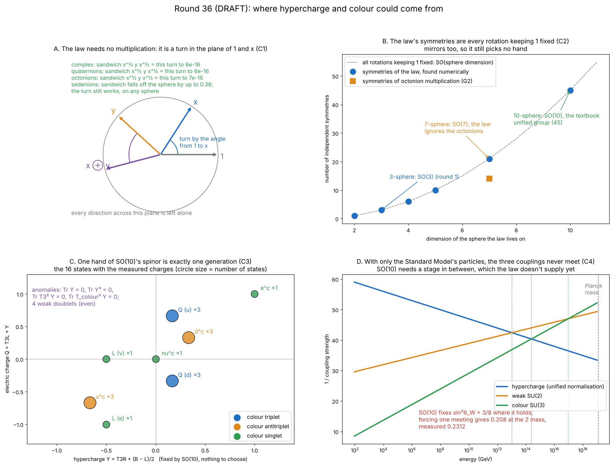

# Round 36: where hypercharge and colour could come from

*DRAFT, Nov 27 2026. Not versioned, not proved in Lean. Follows round 35 (`../round35/`). It takes up the two gaps round 33 left (`../round33/`), the last ones on the way to building all the forces in spacetime: hypercharge isn't the circle weight, and colour is missing. Checks: `checks.py` → `checks_output.txt` (**4 / 4 pass**, about 1 s: C1 and C2 numbers, C3 exact, C4 exact plus textbook one-loop running), results in `results.json`. Picture: `figures.py` → `figures/f43`. Colour key: **blue = the law and colour triplets, orange = octonions and antitriplets, green = what fits (colour singlets, SO(10)), purple = the law's output and the anomaly sums, red = where it misses measurement, grey = reference**.*

Rounds 1 to 35 put the law on a 3-sphere, where it is the quaternion sandwich x^½·y·x^½. Its symmetries there gave the weak force's SU(2) and a circle (rounds 31 and 33), but no colour and no hypercharge. This round asks what the law actually needs in order to exist, what its symmetries are in general, and whether a bigger sphere holds the missing forces.

## Verdict first

1. **The law needs no multiplication. It is a turn (C1).**
   - x ⊕ y is the rotation in the plane of 1 and x that carries 1 to x, applied to y. Every direction across that plane is left alone.
   - This equals the sandwich for complex numbers, quaternions and octonions, to 1e-15. With sedenions the sandwich falls off the sphere (by up to 0.32), but the turn is defined on a sphere of any size.
   - So the law needs only a round sphere and a chosen point 1. This is textbook sphere geometry (it is the sphere's transvection). What's ours is noticing that our law is exactly this.
2. **So its symmetries are every rotation that keeps 1 fixed, mirrors included (C2).**
   - On a sphere of dimension m, the law's symmetries are SO(m), found numerically for m = 2 to 10. On round 1's 3-sphere that is SO(3).
   - On the octonions' 7-sphere it is SO(7), 21 symmetries, not just the 14 of G2 that respect octonion multiplication. **The law doesn't see the octonions**, so they give colour no special route.
   - Mirrors respect it too, so on any sphere the law still picks no hand (as round 32 found).
3. **On a 10-sphere, the law's symmetry is SO(10), and that holds all of the Standard Model's forces with the measured charges (C3, exact).**
   - Colour needs 6 directions, a weak SU(2) that commutes with it needs 3 more, and one-handed matter needs spinors that come in two distinct hands. That only happens for SO(m) with m = 2 mod 4. So 10 is the smallest that works.
   - Split the 10 directions into 6 + 4. Rotations of the 6 are colour plus lepton number. Rotations of the 4 are the weak force, left and right.
   - One hand of SO(10)'s spinor is **exactly one generation**: the quark doublet Q, u^c, d^c, the lepton doublet L, e^c and a right-handed neutrino, 16 states. They carry the measured hypercharges, Y = T3R + (B − L)/2, which the group fixes with nothing to choose.
   - Every anomaly cancels (Tr Y, Tr Y³, Tr T3²Y and Tr T_colour²Y are all 0), and there are 4 weak doublets, an even number.
   - **This fills both of round 33's gaps at once.** Hypercharge isn't a circle weight but a rotation mixing 5 of the 10 directions' planes, and colour is the rotation of 6 of them. This is textbook SO(10) unification (Georgi 1974; Fritzsch and Minkowski 1975). What's new for the build is that it is the law's own symmetry on a bigger sphere.
4. **The coupling strengths miss unless something sits in between (C4).**
   - SO(10) fixes the weak mixing angle where it holds: sin²θ_W = 3/8 (round 33's reading of the 3-sphere gave ½).
   - Run down with only the Standard Model's particles, the three couplings never meet at one point. Hypercharge meets the weak force near 10¹³ GeV, hypercharge meets colour near 2 × 10¹⁴ GeV, and the weak force meets colour near 10¹⁷ GeV. Forcing a single meeting predicts sin²θ_W = 0.208 at the Z mass, where 0.231 is measured.
   - Textbook SO(10) models fix this with a stage in between (for example SU(4) × SU(2) × SU(2)) or with new particles. The law doesn't supply either yet.

**Does this open a lead? Yes, within the build.** For the first time the law's own symmetry holds colour, the weak force and hypercharge together, with the measured charges and cancelled anomalies. The only thing chosen is the size of the sphere the law lives on. The physics of SO(10) is textbook, so this isn't new physics. But it turns round 33's dead end into three concrete questions:
- Does anything in the law pick a 10-sphere over a 3-sphere?
- Does the way the law's symmetry breaks give a stage in between that makes the couplings meet?
- Can anything pick the hand? Round 32's answer was no, and that still holds here.

*f43. A: the law as a turn. x ⊕ y turns y by the angle from 1 to x, in the plane of 1 and x; directions across that plane don't move. This equals the sandwich x^½ y x^½ for complex numbers, quaternions and octonions, and works on spheres where no such multiplication exists. B: the number of symmetries of the law on spheres of each size (blue dots, found numerically) lies on the count for all rotations keeping 1 fixed (dashed). Octonion multiplication has fewer (orange). At the 10-sphere the law's symmetry is SO(10), with 45. C: one hand of SO(10)'s spinor, plotted by hypercharge and electric charge. Circle size is the number of states, and the colour shows triplets (blue), antitriplets (orange) and singlets (green). It is exactly one Standard Model generation plus a right-handed neutrino, and its anomaly sums vanish. D: the three coupling strengths run with the Standard Model's particles. They cross in pairs (dotted lines) but not at one point, so SO(10) broken straight to the Standard Model misses the measured weak mixing angle.*

## What the checks show

| Check | What it tests | Result |
|---|---|---|
| C1 | the law against a turn in the plane of 1 and x | equal to 7e-16 for complex numbers, quaternions and octonions; the sedenion sandwich leaves the sphere by up to 0.32, the turn by 4e-16 |
| C2 | the law's symmetries on spheres of dimension 2 to 10 | 1, 3, 6, 10, 21, 45 = all of SO(m), all keeping 1 fixed; mirrors respect it; octonion multiplication alone has 14 (G2) |
| C3 | SO(10)'s spinor of one hand | sizes that work up to 14: 10 and 14; states Q 6, u^c 3, d^c 3, L 2, e^c 1, ν^c 1; all four anomaly sums 0; 4 doublets |
| C4 | weak mixing angle; one-loop running | 3/8 exactly; pairwise meetings at 1.0e13, 2.4e14 and 9.6e16 GeV; single-meeting prediction 0.208 against 0.231 |

The measured inputs in C4 are approximate review values at the Z mass (1/α = 127.95, sin²θ_W = 0.2312, α_s = 0.1179). The conclusion doesn't depend on their last digits.

## What is textbook and what is ours

- **Textbook:** spheres as symmetric spaces and their transvections; Hurwitz's normed division algebras and the failure of sedenions; G2 as the octonions' symmetry; SO(10) unification and its one-generation spinor (Georgi 1974; Fritzsch and Minkowski 1975); which spinors can be one-handed (m = 2 mod 4); one-loop running and the failure of minimal unification without a stage in between.
- **Ours in the build:** that our law is exactly the sphere's turn, so it lives on every sphere and its symmetries are all rotations keeping 1 fixed. That the octonions add nothing to it. And that on a 10-sphere its own symmetry is SO(10), which settles round 33's two gaps.

## Limits

- **The sphere's size is chosen, not derived.** Nothing in rounds 1 to 36 picks 10 over 3.
- **The hand is still chosen.** The law respects mirrors on every sphere, so 16 and its mirror 16̄ come together. Picking one is a premise, as in round 33.
- **Three generations aren't explained.** One spinor is one generation.
- **No breaking mechanism.** How SO(10) breaks to the Standard Model, and whether it does so in a way that makes the couplings meet and keeps the proton stable enough (a textbook constraint on such models), isn't addressed.
- **Gauge fields are read from symmetries.** As in rounds 31 and 33, forces are read as rotations of the hidden space (Kaluza–Klein style). Their field equations on a 10-sphere aren't built here.

## Where this leaves the build

- All three of the Standard Model's force groups, and the measured charges of one generation, now sit inside one symmetry of the law, once the law lives on a 10-sphere.
- Open: what picks 10, how the symmetry breaks (and whether the couplings then meet), the hand, and three generations. The Lean proofs remain on hold.
