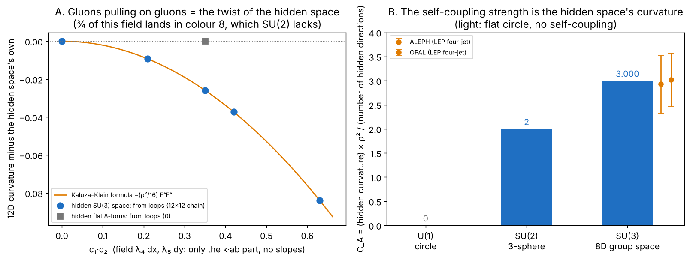

# Round 5: the strong force's group built into spacetime from a hidden SU(3) space

*DRAFT, Nov 27 2026. Not versioned, not proved in Lean. Follows the parent folder `../` (rounds 1–4). Checks: `checks.py` → `checks_output.txt` (**10 / 10 pass**, about 16 s; numpy, scipy), numbers in `results.json`. Picture: `figures.py` → `figures/f12`. Colour key: **orange = known, blue = ours, grey = control**.*

## Verdict first

1. **Done:** one 12 × 12 chain of our law (4 spacetime directions plus the 8 directions of SU(3)'s own group space) carries the strong force's field as curvature, exactly as rounds 3 and 4 did for light and the weak force.
2. **The gluon self-interaction is the twist of the hidden space.** A field made only of the k·ab (commutator) term shows up as 12D curvature when the hidden space's symmetries don't commute, and vanishes on a flat 8-torus whose symmetries do.
3. **The colour factor C_A = 3 is the hidden space's own curvature.** Measured from loops with no field: curvature × ρ² ÷ 8 = 3.000000. LEP's four-jet events measure 2.93 ± 0.60 (ALEPH) and 3.02 ± 0.55 (OPAL). This is QCD's number seen as geometry, not a new prediction: C_A is fixed once the group is SU(3).
4. **The hard limit is unchanged, and twist does not remove it.** Witten (1981) showed that fitting all three forces this way needs 11 dimensions and gives no left-handed matter. The index argument below says a twist (torsion) can't fix that on its own.

*f12. A: a constant field λ₄ dx + λ₅ dy (no slopes, so all of it is the k·ab part) changes the 12D curvature by exactly the Kaluza–Klein amount (blue on orange) on the hidden SU(3) space, and by nothing on a flat 8-torus (grey). Three quarters of it lands in colour 8, a direction an SU(2) space doesn't have. B: the curvature of each hidden space, scaled, is the force's self-coupling strength C_A: 0 for light's circle, 2 for the weak force's 3-sphere (round 4), 3 for SU(3), against the LEP measurements.*

## What the checks show

| Check | What | Result |
|---|---|---|
| J0 | SU(3) bracket, f₁₂₃ = 1, f₄₅₈ = √3/2, Σ f f = 3δ | exact |
| J1 | right-invariant forms from the series (e^M − 1)/M match dg g⁻¹ | 8e-11 |
| J2 | the 8 symmetry fields have constant products (ρ²/4)δ | 3e-16 |
| J3 | they obey SU(3)'s bracket [R_a, R_b] = +f_abc R_c | 2e-11 |
| J4 | no field: hidden curvature from loops = 24/ρ², so C_A = 3.000000 | 1e-6 |
| J5 | 12D curvature from loops = R(SU3) − (ρ²/16)FᵃFᵃ, field only from k·ab | 1e-6 |
| J6 | that field lands ¼ in colour 3, ¾ in colour 8 | exact |
| J7 | same field on a flat 8-torus: every loop closes | 0 |
| J8 | sweep of field strength stays on the formula | 1e-6 |
| J9 | C_A from geometry vs ALEPH and OPAL | 0.12σ, 0.04σ |

Why the group space and not CP²: Witten's minimal choice for SU(3) is the 4D space CP², which has SU(3) as its symmetry but whose symmetry fields change length from place to place, so the Kaluza–Klein formula only holds after averaging over the hidden space. On the group space every symmetry field has the same length everywhere (J2), so the formula holds at each point and a single set of loops tests it. The cost is 8 hidden directions instead of 4. CP² also cannot carry ordinary spinors (it has no spin structure), which is part of Witten's trouble with matter.

## What is textbook and what our law adds

| Piece | Status | Who |
|---|---|---|
| Gauge fields as the curvature of a hidden group space; R = R₄ + R_hidden − (ρ²/16)FᵃFᵃ | **Textbook** | DeWitt 1964; Kerner 1968; Cho 1975 |
| Curvature of a group space with round metric is fixed by its structure constants (so by C_A) | **Textbook** | Milnor, Adv. Math. 21, 293 (1976) |
| C_A = 3 measured in four-jet events | **Measured** | ALEPH, OPAL (Stenzel, hep-ex/0410064) |
| 11 dimensions minimum for all three forces; no left-handed matter in plain Kaluza–Klein | **Textbook** | Witten, Nucl. Phys. B 186, 412 (1981) |
| Net handedness of massless matter fixed by an index that the hidden space's symmetries force to zero | **Textbook** | Witten, in *Shelter Island II* (1983); Atiyah and Hirzebruch (1970) |
| One chain of our law carrying gravity, light, SU(2) and SU(3) as loops on one ring | **Ours** (a reading) | |
| The k·ab term read as the twist of the hidden space, and C_A read as its curvature | **Ours as a reading**; the formulas are textbook | |

Nothing here goes beyond GR plus the Standard Model's forces. Every match is a match because the textbook theory matches.

## Does twist rescue left-handed matter? (argument from textbook facts, not checked numerically here)

The weak force acts only on left-handed matter, and plain Kaluza–Klein produces left- and right-handed massless particles in equal numbers. The count that matters is the net number, left minus right, of massless solutions of the Dirac equation on the hidden space. That number is an index, and it does not change when the equation is changed by a term without derivatives. Adding a twist (torsion) to the hidden space changes the Dirac equation by exactly such a term. So twist can create or remove massless particles, but only in left–right pairs; it cannot make the net handedness nonzero. On a group space like SU(3) the index is zero for a further reason: its directions can be framed everywhere (it is parallelizable), which forces the relevant topological number to vanish.

The known ways out add something besides geometry: extra fields with flux through the hidden space (Randjbar-Daemi, Salam and Strathdee 1983), or hidden spaces with edges and singular points, which is where string theory went. If our law is to say something new here, it would have to supply such a flux or edge from the twisted-boost structure itself. That is an open question, not a result.

## A second limit worth stating

The hidden space's own curvature, 24/ρ² here, enters the 12D action like an enormous cosmological constant, and nothing in pure Kaluza–Klein holds ρ fixed. Both are known problems (the hidden space must be stabilised). The same 12D scalar we read from loops is the Lagrangian: integrated over the hidden space it gives Einstein's action plus the Yang–Mills action, with the gauge coupling set by ρ. That is the bridge to the next round.

## Next rounds

1. **Field equations from loops.** Use the loop-read scalar as an action: show that Einstein's equations plus Yang–Mills come out, compare with Wilson's lattice action Σ(1 − Re tr U) and the MacDowell–Mansouri form for gravity.
2. **Twist and handedness, numerically.** The Dirac operator on the 3-sphere with and without its parallelizing twist: count massless solutions and check they come in left–right pairs, as the index argument says.
3. **Lean:** the loop identity a∘b∘ā∘b̄ = k[a, b](1 + kā)(1 + kb̄) in any ring.

## Sources

DeWitt, in *Relativity, Groups and Topology* (1964). Kerner, Ann. Inst. H. Poincaré 9, 143 (1968). Cho, J. Math. Phys. 16, 2029 (1975). Milnor, Adv. Math. 21, 293 (1976). Witten, Nucl. Phys. B 186, 412 (1981). Witten, "Fermion quantum numbers in Kaluza–Klein theory", in *Shelter Island II* (1983). Atiyah and Hirzebruch, in *Essays on Topology and Related Topics* (1970). Randjbar-Daemi, Salam and Strathdee, Nucl. Phys. B 214, 491 (1983). Stenzel, hep-ex/0410064 (ALEPH and OPAL colour factors). Wilson, Phys. Rev. D 10, 2445 (1974). MacDowell and Mansouri, PRL 38, 739 (1977).
