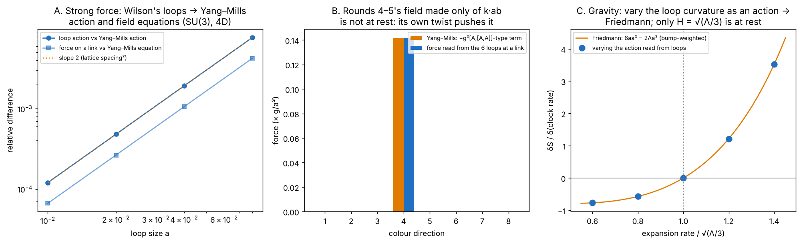

# Round 6: the field equations from loops

*DRAFT, Nov 27 2026. Not versioned, not proved in Lean. Follows the parent folder `../` (rounds 1–4) and `../round5/`. Checks: `checks.py` → `checks_output.txt` (**10 / 10 pass**, about 7 s; numpy, scipy), numbers in `results.json`. Picture: `figures.py` → `figures/f13`. Colour key: **orange = known, blue = ours, grey = reference line**.*

## Verdict first

Rounds 1–5 read each force's *field* off a chain of short links round a small loop. This round uses the same loops as the *action*, varies it, and gets the *equations the fields obey*.

1. **Strong force:** Wilson's sum over loops, Σ(1 − Re tr U/3), becomes the Yang–Mills action as the loops shrink (error falls as size², 1e-4 at the smallest). Nudging one link and adding up the 6 loops that use it gives the Yang–Mills field equation (error 7e-5). This is Wilson 1974, the basis of lattice QCD.
2. **The k·ab part drives itself.** The constant field from rounds 4–5, made only of the commutator, is not at rest: its own commutator pushes it, and the loops read that push to 3e-5.
3. **Gravity:** the curvature read from loops, used as Einstein's action for an expanding universe and varied, gives both of Friedmann's equations. Only the expansion rate H = √(Λ/3) (de Sitter) leaves the action unchanged, and the loop answer follows Friedmann at every other rate.
4. **What this is not:** the gravity check varies only the size of a uniform universe and its clock rate (a symmetry-reduced test), not every component of the metric. The full set of Einstein's equations from loops is Regge's 1961 method, not done here. Round 1 already showed the vacuum equation (Ricci = 0) holds for the black-hole loops.

*f13. A: the loop action and the force on one link approach the Yang–Mills action and equation, both with error ∝ (loop size)². B: a constant SU(3) field made only of the k·ab part feels a force from its own commutator (orange: formula; blue: read from loops). C: varying the loop-read curvature as an action in the universe's clock rate gives Friedmann's first equation (orange curve); it is zero only at H = √(Λ/3).*

## What the checks show

| Check | What | Result |
|---|---|---|
| L1 | loop action / a⁴ → (g²/12) FᵃFᵃ (Yang–Mills action) | 1.2e-4, order 2.00 |
| L2 | dropping the k·ab ([A, A]) part gives the wrong action | 2.26 vs 7.11 |
| L3 | force on a link (6 loops) × g/a³ → D_μF_μν (Yang–Mills equation) | 6.6e-5, order 2.00 |
| L4 | exact solution (constant field, one colour): zero force on every link | 3e-18 |
| L5 | rounds 4–5's k·ab-only field: nonzero force, loops match formula | 3.3e-5 |
| M1 | expanding universe: curvature from loops = 6(ä/a + ȧ²/a²) | 1e-7 |
| M2 | vary loop action in clock rate → 6aȧ² − 2Λa³ (Friedmann I) | 1e-5 relative |
| M3 | vary loop action in size → 6ȧ² + 12aä − 6Λa² (Friedmann II) | 2.4e-4 relative |
| M4 | de Sitter, H = √(Λ/3): stationary both ways | ≤ 2e-4 of scale |
| M5 | sweep of rates 0.6–1.4 × √(Λ/3): loops follow Friedmann | all |

One fix along the way, so nobody repeats it: the force on a link is read in the colour frame of the link's start, which turns it slightly, an error ∝ a. As in round 1, two loop sizes (Richardson) remove that and leave a².

## What is textbook and what our law adds

| Piece | Status | Who |
|---|---|---|
| Loop (plaquette) action → Yang–Mills action; link variation → Yang–Mills equation | **Textbook** | Wilson, Phys. Rev. D 10, 2445 (1974) |
| Einstein's action ∫√−g (R − 2Λ); reduced to a uniform universe it gives Friedmann's equations | **Textbook** | Hilbert 1915; Friedmann 1922; any cosmology text |
| Einstein's equations from loop deficits on a triangulated spacetime | **Textbook** (not reproduced here) | Regge, Nuovo Cim. 19, 558 (1961) |
| Each link built as a chain of short pieces joined by the law, so the action and the field equations come from one operation | **Ours** (a reading) | |
| The self-push of a pure-commutator field read as the k·ab term acting on itself | **Ours as a reading**; the term is textbook | |

Every match here is a match because the textbook theories (Yang–Mills, GR) match. Nothing tests physics beyond them.

## Where this leaves quantum theory and gravity

The loop action is also where quantum theory starts: lattice QCD sums e^(−S) over all link values, and that works. Doing the same for gravity's loop action is Regge's quantum gravity and its successors (dynamical triangulations); the old problem, that gravity's quantum corrections need infinitely many new constants (Goroff–Sagnotti 1986), is still there, and nothing in this round changes it. Round 1's twist section said the same.

## Next rounds

1. **Twist and handedness, numerically:** the Dirac operator on the 3-sphere with and without its parallelizing twist; count massless solutions and check they come in left–right pairs (round 5's index argument).
2. **Full Einstein equations from loops:** Regge's method on a small triangulated patch, with each deficit read by our law.
3. **Lean:** the loop identity a∘b∘ā∘b̄ = k[a, b](1 + kā)(1 + kb̄) in any ring.

## Sources

Wilson, Phys. Rev. D 10, 2445 (1974). Hilbert, Nachr. Ges. Wiss. Göttingen (1915). Friedmann, Z. Phys. 10, 377 (1922). Regge, Nuovo Cim. 19, 558 (1961). Goroff and Sagnotti, Nucl. Phys. B 266, 709 (1986). Yang and Mills, Phys. Rev. 96, 191 (1954). de Sitter, MNRAS 78, 3 (1917).
