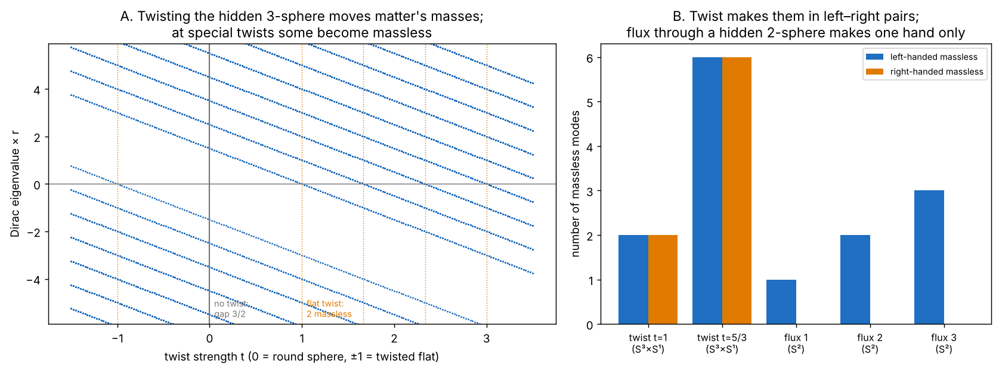

# Round 7: can twisting the hidden space make left-handed matter?

> **Names:** some words or symbols on this page (twist) also mean something else in standard math, physics or computing, or inside this project. [NAMING-COLLISIONS.md](../../../NAMING-COLLISIONS.md) says which meaning is in play.

*DRAFT, Nov 27 2026. Not versioned, not proved in Lean. Follows rounds 1–6 (the parent folder `../`, `../round5/`, `../round6/`). Checks: `checks.py` → `checks_output.txt` (**6 / 6 pass**, under 1 s; numpy), numbers in `results.json`. Picture: `figures.py` → `figures/f14`. Colour key: **blue = computed here, orange = marks and the other handedness, grey = reference**.*

## Verdict first

1. **Twist moves matter's masses, and at special strengths makes some of it massless.** On the round hidden 3-sphere no matter particle is massless (the lightest has mass 3/(2r)). Twisting the sphere all the way flat (its parallelizing twist) makes exactly 2 massless modes, the constant spinors.
2. **But twist makes them in left–right pairs.** With an even number of hidden directions (here the 3-sphere times a circle), every twist that makes massless matter makes as many left-handed as right-handed. The net handedness stays zero, so twist alone cannot give the weak force's left-handed matter. This shows round 5's index argument on explicit spectra.
3. **Magnetic flux through a hidden 2-sphere does give one hand only.** Flux n gives n massless modes, all of one handedness. This is the textbook way out (Randjbar-Daemi, Salam and Strathdee 1983) and the reason string theory and its relatives carry fluxes.
4. **What that means for our law:** if the twisted-boost structure is to explain left-handed matter, it has to produce something that acts like flux through the hidden space, not only twist. That is the sharp open question this round leaves.

*f14. A: Dirac eigenvalues on the hidden 3-sphere as the twist strength t goes from the round sphere (t = 0, gap 3/2) through the two flat twists (t = ±1) and beyond; each crossing of zero (orange lines) is a massless mode. B: counts of massless modes by handedness. Twist on the 3-sphere times a circle gives equal left and right; flux 1, 2, 3 through a hidden 2-sphere gives 1, 2, 3 of one hand and none of the other.*

## What the checks show

| Check | What | Result |
|---|---|---|
| N1 | round 3-sphere, Dirac operator built from spin-j matrices: ±(n + 3/2)/r, multiplicity (n+1)(n+2) | exact, n ≤ 6 |
| N2 | full parallelizing twist (t = 1): exactly 2 massless modes; untwisted: 0 | 2 vs 0 |
| N3 | massless modes only at t = 1 + 4j/3 and 1 − 4(j+1)/3 (−1, 1, 5/3, 7/3, 3) | gap ≥ 0.015 elsewhere |
| O1 | hidden 3-sphere × circle, six twist strengths: left = right every time | e.g. t = 1: 2 and 2; t = 5/3: 6 and 6 |
| P1 | hidden 2-sphere, no flux: ±(l+1)/r, no massless modes | exact |
| P2 | flux n = 1…4: n massless modes, all one hand | 1/0, 2/0, 3/0, 4/0 |

How the operators are built: functions on SU(2) split into copies of each spin-j representation (Peter–Weyl), so the Dirac operator becomes a matrix made from spin-j angular-momentum matrices and is diagonalised numerically; no eigenvalue formula is put in. The twist strength t scales the twist part of the spin connection: t = 0 is the ordinary (Levi-Civita) one, t = ±1 are the two flat Cartan–Schouten connections whose twist cancels the sphere's curvature. Other conventions for how spinors feel twist (for example the "one-third" Dirac operator) move the crossing points but not the left–right pairing.

## What is textbook and what our law adds

| Piece | Status | Who |
|---|---|---|
| Dirac spectrum of the round 3-sphere; no massless modes on positive curvature | **Textbook** | Bär 1996; Lichnerowicz 1963 |
| Flat twisted (Cartan–Schouten) connections on a group space; parallel spinors | **Textbook** | Cartan and Schouten 1926 |
| Net handedness is an index, unchanged by twist; zero on a group space | **Textbook** | Atiyah and Singer 1963; Witten 1983 |
| Flux through a hidden 2-sphere gives one-handed massless matter | **Textbook** | Randjbar-Daemi, Salam and Strathdee 1983 |
| Asking whether the twisted-boost structure can supply flux, not only twist | **Ours** (an open question, not a result) | |

These are illustrations of textbook theorems on explicit spectra, not independent tests of the theorems, and nothing here goes beyond known physics.

## Next rounds

1. **Full Einstein equations from loops:** Regge's method on a small triangulated patch, with each deficit read by our law.
2. **Flux from the law:** look for a configuration of the twisted boosts that acts like magnetic flux through a hidden 2-sphere, and count the massless modes it gives.
3. **Lean:** the loop identity a∘b∘ā∘b̄ = k[a, b](1 + kā)(1 + kb̄) in any ring.

## Sources

Bär, J. Math. Soc. Japan 48, 69 (1996). Lichnerowicz, C. R. Acad. Sci. Paris 257, 7 (1963). Cartan and Schouten, Proc. KNAW 29, 803 (1926). Atiyah and Singer, Bull. AMS 69, 422 (1963). Witten, "Fermion quantum numbers in Kaluza–Klein theory", in *Shelter Island II* (1983). Randjbar-Daemi, Salam and Strathdee, Nucl. Phys. B 214, 491 (1983).
