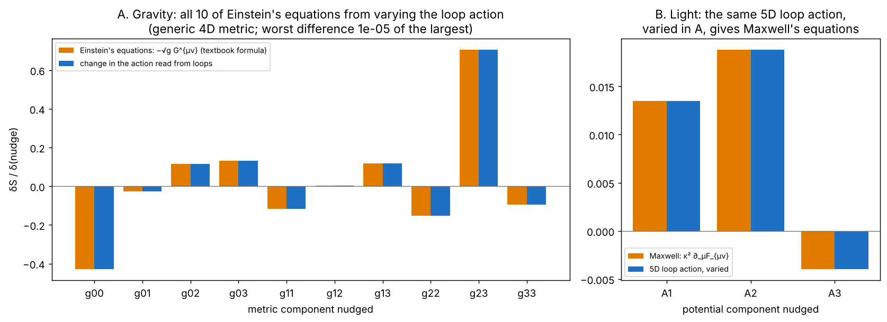

# Round 8: all of Einstein's equations, and Maxwell's, from varying the loop action

> **Names:** some words or symbols on this page (twist) also mean something else in standard math, physics or computing, or inside this project. [NAMING-COLLISIONS.md](../../../NAMING-COLLISIONS.md) says which meaning is in play.

*DRAFT, Nov 27 2026. Not versioned, not proved in Lean. Follows rounds 1–7 (the parent folder `../`, `../round5/`, `../round6/`, `../round7/`). Checks: `checks.py` → `checks_output.txt` (**5 / 5 pass**, about 60 s; numpy, scipy, sympy), numbers in `results.json`. Picture: `figures.py` → `figures/f15`. Colour key: **orange = textbook formula, blue = from loops, grey = zero line**.*

## Verdict first

1. **Gravity, in full.** For a generic metric, with all 10 components varying from place to place, the curvature read from loops is turned into Einstein's action ∫√g R. Nudging each of the 10 components changes it by exactly −√g G^{μν}, which is Einstein's equations. The worst difference is 1e-5 of the largest. Round 6 did this only for a uniform expanding universe.
2. **Light, from the same action.** In round 3's 5D chain, the loop-read curvature is −(κ²/4)F_{μν}F_{μν}, now for a field that varies in space. Nudging the potential A changes the action by κ²∂_μF_{μν}, which is Maxwell's equations. The difference is 5e-7.
3. **So one action, read from loops, gives the field equations of gravity and light.** With round 6 (Wilson's loops give Yang–Mills) every force we have built now gets its equations from loops of the law. All of it is textbook (Hilbert 1915, Kaluza 1921, Wilson 1974); the reading through one operation is ours.
4. **What this is not:** this varies a smooth metric, read pointwise from small loops. It is not Regge's method (Einstein's equations on a spacetime glued from flat pieces), which would be the version with no smooth background at all. It uses Euclidean signature; the algebra is the same for Lorentzian.

*f15. A: for each of the 10 metric components, the change in the loop-read action when that component is nudged by a smooth bump (blue), next to Einstein's tensor computed independently by the textbook formula (orange). B: the same for the 5D chain, nudging the three varying components of the electromagnetic potential, against Maxwell's equations.*

## What the checks show

| Check | What | Result |
|---|---|---|
| Q1 | generic 4D metric: curvature scalar from loops = textbook formula | 4e-6 relative |
| Q2 | the whole Ricci tensor (10 components) from loops = textbook formula | 7e-5 of the largest (11.65) |
| Q3 | nudge each of the 10 components: δS from loops = −√g G^{μν} | worst 1.1e-5 of the largest |
| S1 | 5D chain, varying field: curvature from loops = −(κ²/4)F² | 2e-8 |
| S2 | nudge A₁, A₂, A₃: δS from the 5D loop action = κ²∂_μF_{μν} | worst 5e-7 |

How it is done: the metric varies in two of the four coordinates (all 10 components depend on both), on a 33 × 33 grid. At every grid point the 6 loop planes are walked as chains of short links joined by the law, with two loop sizes to cancel the leading error, as in earlier rounds. The nudge is a smooth bump of width 0.12, and the change is taken as a centred difference with step 2e-3 (round 6 found a larger step adds a visible error from the action's cubic terms). Einstein's tensor for comparison comes from the Christoffel-derivative formula by finite differences, which does not use loops.

## What is textbook and what our law adds

| Piece | Status | Who |
|---|---|---|
| Varying ∫√g R in the metric gives Einstein's equations | **Textbook** | Hilbert 1915 |
| 5D curvature = 4D curvature − ¼F², so the 5D action gives Einstein plus Maxwell | **Textbook** | Kaluza 1921; Klein 1926 |
| Gravity from loop deficits with no smooth background | **Textbook** (not done here) | Regge 1961 |
| Reading the action, and so the field equations, off chains of one operation for every force | **Ours** (a reading) | |

Every match is a match because GR and Maxwell's theory match. Nothing here tests physics beyond them.

## Where the whole series stands

- **Fields:** light, weak, strong and gravity each read as curvature of one chain (rounds 1–5).
- **Equations:** Yang–Mills (round 6), Friedmann (round 6), all of Einstein's and Maxwell's (round 8), from varying the loop action.
- **Twist:** frame dragging is the twist of the time leg (round 2); twist moves matter's masses but cannot make left-handed matter (rounds 5 and 7).
- **Open:** whether the law's twisted boosts can act like flux through a hidden space (the one route to left-handed matter), and the quantum problem of gravity, which none of this touches.

## Next rounds

1. **Flux from the law:** look for a configuration of the twisted boosts that acts like magnetic flux through a hidden 2-sphere, and count the massless modes it gives.
2. **Lean:** the loop identity a∘b∘ā∘b̄ = k[a, b](1 + kā)(1 + kb̄) in any ring.
3. **Regge version:** Einstein's equations on a spacetime glued from flat pieces, each deficit read by the law.

## Sources

Hilbert, Nachr. Ges. Wiss. Göttingen (1915). Kaluza, Sitzungsber. Preuss. Akad. (1921). Klein, Z. Phys. 37, 895 (1926). Regge, Nuovo Cim. 19, 558 (1961). Wilson, Phys. Rev. D 10, 2445 (1974).
