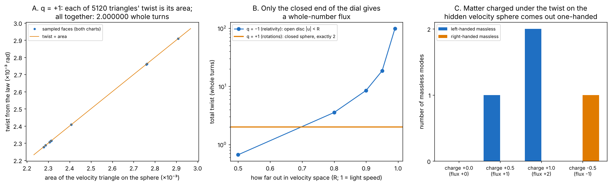

# Round 9: the law's own twist acts as flux through a hidden sphere

> **Names:** some words or symbols on this page (⊕, twist) also mean something else in standard math, physics or computing, or inside this project. [NAMING-COLLISIONS.md](../../../NAMING-COLLISIONS.md) says which meaning is in play.

*DRAFT, Nov 27 2026. Not versioned, not proved in Lean. Follows rounds 1–8 (the parent folder `../`, `../round5/` … `../round8/`) and uses the twisted-boost law from `../../twisted-boosts/`. Checks: `checks.py` → `checks_output.txt` (**7 / 7 pass**, under 1 s; numpy), numbers in `results.json`. Picture: `figures.py` → `figures/f16`. Colour key: **blue = from the law, orange = geometry or textbook, grey = reference**.*

## Verdict first

Round 7 found that twist alone makes massless matter only in left–right pairs, and that **flux** through a hidden 2-sphere is what makes one hand. This round asks whether the law's own twist can be that flux.

1. **At the rotation end of the dial (q = +1), yes.** The twisted-boost law's twist of each small velocity triangle equals its area on a sphere, to 3e-17, for all 5,120 triangles of a fine mesh. Added up over the whole closed velocity sphere it is exactly 4π: **2 whole turns of flux**. It can't be smoothed away: the two halves' frames differ by a turn that winds twice round the equator.
2. **At relativity's end (q = −1), no.** Velocity space is an open disc, and the twist piles up without bound toward light speed (0.7 turns out to R = 0.5, 98.5 turns out to R = 0.99). Flux comes in whole numbers only when the space closes up.
3. **Matter charged under that twist comes out one-handed.** Matter that feels the twist only through its spin gets no massless modes, as in round 7. Matter that carries an extra charge c under the twist sees flux 2c: charge ½ gives one massless left-handed mode, charge 1 gives two, and the opposite charge gives the other hand.
4. **What is assumed, not derived:** (a) a hidden 2-sphere whose geometry is the q = +1 end of the dial, and (b) that matter carries a charge under the twist on top of its spin. Without (b) there is no handedness. Neither is derived from the law yet, and one charge under one twist is far from the Standard Model's pattern (two forces acting on left-handed matter, three families).

*f16. A: twist from the law against area on the unit sphere for sampled triangles; the total over the sphere is 2.000000 turns. B: total twist as velocity space is filled out: the open q = −1 disc grows without limit, the closed q = +1 sphere gives exactly 2. C: massless modes by handedness for matter with charge c under the twist (flux 2c).*

## What the checks show

| Check | What | Result |
|---|---|---|
| R1 | 5,120 velocity triangles at q = +1: twist from the law = spherical area | worst 3e-17 |
| R2 | total twist over the closed velocity sphere | 4π = 2.000000000000 turns |
| R3 | the two charts' frames wind round the equator | 2 times (sign set by orientation) |
| R4 | q = −1: twist over a patch = minus its hyperbolic area, exactly; whole disc unbounded | to 1e-9; 0.7 → 98.5 turns as R → 0.99 |
| T1 | matter with no extra charge: no massless modes | 0 / 0 |
| T2 | charge ½ and 1: massless modes all one hand | 1 / 0 and 2 / 0 |
| T3 | charge −½: the other hand | 0 / 1 |

How the twist is computed: each triangle (a, b, c) is moved so a is at rest with the law itself (u = (−a)⊕b, w = (−a)⊕c), then its twist is the phase of (1 − q u v̄)/(1 − q ū v) with v = (−u)⊕w. The sphere is covered by two stereographic charts, each used away from its own pole. The area it is compared with comes from the triangle's corners on the sphere (Van Oosterom–Strackee formula), not from the law. The massless-mode counts use round 7's Dirac operator on the 2-sphere, with the flux set to 2c.

## What is textbook and what our law adds

| Piece | Status | Who |
|---|---|---|
| Twist of composed rotations = area on the velocity sphere; total 4π = 2π × (Euler number 2) | **Textbook** | Gauss–Bonnet; Thomas 1926 and Wigner 1939 for the boost version |
| A 2-sphere's own frame-turning is a charge-2 magnetic monopole | **Textbook** | Hopf 1931; Dirac 1931; Wu and Yang 1975 |
| Flux through a hidden 2-sphere gives one-handed massless matter and holds the sphere's size | **Textbook** | Randjbar-Daemi, Salam and Strathdee 1983 |
| Using the hidden space's own frame-turning as the gauge field matter is charged under | **Textbook** in string theory | Candelas, Horowitz, Strominger and Witten 1985 ("standard embedding") |
| That the flux is the twisted-boost law's twist at its q = +1 end, and that the dial's closed end is the only one with whole-number flux | **Ours** (a reading) | |
| A picture where visible spacetime sits at q = −1 and the hidden sphere at q = +1 | **Ours, speculative**: an idea, not a result | |

## What this says about "reality is twisted"

The twist does more than round 7 suggested. On its own it only moves masses around in left–right pairs. But on the closed end of the dial it is also a whole-number flux, and flux is exactly what makes one-handed matter. So the twist can supply the missing ingredient, if matter carries a charge under it. Whether the law fixes that charge is the next question. One concrete lead is that the law works in half-velocities ("half a kick"), the same halving that gives spin-½. If that halving fixes the charge at ½, it would give exactly one massless left-handed mode. That is a lead to test, not a claim.

## Next rounds

1. **Does the law fix the charge?** Test whether the half-velocity structure of the twisted boosts makes matter's charge under the twist ½.
2. **Lean:** the loop identity a∘b∘ā∘b̄ = k[a, b](1 + kā)(1 + kb̄) in any ring, and twist = q × area.
3. **Regge version:** Einstein's equations on a spacetime glued from flat pieces.

## Sources

Thomas, Nature 117, 514 (1926). Wigner, Ann. Math. 40, 149 (1939). Hopf, Math. Ann. 104, 637 (1931). Dirac, Proc. R. Soc. A 133, 60 (1931). Wu and Yang, Phys. Rev. D 12, 3845 (1975). Randjbar-Daemi, Salam and Strathdee, Nucl. Phys. B 214, 491 (1983). Candelas, Horowitz, Strominger and Witten, Nucl. Phys. B 258, 46 (1985). Van Oosterom and Strackee, IEEE Trans. Biomed. Eng. 30, 125 (1983).
