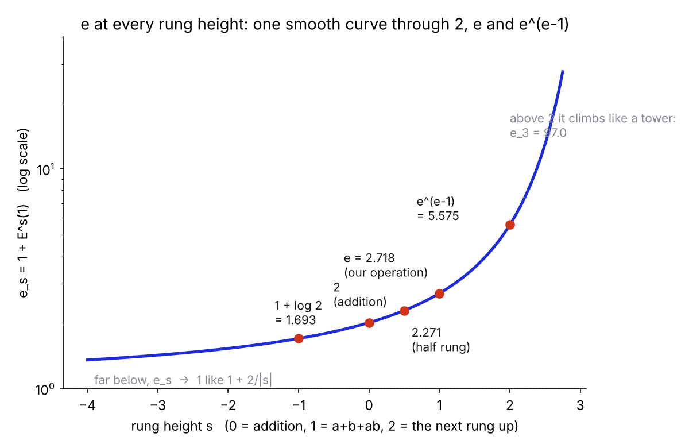
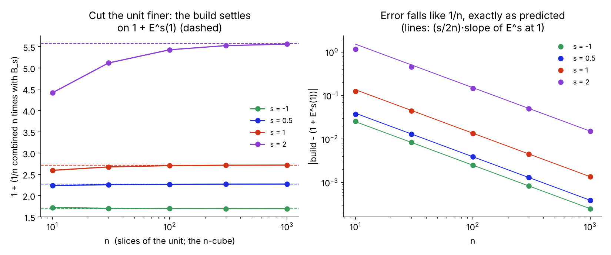
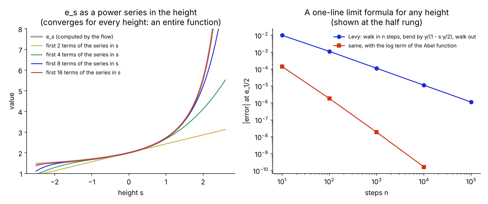
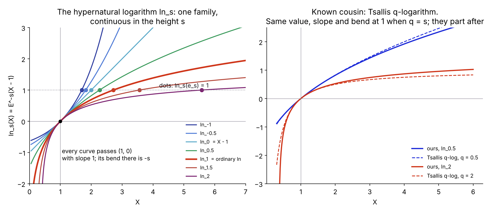
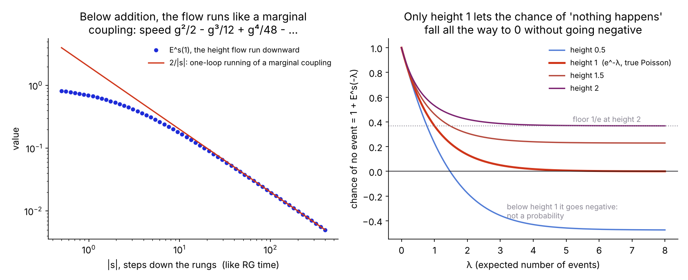

# e and the hypernatural logarithm at every rung height

*Renamed Nov 26 2026: "supernatural logarithm" is now the **hypernatural logarithm** (Brennan); its inverse is the **hypernatural exponential** exp⁽ˢ⁾(t) = 1 + Eˢ(t). See `../../named-functions/`.*

*Nov 25, 2026. Brennan asked on a call whether a function gives e at any rung height, continuously, and whether it has a closed form. Checks: `e_every_height.py`, **26 of 26 pass** (`e_every_height_output.txt`). Pictures: `figures.py`. Builds on `../regular_iteration.py` (the flow E^t, 16/16) and `../../e/` (e from the n-cube).*

## The answer

**Yes.** Build e at height s the way e is built from the n-cube (cut the unit into n slices, combine them with the height-s operation B_s, add the cube's empty corner) and you get

**e_s = 1 + E^s(1)**

for every real height s. It goes through 2 at addition, e at our operation, e^(e−1) at the next rung, and falls toward 1 far below. Checked at ten heights; the error shrinks like 1/n exactly as predicted.

**Closed form:** at whole heights it is a tower of exponentials or logs. At fractional heights no elementary closed form is known, and the half-rung value has already failed a 120-digit integer-relation search against π, e, ln 2 and the usual constants (`../../pi/constants_output.txt`). The most closed forms that exist are an Abel-function formula, a one-line limit formula (Lévy), and a power series in the height that converges for every height.

| height s | e_s | form |
|---|---|---|
| −2 | 1.5265890341 | 1 + log(1 + log 2) |
| −1 | 1.6931471806 | 1 + log 2 |
| −1/2 | 1.8202323343 | |
| 0 (addition) | 2 | 1 + 1 |
| 1/2 | 2.2710274138899515214246518766722806879544… | no closed form known |
| 1 (a+b+ab) | 2.7182818285 | e |
| 3/2 | 3.5645129118 | |
| 2 | 5.5749415248 | e^(e−1) |
| 3 | 97.0223655661 | e^(e^(e−1) − 1) |

## Why it works (ours, short)

B_s is addition seen through E^s, so combining x with itself n times at height s is exactly E^s(n·E^−s(x)). With x = 1/n, n·E^−s(1/n) = 1 − s/(2n) + …, because every iterate starts E^−s(x) = x − (s/2)x² + … . So the build tends to E^s(1), and the error is about −(s/2n)·(slope of E^s at 1). The right panel below shows the measured errors sitting on those predicted lines.

## The most closed form there is

- **Abel form (known method):** e_s = 1 + Ψ(Φ(1) + s), where Φ is the Abel function (Fatou coordinate) of E, Φ(e^x − 1) = Φ(x) + 1, and Ψ is its inverse. Φ is the "which rung am I on" ruler; adding s is climbing s rungs. Regular iteration is Szekeres (Acta Math. 1958) and Écalle; the algorithm is Lévy's (1928).
- **One-line limit (Lévy-type, known):** E^s(x) = lim E^n( y/(1 − s·y/2) ) with y = L^n(x), L(x) = log(1 + x). Walk in n steps toward 0, bend by the height, walk out. Error ~1/n. Adding the log term of the Abel function, Φ(y) ≈ −2/y + (1/3)·log y (coefficient ours to derive, standard method), makes the error fall like 1/n² (to 2e-10 at n = 10⁴).
- **Power series in the height (ours to apply; known method):** because e^x − 1 is entire, Ψ extends to an entire function by Ψ(w + 1) = E(Ψ(w)), so e_s is an entire function of s and its power series converges at every height:
  e_s = 2 + 0.43305 s + 0.17581 s² + 0.06852 s³ + 0.02593 s⁴ + 0.00959 s⁵ + … (coefficients in `e_every_height.json`). The s coefficient 0.43305 is Julia's iterative logarithm at 1. Twenty terms reproduce e_s on [−1, 1] to 1e-9. The coefficients fall slowly, as they must for a function that later climbs like a tower.
- **What is ruled out (known):** the formal power series of the fractional iterates in x diverges (Baker; Szekeres 1963 cites e^z − 1 as the example that converges only at whole s), so no power series around 0 gives E^s. That rules out the usual kinds of closed form near 0. It does not prove e_1/2 is not some exotic closed-form number, and I don't claim that.

## The hypernatural logarithm

Brennan's name (informal) for the log that goes with e_s:

**ln_s(X) = E^−s(X − 1)**, its inverse **exp_s(t) = 1 + E^s(t)**.

It is one family, continuous in the real height s, not a separate log per rung. Checked at seven heights from −1 to 2:

- ln_s(1) = 0, ln_s(e_s) = 1, ln_s(exp_s(t)) = t.
- Every member passes through (1, 0) with slope 1, and **its bend at 1 is −s**: the height is literally the log's curvature at 1 (ours, from E^−s(x) = x − (s/2)x² + …).
- ln_1 is the ordinary natural log, ln_0(X) = X − 1, ln_2(X) = log(1 + log X).
- It turns the height-s product X ⊗_s Y = 1 + B_s(X − 1, Y − 1) into addition. ⊗_1 is ordinary multiplication.
- **Heights compose:** ln_(s+t)(X) = ln_s(1 + ln_t(X)), and ln_s(e_(s+t)) = e_t − 1 (ours, exact by construction).
- **It turns ordinary multiplication into the rung-(1 − s) operation:** ln_s(X·Y) = B_(1−s)(ln_s X, ln_s Y). At s = 1 that is "log turns × into +"; at s = 0 it is "X − 1 turns × into a + b + ab" (ours).

**Name check.** "Hypernatural logarithm" is not an established term (web search, Nov 25). Neighbours it must not be confused with:
- *super-logarithm* (slog): the inverse of tetration, i.e. the Abel function of e^x. Ours is not that; the matching object here is Φ, the Abel function of e^x − 1, our "rung ruler". The relation is ln_s(X) = Ψ(Φ(X − 1) − s): the hypernatural log at height s steps down s rungs on that ruler.
- *super-logarithms* in analysis (e.g. Caffarelli–Kohn–Nirenberg papers): infinitely iterated logs. Different.
- *regular iteration / iterative logarithm*: the machinery underneath (Szekeres, Écalle, Julia). Known.
- *Tsallis q-logarithm* (1988; q-product, Borges 2004): the closest known cousin (right panel above). Ours and Tsallis' agree exactly at s = q = 0 and s = q = 1, and to second order (same bend −s) at every height; they part at third order (ours u − (s/2)u² + (s²/4 + s/12)u³, Tsallis u − (q/2)u² + (q(q+1)/6)u³). The project already reads Tsallis' family as the corner dial k = 1 − q; the hypernatural log is the other direction, height. What Tsallis' family lacks is the composition law ln_(s+t) = ln_s(1 + ln_t).
- *Bennett's commutative hyperoperations* (A. A. Bennett, "Note on an operation of the third grade", Annals of Math. 17(2), 1915, 74–75): the nearest prior work for B_s. Bennett climbs rungs by transporting with exp (+, ×, a^(log b), …); ours transports with E = eˣ − 1 = (x ↦ x − 1) ∘ exp, so the identity stays 0 at every height. Known; added Nov 25 from the operations catalog (`../../operations-catalog/`).

## Where e_s and ln_s could be used across the work

Each line: what swapping in the height-s version means, whether it is real or a relabeling, and whether it is worth a follow-up. Pieces marked known are published; readings are ours.

1. **Entropy, free energy and Rényi (information-theory, thermodynamics, entropy-noise, statistics). Real; top follow-up.** Since ln_s(X·Y) = B_(1−s)(ln_s X, ln_s Y), any quantity that is "log of something that multiplies for independent systems" (Rényi entropy, log Z, cumulant generators) gets a height-s version that composes exactly by B_(1−s). That is a new family of composable entropies along the height, beside Tsallis' along the dial (Tsallis composes by a + b + (1−q)ab; ours by B_(1−s)). Caveat: Shannon-type averages don't pass through B_(1−s) the way they pass through the dial, so this works for the log-of-power-sum kind, not the average-of-log kind. Known: Tsallis, Rényi, Sharma–Mittal, Tempesta's group entropies. Ours: this family and its law.
2. **Asymptotic safety's e^(−θt), and running couplings (why-i/e-i-pi/asymptotic-safety). Real parallel; follow-up.** Putting e_s into e^(−θt) is only a relabeling. But the height flow itself is a running coupling: d/ds E^s = λ(E^s) with λ(g) = g²/2 − g³/12 + g⁴/48 − g⁵/180 + 11g⁶/8640 − … (exact, checked), and below addition it runs like 2/|s|, the one-loop shape of a marginal coupling (left panel below). The λ series diverges (Erdős–Jabotinsky 1960), and resumming it is exactly Écalle's resurgence, the same mathematics now used for renormalons in quantum field theory. Known: each piece. Ours: reading the rung height as RG time for a marginal coupling. This points toward the quantum side of the North Star.
3. **Euler's formula and the 2π horizon period (why-i/e-i-pi). Real question; follow-up, harder.** exp_s(z) = 1 + E^s(z). At whole heights 1, 2, 3, … it is a function of e^z, so it has period 2πi; at height 0 (1 + z) it has none. At fractional heights 0 < s < 1, writing E^s = E^(s−1)∘E makes it 2πi-periodic too, but whether that is the natural complex continuation is open (it runs into the Écalle–Voronin invariants of e^z − 1). Question to settle: does the 2π period exist at every height above addition and vanish exactly at addition? Unchecked.
4. **Poisson, "no event" and point processes (dial-point-processes, measure-probability). Small real result; no follow-up needed.** e^(−λ) is the n-fold build of −λ/n at height 1. At height s the chance of no event becomes 1 + E^s(−λ). Its floor is 1 + E^(s−1)(−1): negative below height 1 (not a probability), exactly 0 at height 1, positive above (1/e at height 2). So height 1 is the only height where "nothing happens" can become impossible without going negative, which is one more reason e is the probabilistic constant (right panel below; ours, checked numerically).
5. **Compound interest and force of interest (actuarial). Clean but mostly relabeling; low priority.** Force of interest log(1 + i) is ln_1(1 + i). Height 0 gives simple interest (δ = i), height 1 continuous compounding; fractional heights interpolate between them while still composing (by B_s). Neat, but there is no known demand for it.
6. **e on the n-cube (e/). Done here.** e_s is the cube total at height s, so the cube construction itself now has a height dial.
7. **The e-i-pi corner-dial chain ((e^(kx) − 1)/k). Two directions, not a replacement.** That chain moves along the corner dial k; e_s moves along height s. They share the point (k, s) = (1, 1) and agree to second order. A two-parameter "e at (k, s)" is possible, but would mostly be bookkeeping unless item 1 or 3 needs it.
8. **Fused constants and π (fused-constants, pi). Nothing new to do.** The half-rung value already has 120 digits and no relation to known constants. The kiss base e^(1/e) could be redone at height s, but that is a relabeling unless the tower itself is built at height s.
9. **Calculus (d/dx e^x = e^x). Relabeling.** Only height 1 is its own derivative. At other heights the defining property is "turns + into ⊗_s", not self-derivative.

## Known vs ours

- **Known:** regular iteration of e^x − 1 (Szekeres 1958, Écalle, Lévy 1928), divergence of the formal fractional iterates (Baker; Szekeres 1963), Julia's iterative logarithm and its divergent series (Erdős–Jabotinsky 1960), extended Fatou parametrizations, Tsallis q-logarithm and q-product (Tsallis 1988, Borges 2004), resurgence and renormalons.
- **Ours:** e_s = 1 + E^s(1) from the n-cube build and its 1/n error law; the hypernatural logarithm as a named family with bend −s, the composition law, and ln_s(XY) = B_(1−s); applying the entire-in-s argument to e_s and its Taylor coefficients; the comparison with Tsallis; the survey readings (entropy family, running-coupling reading, 2π question, Poisson floor).
- **Not done:** no Lean (the integer-height identities are already covered by `../lean/` and the e page); item 3 is unchecked.

## Files

- `e_every_height.py` → `e_every_height_output.txt`, `e_every_height.json` (26/26)
- `figures.py` → `figures/f1_e_by_height.png` … `f5_survey_leads.png`
