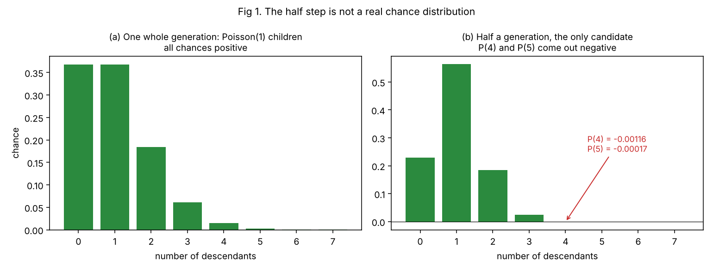
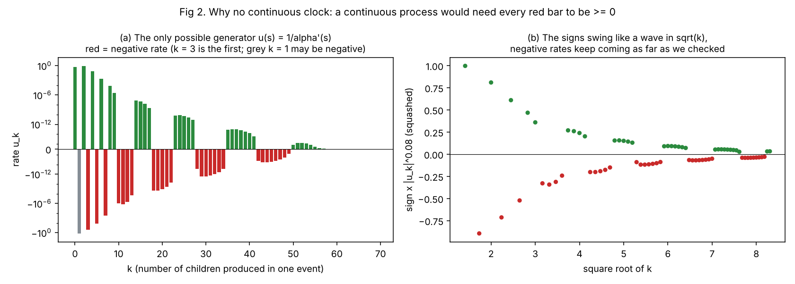
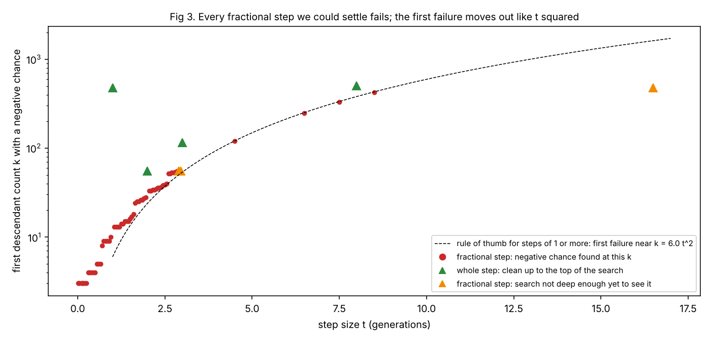
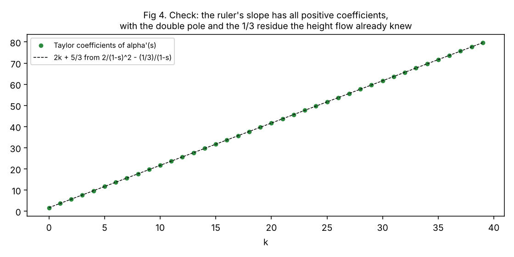

# Fractional steps of the height flow: continuous, rational, or whole only? (DRAFT)

**Result in one sentence:** only whole steps work; the rung step has no continuous-time version and no half,
third or other fractional version that stays a real set of chances.

Status: DRAFT, not reviewed, not published. Picked up from lead R1 in
`../closed-leads-revisit/README.md` ("negative numbers at fractional steps is one known question: embeddability").

## The question in plain words

The height flow's one rung step is the critical Poisson(1) branching process: each individual has a Poisson(1)
number of children. Its generating function is f(s) = e^(s−1); with x = s − 1 it is the rung step
g(x) = e^x − 1. Brennan asked whether this process can be run in **continuous** time (every real step size t),
only in **rational** steps (½, ⅓, ⅔ ...), or only in **whole** steps.

For a branching process this is a named question, *embeddability* (Karlin and McGregor, 1968): a whole-step
process embeds in continuous time exactly when there is a rate function u(s) with u(1) = 0 whose coefficients
are all ≥ 0 except the one for "one child" (k = 1). Those coefficients are the rates of an individual dying
(k = 0) or splitting into k (k ≥ 2).

## Fig 1. Half a generation is not a real distribution

The only half step that composes with itself to give one generation (see "Why there is only one candidate"
below) gives P(0) = 0.2289, P(1) = 0.5641, P(2) = 0.1843, P(3) = 0.0239, then **P(4) = −0.00116** and
P(5) = −0.00017. A chance cannot be negative, so there is no half generation.

## Fig 2. Why there is no continuous clock

The only possible rate function is u(s) = 1/α′(s), where α is the Abel (Fatou) coordinate of the rung step.
Its rates start

| k | 0 | 1 | 2 | 3 | 4 | 5 |
|---|---|---|---|---|---|---|
| u_k | 0.6111 | −1.3694 (allowed) | 0.9515 | **−0.2506** | 0.0704 | −0.0149 |

u₃ = −0.2506 would be a negative rate of splitting into three. That one number settles it: **the critical
Poisson(1) process does not embed in continuous time.** Panel (b) shows the signs keep swinging in waves
spaced evenly in √k, as far out as we computed.

## Fig 3. Which step sizes work: whole ones only

We computed the candidate step F_t for 62 fractional step sizes from 0.01 to 2.95 (among them the unit
fractions 1/2, 1/3, 1/4, 1/6, 1/8, 1/10, 1/20, 1/30 and 1/100), and for the steps 4.5, 6.5, 7.5, 8.5 and 16.5.

- **Every fractional step we could settle has a negative chance.** That includes every rational step tested
  (½, ⅓, ¼, ⅙, ⅛, 1/10, 1/20, 1/30, 1/100, 3/2, 5/2 ...), so the answer to "continuous or just rational" is
  neither.
- **Whole steps stay clean** (steps 1, 2, 3 and 8 as controls, the last checked at 90 digits out to k = 511).
- **The first bad count moves out like t².** For steps of 1 or more, the first negative chance sits near
  k ≈ 6.0 t² (4.5 → 120, 6.5 → 248, 7.5 → 331, 8.5 → 425). So small steps fail at once and big fractional steps
  fail only far out in the tail, at chances around 10⁻⁴⁹.
- Steps 2.9, 2.95 and 16.5 (orange) are not settled: their first failure would sit beyond the depth of the
  search we ran for them, which is what the t² rule predicts.

## Fig 4. Check: the Abel ruler itself is fine

α′(s) has all positive coefficients, matching 2k + 5/3 from its double pole 2/(1 − s)² and the 1/3 residue
the height flow already carries. So the ruler is a clean object; it is only its reciprocal, the rate
function, that goes negative.

## Why there is only one candidate

Any continuous family of steps F_t with F₁ = f has a rate function solving Julia's equation
u(f(s)) = f′(s) u(s). Its solutions are 1/(α′(s) P(α(s))) with P of period 1. Because α maps the disc onto a
region that contains a whole half-plane, a periodic P that stays finite there must be constant. So u = 1/α′ up
to a time rescaling, and F_t = α⁻¹(α + t) is the only flow. (The same argument pins down the half step.)

## What is known and what is ours

**Known.**
- Embeddability and its test on the rate function: Karlin and McGregor (1968); necessary conditions: Grey
  (1975); fractional iterates of generating functions and embedding: Goryainov (1993, 2002).
- The same question for distributions is infinite divisibility, and for Markov chains it is Kingman's
  embedding problem (1962).
- Abel/Fatou coordinates of a parabolic fixed point (Fatou), and the "horn" invariants that measure how far a
  parabolic map is from a time-one flow (Écalle, Voronin).
- e^x − 1 has no fractional iterate that is analytic at its fixed point: the formal half-iterate series has
  zero radius of convergence (Baker; Erdős and Jabotinsky). That is a statement about analyticity at x = 0,
  not about positivity of chances, so it does not answer our question.
- Linear-fractional (Möbius) offspring laws *do* embed. So "critical" alone does not forbid a continuous
  clock; the Poisson shape does.

**Ours (as far as we found; not seen in the sources we read).**
- The verdict for the critical Poisson(1) case: not embeddable, with the explicit witness u₃ = −0.2506.
- No rational step works either: every fractional step tested, including all unit fractions tried, gives a
  negative chance.
- The t² law for where the first negative chance appears (k ≈ 6.0 t²).
- The picture of why (a sketch, not a proof): the horn term of the rung step enters the step F_t with weight
  sin(πt), which vanishes only at whole t; it puts a wave of size about e^(−a√k)·cos(b√k) into the chances,
  and that wave eventually beats the positive main term. We **conjecture** every non-whole step fails, with
  the failure pushed out like t².

## What this means for the theory

- The smooth height-flow equation dx/dt = x²/2 − x³/12 + … is real as an equation for the generating
  function, and our rate function matches it near s = 1. But it is a **shadow**: no actual population follows
  it between generations. The rung ladder is discrete in the probabilistic sense, and that discreteness is
  forced, not a modelling choice.
- This joins six old closures under one name. "Fractional rungs are not counts" (`combinatorics/`), the
  half iterate blocking a fractional power set (`fractional-powerset/`), the Poisson floor going negative
  below height 1 (`fractional-rungs/e-every-height/`), two half steps of (1 + x/n)ⁿ missing at x³
  (`information-theory-full/`), fractional count models giving negative probabilities (`actuarial/`) and the
  backward Kok clock all have the same shape: whole steps are fine, fractional steps leave the set of real
  chances. This folder supplies the theorem-style reason for the branching case.
- The open edge is the conjecture above (every non-whole t fails) and a proof of the t² law; both would go
  through the horn invariant of e^x − 1.

## Checks

- α(f(s)) − α(s) − 1 ≈ 2·10⁻³⁸; F₁ = f to 6·10⁻³⁹; F_½ ∘ F_½ = f to 6·10⁻³⁹.
- Rate function near s = 1 matches x²/2 − x³/12 (the height flow's own beta function); residue 1/3.
- Rate coefficients sum to 0 (u(1) = 0) to 5·10⁻¹⁸.
- Whole-step controls (1, 2, 3, 8) show no negative chance down to each run's noise level; at 90 digits the
  step-8 tail stays smooth and positive below 10⁻⁶⁰, so the negatives at 7.5 and 8.5 (around 10⁻⁴⁹) are real.
- The negatives come in regular blocks (for 8.5: k = 425–438, then 466–492), not scattered like noise.

## Files

- `fatou_series.py`: exact Abel-coordinate series φ(x) = −2/x + ⅓ log(−x) + Σ a_k x^k (a₁ = −1/36, a₂ = 1/540 ...).
- `flow.py`: α, α′, the rate function u and the step F_t by pushing to the fixed point and pulling back.
- `grid.py`, `far.py`, `far2.py`: the step-size scans (outputs `grid_output.*`, `far_output_*.json`,
  `far2_t*.json`).
- `figures.py` → `figures/`.

## Sources

- Karlin, S. and McGregor, J. (1968), embeddability of discrete-time branching processes, Trans. AMS 132:
  https://www.ams.org/journals/tran/1968-132-01/S0002-9947-1968-0222966-1
- Grey, D. R. (1975), two necessary conditions for embeddability of a Galton–Watson branching process,
  Math. Proc. Cambridge Phil. Soc.:
  https://www.cambridge.org/core/journals/mathematical-proceedings-of-the-cambridge-philosophical-society/article/two-necessary-conditions-for-embeddability-of-a-galtonwatson-branching-process/AAB2071E12599440B258A354CE2AC58B
- Goryainov, V. V., Sbornik: Mathematics: https://m.mathnet.ru/eng/sm667 and https://m.mathnet.ru/eng/sm986
- Named from memory, not reopened for this draft: Kingman (1962) on the Markov embedding problem; Baker
  (1958) and Erdős–Jabotinsky (1960) on fractional iterates of e^x − 1; Écalle and Voronin on horn invariants.
