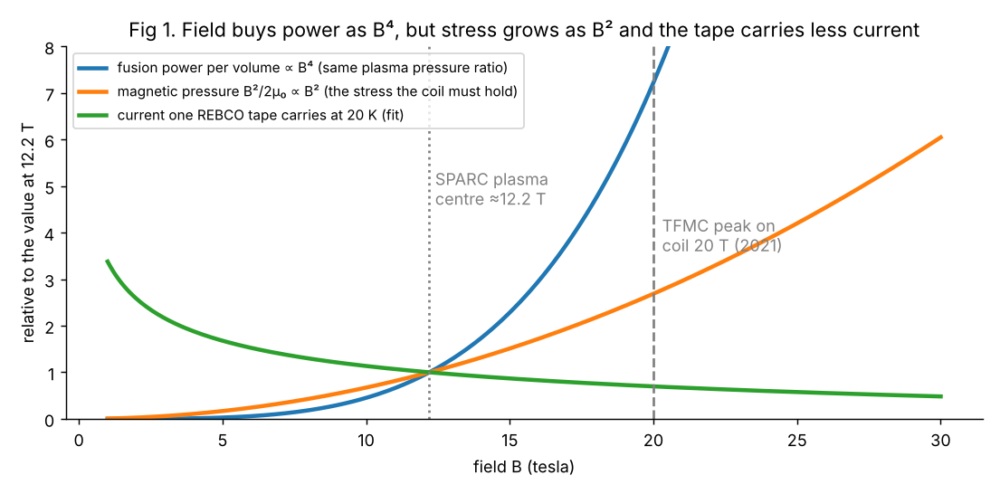
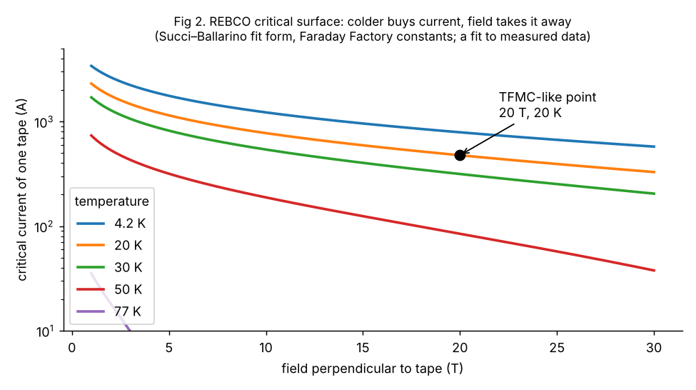
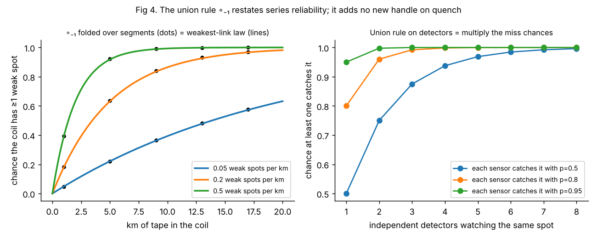
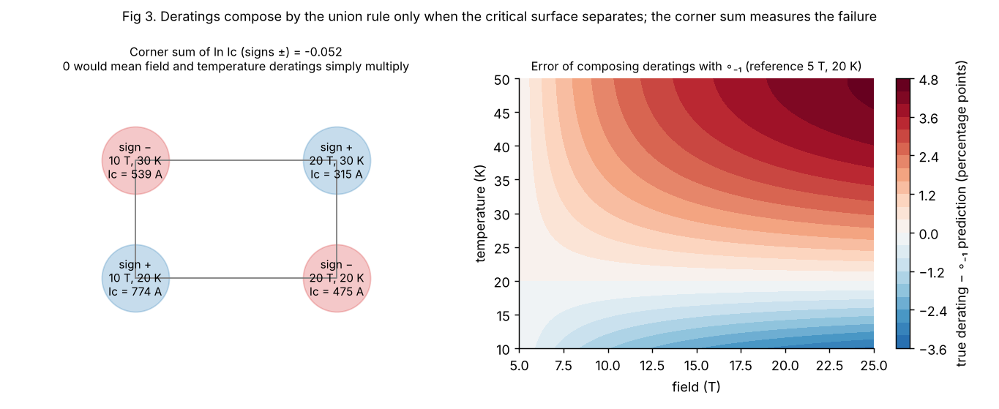
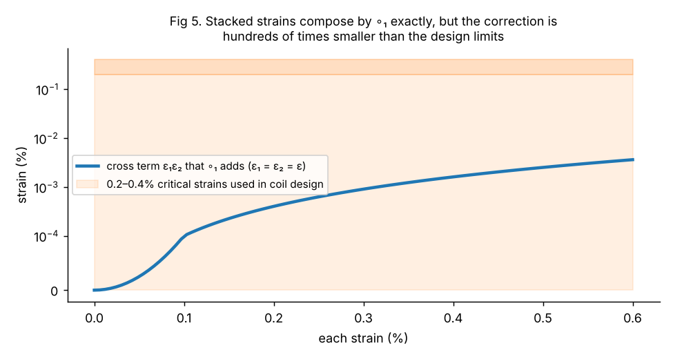
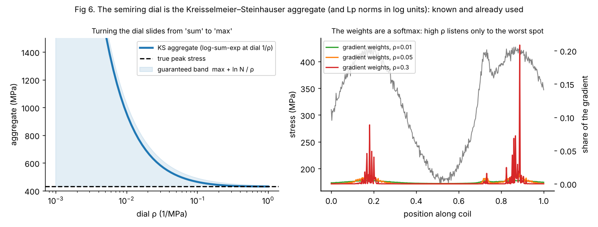
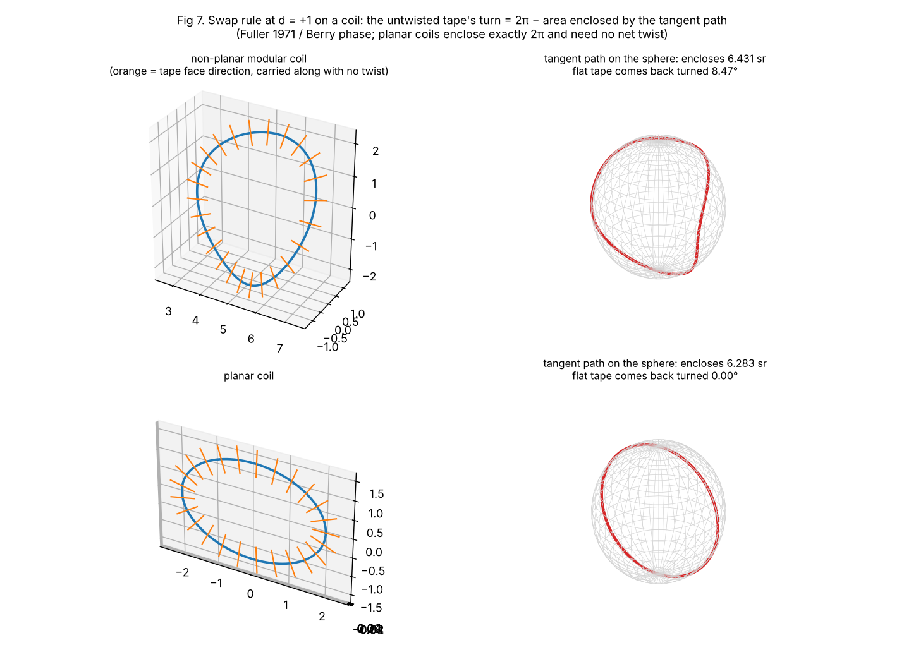
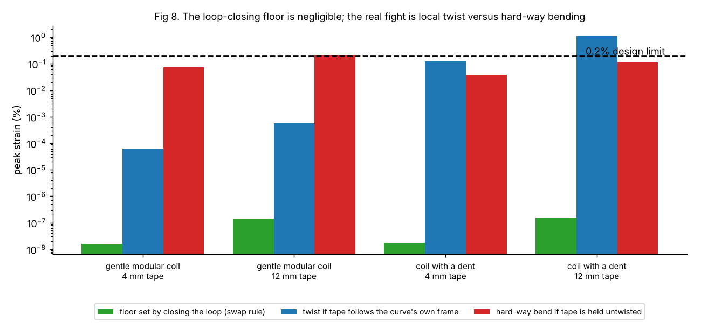
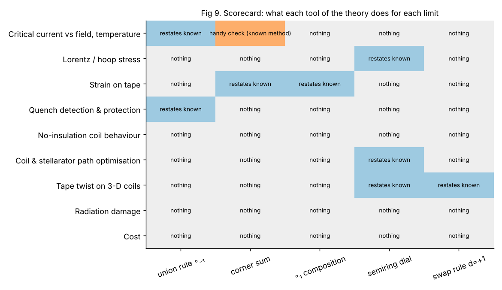

# DRAFT · Stronger fusion magnets: what limits them, and what the theory can do about it

Nov 26, 2026. Asked for by Brennan: "I'd like to look at some more applied mathematics and I, I'm interested in figuring
out how to build uh, magnets that are more strong to help with fusion." Checks: `checks.py` → `checks_output.txt`,
**20/20 pass** (numpy). Pictures: `figures.py` → `figures/`. Shared models: `lib.py`. Marked DRAFT.

## The answer in plain words

**The theory does not give a new way to make fusion magnets stronger.** What stops stronger magnets today is how much
current the superconducting tape carries in a high field, holding the crushing magnetic forces, catching a slow quench
before it burns a spot, neutron damage, and cost. Those are materials and engineering problems, and none of them has
the "compose two things into one" shape the theory is built on. Where the theory's tools do apply, each one lands on
maths engineers already use, and below we give each one its existing name.

Judged on their own merits:

- **One handy check, using a known method.** The cube corner sum, applied to four current measurements, tells you
  whether you can multiply a field derating by a temperature derating (section 3.2). That is a 2×2 factorial
  interaction test (Yates 1937). On a published REBCO fit the error from multiplying runs up to about 4.5 percentage
  points. It is a useful way to set up a derating budget, but it isn't new.
- **One neat restatement with no strain payoff.** The swap rule at d = +1 says exactly how much a tape held flat comes
  back turned after one lap around a 3-D coil (section 3.5). That is Fuller's theorem (1971). The strain floor it sets
  is more than a million times below the design limit, so it doesn't help.
- **Not a lead for stronger magnets.** The union rule, ∘₁ strain composition and the semiring dial restate series
  reliability, multiplying stretches and Kreisselmeier–Steinhauser / Lp aggregation. All three are standard.

## 1. Why field matters, and what pushes back (fundamental, known)

*Fig 1. All curves are normalised to 12.2 T, SPARC's design field at the plasma centre. Blue: at the same ratio of
plasma pressure to magnetic pressure, fusion power per volume grows as B⁴, so doubling the field gives 16×. Orange: the
magnetic pressure the coil has to hold back grows as B², reaching 159 MPa at 20 T (check A1). Green: the current one
REBCO tape can carry at 20 K falls as the field rises (from the fit in Fig 2).*

This one picture sums up the engineering problem: you win as B⁴, but you pay twice, once in force (B²) and once in
tape (less current per tape at higher field, so you need more tape to carry the same amps).

## 2. What limits fusion magnets today (checked against current sources)

*Fig 2. Critical current of one REBCO tape with the field perpendicular to the tape. This uses the Succi–Ballarino fit
form with constants fitted to Faraday Factory tape (arXiv 2411.18124, Table III). It is a fit to measured data, not the
data itself. At 20 K and 20 T it gives 475 A per tape (check C5).*

| Limit | Where things stand (source) |
|---|---|
| **Field milestone** | MIT and CFS's TFMC reached 20 T on Sept 5, 2021, with 110 MJ stored, in a no-insulation, no-twist (NINT) REBCO coil ([CFS](https://cfs.energy/news-and-media/cfs-mit-high-field-magnet-technology/); [arXiv 2308.12301](https://arxiv.org/pdf/2308.12301)). |
| **Critical current vs field, temperature, strain** | Current falls with field and rises steeply on cooling (Fig 2). It also depends on strain, peaking at a middle strain and falling off on both sides, with the shape depending on the tape's twin structure ([Osamura, Machiya, Hampshire](https://durham-repository.worktribe.com/output/1408077/mechanism-for-the-uniaxial-strain-dependence-of-the-critical-current-in-practical-rebco-tapes); [AIP Adv. 2019](https://dro.dur.ac.uk/28738)). The irreversible strain limit varies from tape to tape and with how it is defined ([arXiv 1502.06713](https://arxiv.org/pdf/1502.06713)). |
| **Lorentz / hoop stress** | Magnetic pressure B²/2μ₀ is 159 MPa at 20 T (check A1). The structure, not the superconductor, often sets the size. |
| **Quench** | REBCO normal zones spread slowly, at about 20–60 mm/s in a recent fusion-style cable test, so a spot can get dangerously hot before the voltage shows ([De Stasio et al. 2026 abstract](https://iris.polito.it/handle/11583/3008073)). Fibre-optic sensing is being developed for this ([PMC12694188](https://www.ncbi.nlm.nih.gov/pmc/articles/PMC12694188/)). |
| **No-insulation coils** | They make quenches easier to survive, but an open circuit is their worst case. The TFMC was deliberately not optimised for quench and took localised damage in an intentional open-circuit quench at 31.5 kA ([arXiv 2308.12301](https://arxiv.org/pdf/2308.12301)). |
| **Coil shape (stellarators)** | Tape on 3-D coils is strained by twist and by "hard-way" bending. Optimisers now penalise both, assuming critical strains of 0.2–0.4%, with 0.2% used by EPOS and CSX ([Paul et al., JPP 2025 / arXiv 2409.01925](https://arxiv.org/html/2409.01925v1)). |
| **Radiation** | An in-situ test at 40 K with 14 MeV neutrons found current falling linearly with fluence, starting far below what earlier tests predicted. The damage annealed out at room temperature ([Oxford](https://ora.ox.ac.uk/objects/uuid:b463ec76-d8da-4bd4-b78a-38bfcbee57fb)). Lifetimes may be shorter than projected, and the field is still in flux. |
| **Cost** | Mass-produced REBCO sells for about $15–30 per metre, against industry targets of $50/kA·m near term and $10–20/kA·m long term ([Oct 2025 report](https://www.energy-daily.com/reports/Compact_fusion_boom_propels_PLD_REBCO_tape_production_while_spotlighting_cost_and_stability_hurdles_999.html)). |
| **Schedule** | SPARC's first TF magnets are being installed, with first plasma now projected for 2027 ([SPARC](https://en.wikipedia.org/wiki/SPARC_(tokamak))). |

## 3. Testing the theory's tools, one by one

### 3.1 The union rule ∘₋₁ (known: series reliability, weakest link)

*Fig 4. Left: folding ∘₋₁ over short segments (dots) gives exactly the weakest-link law 1 − e^(−λL) (lines). Right:
with independent detectors, the chance that at least one catches the quench is the ∘₋₁ fold of their individual
chances.*

- The fold of ∘₋₁ over a set of failure chances is 1 − ∏(1 − pᵢ) (check B1). Over fine segments it becomes the
  Poisson weakest-link law (B2). The lift −ln(1 − p) turns it into adding hazards (B3).
- The same rule composes deratings (Fig 3 below): if field costs a fraction δ_B of the current and temperature costs
  δ_T, multiplying the factors gives a total loss of δ_B ∘₋₁ δ_T.
- **Verdict: restates known.** Reliability engineers have used this for decades. It gives no handle on the actual
  quench problem, which is a slow heat front moving through a cable.

### 3.2 The cube corner sum (known: factorial interaction contrast). Handy check.

*Fig 3. Left: take ln(current) at the four corners of a field × temperature square and add them with alternating signs.
A sum of zero means field and temperature deratings simply multiply, and ∘₋₁ composes them exactly. On the fitted
REBCO surface (10→20 T, 20→30 K) the sum is −0.052 (check C2). Right: the error from composing with ∘₋₁ relative to
5 T, 20 K. It reaches about 4.5 percentage points at high field and temperature.*

- The gap between the true derating and the ∘₋₁ prediction is exactly (1 − δ_B)(1 − δ_T)(1 − e^corner) (check C4).
  So the corner sum is the right single number to watch.
- *Known:* this is the 2×2 factorial-design interaction effect (Yates 1937). The reason it is nonzero here is also
  known: the fit's B₀ and B_irr depend on temperature, so the shape of the field curve changes as you cool.
- *Ours:* reading it as "the failure of ∘₋₁ composition", with the exact gap formula above.
- **Verdict: a handy check, but not new.** Four measurements tell you whether a separable scaling law is safe in your
  operating window before you build a derating budget on it.

### 3.3 Composition ∘₁ for stacked strains (known: stretches multiply)

*Fig 5. Cooldown, winding and Lorentz strains stack as stretch ratios, (1 + ε₁)(1 + ε₂) − 1 = ε₁ ∘₁ ε₂ (check D1).
The extra term ε₁ε₂ is about 0.001 percentage points at working strains (D2), hundreds of times smaller than the
tape-to-tape spread in limits.*

**Verdict: restates known, and the correction it adds is negligible.**

### 3.4 The semiring dial (known: Kreisselmeier–Steinhauser aggregation, Lp norms)

*Fig 6. Left: log-sum-exp at dial 1/ρ slides from "sum" to "max", always within max + ln N/ρ (check E1). Right: its
gradient weights are a softmax. At high ρ, only the worst spot along the coil steers the design.*

- Optimisers can't work directly with "peak stress anywhere on the coil" or "worst strain anywhere on the tape",
  because a max has kinks. The fix in structural optimisation is the **Kreisselmeier–Steinhauser function**, which is
  exactly the theory's semiring dial (Maslov dequantization) at a finite setting. Coil codes such as SIMSOPT use
  **Lp norms** for the same job, and an Lp norm is the same dial in log units (check E3).
- Gradually turning the dial up during optimisation, "adaptive KS", is also already published.
- **Verdict: restates known.** The theory gives these tools one name, but they are already in use for exactly this
  purpose.

### 3.5 The swap rule at d = +1 on a coil (known: Fuller's theorem / geometric phase)

*Fig 7. Carry the tape's face direction around the coil without twisting it. After one lap it comes back turned by
2π minus the area the tangent path encloses on the sphere: the theory's swap rule, turn = d × enclosed area, at
d = +1 (checks F1, F2; matches to 3×10⁻¹⁴). A planar coil's tangent path is a great circle enclosing exactly 2π, so the
tape comes back unturned and needs no net twist (F3). That is one reason planar-coil stellarator designs are easier to
wind.*

*Fig 8. Green: the smallest twist strain any winding must have just to close the loop, spread evenly. It is around
10⁻⁷ % (F4). Blue and red: the real trade-off. If the tape follows the curve's own frame, there is no hard-way bend,
but on a coil with a dent the twist spikes to 1.1% with 12 mm tape. Held untwisted, it bends the hard way by about
0.11% instead (F5). The test coils are illustrative shapes, not a real design.*

- *Known:* this is the Călugăreanu–White–Fuller result. The 2025 SIMSOPT strain paper doesn't phrase its "net tape
  rotation" penalty this way, but the geometry is classical.
- *Ours:* placing it as the same swap rule that gave Thomas, Foucault and Berry precession on the precession page.
- **Verdict: a nice restatement, with no practical payoff for strength.** The closing floor is negligible. The real
  strain fight is local, and that is what the optimisers already handle.

### 3.6 Where the theory has nothing

- **Stress.** Fields from different coils add linearly (Biot–Savart). The B² force is a plain square with no
  composition law hiding in it.
- **Quench spread.** This is a nonlinear heat front with current sharing, and no tool here touches it.
- **No-insulation coils.** These are linear circuits with turn-to-turn contact resistance.
- **Radiation and cost.** These are materials science and manufacturing.

## 4. Scorecard

*Fig 9. Orange: a handy check using a known method. Blue: restates known engineering maths. Grey: nothing.*

## 5. Known versus ours

| Item | Status |
|---|---|
| B⁴ power, B² pressure, REBCO critical surface | known |
| ∘₋₁ fold = series reliability, weakest link | known |
| Corner sum = 2×2 factorial interaction (Yates) | known; the exact gap formula for ∘₋₁ composition (check C4) is *ours*, a one-line identity |
| ∘₁ = multiplying stretch ratios | known |
| Semiring dial = KS aggregation; Lp = the dial in log units | known |
| Tape closing turn = 2π − tantrix area (Fuller) | known; reading it as the swap rule at d = +1 is *ours* |
| Test coils, the derating-error map, the twist budget numbers | *ours*, illustrative |

## 6. If you still want to help make magnets stronger

The levers are elsewhere: better pinning in the tape, stronger and cheaper structure, faster quench detection, and
coil-shape optimisation. The last one is open-source software (SIMSOPT), where your software and architecture
background is directly useful. This theory isn't required for any of them.

## Files

`lib.py` (models), `checks.py` → `checks_output.txt`, `results.json` (20/20), `figures.py` → `figures/` (9 pictures),
`figures_output.json`.

## Sources

- [CFS: magnet technology validated](https://cfs.energy/news-and-media/cfs-mit-high-field-magnet-technology/) · [The SPARC TFMC program, arXiv 2308.12301](https://arxiv.org/pdf/2308.12301)
- [Succi–Ballarino fit form used with Faraday Factory constants, arXiv 2411.18124](https://arxiv.org/pdf/2411.18124)
- [Osamura, Machiya, Hampshire: strain dependence of Ic](https://durham-repository.worktribe.com/output/1408077/mechanism-for-the-uniaxial-strain-dependence-of-the-critical-current-in-practical-rebco-tapes) · [twin orientation, AIP Advances 2019](https://dro.dur.ac.uk/28738) · [electromechanical limits, arXiv 1502.06713](https://arxiv.org/pdf/1502.06713)
- [Paul et al., strain optimisation for REBCO stellarator coils in SIMSOPT](https://arxiv.org/html/2409.01925v1)
- [In-situ cryogenic 14 MeV neutron irradiation of REBCO (Oxford)](https://ora.ox.ac.uk/objects/uuid:b463ec76-d8da-4bd4-b78a-38bfcbee57fb)
- [Quench propagation in a REBCO fusion cable (De Stasio et al.)](https://iris.polito.it/handle/11583/3008073) · [phase-OTDR fibre monitoring of HTS magnets](https://www.ncbi.nlm.nih.gov/pmc/articles/PMC12694188/)
- [REBCO production and prices, Oct 2025](https://www.energy-daily.com/reports/Compact_fusion_boom_propels_PLD_REBCO_tape_production_while_spotlighting_cost_and_stability_hurdles_999.html)
- [KS aggregation in stress-constrained topology optimisation (Struct. Multidisc. Optim.)](https://link.springer.com/article/10.1007/s00158-011-0742-8)
- [Dennis & Hannay, Geometry of Călugăreanu's theorem](https://arxiv.org/abs/math-ph/0503012)
- [SPARC status](https://en.wikipedia.org/wiki/SPARC_(tokamak))
