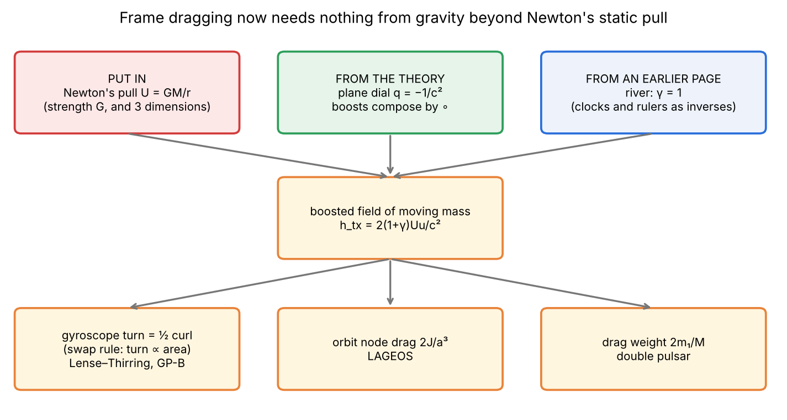
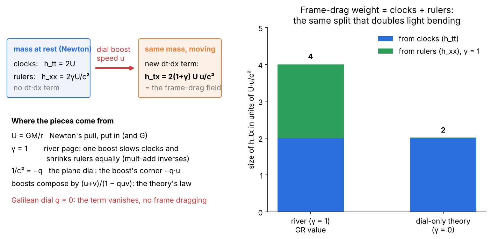
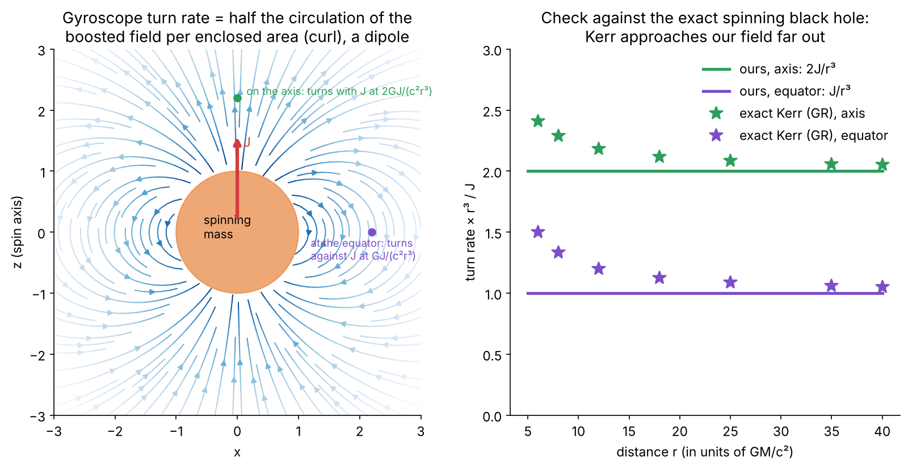
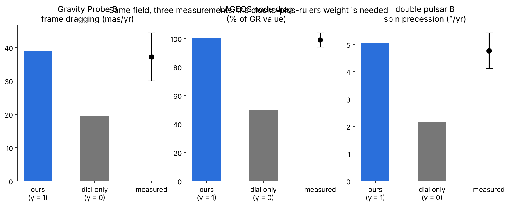
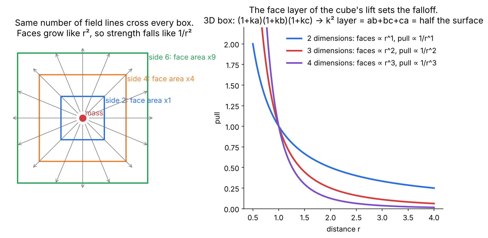
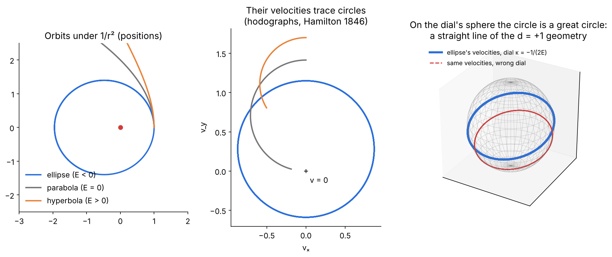
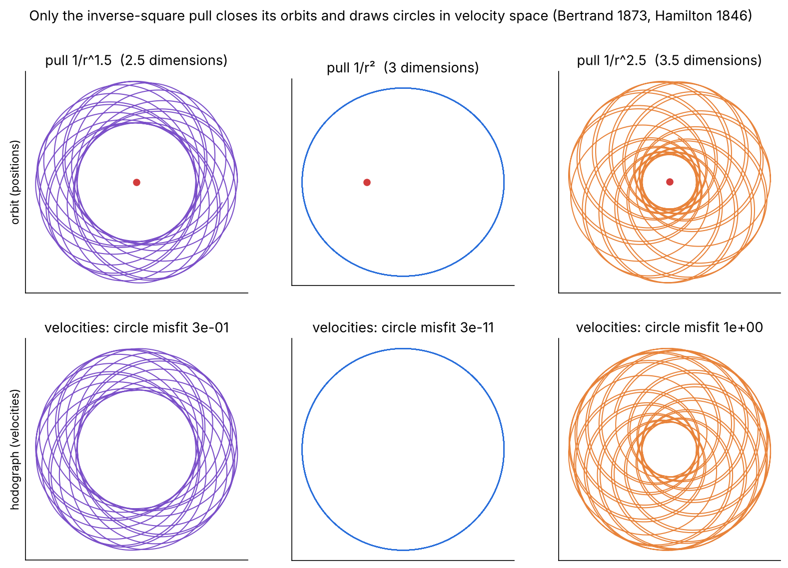

# DRAFT: Gravity from the theory: frame dragging and the inverse-square law (Nov 25, 2026)

Asked by Brennan (voice call): the frame-dragging lead ("Yeah"), and Newton's inverse-square law, "I feel like we
should be able to derive that also from this theory." Also: "I'm kind of wondering if frame dragging might be related
to the speed of light somehow."

## The result in three sentences

Frame dragging now comes out of the theory with nothing from gravity put in except Newton's static pull: boost
Newton's field with the plane dial's boost and a drag term appears, of size 2(1+γ)·U·u/c², whose half-curl is
exactly the Lense–Thirring turn, matching Gravity Probe B, LAGEOS and the double pulsar. And yes, it is tied to the
speed of light: the drag is first order in the dial q = −1/c² and vanishes at the Galilean dial q = 0. The
inverse-square law does **not** come out: the theory restates it (the box's face layer grows like r²) but supplies
neither the three dimensions nor the rule that gravity is a conserved flux; the one real link we found is that 1/r²
is exactly the pull whose orbits' velocities run along straight lines of the dial's geometry, with the dial set by
the orbit's energy.

*Fig 7. What frame dragging now rests on. Red: put in (Newton's U = GM/r, which carries G and the three dimensions).
Green: from the theory (the plane dial and its boost law). Blue: from the general-relativity page (the river gives
γ = 1). Orange: what follows, each checked against data or an exact solution.*

All numbers below are from `checks.py` (**26/26 pass**). Units G = c = 1 unless stated.

---

## Part F. Frame dragging (fundamental first)

### F.1 Boosts compose by the theory's law (fundamental)

The dial boost on (t, x) is t = Γ(t′ − q·u·x′), x = Γ(x′ + u·t′), Γ = 1/√(1 + q u²). Two of them compose to one with
speed (u + v)/(1 − q·u·v) (check F0): the theory's velocity law from the twisted-boosts page. q = −1/c² is special
relativity, q = 0 is Galilean. The boost keeps the dial's interval dt²/q + dx² unchanged (F1b).

### F.2 Boost Newton's field: the drag term appears

*Fig 4. Left: a mass at rest has a clock part (h_tt = 2U) and a ruler part (h_xx = 2γU/c²) and no dt·dx part. Boost
it with the dial boost and a dt·dx part appears: the frame-drag field. Right: its size is clocks + rulers, 2 + 2γ.
With the river's γ = 1 it is 4, the general-relativity value; a dial-only theory (γ = 0) gets 2.*

Exact result (sympy, F1a):

  **h′_tx = −2 Γ² (1 + γ) q U u**

- At q = 0 it is zero (F1c): with an infinite light speed, a moving mass drags nothing.
- With q = −1/c², to first order in u: h′_tx = 2(1 + γ) U u / c² (F1d).
- γ = 1 comes from the general-relativity page's river: one boost through the river slows clocks and shrinks radial
  rulers by circle-operation inverse amounts (the operation was called mult-add before 1.0), the same reason light bends twice the Newtonian amount. So the factor 4 in
  frame dragging is "half from clocks, half from rulers", exactly like light bending.

**Brennan's speed-of-light question.** Yes. Frame dragging is the boost's corner term −q·u acting on Newton's field,
so it scales as |q| = 1/c² and disappears in the Galilean limit. One refinement of the explanation from the call:
the drag around a steadily spinning body doesn't need waves or a propagation delay. It comes from the boost law
itself (Lorentz covariance). A finite invariant speed is exactly what a nonzero dial means, so the two statements
agree in spirit; the theory pins it to the dial.

### F.3 A spinning ball, and the gyroscope's turn

*Fig 5. Left: add up the boosted fields of every moving bit of a spinning ball. The gyroscope turn field is a dipole:
on the axis a gyroscope turns with the spin at 2GJ/(c²r³); at the equator it turns against it at GJ/(c²r³). Right:
check against the exact spinning black hole of general relativity (Kerr, stars): it approaches our lines far out.*

- Superposing the moving mass of a uniform spinning ball gives ∫ρu/|x − x′| = ½ J × x / r³ outside (F2, numeric
  quadrature, errors ≤ 4×10⁻⁴). So h₀ = −(1 + γ) J × x / r³.
- The gyroscope turns at **−½ curl h₀**, which is half the circulation of h₀ per enclosed area (F3b, small loops in
  three orientations). This is the swap rule's shape, turn = density × area, with the density now the swirl of the
  boosted field. With γ = 1: Ω = (3(J·r̂)r̂ − J)/r³ (F3), the Lense–Thirring/Schiff precession.
- Independent checks against general relativity's exact solutions: Kerr's far field g_tφ = −2J sin²θ/r is the same
  field (F4a); the exact static gyroscope in Kerr tends to 2J/r³ on the axis and J/r³ at the equator (F4b, 0.25% off
  at r = 800, closing like 1/r).
- The same "half the swirl per area" rule, weighted by the clock rate, gives the precession page's spinning-BTZ
  result **J/(2(r² − M)) exactly** (F5). So that page's number now has the same origin.
- An orbit in the same field has its node dragged at 2J/a³, prograde (F6, numeric orbit with the force
  −∇Φ + v × curl h₀ taken from the Lagrangian ½v² − Φ + h₀·v; 1.9998×10⁻⁶ vs 2.0000×10⁻⁶).

### F.4 Against data

*Fig 6. Blue: ours (γ = 1). Gray: a dial-only theory (γ = 0). Black: measured.*

| Test | Ours (γ = 1) | γ = 0 | Measured |
|---|---|---|---|
| Gravity Probe B frame dragging | 40.8 mas/yr (vector); 39.1 along the measured axis | 19.5 | 37.2 ± 7.2 (Everitt et al. 2011) |
| LAGEOS node drag | 30.7 mas/yr | 50% of that | 99 ± 5% of 30.7 (Ciufolini & Pavlis 2004; ±10% with systematics) |
| Double pulsar B, total spin precession | 5.07 °/yr | 2.16 °/yr | 4.77 +0.66 −0.65 (Breton et al. 2008) |

The twisted-boosts page's drag weight "2·m₁/M" on the double pulsar is (1 + γ)·m₁/M: the same clocks-plus-rulers
factor (F7d). γ = 0 misses Gravity Probe B by 2.5σ, the double pulsar by 4.0σ and LAGEOS by about 10σ (5σ with its
total error), so the data need the river's γ = 1.

### F.5 What is known, what is ours (frame dragging)

| Piece | Status |
|---|---|
| Gravitomagnetism from boosting the static field, factor 4 from a tensor field | known textbook argument (e.g. Ohanian & Ruffini, *Gravitation and Spacetime*) |
| Lense–Thirring 1918, Schiff 1960 gyroscope precession | known |
| The drag term is first order in the plane dial and vanishes at q = 0 | ours (dial reading of a known fact) |
| Frame-drag weight 4 = clocks 2 + rulers 2, from the river's circle-operation inverse | ours (reading); γ = 1 itself was derived on the GR page from the river postulate |
| BTZ static gyroscope J/(2(r² − M)) from the same half-swirl rule | ours (route); the number is GR |
| "Turn = ½ circulation per area" as the swap rule's shape | ours (framing); the formula is the standard gyroscope rule, checked here, not proved from the algebra |

**Verdict on its merits.** This closes the open edge of the precession page: frame dragging no longer borrows
general relativity's field. It follows from Newton's static pull, the theory's boost law and the river's γ = 1, and
every number matches. It predicts nothing new (it reproduces general relativity's weak field), so it is a real
unification step, not a discovery. Still put in by hand: Newton's U = GM/r (with G) and adding fields linearly
(weak field only). The river postulate itself also contains Newton's escape speed, so G and 1/r enter twice from
the same place.

---

## Part N. The inverse-square law

### N.1 Earlier notes

No earlier page derived 1/r². The general-relativity page put Newton in through the river (v² = 2m/r) and got the
shell theorem from Einstein's equations, not from the operation. The pages under `dark-sector/` fit galaxy data
with Newton assumed.

### N.2 Flux through a growing box: a restatement

*Fig 1. Left: the same field lines cross every box; faces grow like r², so strength falls like 1/r². Right: in n
dimensions the face layer grows like r^(n−1), and so does the falloff.*

- In the lift (1 + ka)(1 + kb)(1 + kc) the k² layer is ab + bc + ca, half the box's surface (N1). In n dimensions
  the face layer of a cube of side r is n·r^(n−1) (N2).
- The 1/r² field's flux through any box around the mass is 4π, whatever its size or where the mass sits; zero for a
  box that misses it (N3).

So "1/r² = one over the cube's face layer" is true and is ours as wording, but it is Gauss's law (1813) in cube
clothing. It holds for **any** conserved flux in 3D (light, electric field, sound energy). The theory adds nothing
here: the dimension 3 and "gravity is a conserved flux" are both put in.

### N.3 The one real link: orbits' velocities run straight in the dial's geometry

*Fig 2. Left: orbits under 1/r². Middle: their velocities trace circles (Hamilton's hodograph). Right: put the
ellipse's velocities on the sphere of the dial κ = −1/(2E) (κ-stereographic chart, the twisted-boosts page's
velocity geometry) and the circle is a great circle, a straight line there. With the wrong dial (red) it is not.*

- Bound orbits (E < 0): velocities land on a great circle of the d = +1 sphere when the dial is κ = −1/(2E) (N4,
  residual 2×10⁻¹²; wrong dial 0.38).
- Escaping orbits (E > 0): velocities land on a straight line of the d = −1 hyperboloid (N5, residual 5×10⁻¹⁵).
- The parabola (E = 0) sits at the flat end, d = 0: a circle through v = 0 (N6).
- The velocity metric that does this (Milnor 1983) is the κ-stereographic chart of the twisted-boosts page with
  κ = −1/(2E) (N9). **So the plane dial is the orbit's energy, sign included.**

*Fig 3. Top: orbits under pulls 1/r^1.5, 1/r², 1/r^2.5 (the flux law in 2.5, 3 and 3.5 dimensions). Bottom: their
velocities. Only 1/r² closes and draws circles.*

- Only the inverse-square pull gives circular hodographs (N7; Hamilton's converse): misfit 3×10⁻¹ and 1.1 for the
  neighbours, 3×10⁻¹¹ for 1/r².
- For the flux law in n dimensions the apsidal angle is π/√(4 − n) (N8): closed orbits only at n = 3 (Bertrand
  1873), stable orbits only for n < 4 (Ehrenfest 1917).

**Status.** All known: Hamilton's hodograph (1846–47), Fock's sphere for the Kepler/hydrogen problem (1935), Moser
(1970), Milnor, "On the geometry of the Kepler problem" (1983). Ours: that this velocity geometry is the plane dial
of the theory, with d = sign(−E).

**Is it a derivation?** Not yet. It is an equivalence: *1/r² ⇔ free orbits move along straight lines of the dial's
velocity geometry.* It would become a derivation if the theory gave a reason that free fall's velocities must
follow dial lines (inertia in velocity space, the way inertia is a straight line in space). We don't have that
reason.

**Follow-up (Nov 26): `velocity-lines/README.md`.** Brennan asked for that reason. Not found inside the operation
alone; instead the rule is stated with the theory's dial addition ((−v₀) ⊕_κ v(t) stays on one line), shown to give
1/r² without assuming three dimensions, to force n = 3 together with Gauss, and to be the same sphere as the
hydrogen atom (Fock 1935). 13/13 checks.

**Follow-up 2 (Nov 26): `river-rebuild/README.md`.** The river model rebuilt on that rule: the river is the rule's
zero-energy family (the dial's flat middle), so Newton's escape speed is now an output; with the theory's local
relativity it is exactly Schwarzschild (γ = β = 1), Mercury 42.98″/century and light bending 1.751″ follow, and rule +
Einstein picks 3 space dimensions. One bridge from the weak-field rule to the exact river remains an input.
19/19 checks.

### N.4 A dead end checked in passing

The union rule ∘₋₁ is the rule for overlapping shadows, which is Le Sage's 1748 "shadow" theory of gravity: it gives
1/r² from solid angle, but overlapping shadows make gravity non-additive and the absorbing flux would heat and slow
bodies (Maxwell 1875, Poincaré 1908); no shielding is seen. Not followed.

### Verdict on each lead, on its own merits

1. **1/r² from cube faces / flux.** A correct restatement with nothing added. Not a lead.
2. **1/r² ⇔ dial-straight velocities, dial = −1/(2E).** Worth following. It is the only place where the theory's own
   geometry singles out the inverse-square law, and the same sphere (Fock 1935) explains the hydrogen atom's
   energy levels, so it sits on a quantum–gravity crossing, which is the North Star's direction. The missing piece is
   a reason for velocities to move on dial lines.
3. **Frame dragging from Newton + the boost dial.** Done: it comes out, with the right numbers, and the 1/c² is the
   dial. Not new physics, but it removes the last precession that needed general relativity as input.

## What's still put in by hand

- Newton's U = GM/r: the strength G and the three dimensions. (Newton's G is the subject of a separate running
  thread.)
- Linear superposition (weak field).
- The river postulate (which also contains Newton's escape speed).

## Files

- `checks.py` → `checks_output.txt`, `results.json`: **26/26 pass** (sympy, numpy, scipy), about 3 minutes.
- `figures.py` → `figures/fig1` to `fig7` (labeled PNGs, read results.json).
- No Lean file this time: this container has no Lean toolchain. Candidates for a later Lean pass: the box lift layer
  (N1, N2), the boosted-field identity h′_tx = −2Γ²(1+γ)qUu as a rational identity (F1a), and the γ = 0 halving.

## Known vs ours (summary)

| Piece | Status | Source |
|---|---|---|
| Face layer of the lift = half the box surface; falloff 1/r^(n−1) | known (Gauss); cube wording ours | N1–N3 |
| Hodographs are circles only for 1/r² | known | Hamilton 1846–47 |
| Velocity geometry of fixed energy has curvature sign −E | known | Fock 1935, Moser 1970, Milnor 1983 |
| That geometry = the theory's plane dial, κ = −1/(2E) | ours (identification) | N4–N6, N9 |
| Closed orbits only at n = 3, stable only n < 4 | known | Bertrand 1873, Ehrenfest 1917 |
| Boosted Newton field gives the drag term, factor 2(1+γ) | known | textbook gravitomagnetism |
| Drag ∝ dial q, zero at q = 0 | ours (reading) | F1 |
| Drag weight = clocks + rulers via the river's γ = 1 | ours (reading) | F1d, GR page |
| Lense–Thirring, node drag, GP-B, LAGEOS, double pulsar numbers | known physics, reproduced | F3–F7 |
| BTZ J/(2(r² − M)) from the half-swirl rule | ours (route) | F5 |
