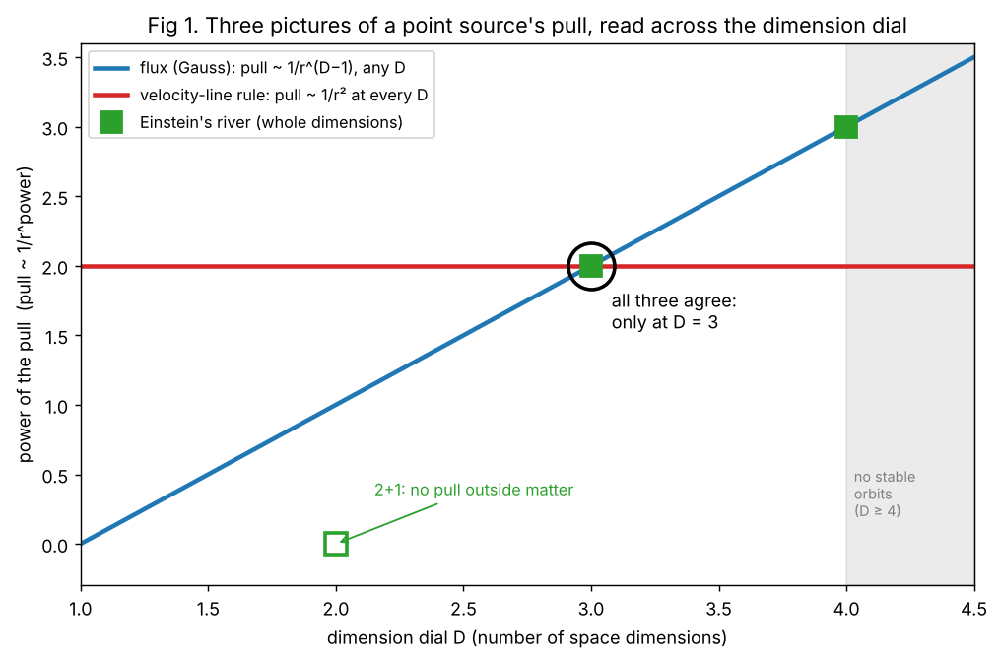
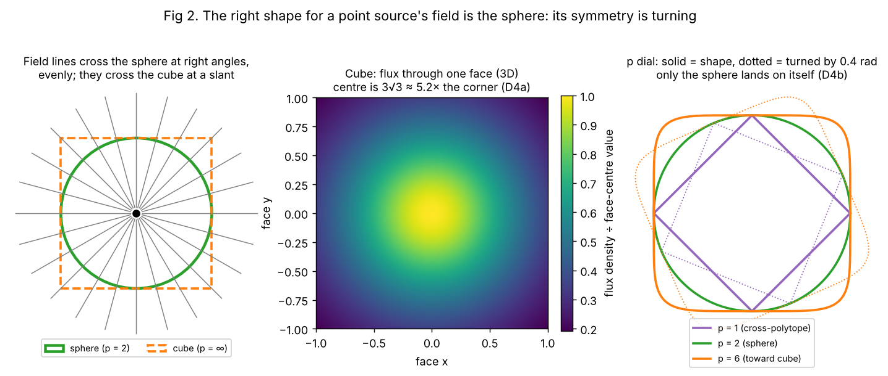
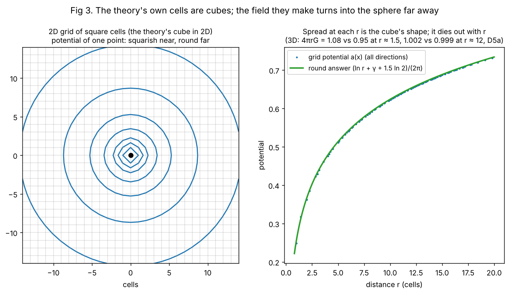
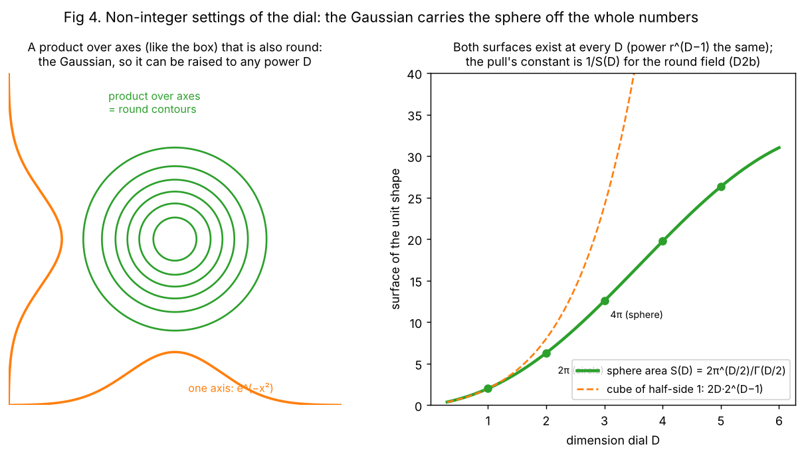
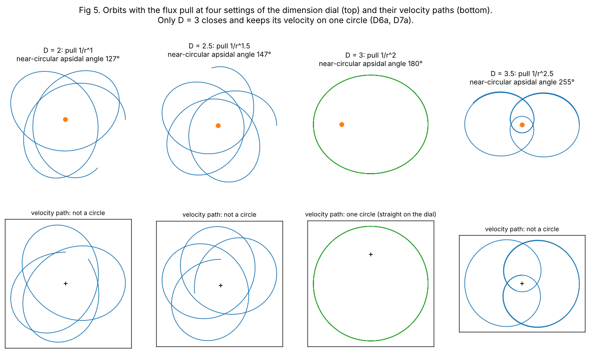
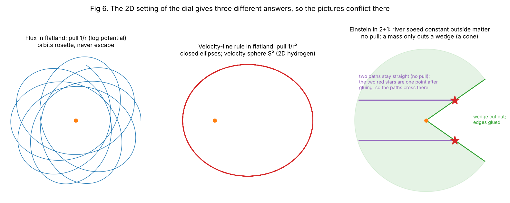
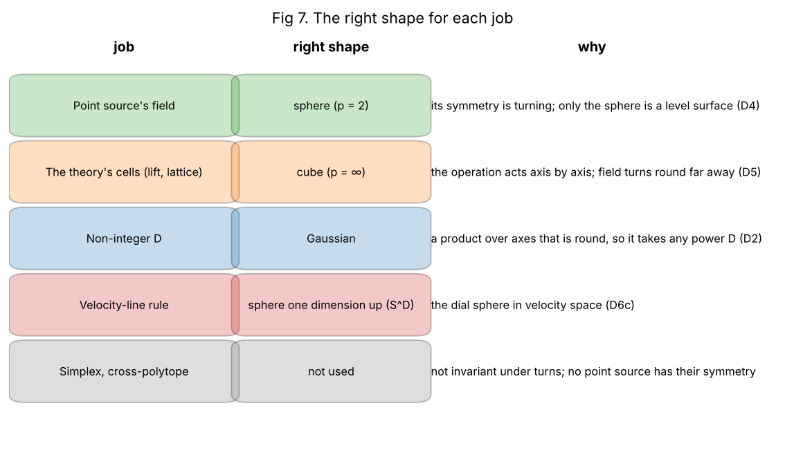

# DRAFT: How the dimension dial sets the power of gravity (Nov 26, 2026)

Asked by Brennan (voice call). He answered "Yes" and then "Yep. Let's take a look at that." when asked whether to
work out if the dimension dial gives inverse square in 3D and 1/r in 2D. He added: "And please use the right shape
for the job."

Follows `../velocity-lines/` (the velocity-line rule) and `../river-rebuild/` (the river built on it).

## The result in plain words

**Yes, the dimension dial gives 1/r² in 3D and 1/r in 2D, but only through the flux picture. The velocity-line rule
doesn't move with the dial: it asks for 1/r² in every dimension. So the two pictures conflict everywhere except
D = 3.** Einstein's equation adds a third answer: it follows the flux picture from 3D up, and in 2D it gives no pull
at all. All three agree at exactly one setting of the dial, D = 3. That is the honest reason "rule + flux" picked
three dimensions on the earlier pages, and it means the rule cannot also give the 2D case.

The right shape for each job: the **sphere** for the field of a point source (its symmetry is turning), the
**cube** for the theory's own cells (where the operation works axis by axis), and the **Gaussian** to carry the
sphere to non-integer settings of the dial (it is a product over axes, like the box, and it is round).

*Fig 1. The power of the pull against the dimension dial D. Blue: flux (Gauss), power D − 1. Red: the velocity-line
rule, power 2 everywhere. Green squares: Einstein's river (whole dimensions only; the open square at D = 2 means no
pull outside matter). All three meet only at D = 3.*

All numbers are from `checks.py` (**19/19 pass**, about 10 seconds).

---

## 1. Flux: the dial's own answer is 1/r^(D−1) (fundamental)

- The theory's box with D sides 1 + a has the lift (1 + a)^D, and its face layer is the coefficient C(D, D − 1) = D,
  for any real D (D1a). That layer is D·a^(D−1) = d/da (a^D): **surface = derivative of volume.** The same holds for
  the sphere, d/dr (V_D r^D) = S_D r^(D−1) (D1b).
- So every shape's surface grows like r^(D−1), and a fixed flux spread over it falls like **1/r^(D−1)**: 1/r² at
  D = 3, 1/r at D = 2. The power does not depend on the shape. Only the constant and the evenness do (section 2).

**Status.** Gauss's law in D dimensions: known. The face layer as the lift's C(D, D − 1) off the integers: ours as
wording (first write-up N1–N3 did the whole-number case).

## 2. The right shape for the field: the sphere

*Fig 2. Left: field lines from a point cross a sphere at right angles and evenly; they cross a cube at a slant.
Middle: flux through one face of a cube around the source; the centre gets 3√3 ≈ 5.2 times the corner (D4a). Right:
the p dial (cross-polytope p = 1, sphere p = 2, toward the cube p → ∞), each turned by 0.4 rad; only the sphere lands
on itself (D4b).*

- A point source looks the same from every direction, so its field's level surfaces must survive every turn. On the
  polar-coordinates page's p dial, only p = 2 does (D4b, deviation 2×10⁻¹⁶ vs 0.07 to 0.25 for the others).
- A cube around the source still catches all of the flux (6 faces × face = 1.000000000000), but unevenly (D4a). So
  the cube gives the right power and the wrong picture.
- The simplex and the cross-polytope are not used: no point source has their symmetry.

**Status.** Known. Choosing it on the theory's p dial is ours.

## 3. The theory's cells are cubes, and their field turns round

*Fig 3. Left: a grid of square cells (the cube in 2D) with one point source; the potential's contours are diamonds
near the source and circles far away. Right: the grid potential in every direction against the round answer.*

- The operation works axis by axis, so its natural cells are cubes. On a grid of cubes (D = 3) the source's
  potential times 4πr is 1.08 along an axis and 0.95 along a diagonal at r ≈ 1.5, and 1.002 vs 0.999 at r ≈ 12
  (D5a). The cube's shape dies out and the sphere takes over.
- On a 2D grid the potential grows like (ln r + γ + 1.5 ln 2)/(2π), to 4 decimal places at r = 20 (D5b). So the
  pull is 1/(2πr): the theory's own 2D cells give 1/r.

**Status.** Lattice Green's functions are known (Watson 1939; the 2D constant is McCrea and Whipple 1940). Reading
the grid as the theory's cube cells is ours.

## 4. Non-integer settings: the Gaussian carries the sphere

*Fig 4. Left: one axis's bell curve, multiplied over axes, has round contours. Right: the unit sphere's surface S(D)
and the cube's, at every D.*

- The Gaussian is the one function that is both a product over axes (like the box) and round (Maxwell's
  characterization). Raise one axis's heat kernel to the D-th power and integrate over time: the potential is
  Γ(D/2 − 1)/(4π^(D/2) r^(D−2)) and the pull is **1/(S_D r^(D−1))**, S_D = 2π^(D/2)/Γ(D/2), for every D (D2a, D2b,
  D2c).
- The pull is smooth through D = 2 and equals 1/(2πr) there (D3a). The potential has a pole at D = 2, and what is
  left is −ln(r)/(2π) (D3b). So the log in flatland is where the r^(2−D) family passes through zero.
- Below D = 2 the potential grows with distance. At D = 1 the pull is constant.

**Status.** Known: this is how dimensional regularization continues to non-integer D ('t Hooft and Veltman 1972).
Ours: the Gaussian as "the box's power that is also round", which is why the dimension dial can be slid smoothly.

## 5. The velocity rule does not move with the dial

*Fig 5. Top: orbits under the flux pull at D = 2, 2.5, 3, 3.5. Bottom: their velocity paths. Only D = 3 closes, and
only D = 3 keeps the velocity on one circle.*

- With the flux pull 1/r^(D−1), the velocity path is a circle (a straight line in the dial geometry) only at D = 3.
  The misfit is 7×10⁻¹² at D = 3 and 0.35 to 0.77 elsewhere (D6a).
- Near-circular orbits turn by π/√(4 − D) between closest and farthest points (D7a, to 5×10⁻⁴). At D = 3 that is
  180°, so the ellipse closes. At D = 4 it blows up: no stable orbits from four space dimensions up (D7b).
- The rule itself is the same in every dimension: it wants 1/r², because a 1/r² orbit stays in a plane. Its dial
  sphere is one dimension up from the space, S^D. The level counts are 2l + 1 in 2D and (l + 1)² in 3D (D6c).

**Status.** Known: π/√(4 − D) (Newton, *Principia* I, Prop. 45), Ehrenfest 1917, 2D hydrogen (Zaslow and Zandler
1967), Fock 1935. Ours: reading them across the dimension dial.

## 6. Flatland: three different answers

*Fig 6. D = 2. Left: the flux pull 1/r; orbits make rosettes and never escape. Middle: the velocity rule's 1/r²;
closed ellipses, with velocity sphere S². Right: Einstein in 2+1; a mass only cuts a wedge out of space; paths stay
straight and cross where the wedge's edges are glued (red stars).*

- Flux: pull 1/r (D5b, D3a).
- Velocity rule: pull 1/r², closed ellipses (D6b).
- Einstein: the general river has Gᵗₜ = −(D − 1)/(2r^(D−1)) · (r^(D−2) v²)′ for D = 2, 3, 4 (D8b). At D = 2 empty
  space needs a constant river speed, so there is no pull outside matter (D8a). A mass only makes a cone.

So **the dial does not give the 2D case from the same rule.** In 2D the three pictures give three answers. In 3D they
give one (D9).

**Status.** Known: 2+1 gravity has no pull outside matter (Deser, Jackiw and 't Hooft 1984). The three-way table on
the dimension dial is ours.

---

## 7. The right shape for each job

*Fig 7. Which shape fits which part of the problem, and why.*

| Job | Shape | Why |
|---|---|---|
| Field of a point source | sphere (p = 2) | its symmetry is turning; only the sphere survives every turn (D4) |
| The theory's cells (lift, lattice) | cube (p = ∞) | the operation acts axis by axis; far away the field turns round (D5) |
| Non-integer D | Gaussian | a product over axes that is round, so it can be raised to any power D (D2) |
| Velocity-line rule | sphere one dimension up, S^D | the dial sphere in velocity space (D6c) |
| Simplex, cross-polytope | not used | no point source has their symmetry |

## Verdict, on its own merits

- **Does the dial give 1/r² in 3D and 1/r in 2D?** Yes, from flux, and smoothly in between: pull
  1/(S_D r^(D−1)), with the log potential exactly at D = 2.
- **From the same rule?** No. The velocity-line rule wants 1/r² at every D, so it conflicts with the dial everywhere
  except D = 3. Einstein's equation agrees with flux from D = 3 up and gives no pull at D = 2.
- **Is it worth following? Yes, in one narrow way.** "All three pictures agree only at D = 3" is a clean way to say
  why space has three dimensions in this theory: three independent pictures, one meeting point. The pieces are
  known; putting them on one dial is ours. It doesn't give a new prediction.
- **A choice it exposes.** If 2D gravity matters to the theory, we must pick which picture to trust there. The flux
  picture is the one the dimension dial supports. The velocity rule only holds at D = 3.

## Files

- `checks.py` → `checks_output.txt`, `results.json`: **19/19 pass** (sympy, numpy, scipy).
- `figures.py` → `figures/fig1` to `fig7` (labeled PNGs).
- `grtools.py`: copied from the general-relativity page.
- No Lean file: no Lean toolchain in this container. Lean candidate: C(D, D − 1) = D as a ring identity for whole D.

## Known vs ours

| Piece | Status | Source |
|---|---|---|
| Gauss's law in D dimensions; pull 1/(S_D r^(D−1)) | known | Gauss 1813; any D: dimensional regularization, 't Hooft and Veltman 1972 |
| Log potential at D = 2 as the pole of r^(2−D) | known | (same) |
| Lattice Green's functions, cube near and round far; 2D constant | known | Watson 1939; McCrea and Whipple 1940 |
| Gaussian = only round product function | known | Maxwell 1860 (Herschel's argument) |
| Apsidal angle π/√(4 − D) for power laws; no stable orbits for D ≥ 4 | known | Newton, *Principia* I, Prop. 45; Ehrenfest 1917 |
| 2D hydrogen (S², 2l + 1 levels) | known | Zaslow and Zandler 1967 |
| 2+1 gravity: no pull outside matter, cones | known | Deser, Jackiw and 't Hooft 1984 |
| Face layer C(D, D − 1) = D of the lift off the integers | ours (wording) | D1a |
| Sphere chosen on the theory's p dial; cube for the theory's cells; Gaussian as the box's round power | ours (reading) | D2, D4, D5 |
| Flux, velocity rule and Einstein meet only at D = 3 on the dimension dial | ours (framing; pieces known) | D9 |
