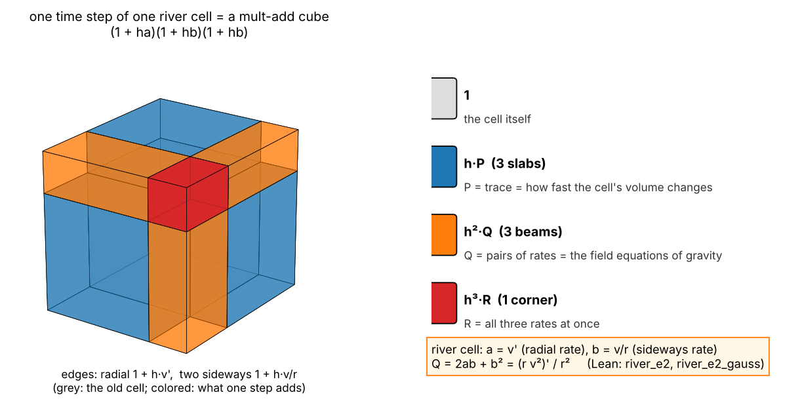
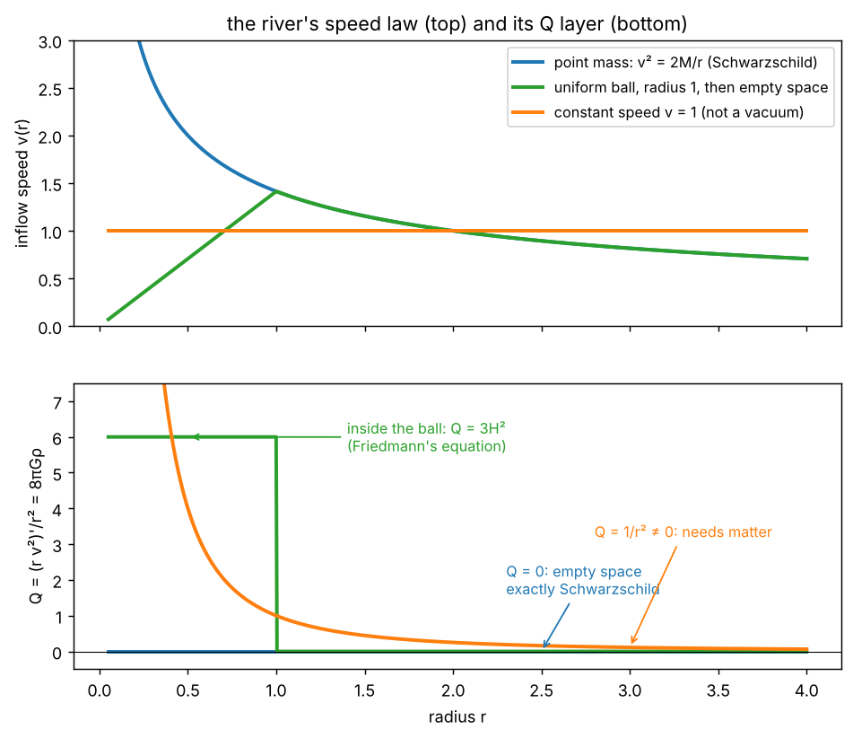
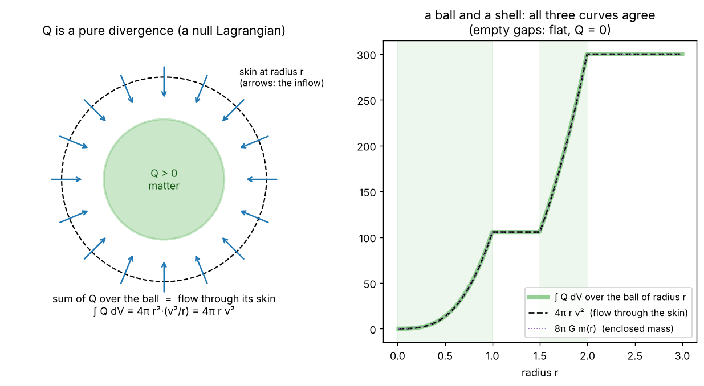
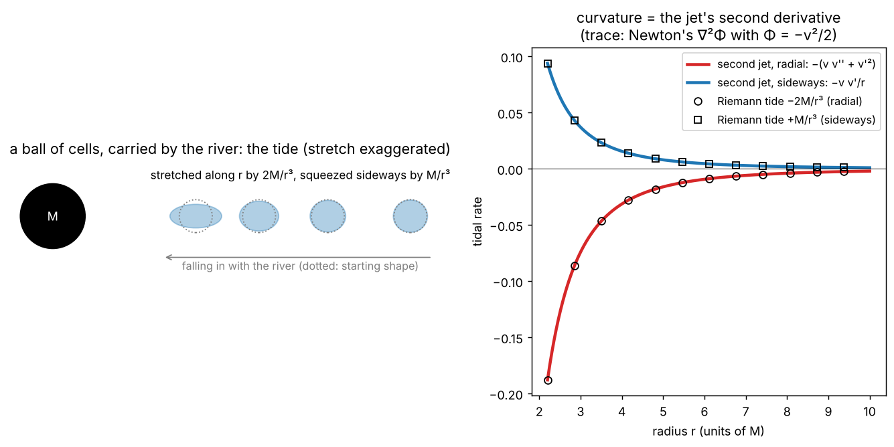
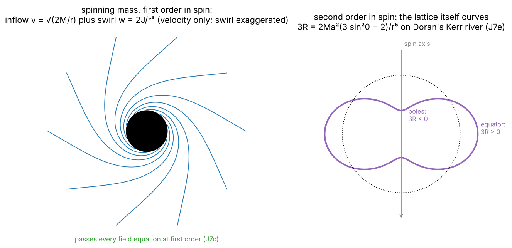
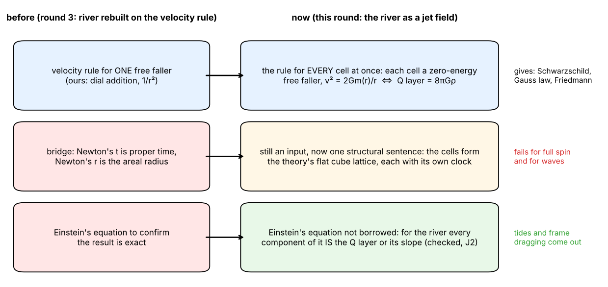

# DRAFT: The river as a jet field (Nov 26, 2026)

> **Names:** some words or symbols on this page (twist) also mean something else in standard math, physics or computing, or inside this project. [NAMING-COLLISIONS.md](../../../NAMING-COLLISIONS.md) says which meaning is in play.

Asked by Brennan (voice call): "it's this idea of a number being represented by multiple dimensions and so that
could mean all the different i think of the jet is kind of what we talked about as well maybe", and "there's just
more structure to it i think than just velocity ... not just the first derivative".

Follows `../river-rebuild/` (the river built on the velocity-line rule) and `../dimension-dial/`. Uses the jet
layers from `../../jet-fields/`.

## The result in plain words

**Yes: once each cell of the river carries its jet (its velocity and how that velocity changes), the velocity rule
applied to every cell at once gives exact Schwarzschild without borrowing Einstein's equation.** For the river, every
component of Einstein's equation turns out to be one layer of the theory's own cube, the second layer Q of the cell's
one-step box, or the slope of that layer. Setting "every cell is a zero-energy free faller" is the same as Q = 8πGρ,
and in empty space that is Q = 0, which is exactly Schwarzschild.

The jet's next layer, the second derivative, comes out as the tide (spacetime curvature), and its trace is Newton's
Poisson equation, exactly. A spinning mass also works to first order in spin with velocity alone: inflow plus a
swirl 2J/r³, which is frame dragging.

Two honest limits. First, one input is still there: the cells form the theory's flat cube lattice and each keeps its
own clock. That replaces the earlier "proper time and areal radius" bridge with one structural sentence, but it is
still an assumption. Second, that flat lattice fails at second order in spin: the full Kerr black hole needs cells
that carry a rotation as well as a velocity, and a lattice that curves. That is the "more structure than velocity"
Brennan described, and it shows up exactly there.

The law itself, Q = 8πGρ, is known: it is Einstein's energy constraint (Arnowitt, Deser and Misner, 1959) written
in river variables. What is ours is reading it as the cube's second layer of the river's jet, and the checks that
this one layer carries every field equation of the river.

*Fig 1. One time step of one river cell is a circle-operation cube (1 + ha)(1 + hb)(1 + hb), with a = v' the radial
stretch rate and b = v/r the sideways rate. The pieces sort into layers: three slabs (P, the volume rate), three beams
(Q, the pairs of rates) and one corner (R). The beams are gravity's field equations for the river.*

All numbers are from `checks.py` (**19/19 pass**, about 15 seconds).

---

## 1. The jet of a flowing cell (fundamental)

A cell in a flow is carried along by the velocity u, and it is also stretched and turned by the velocity's slope,
the gradient S = ∇u. The jet-fields page writes one step of length h as the map x ↦ x + h·u(x). Its volume change is

> det(I + hS) = 1 + h·P + h²·Q + h³·R  (Lean: `det_one_add_smul`, already in the library)

with P the trace, Q the sum of the three 2×2 corner minors, and R the determinant. In principal axes these are the
layers of the circle-operation cube of the three stretch rates. That is the "number represented by multiple dimensions":
the cell's state is not one velocity but the whole jet (u, S, ∇S, ...), and the cube organizes it into layers.

For the river falling into a star at speed v(r), the gradient has one radial rate and two equal sideways rates:

| layer | river cell (inflow) | meaning |
|---|---|---|
| P | −(v' + 2v/r) | how fast the cell's volume changes |
| Q | 2v'·v/r + v²/r² = (r v²)'/r² | pairs of rates |
| R | −v²v'/r² | all three at once |

(J1. Q is the same for inflow and outflow, since it is quadratic: Lean `river_e2_neg`.)

## 2. Every field equation of the river is the Q layer

Take the river spacetime of `../river-rebuild/`: flat space, cells moving inward at v(r), each cell's clock ticking
its own time. Compute Einstein's tensor for any v(r), with no field equation assumed. Every component is the Q layer
or its slope:

| Einstein component | value |
|---|---|
| G^t_t (energy density) | −Q |
| G^r_r (radial) | −Q |
| G^θ_θ = G^φ_φ (sideways) | −(r²Q)'/(2r) |
| all off-diagonal | 0 |

(J2a–J2d.) So **empty space is exactly Q = 0**. Nothing else is left to impose. Q = 0 means (r v²)' = 0, so
r v² is a constant, 2GM, which is the Schwarzschild river (J4b; Lean `river_e2_gauss`, `vacuum_e2`).

*Fig 2. Top: three speed laws. Bottom: their Q layer. The point mass has Q = 0 everywhere outside the center: exactly
Schwarzschild. A uniform ball has Q = 3H² inside (Friedmann's equation) and Q = 0 outside. A constant speed has
Q = 1/r², so it needs matter spread through space.*

## 3. The Q layer is a pure divergence, so Gauss's law is exact

The jet-fields page found that Q is a null Lagrangian. For any 3D flow, Q(∇u) = div F with
F = (u·(div u) − (u·∇)u)/2 (J3a, symbolic, for an arbitrary field). So summing Q over a ball gives only what flows
through its skin:

> ∫_ball Q dV = 4π r² · F_r = 4π r v²  (J3b)

With Q = 8πGρ this is r v² = 2G·m(r), the river speed set by the enclosed mass, with no approximation. Matter
outside the ball does nothing to the inflow inside, the shell theorem, here as a fact about the cube's second
layer.

*Fig 3. Left: the sum of Q over a ball equals the flow through its skin. Right: a ball and a shell of matter. The
running sum of Q (green), the flow 4π r v² (dashed) and 8πG m(r) (dotted) lie on top of each other, and Q = 0 in the
empty gaps.*

## 4. The velocity rule for every cell at once

The velocity-line rule says a free faller from rest far away has zero energy: v²/2 = Gm/r. Apply it to every cell,
each with the mass inside it: v² = 2G·m(r)/r. Then

> Q = 2G·m'(r)/r² = 8πGρ  (J4a, using m' = 4πr²ρ)

so "every cell is a zero-energy free faller" and "the cube's second layer equals 8πGρ" are the same statement. Two
cases:

- **Empty space**: ρ = 0, Q = 0, exactly Schwarzschild (J4b).
- **A uniform ball**: v = Hr, every rate equal, Q = 3H² = 8πGρ, which is Friedmann's equation for a collapsing
  dust ball (J4c; Lean `friedmann_e2`). Glued to the outside, this is the Oppenheimer–Snyder collapse (known, 1939).

In empty space the enclosed mass cannot change in time: a river with v² = 2m(t)/r breaks the field equations by an
amount proportional to dm/dt (J5). That is Birkhoff's theorem (known), here read off the Q layer.

The "8πG" is not borrowed. It is Newton's G times the 4π of the sphere's area and the 2 of v²/2.

## 5. The second derivative of the jet is the tide

A cell's first jet is its gradient S. Following the cell, the rate at which S changes, plus S², is how neighboring
cells drift apart: the tide. Computing the spacetime curvature (Riemann) of the river for any v(r) gives exactly

> R(e, u, e, u) = −(DS/Dt + S²)  along the radial and sideways directions (J6a)

| direction | second jet | Schwarzschild |
|---|---|---|
| radial | −(v v'' + v'²) | −2M/r³ (stretched) |
| sideways | −v v'/r | +M/r³ (squeezed) |

The trace is −∇²(v²/2). With Φ = −v²/2 this is ∇²Φ, Newton's Poisson equation, exact for the river (J6b, J6c).

*Fig 4. Left: a ball of cells carried in by the river is stretched along r and squeezed sideways (exaggerated).
Right: the second jet (curves) and the curvature computed from the metric (markers) agree at every radius.*

This answers "not just the first derivative": the velocity is the jet's first entry, its gradient carries the field
equations (the Q layer), and its second derivative is the curvature.

## 6. Spin: velocity is enough at first order, not beyond

The Q layer's gradient is dQ/dS = (tr S)I − S (J7a; Lean `e2_addSmul`). The matching vector law is the momentum
constraint, div((tr S)I − S) = 0. Give the cells a swirl w(r) as well as the inflow. The vector law becomes
(r⁴w')' = 0, so **w = 2J/r³** (J7b), the Lense–Thirring frame-dragging rate (known).

- **First order in spin:** inflow √(2M/r) plus swirl 2J/r³ passes every field equation (J7c). Frame dragging is a
  velocity field. The extra "twist" term in Doran's Kerr river also passes, but at this order it is only a
  relabeling of the angle φ → φ + h(r) (J7d).
- **Second order in spin:** the flat lattice fails. Doran's Kerr river has slices that are flat at first order and
  curved at second, with scalar curvature 3R = 2Ma²(3 sin²θ − 2)/r⁵ (J7e). It is not just Doran's choice: no
  slicing of Kerr is even conformally flat (Garat & Price, 2000, known).

*Fig 5. Left: river lines around a spinning mass at first order (swirl exaggerated): inflow plus swirl, velocity
only, and every field equation holds. Right: at second order the lattice itself curves, positive at the equator
and negative at the poles.*

So full spin needs more than a velocity per cell. Hamilton and Lisle (2008, known) showed the Kerr river works if
each cell carries a Lorentz transformation, a boost plus a rotation, instead of a velocity alone. In the theory's
terms that is the dial family per cell: the cell carries its velocity and its own turning, and the lattice is
allowed to curve. Gravitational waves need the same extra structure, since a wave is a ripple in the lattice
itself.

**Update (Nov 26, `../spinning-river/`):** the turn was added and full Kerr comes out exactly. The lattice the cells
move through stays flat (in oblate spheroidal coordinates); only the cells' own slices curve. So the limit above is
about velocity alone, not about the flat lattice.

## 7. What went in, what came out

*Fig 6. Before: the velocity rule for one faller, a bridge reading Newton's t as proper time and r as areal radius,
and Einstein's equation to confirm. Now: the rule for every cell (Q = 8πGρ), one structural sentence (flat cube
lattice, own clocks), and Einstein's equation is not borrowed because every component of it is the Q layer.*

Count of Einstein's ten equations: the Q law is one of them (the energy constraint) and the vector law is three
more (the momentum constraints). For the spherical river and for slow spin those four carry everything, because
the flat lattice and own clocks fix the rest. For full spin and for waves they don't, and the lattice has to bend.

## Verdict, on its own merits

- **Holds:** for empty space around a star and for slow spin, the jet picture makes Einstein's equation
  unnecessary as an input: the field equations of the river are the cube's second layer of its jet. With matter,
  the same layer gives the energy law Q = 8πGρ, Gauss's law exactly (the layer is a pure divergence) and Friedmann's
  equation for a uniform ball. Curvature is the jet's second derivative. (General collapsing dust is the known
  Lemaître–Tolman–Bondi family; it was not re-derived here.)
- **Partly:** the old bridge is not gone. It is now one sentence about structure (flat cube lattice, own clocks),
  which is cleaner but still assumed.
- **Fails, and says why:** full Kerr and gravitational waves. Each cell then needs a rotation as well as a velocity,
  and the lattice must curve. That matches "more structure than velocity" and points to where to look next.
- **Known, not ours:** Q = 8πGρ is Einstein's energy constraint in Painlevé–Gullstrand variables (ADM 1959). The
  river itself (Painlevé 1921, Gullstrand 1922; Hamilton & Lisle 2008), Lense–Thirring (1918), Birkhoff (1923),
  Friedmann (1922), Oppenheimer–Snyder (1939), Garat–Price (2000), Doran's Kerr form (2000), and null Lagrangians are
  all known.

## Files

- `checks.py`: 19 symbolic checks (J1–J7), writes `checks_output.txt` and `results.json`.
- `lintools.py`: fast first-order Einstein tensor, used for the spin checks.
- `grtools.py`: the general-relativity helper shared with the earlier pages.
- `figures.py`: the six figures in `figures/`.
- `lean/JetRiver.lean`: the layer identities (`river_e2`, `river_e2_neg`, `river_e2_gauss`, `vacuum_e2`,
  `friedmann_e2`, `e2_addSmul`). Written without a Lean toolchain, so not yet compiled; it builds on
  `FusedAlgebra.Topics.JetFields`.

## Known vs ours

| piece | status |
|---|---|
| det(I + hS) = 1 + hP + h²Q + h³R, Q a null Lagrangian | known (classical); in the library from `jet-fields` |
| River (Painlevé–Gullstrand) metric, Schwarzschild as v² = 2M/r | known |
| Q = 8πGρ as Einstein's energy constraint | known (ADM 1959, in these variables) |
| Every Einstein component of the river is Q or −(r²Q)'/(2r) | known in substance; **ours** as the statement "the field equations are the cube's second layer" |
| Gauss law r v² = 2Gm(r) from Q = div F | **ours** as a reading of the null Lagrangian; the result (shell theorem) is known |
| "Every cell a zero-energy faller" ⇔ Q = 8πGρ | **ours** as the bridge from the velocity rule |
| Tide = second jet, trace = Poisson for Φ = −v²/2 | known in the river literature; **ours** as the jet's second layer |
| Swirl 2J/r³ passes at first order; Doran's twist is a relabeling there | known physics; **ours** as the check |
| Kerr slices curved at second order, 3R = 2Ma²(3 sin²θ − 2)/r⁵ | computed here; the no-flat-slice theorem is known (Garat–Price 2000) |
