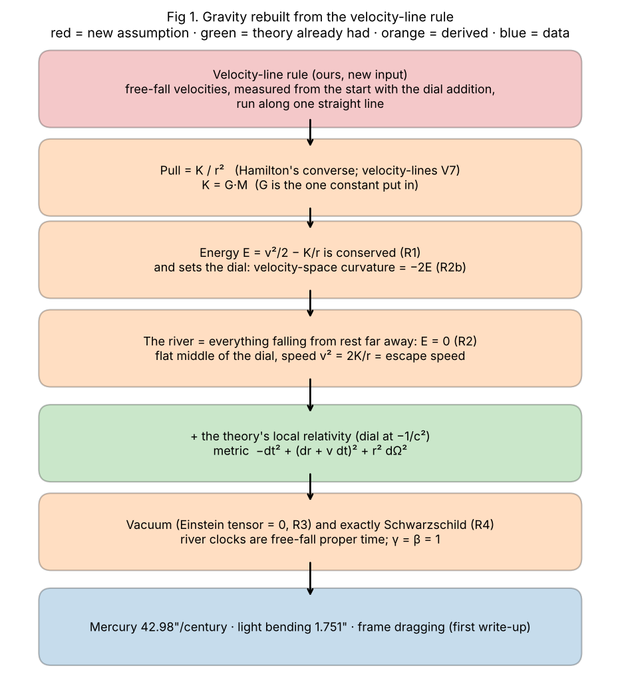
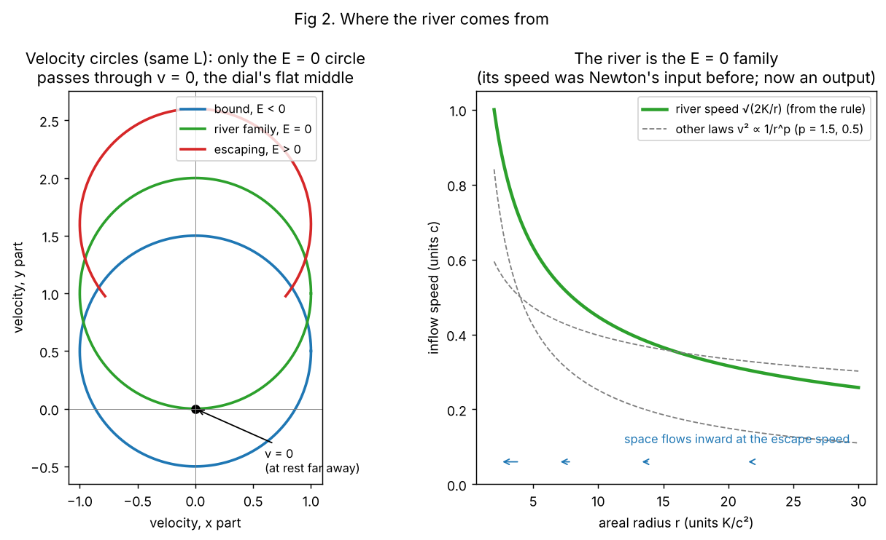
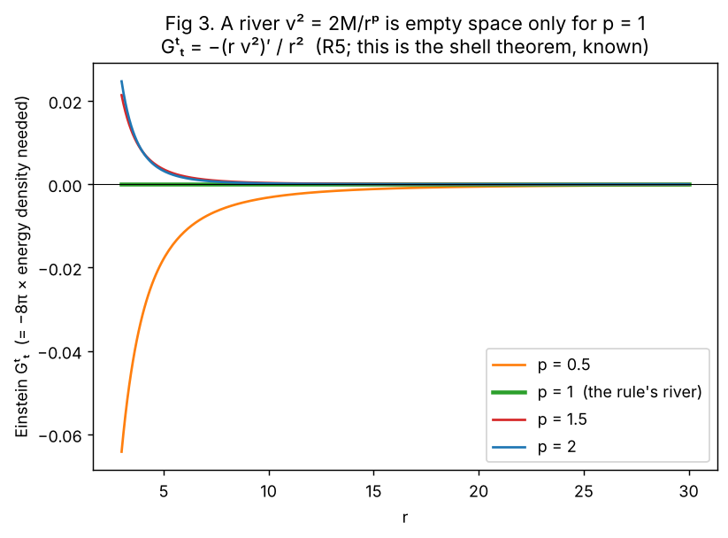
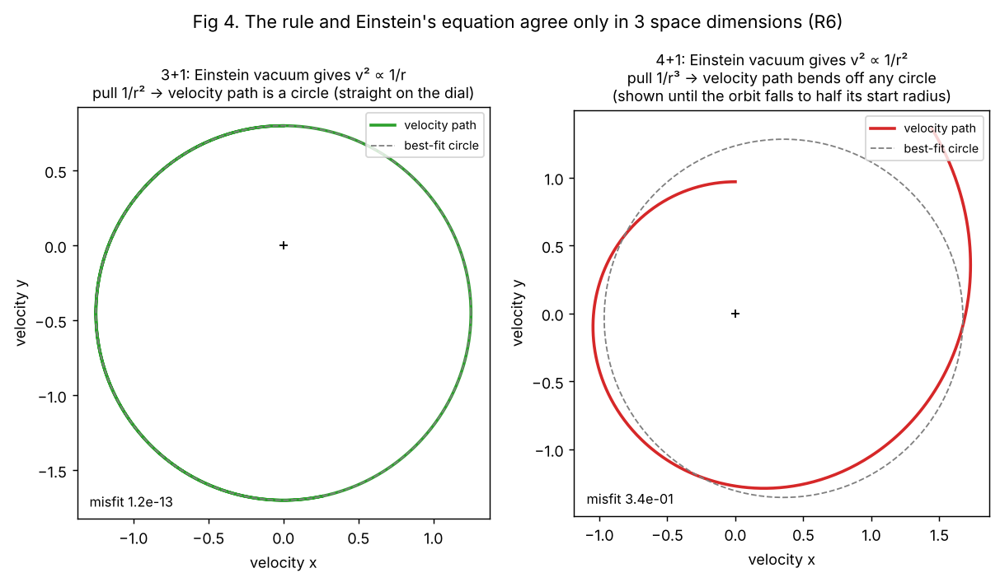
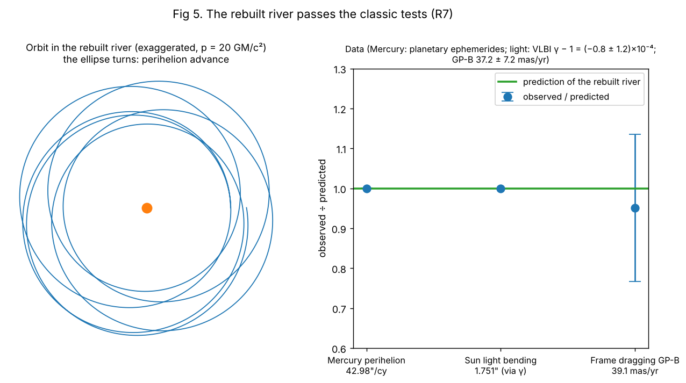
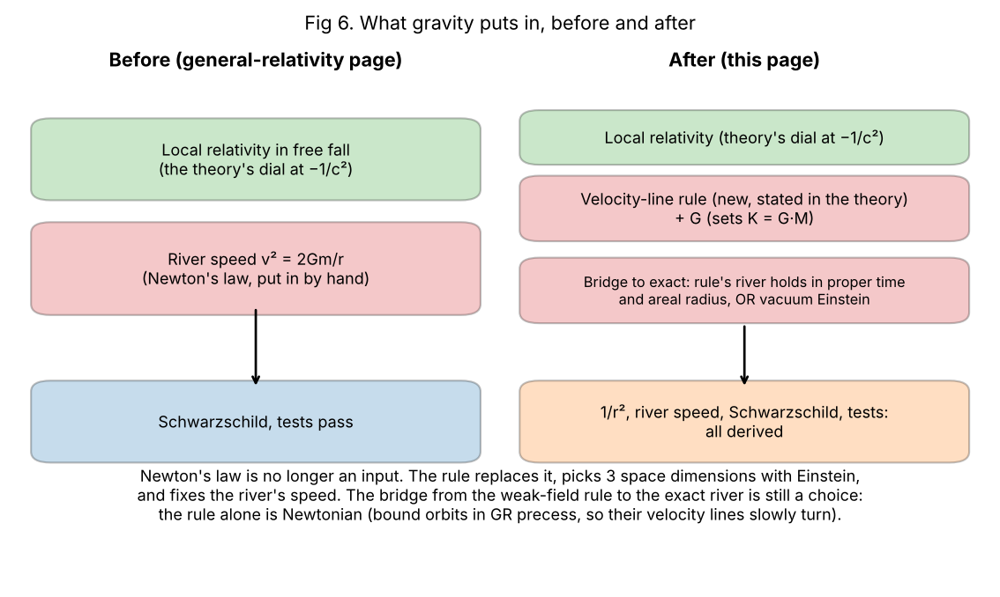

# DRAFT: The river model of gravity, rebuilt on the velocity-line rule (Nov 26, 2026)

Asked by Brennan (voice call), answering "should I rebuild the river model on the new velocity rule, so the rule and
G are gravity's only inputs?": "Both" (the second part, associahedron coordinates, is handled elsewhere).

Follows `../velocity-lines/README.md` (the velocity-line rule) and the general-relativity page's river model.

## The result in plain words

**Newton's law is no longer an input: the river's speed, and with it the full Schwarzschild geometry and the classic
tests, now follow from the velocity-line rule, G and the theory's own local relativity.** The river turns out to be
exactly the zero-energy family of the rule's orbits, which sits on the flat middle of the dial. Two honest limits
remain. The rule is a weak-field (Newtonian) statement, so getting from it to the exact river still needs one bridge:
either "the rule's river holds in proper time and areal radius", or Einstein's vacuum equation. And with Einstein's
equation as the bridge, 1/r² already follows from Einstein (the shell theorem, known); the rule's own jobs there are
to fix the constant as Newton's mass and to pick three space dimensions.

*Fig 1. The chain from the rule to the tests. Red: the one new assumption. Green: what the theory already had.
Orange: derived here. Blue: data.*

All numbers are from `checks.py` (**19/19 pass**, about 20 seconds). Units G = c = 1 unless stated.

---

## 1. From the rule to the pull (fundamental)

The velocity-lines page found the rule: **in free fall, measure every velocity from the starting velocity with the
theory's dial addition, and they all point one way.** That page showed (V7) the rule forces the pull K/r², with no
dimension or flux assumed. Here we take that as the starting point.

- With the pull K/r², the energy E = v²/2 − K/r is conserved (R1, symbolic).
- E sets the dial of velocity space: Milnor's velocity metric 2|dv|/(|v|² − 2E) has curvature exactly **−2E** (R2b,
  symbolic). Bound orbits get the sphere end, escaping ones the hyperboloid end.
- G enters only here: K = G·M. The rule alone says "some K"; G says K is proportional to the source's mass.

**Status.** Hamilton's converse and Milnor's metric are known. The rule in the dial's words is ours (previous page).

## 2. The river is the zero-energy family (ours)

*Fig 2. Left: velocity circles with the same angular momentum. Only the E = 0 circle passes through v = 0 (at rest
far away). Right: the river's inflow speed √(2K/r) against other possible laws.*

- The river is "space flowing inward at the speed of things that fell from rest far away." Those things have
  **E = 0**, so v² = 2K/r (R2a). On the general-relativity page this was postulate 2, Newton's escape speed put in
  by hand. Here it is an output of the rule.
- E = 0 is the **flat middle of the dial** (curvature 0, R2c): the Galilean end, between the sphere (bound) and the
  hyperboloid (escaping).
- For every orbit, |v|² − 2E = v_esc(r)² (R2d). So the river's speed is the scale of the whole velocity geometry: the
  dial chart's scale factor at the orbit's point is 2/v_esc² = r/K, which is Kepler's clock dt/r from the previous
  page.

**Status.** That the river observers are radial E = 0 free fall is known (Painlevé 1921, Gullstrand 1922; "river
model", Hamilton and Lisle 2008). Reading the river as the flat-middle dial setting of the velocity geometry, and
taking its speed from the rule instead of Newton, is ours.

## 3. Add the theory's local relativity: Schwarzschild, exactly

*Fig 3. How much matter a river v² = 2M/rᵖ needs at each radius. Only p = 1, the rule's river, is empty space.*

- Put the river into local relativity (the theory's dial at −1/c²): the metric is −dt² + (dr + v dt)² + r² dΩ².
  With v² = 2M/r its Einstein tensor vanishes everywhere (R3, symbolic): it is empty space.
- River observers are in free fall, and their clock t is their own proper time (R4a). Relabelling the clock gives
  Schwarzschild's familiar form (R4b), and the isotropic form gives **γ = 1 and β = 1** (R4c, R4d).
- For a general river, Gᵗₜ = −(r v²)′/r² (R5a), so v² = 2M/rᵖ is empty only at p = 1 (R5b). This is the shell
  theorem (known; already on the general-relativity page).

**Status.** All known (Schwarzschild 1916; Painlevé–Gullstrand). What is new is only where the river speed came from.

## 4. Three dimensions: the rule and Einstein agree only here

*Fig 4. Left: in 3+1 dimensions, the empty-space river gives a 1/r² pull and the velocity path is a circle (a
straight line on the dial), misfit 10⁻¹³. Right: in 4+1 dimensions, the empty-space river gives a 1/r³ pull and the
velocity path bends off every circle, misfit 0.34.*

- In 4+1 dimensions the general river has Gᵗₜ = −(3/2)(r² v²)′/r³ (R6a, symbolic), so empty space needs v² ∝ 1/r²
  and the pull is 1/r³ (Tangherlini 1963, known). That breaks the velocity-line rule.
- So "rule + Einstein's equation" picks **3 space dimensions** (R6b). The previous page found "rule + conserved flux"
  picks the same.

**Status.** Tangherlini's solutions are known. Using the rule as the dimension selector is ours.

## 5. What the rebuilt river predicts

*Fig 5. Left: an orbit in the rebuilt river, exaggerated (p = 20 GM/c²); the ellipse turns. Right: observed ÷
predicted for Mercury, light bending and frame dragging.*

| Test | Rebuilt river | Observed | Check |
|---|---|---|---|
| Perihelion per orbit, p = 2000 M, e = 0.3 | 9.446143689×10⁻³ rad (geodesic) | Darwin's exact 9.446143693×10⁻³ | R7a |
| Light bending, b ≈ 1000 M | 4.0077981×10⁻³ rad | 4M/b + (15π/4)(M/b)² = 4.0077554×10⁻³ | R7b |
| Mercury | 42.98″/century | 42.98 ± 0.04 | R7c |
| Sun-grazing light | 1.7512″ | VLBI: γ − 1 = (−0.8 ± 1.2)×10⁻⁴ | R7d |
| Frame dragging (GP-B) | 39.1 mas/yr along the measured axis | 37.2 ± 7.2 | first write-up, F-part |

The frame dragging carries over because the first write-up needed only Newton's static field (now from the rule),
the theory's boost dial, and γ = 1 (now R4d).

## 6. An observation, not a derivation: the velocity line's turn

In the exact river, bound orbits precess, so their velocity line slowly turns. Per orbit the turn is

**turn = 2(2 + 2γ − β) × (area of the velocity circle) / c²**, which is 6 × area / c² with γ = β = 1 (R8).

This has the shape of the swap rule ("turn = dial × enclosed area"), but the factor 6 is not derived from the swap
rule here. It is a restatement of the known formula 6πGM/(c²p) in the velocity picture. Whether the swap rule gives
the 6 on its own is a clean next test.

**Status.** Ours (observation).

---

## 7. What gravity puts in, before and after

*Fig 6. Left: the general-relativity page's inputs. Right: this page's.*

| Input | Before | After |
|---|---|---|
| Local relativity in free fall (the theory's dial at −1/c²) | yes | yes |
| River speed v² = 2Gm/r (Newton) | **put in** | derived (R2a) |
| Velocity-line rule | no | **put in** (stated in the theory's terms) |
| G | inside Newton | **put in** (K = G·M) |
| Bridge from the weak-field rule to the exact river | not needed | **put in**: rule's river exact in proper time and areal radius, or vacuum Einstein |
| 1/r² | inside Newton | derived (rule, V7) |
| Three space dimensions | assumed | derived (rule + Einstein, R6) |

## Verdict, on its own merits

- **Did we get what was asked?** Mostly. Newton's law is gone as an input, and gravity's inputs are now the rule, G,
  and one bridge to the exact theory. The bridge is the part that is not yet the rule: the rule is exact for Kepler
  orbits, and in the exact theory only the river family keeps it exactly.
- **Is the river reading worth keeping? Yes.** It explains why the river flows at the escape speed (it is the E = 0
  family, the flat middle of the dial), and it ties the river to the velocity geometry's scale (R2d).
- **Is it new physics? No.** Every prediction equals general relativity's. What is new is the order of the
  argument: the theory's operation and dial first, then one rule, then gravity.
- **Next leads.** (1) Can the bridge be dropped, by stating the rule in proper time and areal radius for all
  E = 0 free fall and showing it forces vacuum Einstein? (2) Does the swap rule give the factor 6 in §6?

## Files

- `checks.py` → `checks_output.txt`, `results.json`: **19/19 pass** (sympy, numpy, scipy).
- `figures.py` → `figures/fig1` to `fig6` (labeled PNGs).
- `grtools.py`: copied from the general-relativity page (Christoffels, Riemann, Einstein).
- No Lean file: no Lean toolchain in this container.

## Known vs ours

| Piece | Status | Source |
|---|---|---|
| 1/r² hodographs are circles, and only for 1/r² | known | Hamilton 1846–47 |
| Velocity space of energy E has curvature −2E | known | Fock 1935, Moser 1970, Milnor 1983 |
| River (Painlevé–Gullstrand) form of Schwarzschild; river observers fall from rest at infinity | known | Painlevé 1921, Gullstrand 1922, Hamilton and Lisle 2008 |
| Gᵗₜ = −(r v²)′/r²; shell theorem | known | (general-relativity page) |
| Higher-dimensional vacuum: v² ∝ 1/r^(n−3) | known | Tangherlini 1963 |
| Perihelion, light bending, γ = β = 1 | known | Einstein 1915, Eddington 1919, PPN |
| River speed taken from the velocity-line rule instead of Newton | ours | R1, R2a |
| River = flat middle (q = −2E = 0) of the dial; river speed = scale of velocity geometry | ours (reading) | R2b–R2d |
| Rule + Einstein selects 3 space dimensions | ours (this version) | R6 |
| Turn per orbit = 2(2 + 2γ − β) × velocity-circle area / c² | ours (observation, restatement) | R8 |
