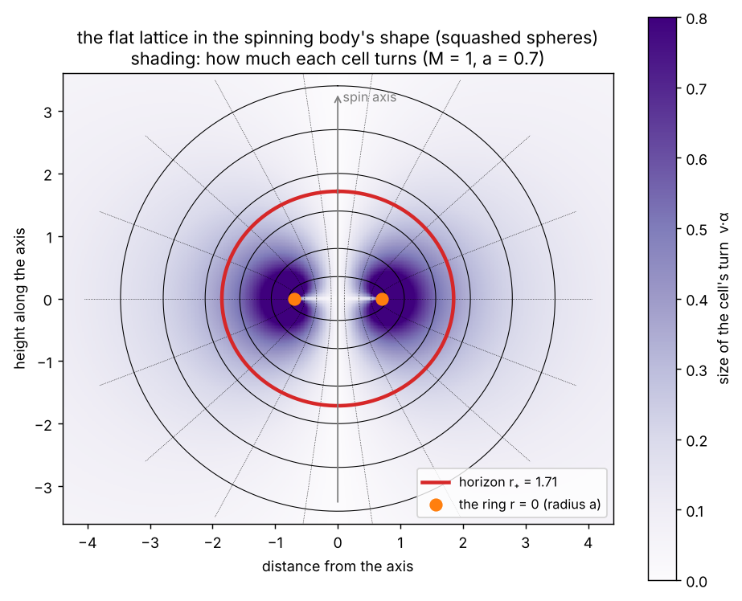
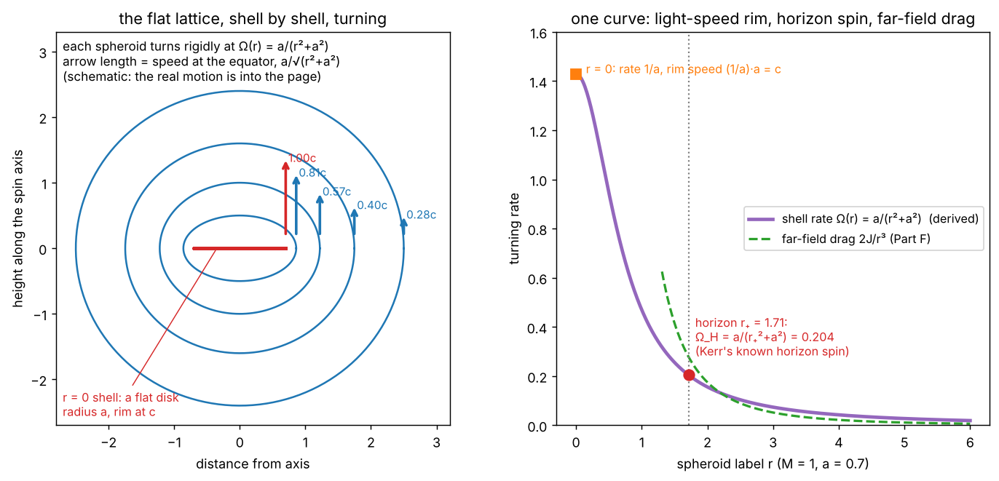
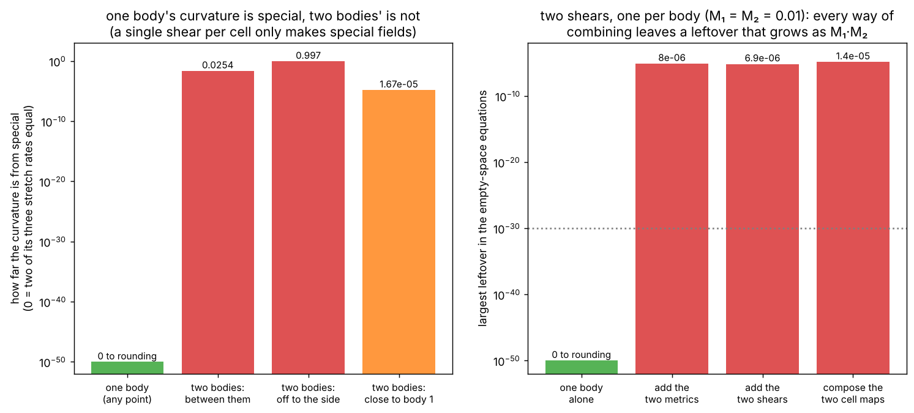
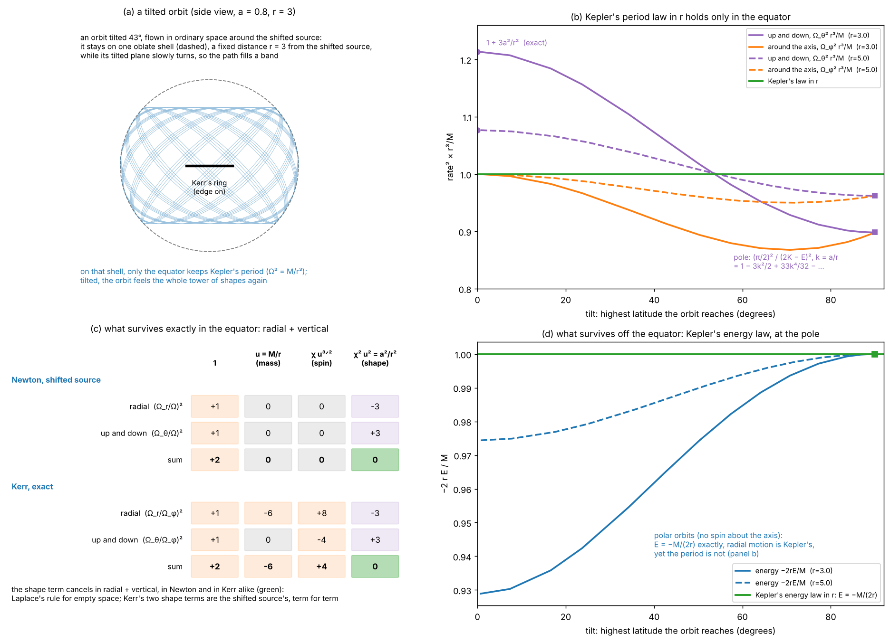
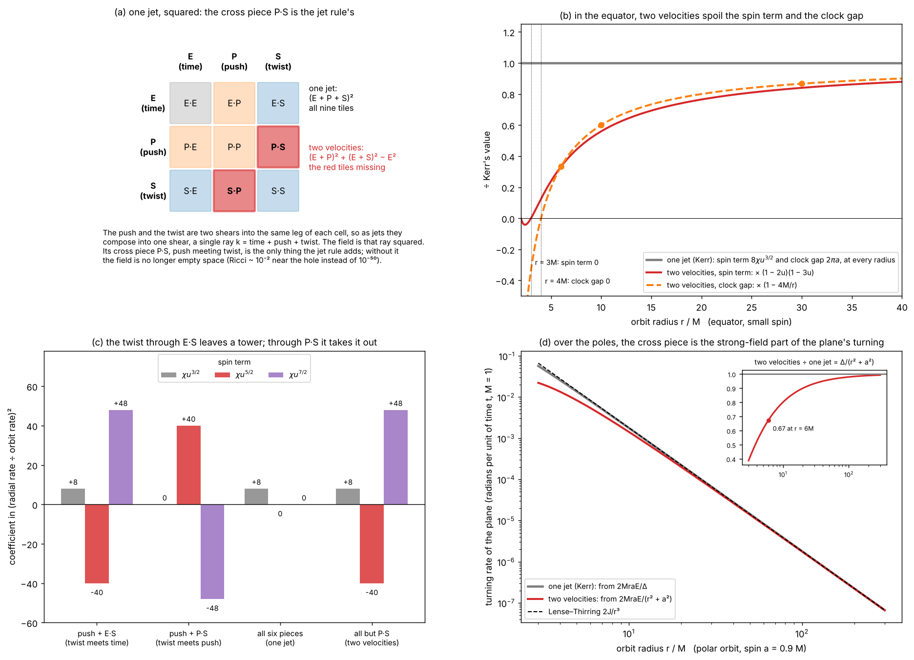
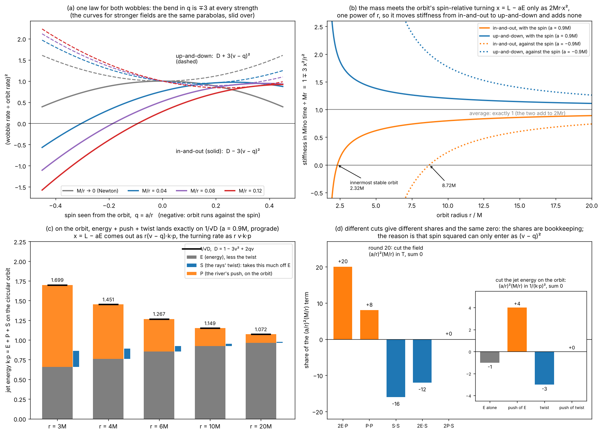

# DRAFT: The spinning river, and every idea of a frame (Nov 26, 2026)

Asked by Brennan (voice call). He said "Yeah, that is a, a good idea" to giving each river cell a rotation as well as a
velocity. He added: "And I'd also like to figure out if there's any other concept of frame. I feel like procession is
where we started talking about frame dragging at first." He then said "Yes" to widening the search to frame-dragging
look-alikes outside gravity: Larmor's theorem, spinning fluids and Foucault's pendulum.

Follows `../jet-river/` (the river as a jet field).

## The result in plain words

**One move gives the whole spinning black hole.** Take the source of a non-spinning black hole and turn its height on
the spin axis by i, the dial's rotation number, from 0 to i·a. That one move sets everything the river needs: the flat
lattice's squashed spheres, each cell's speed, and each cell's turn. Every field equation of empty space then holds,
to 50 digits, and the curvature is Kerr's own. What is still put in is the mass, the river's rules, and the reading
that spin is this shift. Frame dragging far away sets its size: a = J/M, spin divided by mass. The shift is known as
the Newman–Janis shift, and nobody has settled why it works. In this theory i is a setting of the dial, not a trick,
which makes it a lead.

How it got here:

1. **Tested (Part 1):** a velocity plus a turn for each cell gives Kerr, and only the right turn works.
2. **Turn derived (Part 3):** from shells that turn rigidly and a clock gap that each falling ring keeps, plus
   Sagnac's area law and frame dragging.
3. **Speed and lattice derived (Part 4):** from the complex distance to the shifted source.
4. **Turn from the same shift (Part 5):** the shifted source's light rays lean sideways by exactly the turn.
5. **Charge (Part 6):** the same move with a charge gives the charged spinning black hole, and a magnet with the
   electron's ratio g = 2.
6. **Two bodies (Part 7):** one shear per cell can't hold two bodies, and two shears don't combine. What adds for
   bodies at rest is the log of the clock rate, by velocity addition, with a strut whose push is Newton's force.
7. **Two spinning bodies in orbit (Part 8):** three rules (fields sent at light speed, clock rates multiply, masses
   seen through each other's clocks) give gravity's slow-orbit field exactly. The orbits turn and decay as binary
   pulsars show, the spins don't line up but sort into two families, and the wave's run-up and ring-down come out.
   The merger is still a gap.
8. **The next level of detail (Part 9):** the three rules fail at 2PN. A clock riding on one body runs at the wrong
   rate at that order, by a formula in the mass ratio. The bodies only feel each other's own fields, and the clock
   rule turns out to shape only the field between them. What's missing is likely the field's own energy between the
   bodies, or the field of a body that is speeding up.
9. **A fourth rule (Part 10):** adding gravity's own field energy as a source closes that gap exactly, at every mass
   ratio. The last piece is a speeding-up body's own field multiplied by itself. With it, both body 1's clock rate and
   the orbit's size match general relativity's 2PN answers.
10. **A spinning hole's orbit, split (Part 11):** each new number in Kerr's orbit factor comes from one piece of the
   field. The spin's 8 is energy times the rays' twist, electromagnetism's 4 doubled, and equally the push rule's
   4 + 4. The −3 is Newton's pull of the shifted source, the hole's shape, which the rules leave open and the shift
   fixes.
11. **Why only one −3 (Part 12):** Kepler's law holds exactly in the shift's own radius, the distance along a tangent
   to Kerr's ring. In that radius the whole tower of shapes is one term, each shape cancelling what the ones below
   leave, and gravity keeps the same law plus the clock gap.
12. **Tilted orbits (Part 13):** Kepler's period law in that radius holds only in the equator; tilted orbits feel the
   whole tower again. What survives: Kepler's energy law for orbits with no spin about the axis, and Laplace's rule in
   the equator. Kerr obeys the same rule there: its radial and up-and-down shape terms cancel, and both are the
   shifted source's.
13. **Orbits over the poles (Part 14):** Kerr's polar orbit follows the shifted source's exact polar law at Newtonian
   strength, at every order in a/r and in the same radius. Beyond Newton it adds terms in a²M/r³ that the equator
   doesn't have.
14. **What those polar terms are (Part 15):** not frame dragging felt twice. Over the poles the spin's twist only turns
   the orbit's plane, at Lense–Thirring's rate. The extra terms are the river's push meeting the mass. The river's time
   part alone gives the shifted source's polar law exactly, and in the equator the twist cancels the push's terms
   exactly, which is why the equator's shape stays Newton's.
15. **Push and twist as one jet (Part 16):** by Brennan's jet rule the push and the twist compose into one boost, and
   the field gets one extra piece, push meeting twist. That piece isn't what cancels Part 15's terms, but it is what
   keeps the field empty space, the clock gap at 2πa at every radius, Kerr's spin term at 8χu^{3/2}, and the polar
   plane turning at full strength near the hole.
16. **Why the push's +28 equals the twist's 28 (Part 17):** one exact law for both wobbles of an equatorial orbit,
   D − 3(v − q)² in-and-out and D + 3(v − q)² up-and-down (v = √(M/r), q = a/r, D = 1 − 3v² + 2qv). Spin squared can
   enter only through (v − q)², the orbit's turning measured against the hole's, so the shape term stays Newton's −3
   at every strength. The mass meets that turning with one power of r, so it never adds stiffness.

The turn shows up in a measurable place. The cell's clock leg doesn't close around the spin axis: after one lap at
the equator it is off by 2πa. That is exactly the shift in Kerr's orbital periods: prograde orbits take 2πa longer,
retrograde ones 2πa shorter, at every radius. This is the known "gravitomagnetic clock effect". Reading it as the
cell's clock gap is ours.

**Frames.** Our pages already hold 17 ideas of a frame. Foucault's pendulum, Larmor precession and the Berry phase
were on the precession page all along. They line up along the dial with one law, turn per loop = d × area. Of the
three outside-gravity look-alikes:

- **Larmor's theorem (new here):** a magnetic field acts on charges exactly like a turning frame. Its ½ is the same
  ½ as in the gyroscope rule of frame dragging.
- **Spinning fluids:** sound in a flowing fluid sees exactly our river. A draining, spinning bathtub drags waves the
  way a spinning star drags light. It does so with negative energy in our Q layer, though, and a fluid can't make
  the turn, so no fluid can make full Kerr.
- **Foucault:** this one was already ours. Earth's own frame dragging adds only 4.6 × 10⁻¹⁰ to the pendulum's turn,
  at every latitude.

*Fig 1. Left: a non-spinning hole. Each cell's radial leg is pushed by v along its time leg, which is one shear.
Right: a spinning hole. The radial leg is also pushed by −v·α along the azimuth leg: the turn, a second shear. The
two shears commute. Both sit at the dial's flat middle, where boosts and turns both become shears.*

All numbers are from `checks.py` (**106/106 pass**, about 21 minutes). Curvature is computed with exact symbolic
derivatives and 50-digit arithmetic at sample points (`numgr.py`).

---

## Part 1. The spinning river

### 1.1 The lattice: flat space in the shape of a spinning body (fundamental)

A spinning body is squashed at the poles, so the natural lattice is made of squashed spheres (oblate spheroids).
Their semi-axes are √(r² + a²) across and r along the axis, where a = J/M is the spin per unit mass. At r = 0 they
shrink to a ring of radius a. This is still ordinary flat space, only labeled differently:

> x = √(r²+a²) sin θ cos φ, y = √(r²+a²) sin θ sin φ, z = r cos θ  gives dx² + dy² + dz² exactly (K1b)

Every curvature component of this lattice is zero (K1a).

*Fig 2. The lattice in a slice through the spin axis. Black ellipses are the squashed spheres; dotted curves run
outward. The red curve is the horizon, the orange dots are the ring, and the shading shows how much each cell turns.*

### 1.2 Each cell: a velocity and a turn

The cell's legs are the lattice's legs, changed in one place. The radial leg picks up

> e_r = (lattice radial leg) + v·(time leg) − v·α·(azimuth leg),  v = √(2Mr)/ρ,  α = a sin θ / √(r² + a²)

with ρ² = r² + a² cos²θ. The first push is the river's boost, unchanged from the non-spinning case. The second is the
turn: the radial leg leans toward the azimuth by α. The map has the form I + (shear) with (shear)² = 0, and the two
shears commute (K5a; Lean `shear_sq`, `cellMap_mul`). That is the dial's flat middle, q = 0, the dual numbers, where
a boost and a turn are both shears and simply add.

### 1.3 Kerr comes out, exactly

| check | result |
|---|---|
| every field equation of empty space (Ricci = 0), a = 0.7 M | max error 4.5 × 10⁻⁵⁰ (K2a) |
| the same near the fastest spin, a = 0.99 M | 3.3 × 10⁻⁵⁰ (K2b) |
| curvature invariant R_abcd R^abcd vs Kerr's formula | agree to every digit shown (K2c) |
| horizon: g^rr ρ² = r² − 2Mr + a² | Kerr's horizon, r₊ = M + √(M² − a²) (K6b) |
| slow spin: the turn's first-order part | the swirl 2J/r³ of `jet-river` (K6a) |

This metric is known: it is Doran's form of Kerr (2000). Hamilton and Lisle (2008) read it as a river whose cells
carry a Lorentz transformation, a boost plus a rotation. What is ours is the reading at the dial's flat middle, two
commuting shears on a flat spheroidal lattice, and the forcing tests below.

### 1.4 The turn is forced

*Fig 3. Largest field-equation error for each variant (log scale). Only the right turn with the right speed law is
zero (green). Velocity alone fails, any other size or shape of turn fails, and any other speed law fails (red).*

| variant | max error |
|---|---|
| velocity only, no turn | 0.53 (K3a) |
| half the turn / 1.5× the turn | 0.40 / 0.66 (K3b) |
| turn ∝ sin θ instead of sin²θ | 0.26 (K3b) |
| speed √(2Mr) or √(2Mr)/ρ² instead of √(2Mr)/ρ | 22.8 / 2.4 (K3c) |

So the turn isn't decoration. On this lattice, a spinning hole needs it, at exactly this size.

### 1.5 The velocity rule is unchanged

The cell's 4-velocity is u = −dt, and g^tt = −1 (K4a). So u has unit length and is a gradient, which makes it a free
fall. Its energy is E = 1, starting from rest far away, and it carries no angular momentum (K4b). This is the same
rule as in `velocity-lines` and `jet-river`: every cell is a zero-energy free faller. The speed law v² = 2Mr/ρ² is
that rule with the squashed-sphere "radius" ρ²/r in place of r.

### 1.6 The turn is a clock gap: Kerr's clock effect

The cell's time leg is dt − a sin²θ dφ. It does not close: going once around the axis, the clocks disagree by
2πa sin²θ.

Circular orbits in the equatorial plane have periods (K7a; Lean `kerr_period`)

> T± = 2π (r^(3/2)/√M ± a)  (prograde +, retrograde −)

So each orbit is shifted by exactly 2πa from Kepler's period, at every radius. That is the clock gap of one lap at
the equator (K7b). Their difference T₊ − T₋ = 4πa (4πJ/Mc² in ordinary units) is the known gravitomagnetic clock
effect (Cohen & Mashhoon, 1993). It doesn't depend on the radius, or even on G.

*Fig 4. Left: clocks carried around the spin axis fail to agree after one lap. Right: prograde and retrograde orbital
periods differ from Kepler's by +2πa and −2πa at every radius.*

### 1.7 What this changes from the last page

`jet-river` said full spin needed "cells that carry a rotation and a lattice that curves". The first half holds. The
second half needs a correction: the lattice the cells move through stays flat. What curves is the slice the cells
themselves see, the curvature 3R = 2Ma²(3 sin²θ − 2)/r⁵ found there. The input list is the same as for the non-spinning
case, a flat lattice and cells that are free fallers. The new structure is that each cell carries a turn as well as a
velocity.

Still not covered: gravitational waves. A wave is a ripple that travels, and a fixed lattice with fixed cell maps
can't carry one. It would need the cell maps themselves to change in time.

---

## Part 2. Every idea of a frame

### 2.1 Pass one: our own pages

The precession page is where frame dragging first came up. Its swap rule says b ∘ a = X⁻¹(a ∘ b)X: swapping the
inputs turns the answer and keeps its size. Over a loop that becomes **turn = d × area**. The precession page then
named frame dragging as "the only precession here that the theory can't produce on its own". Part F of the gravity
page closed that gap. This page closes it for full spin.

Here are all 17 frame ideas on our pages, sorted by the dial (survey of the repository):

*Fig 5. Every idea of a frame in our work, by dial setting. Left, d = +1, turning: Foucault, Coriolis, the tumbling
body, Larmor and Berry, Fuller's coil. Middle, d = 0, the flat middle: Galilean boosts (nothing precesses), the river
cells, the acoustic metric. Right, d = −1, relativity: Thomas–Wigner, geodetic, Lense–Thirring, rotating BTZ, Kerr's
clock effect. Purple: added on this page.*

| idea | where on our pages | dial | tie to frame dragging |
|---|---|---|---|
| swap rule, turn = d × area | precession §1 (A1–A7, Lean `swap_is_turn`) | any | the parent rule |
| holonomy ω (an output reading) | twisted-boosts; affine-names §6 | any | frame dragging's turn is a holonomy |
| Thomas–Wigner rotation | precession §2; twisted-boosts (36/36) | −1 | added to the drag in the double pulsar |
| geodetic (de Sitter) precession | twisted-boosts GP-B | −1 | frame dragging's sister effect |
| Foucault's pendulum, Coriolis | precession §4 (C5–C7) | +1 | turning frame, the everyday version |
| tumbling body's phase | precession §5 (D1–D3) | +1 | none |
| torqued gyroscope | precession §6 (E1–E6) | +1 | the 90° of the swap rule |
| Larmor precession, Berry phase | precession §7 (F1–F4) | +1 | half the d = +1 twist |
| Fuller's coil twist | fusion-magnets §3.5 | +1 | none |
| rotating BTZ drag (Fermi–Walker cross-check) | precession §8 (41/41) | −1 | a 2+1 frame dragging, exact |
| Lense–Thirring from boosting Newton | gravity-from-theory Part F (26/26) | −1 | derives frame dragging |
| river swirl 2J/r³ | jet-river J7 | 0 and −1 | slow-spin frame dragging |
| teleparallel tetrad, torsion | gr-bridges Part T | 0 | the river's frame and its defects |
| gauge connection, Aharonov–Bohm | electromagnetism | commuting case | same loop law, phases commute |
| Purcell: magnetism from a moving frame | electromagnetism | −1 | B as a frame effect |
| Bargmann phase m·area/ħ | bridge-survey (prediction) | 0 | the d = 0 version of the loop law |
| perihelion turn ≈ 6 × area/c² | river-rebuild §6 | −1 | shaped like the swap rule (observation) |

Missing before this page: Larmor's theorem, analogue gravity (spinning fluids), the Sagnac effect, and the Hannay
angle (cited once, never used).

### 2.2 Pass two: the literature, and the three look-alikes outside gravity

**Larmor's theorem (1897).** A charge in a weak magnetic field moves exactly as it would with no field, watched from
a frame turning at −qB/2m, up to terms of order B². Our check: the leftover error grows 4.18 times when B doubles, as a
B² error should, while without the turn it grows only 2 times (F1a).

- Our tools express it: the magnetic force qv × B has the Coriolis form 2m v × Ω, and Coriolis is the swap rule at
  d = +1 (precession page).
- The ½ in −qB/2m is the same ½ as in Part F's gyroscope rule, Ω = −½ curl h. In gravity, the field B_g = curl h plays
  the magnetic role. This is the known gravitational Larmor theorem (Mashhoon). Ours: the line through the swap rule.
- **Lead?** Modest. It explains a factor we already had, rather than opening something new.

*Fig 6. Left: a charge orbiting in a magnetic field (blue) and the field-free orbit watched from a frame turning at
Larmor's rate (dashed orange) lie on top of each other. Right: Foucault's turn against latitude (green). Earth's own
frame dragging (dashed purple) has the same shape, at 4.6 × 10⁻¹⁰ of the size.*

**Spinning fluids (analogue gravity).** Sound in a moving fluid travels on the metric −c²dt² + (dx − u dt)². That is
exactly our river, with the fluid's velocity as the river's (Unruh 1981; Visser 1998). A draining, spinning bathtub
has u_r = −A/r and u_φ = B/r. Sound is trapped inside r = A, and between r = A and r = √(A² + B²) waves must move
with the spin, as light must inside a spinning hole's ergoregion. Spinning water tanks have shown waves being
amplified this way (Torres et al., 2017).

- **Ours, the field-law side:** for any 2D flow, the energy density the river's cells measure is the Q layer of the
  strain, G_nn = det(sym ∇u) (F2a). For the bathtub that is −(A² + B²)/r⁴, which is negative (F2b). So the vortex
  drags waves like a spinning star, but in gravity's terms it would need negative energy. The analogy is in the
  velocities, not in the field law.
- **Ours, the Kerr side:** a fluid has only a velocity per point, no turn. By K3a, velocity alone can't make Kerr.
  This matches the known result that fluid vortices reproduce Kerr only in the equatorial plane (Visser & Weinfurtner,
  2005). The turn is the reason.
- **Lead?** Yes, a small one. "Fluids lack the turn" is a sharp, testable statement in our language. A system whose
  cells carry an internal turn, such as a fluid with a spin field (micropolar fluids, superfluid helium-3 textures),
  is where a full Kerr analogue might live. That is untested.

*Fig 7. Left: streamlines of a draining, spinning bathtub, with its sound horizon (black) and ergoregion edge (red
dashed). Right: the vortex's swirl rate B/r² and a spinning mass's swirl rate 2J/r³ both drag waves. The vortex's Q
layer is negative, though, while gravity's empty space has Q = 0.*

**Foucault's pendulum as a geometric phase.** Foucault's turn, 360° × sin(latitude) per sidereal day, is the
holonomy of carrying a direction around a circle of latitude on the sphere: d = +1 times the enclosed area. This was
already checked on our precession page (C5–C7), with the Berry and Hannay phases as its family (Berry 1984; Hannay
1985).

- New here: Earth's own frame dragging adds a vertical turn 2 sin(lat)·GJ/(c²R³). That is the fraction
  2(I/MR²)(GM/Rc²) = 4.6 × 10⁻¹⁰ of Foucault's turn, the same at every latitude, about 155 mas/yr at 45° (F3a).
- **Lead?** No. It is a nice number, but known physics with nothing new to test.

**Sagnac effect (from the survey's gap).** Light sent both ways around a turning loop returns with a time difference
4ΩA/c², a frame effect proportional to area: the same loop law again. The Kerr clock effect in §1.6 is gravity's
Sagnac effect, and here it is the cell clock's gap.

- **Lead?** Yes. The clock gap is a direct, quantitative reading of "the turn each cell carries". If the theory can say
  why the gap is a sin²θ per radian, it would derive the turn instead of finding it. (Done in Part 3.)

## Part 3. Deriving the turn (round 7)

Asked by Brennan, who answered "Yes" to: "Should I try to derive the turn's size from the dial, so Kerr's clock gap
becomes an output instead of something we found by testing?"

**Result: the turn's shape and size come out of four short steps, and the field equations then only confirm.** It
takes two assumptions, one known law, one far-field match and one reading. Kerr's a = J/M is an output, and so is its
clock gap, 2πJ/M per lap. Nothing is fitted. What is still put in by hand: the flat spheroidal lattice, and the speed
law v² = 2Mr/ρ² from Part 1, which is still matched by the field equations rather than derived.

*Fig 8. The chain. Blue: the area law gives the shape. Purple: the circulation law gives the rate in each shell.
Green: frame dragging far away gives the size. Orange: the rim at light speed ties the lattice's ring to the turn.
Red: the output, Kerr, with every empty-space field equation satisfied.*

### 3.1 Shape: the area law (D1)

Suppose each lattice spheroid turns as a whole, at its own rate Ω(r) (assumption 1: rigid shells). At the dial's flat
middle, the turning shell's time leg is the lattice time leg pushed sideways by the shell's speed: one more shear.
Around a latitude circle, that leg's clock gap is exactly 2 × Ω × (the circle's area). This is Sagnac's law, known,
and at q = 0 it holds exactly, with no γ factor (D1a). The circle's area is π(r² + b²) sin²θ, so

  turn f = Ω(r) · (r² + b²) · sin²θ.

**The sin²θ shape is just the area of a latitude circle.** And Part 1's turn amount, α = a sinθ/√(r² + a²), turns out
to be exactly the speed of the shell at that point (D1b). So the "turn" is the cell being pushed along the turning
shell's own time leg.

### 3.2 Rate per shell: the circulation law (D2)

For any turn function, the cells fall along cones of fixed θ (D2a). A latitude ring of cells therefore stays a
latitude ring as it falls. The ring's clock gap changes at the rate −2π u^r ∂f/∂r (D2b). Assumption 2 is that a
falling ring keeps its gap. This is a circulation law, like Kelvin's for a swirling fluid. It holds exactly when f
doesn't depend on r. With 3.1 that forces

  Ω(r) = κ / (r² + b²),  f = κ sin²θ.

### 3.3 Size: frame dragging far away (D3)

Far out, this cell gives g_tφ → −2Mκ sin²θ / r. Part F derived frame dragging's far field, −2J sin²θ / r, and checked
it against Gravity Probe B and LAGEOS. Matching the two gives **κ = J/M**.

### 3.4 The ring: the rim at light speed (D4)

The innermost shell, r = 0, is a flat disk of radius b. Its rim moves at κ/b. Reading the dial's edge as the fastest
a shell can go puts the rim at light speed, which gives **b = κ**. The lattice's ring and the turn are then the same
length, and every other shell moves slower than light: 1 − α² = ρ²/(r² + κ²) ≥ 0, which is zero only on the ring.
This matches a known picture of Kerr's source: Israel (1970) read it as a flat disk of radius a spanning the ring,
with its material reaching light speed at the rim (and with negative energy density, so it isn't a realistic star).
Our r = 0 shell is a lattice shell in flat space, not Israel's material disk. The match is in the radius and the rim
speed.

### 3.5 The field equations confirm, and every step matters (D5, D6)

The derived cell is identical to Part 1's tested one, with a = J/M (D5a). It solves every empty-space field equation,
max |Ricci| = 5 × 10⁻⁵⁰ (D5b). Change any step and empty space breaks (D5c):

*Fig 10. The largest field-equation error for the derived chain (green) and for five changes to it (red). Those are
a rim faster or slower than light, two ways of letting the clock gap change between shells, and a gap that drifts
with r. Log scale; the dotted line is the 10⁻³⁰ "zero" threshold.*

There is also a bonus, which is a check we didn't aim for. At the horizon, Kerr's dragging rate −g_tφ/g_φφ equals the
derived shell rate a/(r₊² + a²) (D6b). That is Kerr's known horizon spin, Ω_H. It is also the rate of Carter's frame.
The t–φ block closes exactly there: g_tφ² − g_tt g_φφ = sin²θ (r² − 2Mr + a²) (D6a).

*Fig 9. Left: the flat lattice, each spheroid turning rigidly at Ω(r) = a/(r² + a²). The arrows show each shell's
equator speed, and only the r = 0 disk's rim reaches c. Right: one curve carries the light-speed rim at r = 0, Kerr's
horizon spin at r₊, and frame dragging's 2J/r³ far away.*

### 3.6 What is still assumed, plainly

| step | status |
|---|---|
| flat spheroidal lattice | put in (Part 1.1); derived in Part 4 |
| speed v² = 2Mr/ρ² | put in, matched by the field equations (K3c); derived in Part 4 |
| shells turn rigidly | **assumption 1** |
| clock gap = 2 Ω × area | known law (Sagnac), exact at q = 0 |
| a falling ring keeps its gap | **assumption 2** (circulation law) |
| κ = J/M | derived, from Part F's far field |
| rim at light speed, b = κ | a **reading** of the dial's edge; the field equations confirm only b = κ works |
| Kerr, a = J/M, clock gap 2πJ/M, Ω_H | **output**, checked |

The next gap is the speed law. If it can be derived too, perhaps as a Gauss law on the spheroids the way rv² = 2Gm
came out of the jet river, then Kerr would follow from the lattice shape plus the two assumptions.

## Part 4. Deriving the speed law, and the lattice's shape (round 8)

Asked by Brennan, who answered "Yes" to: "Should I try to derive the speed law next, so Kerr follows from just the
lattice's shape and those two assumptions?"

**Result: one move gives both remaining inputs.** Take the non-spinning source and turn its height on the axis by
the dial's rotation number i, moving it from 0 to i·a. Its distance from each point then becomes the complex number
D = r − i a cos θ. Three things fall out at once. The real part of D is the lattice label r, so the squashed spheres
are the level sets of Re D. D = 0 is a ring of radius a, the same ring the turn needed in Part 3. And Newton's
potential of the moved source, Re(M/D) = Mr/ρ², is exactly the speed law v² = 2Mr/ρ² through the jet river's rule
v²/2 = −Φ. This is a reading, not a proof: it assumes the spin is that one shift. Within the reading, nothing else
is put in except the mass M.

*Fig 11. Left: the one move. The source's height is turned a quarter turn in the complex plane, from 0 to i·a, and
not slid along the real axis by a (grey, which fails). Right: what that does in real space. Purple shows the level
sets of Re D, which are the lattice's squashed spheres. Red marks D = 0, the ring of radius a, which is the edge of
the flat disk r = 0. Blue shows the cell speed² = 2 Re(M/D).*

### 4.1 The complex distance (S1)

Move a point source up the spin axis by i·a. Its squared distance x² + y² + (z − ia)² is exactly (r − i a cos θ)² in
the lattice's coordinates (S1a, also `complex_distance` in Lean). So the lattice's spheroids are not a choice: they
are where the shifted source's distance has a fixed real part. The distance vanishes on the ring r = 0, θ = π/2,
radius a (S1b).

**Two routes meet at one ring.** Part 3 found the turn's ring at radius b = κ = J/M, from frame dragging. Here the
ring sits at radius a, from the shift. They agree only when a = J/M, and that is Kerr's own relation.

### 4.2 The speed law (S2, S3)

Newton's potential of the moved source is Re(M/D) = M r/(r² + a² cos²θ) (S2a). Far away it is M/r, the ordinary
potential of mass M. The jet river's rule says the cell's speed sets the potential, Φ = −v²/2 (jet-river J6b). So
v² = 2Mr/ρ², exactly the law Part 1 found by testing (S2b). Re(M/D) is an exact flat-space potential: Laplace's
equation holds everywhere off the disk, not just far away (S3). That is the empty-space form of the jet river's
trace law.

### 4.3 Being a potential of mass M is not enough (S4)

Many flat-space potentials have mass M. A point at the centre, a point slid up the axis by a real a, and a point
moved by i·a/2 are all harmonic, and all tend to M/r far away (S4a). With the lattice and turn from Part 3, every one
of them breaks empty space. Only the i·a shift works (S4b).

*Fig 12. The largest field-equation error for four speed laws, each a flat-space potential of mass M. Only the
source moved by i·a gives empty space. The i·a/2 shift fails because its ring (radius a/2) is not the turn's ring.*

### 4.4 What is assumed now, plainly

| piece | status |
|---|---|
| spin = the source's height turned by i, from 0 to i·a | **reading** (the dial's rotation number); known as the Newman–Janis shift |
| lattice's squashed spheres, and their ring | **derived** from the shift (S1) |
| speed law v² = 2Mr/ρ² | **derived**: the shifted source's potential, through the jet river's v²/2 = −Φ (S2, S3) |
| shells turn rigidly; a falling ring keeps its clock gap | the two assumptions of Part 3 |
| a = J/M | derived twice (frame dragging far away, and the two rings meeting) |
| Kerr | output, checked to 50 digits |

**Lead, on its own merits.** The shift by i·a is known: Newman and Janis (1965) used it to get Kerr from
Schwarzschild, and Appell (1887) and Newman (1973) read it as a source at a complex position. Kerr's Kerr–Schild
function 2Mr/ρ² is also known to be this harmonic function. Why the shift works has never had a settled explanation.
In the theory, i is not a trick: it is the dial's rotation setting. Spin enters the river twice, as a shear at the
dial's flat middle (the turn, q = 0) and as a quarter turn of the source (q = +1). If the dial can say why those two
settings go together, that would explain the Newman–Janis shift. That lead is worth following. Part 5 derives the turn from
the shift as well, so one move gives everything.

## Part 5. The turn from the same shift (round 9)

Asked by Brennan: "Yes fix the sentences and try to get the turn from the same shift".

**Result: the shifted source's own light rays carry the turn.** Through each point, the source moved to i·a sends two
real light rays, one out and one in. Both lean sideways by the same amount, and that sideways part is −a sin²θ dφ:
exactly the turn round 7 derived from rigid shells and the circulation law. So the one move of Part 4 gives the
lattice, the speed and the turn. Together these give the whole spinning black hole, with every field equation of empty
space holding to 50 digits.

*Fig 13. Rays in the plane of the equator. Left: no spin, so the rays run straight out from the centre. Right: the
source is moved by i·a, and every ray is a straight line tangent to the ring of radius a. The lean, a/√(r² + a²), is
the speed of round 7's turning shell.*

### 5.1 The rays of a shifted source (T1–T3)

For a real source, the ray through a point is the unit direction to the source. For the shifted source that direction,
E = grad D, is a complex unit vector, E = p + i q. A real ray k must be a unit vector with k·E = 1, which means k·p = 1
and k·q = 0. Those are a circle and a plane, so there are exactly two solutions: k = (p ± q × p)/|p|² (T1). With no
spin, q = 0 and both are the ordinary radial ray.

On the lattice, the outgoing ray is k = (ρ²/(r²+a²)) dr − a sin²θ dφ. That is a radial part along the shell's normal,
plus a sideways part (T2). The ingoing ray has the same sideways part and the opposite radial part (T3). The lean is
exactly α = a sin θ/√(r² + a²), the speed of round 7's turning shell (T2b). In the plane of the equator, every ray is
a straight line tangent to the ring of radius a.

### 5.2 The turn (T4)

The river rule reads: push each cell along its ray, without the ray's radial part. With no spin the ray is purely
radial, and this is the plain river, w = dt. With the shift it gives w = dt − a sin²θ dφ. That is round 7's turn
f = κ sin²θ, with κ = a. This rule is a reading. The calculation behind it is T2.

### 5.3 The whole black hole from one move (T5)

The same rays and speed give Kerr in its ray form, flat + v²(dt + k)(dt + k). This is the known Kerr–Schild form, and
it solves every empty-space field equation (T5a). Other light rays with the same speed law fail: a purely radial ray,
and a ray with half the sideways part (T5b). Built from the shift alone, the river cell is Part 1's Kerr cell (T5c).

*Fig 14. One move gives everything. Turning the source's height by i gives the complex distance D. From D come the
lattice (Re D), the speed (Re M/D) and the turn (the light rays with k·E = 1). Together they give Kerr. Frame dragging
far away sets a = J/M.*

### 5.4 What is assumed now, plainly

| piece | status |
|---|---|
| spin = the source's height turned by i, from 0 to i·a | **reading** (the dial's rotation number); known as the Newman–Janis shift |
| lattice, speed law, turn | **derived** from the shift (Parts 4 and 5) |
| push the cell along its ray without the radial part; v²/2 = −Φ | river rules (the second from the jet river) |
| a = J/M | from frame dragging far away (Part 3) |
| Kerr | output, checked to 50 digits |

The two assumptions of Part 3 (rigid shells, a kept clock gap) are no longer needed. They now come out as properties
of the shift's rays: the ray's lean is the rigid shell's speed, and the turn has no r in it.

**Lead, on its own merits.** In this theory, spin is one setting of the dial applied to the source's position. Rotation
numbers (q = +1) act on where the source is. Shears at the flat middle (q = 0) act on each cell. The first produces
the second. That two-setting structure is a candidate explanation of why the Newman–Janis shift works, and it is worth
following. The next tests: charge (Kerr–Newman), where the shift is known to work and the river should follow (done
in Part 6); then a case where the shift isn't known to work, such as two bodies.

## Part 6. Charge on the same shifted source (round 10)

Asked by Brennan, who answered "Yes" to: "Should I test the same move with charge next, the charged spinning black
hole?"

**Result: the same move works with charge.** Put a charge Q on the shifted source and change nothing else. The charged
spinning black hole (Kerr–Newman) comes out. Einstein's equations, now including the electric field's own energy, hold
to 50 digits, and so do Maxwell's equations. The shifted charge also turns out to be a magnet, with the electron's
magnetic ratio, g = 2.

*Fig 15. Left: the shifted charge's one complex potential, Q/D. Its real part (blue) is the electric potential. Its
imaginary part (orange) is a magnetic potential, whose far field is a magnet of moment Qa. Right: the largest
Einstein–Maxwell error for the shifted charge (green) and for three rivals (red). The rivals fail at about 10⁻³ against
10⁻⁵⁰. Their errors are small only because the charge is small, Q = 0.5.*

### 6.1 No spin first: the field's energy in the jet river's Gauss law (C1)

The jet river's Gauss law says r v² = 2 m(r), where m(r) is the mass inside radius r. A charge's electric field holds
energy Q²/(2r) outside radius r, so the mass inside is m(r) = M − Q²/(2r). That gives v² = 2M/r − Q²/r² (C1a). With
the field A = (Q/r) dt, this river is the charged black hole (Reissner–Nordström). Both sets of equations hold (C1b).

### 6.2 Shift the charge: electric and magnetic together (C2)

Moved by i·a, the charge's potential Q/D is one complex number. Its real part is the electric potential Qr/ρ². Its
imaginary part, Qa cos θ/ρ², is a magnetic potential, which far away is a magnet of moment Qa (C2). The black hole's
spin is J = Ma, so the ratio of magnetism to spin, in the units used for particles, is g = 2. That is the electron's
value. For Kerr–Newman this has been known since Carter (1968). Here it comes from the same quarter turn that gives
the spin.

### 6.3 The speed law with charge (C3)

Shift both terms of 6.1. The mass term becomes 2 Re(M/D), as in Part 4. The field-energy term becomes |Q/D|², the size
of the complex potential, not its real part. That is because the field's energy counts the electric and magnetic
parts together: (E² + B²)/8π = |E + iB|²/8π. Together, v² = 2 Re(M/D) − |Q/D|² = (2Mr − Q²)/ρ² (C3).

### 6.4 The charged spinning black hole (C4, C5)

Take that speed, the lattice and turn from the shift, and the field A = Re(Q/D) (dt − a sin²θ dφ). That field is the
charge's potential carried on the cell's turned time leg. Einstein's equations with the field's energy hold, and so do
Maxwell's (C4). The horizon sits where r² − 2Mr + a² + Q² = 0, Kerr–Newman's (C4b). Three rivals fail (C5): taking
the field energy from Re(Q/D)² instead of |Q/D|², dropping the turn from the field, or leaving the charge at the
centre.

### 6.5 What this adds, on its own merits

- **A real test passed.** The shift was built for spin, and charge was not used to set it up. It then gives the
  charged case with no new input except Q. The one new choice, |Q/D|² for the field's energy, is forced: the real
  part fails.
- **Known vs ours.** The charged spinning black hole was found in 1965 with this same complex trick (Newman and
  co-workers), and its g = 2 is known (Carter 1968). Ours: the river form built from the shift, the field-energy term
  as |Q/D|² through the jet river's Gauss law, the field carried on the turned leg, and the rivals failing.
- **Lead.** The electron's g = 2 is also what Dirac's equation gives, and people have long noticed that Kerr–Newman
  shares it. In this theory both the spin and the magnetism come from one quarter turn. That is worth following,
  carefully. With an electron's mass, charge and spin there would be no horizon at all, since the spin and charge are
  far too large for the mass. That would leave a bare ring about the electron's Compton size. So this is a shared
  number, not a model of the electron.
- **Next test, where the shift is not known to work:** two bodies, or a moving one.

## Part 7. Two bodies (round 11)

Asked by Brennan, who answered "Yes!" to: "Should I try a case where the shift isn't known to work, like two bodies?
It's a much harder test, since even standard gravity has no exact answer for two orbiting bodies." He then asked how
we could verify it, and whether the gravitational waves detected from colliding black holes could be used.

**Result: the river as it stands can't hold two bodies, and the reason is plain.** One shear per cell only ever makes
curvature of a special kind, and two bodies' field isn't of that kind. Giving each cell two shears, one per body, also
fails, however the two are combined. What does add exactly, for bodies at rest, is a different quantity: the log of
each cell's clock rate. Along the axis between the bodies, those combine by Einstein's velocity-addition rule. The
exact field then needs a strut to hold the bodies apart, and the strut's push is Newton's inverse-square law once they
are far apart.

*Fig 16. Left: two black holes held at rest on one axis, masses 1 and ½, in Weyl's coordinates, where each is a rod
of length 2M. Blue: ψ = ½ ln(1 − v²), the log of the clock rate, which is the two bodies' ψ added. Orange: the strut
between them. Right: the strut's push from the exact field (solid) against Newton's M₁M₂/ℓ² (dashed). The red dot is
measured from the metric in check B4.*

*Fig 17. Left: how far the curvature is from special, where 0 means two of its three stretch rates are equal. One body
gives 0. Two bodies give values up to 1, except close to one of them. Right: the leftover in the empty-space equations
when each body brings its own shear, for three ways of combining the two shears. Either body alone leaves none.*

### 7.1 Why one shear per cell can't (B1)

Curvature in empty space stretches and squeezes in three directions, at three rates. For one body, at rest or
spinning, two of the three rates are equal: the curvature is "algebraically special" (B1a). That is not an accident of
these examples. Every empty space made by one shear per cell is special: the Goldberg–Sachs theorem, which applies to
every Kerr–Schild metric, the form the river takes. Two bodies at rest, in gravity's exact solution, are not special:
the three rates all differ, by an order-one amount away from the bodies (B1b). So no choice of one shear per cell can
give two bodies.

### 7.2 Two shears, one per body, don't combine (B2)

Each body alone is exact. Put both in, each with its own shear, and combine them three ways: add the two metrics, add
the two shears, or compose the two cell maps one after the other. All three leave a leftover in the empty-space
equations (B2). It grows as M₁·M₂: make both masses ten times smaller and the leftover is a hundred times smaller.
That product is exactly what the interaction between two bodies looks like, so the leftover is the part of gravity
that comes from the bodies acting on each other, which none of the combinations supplies.

### 7.3 What does add: clock rates, by velocity addition (B3)

For bodies at rest on one axis, Weyl found in 1917 that one quantity does add exactly: ψ = ½ ln(1 − v²), the log of
the river cell's clock rate. In Weyl's own flat coordinates, ψ is a sum of Newtonian potentials, one per body, each
spread along a rod of length 2M (B1b). On the axis, each body's ψ is −artanh(u), with u = M/(z − c) its potential.
Adding artanh's is how speeds combine in relativity, so the two bodies' u's combine by Einstein's rule
(u₁ + u₂)/(1 + u₁u₂) (B3; Lean `velocity_addition`). So for two bodies the quantity that adds is a clock-rate angle, not
the cell's speed. In the dial's terms, one body's cell sits at the flat middle, where shears add, while two bodies
combine at the boost setting, where angles add. That last sentence is a reading, ours.

### 7.4 The strut, and Newton's law (B4)

Two bodies can't stay at rest without something holding them apart, and the exact field shows it. On the axis between
them, the field has the same cone-shaped defect at every height: a strut. Its push is (e^−γ − 1)/4, which equals
M₁M₂/(ℓ² − (M₁ + M₂)²) exactly, with ℓ the distance between the centres (B4; Lean `strut_push`). Far apart that is
Newton's M₁M₂/ℓ², so the inverse-square law comes back out of the exact two-body field. This is known: Bach and Weyl
(1922) and Israel and Khan (1964). It is the cleanest place where this page meets the inverse-square law of the thread's
title.

### 7.5 What this means, on its own merits

- **Fails, cleanly:** the river with one shear per cell is a one-body picture. That is a structural fact, not a
  tuning problem, so two bodies need a new ingredient. Adding a second shear isn't it.
- **What works:** for bodies at rest, adding clock-rate angles (Weyl) gives the exact field, with a strut whose push is
  Newton's force. All of that is known. Ours is checking it in this page's terms, the velocity-addition reading on the
  axis, and the failure of each way of combining shears.
- **Lead:** the shift's potential M/D also turns up on the axis of the exact spinning black hole, in the form gravity
  uses for fields that don't change in time. On the axis, in Weyl's coordinate z, Ernst's potential for Kerr is
  (1 − u)/(1 + u) with u = M/(z + ia): a point source shifted by i·a, the same u as in B3 with c = −ia (B5). A known method
  (Sibgatullin's) turns values on the axis into a whole field, and the exact two-spinning-body family is known
  (Kramer and Neugebauer 1980). So the natural next test with spin: combine two shifted sources by velocity addition
  on the axis, build the field, and see whether it is two spinning black holes with a strut. That is checkable, and
  a pass would make the shift a rule for combining bodies, not only for making one.
- **How to verify against nature.** The detected gravitational waves are the real test, and they need moving bodies:
  1. two bodies at rest: done here, by the known route;
  2. two spinning bodies at rest on one axis: the lead above;
  3. slow orbits, the corrections physicists call post-Newtonian, checked against binary pulsars, whose orbits shrink
     as they give off waves (done in Part 8);
  4. the waveform itself, against the LIGO–Virgo–KAGRA signals, hundreds of them since GW150914 in 2015. The
     ringdown at the end of each comes from one spinning black hole, which this page already matches.

## Part 8. Two spinning bodies in orbit (round 12)

Asked by Brennan, who said "Yes" to two spinning bodies on one axis, then asked instead: "Please try two spinning
bodies in a spinning orbit around each other". He added: "I'd be interested to see if the spins start lining up to
each other if they start different", "And then we need to simulate the orbits decaying", and "And at some point the
merge will create a graviton wave".

**Result: three river rules give gravity's field for two bodies in a slow orbit, exactly.** The rules: each body
sends out its own far field at light speed, clock rates multiply, and each mass is seen through the other body's
clock. Leave any one out and the field is wrong. From that field the oval orbit turns and the spins wobble at the
known rates. Adding the waves' known back-push (put in, not yet derived from the rules), the orbit shrinks at the rate
measured in real binary pulsars. All of this downstream is standard physics. Spins that start pointing different ways **do not line up on average**.
They sort into two families instead. The wave's run-up and the merged hole's ring-down come out. The merger in
between needs a supercomputer simulation and is not done here.

*Fig 18. Left: the three rules for two moving bodies. Right: the largest mismatch with gravity's published slow-orbit
field (Blanchet, Faye and Ponsot 1998) at random points, to 40 digits. With all three rules it is zero to rounding.
Dropping any one leaves an order-one error.*

### 8.1 The field of two moving bodies, from three rules (O1)

Gravity has no exact two-body solution, but when the bodies move slowly compared with light it has a field good to
the first correction beyond Newton. That is the "1PN" field that fixes the Einstein–Infeld–Hoffmann motion, and it is
what binary pulsars test. Check O1 builds it from three rules and compares it term by term, at random configurations
with 40-digit arithmetic:

1. **A, light-speed lag:** each body's own far field is the field of one moving mass, sent out at light speed. The
   field at a point comes from where the body was a moment ago, not where it is now.
2. **B, clock rates multiply:** the rate from body 1 times the rate from body 2. This is the same rule Part 7 found for
   bodies at rest (B3). In the slow-orbit form it supplies the cross term 4U₁U₂ exactly (Lean `clock_multiply`).
3. **C, dressed masses:** each mass is seen through the other's clock, m₁ → m₁(1 − m₂/r₁₂).

The frame-dragging part of the field is the one from Part F: −4mv/r for each moving body, plus each spin's own drag.
All three rules together match to 2 × 10⁻⁴¹. Without A the mismatch is 0.06, without B 0.25, without C 0.25.

### 8.2 The spins wobble (O2)

Each spin turns in this field by two pieces already on our pages: the geodetic turn, (3/2) v × ∇U (1 from curved space
plus ½ from Thomas), and half the curl of the frame-dragging field. Together they give the known spin-orbit and
spin-spin precession exactly (Barker and O'Connell; Kidder 1995), symbolically. On a circular orbit, spin 1 turns
about the orbit's axis at (2 + 3m₂/(2m₁)) L/r³.

### 8.3 The orbit turns, shrinks and rounds off (O3, O4)

*Fig 19. Left: the first six laps of an oval orbit of two equal masses. Red: the closest points, turning about 24° per
lap. Middle: the separation over the whole run. The waves carry energy off, so the swing between near and far dies out
and the bodies spiral together. Right: real binary pulsars, observed over predicted.*

The motion follows from the field, plus the waves' back-push on the bodies (the 2.5PN term), integrated numerically.
The back-push is not derived from the rules here: it is the known term (harmonic gauge), put in, with its sign checked
by energy balance.

- **Turning:** the closest point moves on by 6πM/p per lap, p the orbit's width parameter, whatever the mass ratio
  (O3: 1.0014 and 1.0005 of that, for mass ratios 0 and 1, at p ≈ 840 M). This is Mercury's turning, for two bodies.
- **Shrinking:** the energy the orbit loses matches the quadrupole formula (32/5) ν²M⁵/r⁵ to 0.7% at r = 80 M and 2.4%
  at 40 M, closer the wider the orbit, as it should be (O3).
- **Against real pulsars (O4):** for the Hulse–Taylor pulsar the formula gives dP/dt = −2.402 × 10⁻¹², and the
  measured value is 0.9983 ± 0.0016 of that (Weisberg and Huang 2016). For pulsar B of the double pulsar the spin
  wobble comes out at 5.07° per year, and the measured value is 4.77 ± 0.66° (Breton et al. 2008).

### 8.4 Do two spins that start different line up? (O5)

*Fig 20. Left: one pair, mass ratio 0.7, both spins 0.8 of the maximum, from 200 M down to 10 M. Both spins wobble
around the orbit's axis while the orbit's axis itself wobbles. Middle: 80 pairs started with spins pointing every which
way at r = 1000 M, and the angle between their spins at the start and at r = 10 M. Right: the angle between the
spins' shadows on the orbit plane at 10 M, split by which spin started nearer the orbit's axis.*

No, not on average. The mean cosine of the angle between the two spins was −0.04 at the start and −0.08 at the end:
no drift toward lined up. But the spins do sort. When the heavier body's spin starts nearer the orbit's axis, the
spins' shadows on the orbit plane end up close together (median 41°). When it starts farther, they end up nearly
opposite (median 138°). These are the spin-orbit resonances found by Schnittman (2004), and they come out of the
precession in 8.2 with no extra input. A quick version runs in O5 (40 pairs, mass ratio 0.9); `orbits.py` makes the
80-pair run in Fig 20.

### 8.5 The wave (O6)

*Fig 21. The wave from a collision like GW150914. Blue: the run-up as the two bodies spiral in, at leading order.
Grey: the merger, which needs a full supercomputer simulation and is not done here. Red: the merged spinning hole's
own tone. The run-up uses the known quadrupole formula, not a derivation from the rules. The heights of the two pieces
are matched by hand; only their shapes and frequencies are computed.*

The waves that shrink the orbit are what the detectors see. A "graviton wave" in the request is this wave: the graviton
is its quantum particle, the way a photon is light's. The classical wave is what LIGO measures, and that is what is
computed here.

- **Run-up:** from 35 to 150 Hz the leading-order formula gives 0.17 s and 8.7 cycles, against about 0.2 s and 8 cycles
  published for GW150914.
- **Ring-down:** the merged hole (62 solar masses, spin 0.67) rings at 250 Hz and fades in about 4 ms. That is Kerr's
  fundamental tone of a spinning black hole, the one this page builds (Part 5). The number is from the known fit of
  Berti, Cardoso and Will (2006), not computed here.
- **The merger:** the last few orbits and the collision itself are fully nonlinear. Only numerical relativity can do
  them, so that piece is a gap here.
- **The real data:** the detector data could not be downloaded from this session, so no direct comparison with the
  recorded signal was made.

### 8.6 What this means, on its own merits

- **Ours:** the decomposition into three rules, and especially that the clock-multiplication rule found for bodies at
  rest (Part 7) carries over to moving bodies and gives the interaction term with nothing added. Reading the light-speed
  lag as "each body's field is sent out" is the obvious picture, but writing the 1PN field as exactly these three rules
  is not something we found stated.
- **Known:** everything downstream: the 1PN field itself, the motion, the precession, the decay, the pulsar numbers, the
  resonances and the ringdown. These are textbook general relativity, and they come out because the field is exact at
  this order.
- **Put in, not derived:** the waves' back-push on the orbit and the quadrupole formula for the wave. Both should
  follow from rule A carried one step further, and that is a separate test.
- **Tested since (Part 9):** whether the three rules keep working at the next order, 2PN. They don't: body 1's clock
  rate comes out wrong at x³. Rule B turns out to shape only the field between the bodies, not their motion.
- **Still out of reach:** the merger. Matching the detected waveforms end to end would need the rules at higher order
  plus numerical relativity.

## Part 9. The next level of detail (round 13)

Asked by Brennan, who tapped "Test it" on: "Should it test the next level of detail? That's the first place the three
rules could fail."

**Result: the three rules fail at the next level of detail (2PN).** They give body 1's clock rate exactly at the first
correction beyond Newton, and exactly at the next one when body 1 is too light to pull back. With two real masses the
next correction comes out wrong, by ν(15/2 + 9Δ/2 − 23ν/3) in the x³ coefficient (ν = m₁m₂/m², Δ = (m₂ − m₁)/m, with
m = m₁ + m₂). The test also shows why. Each body only feels the other body's own field, lagged and dressed. The clock
rule B, which Part 8 needed for the field, drops out of what the bodies feel. What general relativity adds at this
order must come from the field between the bodies, or from the field of a body that is speeding up, and the rules
have neither.

*Fig 22. Left: body 1's clock rate z₁ on a circular orbit, term by term, for body 1 at ⅓ of the mass. The Newton and
1PN terms match general relativity. The 2PN term is off by 1.62, with the wrong sign. Middle: the 2PN term across the
mass ratio. Grey is general relativity, the red dots are the rules, the dashed curve is the fitted miss, and the open
dot was computed after the fit and lands on it. At m₁ → 0 the two agree. Right: what each body feels, and the two
candidates for what is missing.*

### 9.1 The test: a clock on the orbit (O7)

Fields depend on the coordinates you write them in, so comparing two fields term by term needs the same coordinates on
both sides. Part 8 had that, because the 1PN field is published in harmonic coordinates (Blanchet, Faye and Ponsot
1998). The 2PN field is in the same paper, but its source couldn't be fetched from this session. So this round compares
something that doesn't depend on coordinates: the rate of a clock riding on body 1 around a circular orbit, as a
function of the orbit's frequency. Write it z₁ = 1/u^t and expand it in x = (mω)^(2/3), so x is about v².

- **General relativity's answer:** the first law of binary mechanics (Le Tiec, Blanchet and Whiting 2012) gives
  z₁ = 1 + ∂E/∂m₁ − ω ∂J/∂m₁ at fixed ω. The orbit's energy E and angular momentum J are known to 2PN. Out comes
  z₁ = 1 − (m₂(2m₁ + 3m₂)/2) x − … through x³ (checked symbolically in O7).
- **The rules' answer:** build the field of two bodies on a circle from the rules (`next_order.py`). Each body's own
  field is the moving mass's field, lagged at light speed, with its own nonlinear part (a moving black hole's).
  Clock factors multiply, the drag and space parts add, and each mass is dressed by the field it sits in. Then let
  each body move on a free-fall path of that field, with its own infinite part removed by Hadamard's finite part, the
  method Blanchet, Faye and Ponsot use. Solve for the circular orbit order by order, and read off body 1's clock rate.
  Everything is exact fractions.

The method passes both checks it should pass. Through x² it gives general relativity's clock rate for every mass ratio,
as it must, since Part 8's field is exact there. Through x³ it gives the exact answer for a test mass (m₁ → 0), as it
must, since then body 1 only rides in body 2's own field, which is a black hole's.

### 9.2 The miss (O8)

With two real masses the x³ term is wrong. For body 1 at ⅓ of the mass the rules give +1205/2916 and general
relativity gives −3523/2916. Over seven mass ratios the miss is exactly

  rules − general relativity = m₁m₂(23m₁² − 50m₁ + 36)/3 = ν(15/2 + 9Δ/2 − 23ν/3)   (total mass 1).

That formula was fitted to six mass ratios (it is fixed by five, and the sixth agrees), then confirmed on a seventh,
m₁ = 2/5, computed afterwards (984/625 both ways). The two ways of writing it are one identity (Lean `two_pn_miss`).
The miss is already there at first order in the lighter mass: about 12m₁ when m₁ is small. So it is not a small
correction that only shows up for equal masses. It is the light body's own pull on the heavy one, at 2PN.

### 9.3 Why: the bodies don't feel rule B (O7)

Swapping rule B for its rival, adding the clock rates instead of multiplying them, leaves body 1's clock rate unchanged
through 2PN, to every digit. The reason is how the infinite part of a body's own field is removed. The leading product
of the two fields, the cross term 4U₁U₂, goes as 1/r₁ near body 1 times something smooth, and the finite part of that
averages to zero over directions. The higher products drop out of the clock rate too, as the run shows. So:

- **Rule B shapes the field between the bodies** (that is where Part 8's O1 needed it, at random points of space),
  **but not their motion.** "Each rule is needed" in Part 8 holds for the field, not for the orbits.
- **What a body feels** is the other body's own field, lagged (rule A) and with its mass dressed (rule C), plus its
  own field's finite part. At 1PN that is enough. At 2PN it isn't.
- **The space rule doesn't matter either:** multiplying or adding the two bodies' space stretch (the 4U₁U₂ term in the
  space part) gives the same clock rate (next_order.json, kappa0).

So whatever general relativity has at 2PN that the rules lack must survive the finite part at a body. Two pieces do,
and the rules have neither:

1. **Gravity's own field energy between the bodies, acting as a source.** In general relativity the field's energy
   also pulls. Between two bodies that gives a term that isn't a product of the two fields at the same point but is
   spread out between them, built from ln(r₁ + r₂ + r₁₂) (r₁₂ the distance between the bodies). A spread-out term
   doesn't drop out at a body the way a product does.
2. **The extra field of a body that is speeding up.** Each body here carries the field of a body moving at constant
   velocity. On a circle the bodies accelerate, and at 2PN the nonlinear part of the field feels that.

Which of the two closes the gap, or whether both are needed, can't be told apart without general relativity's 2PN field
itself, which this session couldn't fetch.

### 9.4 What this means, on its own merits

- **The three rules as they stand stop at 1PN.** That is an honest limit. The slow-orbit field and everything Part 8
  built on it (orbit turning, spin wobble, pulsar decay with the back-push put in) are untouched. Effects that need 2PN,
  like the last orbits before a merger, are not given by the rules.
- **Ours:** the test itself (the rules' field run through the clock-rate comparison), the miss formula, and the
  finding that rule B drops out of the motion. The extension of the rules to 2PN is also ours, and it involves choices:
  each body's own nonlinear field is a moving black hole's with no acceleration terms, and the parts of the field that
  aren't clock rates add.
- **Known:** the first law and the clock rate (Le Tiec, Blanchet and Whiting 2012; Detweiler 2008), the 2PN energy and
  angular momentum (Blanchet's review), Hadamard's finite part for point bodies (Blanchet, Faye and Ponsot 1998), and
  that 2PN gravity has field-energy terms spread between the bodies.
- **The next test:** add gravity's own field energy as a fourth rule (the spread-out term between the bodies) and see
  whether the miss closes. If it does, the rules become "fields are sent out, rates multiply, masses are dressed, and
  the field's own energy is a source", which is general relativity's own structure, written in the river's terms.

## Part 10. A fourth rule: the field's own energy (rounds 14 and 15)

Asked by Brennan, who said "Yes" to: "Should I add gravity's own field energy as a fourth rule and see whether it
closes the gap?" (round 14), and then "Yes" to "Should I try to derive the leftover quarter point term?" and "Also see
if you can find the paper" (round 15).

**Result: adding gravity's own field energy closes the 2PN gap exactly, at every mass ratio.** The rules plus the
field's energy rebuild general relativity's 2PN field piece by piece. For body 1 at ⅓ of the mass the miss in the x³
coefficient of its clock rate goes 1.62 → 0.44 → 0.13 → 0. Round 14 left the last 0.13 as one point-like term at each
body. Round 15 derived it: each body speeds up toward the other, its field shifts with it, and the −2V² term of
general relativity's clock field multiplies that shift by the body's own field. Round 14's difference D had left that
product out. With it the miss is 0 at all six mass ratios, a second, separate quantity, the orbit's size at a given
orbital rate, matches the known 2PN law at all six, and the clock field at a body equals the paper's own formula
term by term.

*Fig 23. Left: the miss in body 1's 2PN clock-rate term, step by step, for body 1 at ⅓ of the mass. Red: the three
rules. Orange: plus the closed-form pieces of the field's energy. Blue: plus the four integrals where the field acts on
the field. Green: plus each speeding-up body's own field squared (round 15), which brings the miss to 0. Middle: the same steps across the mass ratio; dots are computed,
curves are the formulas, and the open dots (m₁ = 2/5) were never used in a fit. Right: the picture. The field's energy
between the bodies is itself a source; the last piece sits at each body, from its own field shifting as it speeds
up toward the other.*

### 10.1 What general relativity has that the rules lack

General relativity's 2PN field of two point bodies is published in harmonic coordinates (Blanchet, Faye and Ponsot
1998, arXiv gr-qc/9804079). Round 14 wrote its formulas from the standard form; round 15 read the paper and confirmed
them against its Eqs. (2.4)–(2.5) and its values of Ŵᵢᵢ and the dressed mass at a body, Eqs. (4.7)–(4.8):
g₀₀ = −1 + 2V − 2V² + 8(X̂ + V_iV_i + V³/6), g₀ᵢ = −4Vᵢ − 8R̂ᵢ, gᵢⱼ = δᵢⱼ(1 + 2V + 2V²) + 4Ŵᵢⱼ, with X̂, R̂ᵢ and
Ŵᵢⱼ sourced partly by the field itself. The paper's equations are also on main, copied from its arXiv source
(`topics/gravity-from-theory/sources/bfp1998-2pn-metric.md`). Checked during the work on one moving body: these formulas give
the moving black hole that Part 9's rules use (that check is not in `checks.py` yet).

Subtracting the rules' field from that one leaves the difference D = general relativity − rules. Every piece of D is
the field's energy acting as a source, and they fall into two kinds:

- **Closed-form pieces** (`fourth_rule_closed.py`): the cross part of Ŵᵢⱼ, of R̂ᵢ and of X̂ (moving and speeding-up
  bodies), plus 16V₁ₖV₂ₖ. Each is a derivative, with respect to a body's position, of Fock's function
  g = ln(r₁ + r₂ + r₁₂), whose Laplacian is 1/(r₁r₂): the field of two point sources' energy spread between them.
  The speeding-up body's own extra field (Part 9's second candidate) is one of these pieces.
- **The field acting on the field** (`fourth_rule_integrals.py`): the term Ŵᵢⱼ ∂ᵢⱼV in X̂'s source, the 1PN
  space-space field (itself made of field energy) acting through the Newtonian potential's curvature. With both parts
  static it gives four products, and these have no closed form here, so they are integrated directly.

### 10.2 The closed-form pieces: 1.62 → 0.44 (O10)

Each closed-form piece is valued at each body with Hadamard's finite part, exactly as Part 9 values the rules, and
added to the rules' field before the same clock-rate pipeline runs. For body 1 at ⅓ of the mass the miss drops from
394/243 to 4/9. Over six mass ratios the new miss is exactly

  m₁m₂(5 − 10m₁ + 3m₁²)   (total mass 1),

fitted on three ratios and holding on the other three, including m₁ = 2/5 (222/625), which was never used in a fit.
So the closed-form pieces take away m₁m₂(14m₁² − 20m₁ + 21)/3 of Part 9's miss.

### 10.3 The field acting on the field (O9)

The four products are T1 = Ŵself₁ : ∂∂V₂, T2 = Ŵself₂ : ∂∂V₁, T3 = Ŵcross : ∂∂V₁, T4 = Ŵcross : ∂∂V₂. Each gives X̂
and its gradient at body 1 as a Poisson integral over all space, done in two-centre coordinates: the inner integral
exactly, the outer one numerically after taking out its infinite parts, whose finite part is added exactly. Two
details matter:

- **The shape of the cut-out.** Ordering the integral around body 1 cuts a thin slab, not a ball, out around body 2.
  For a leading term A(u)/ρ³ there, ball minus slab is a₂/3 + b/4, where A = c₀ + b u + c₂u² and a₂ = 2c₂/3. The
  rule was checked on integrands with known answers, and T4 ordered around body 2 instead (a ball there, no
  correction) gives the same numbers.
- **The point part.** ∂ᵢⱼ(1/r) has a point part, −(4π/3)δᵢⱼ δ³. At body 2 it picks up the trace of Ŵ there, taken as
  its average over directions (Hadamard), which adds (1/3)m₂Ŵₖₖ(y₂) times the kernel.

| product | masses | X̂ at body 1 | its gradient | point part (value, gradient) |
|---|---|---|---|---|
| T1 | m₁²m₂ | −1/6 | 1/10 | −1/6, 1/6 |
| T2 | m₁m₂² | 0 | 0 | 0, 0 |
| T3 | m₁²m₂ | −1/3 | −1/10 | 0, 0 |
| T4 | m₁m₂² | 1 | −2 | 1/3, −1/3 |

(totals, point part included). So X̂ at body 1 gains (αm₁²m₂ + βm₁m₂²)/r₁₂³ with **α = −1/2, β = 1**, and its gradient
(γm₁²m₂ + δm₁m₂²)/r₁₂⁴ with **γ = 0, δ = −2**. Every finite part lands on a simple fraction to better than 10⁻⁶. T3's
value was also checked by direct 3D integration with a small ball cut out (−0.3331 at a cut of 10⁻³). T1's gradient
from the slab-corrected integral (−1/15 before its point part) agrees with a separate analytic route through the
inverse Laplacian of Ŵself's gradient (a scratch check, not in the package).

### 10.4 What round 14 left: one point-like term (O10)

With α..δ added, the miss at m₁ = ⅓ is 32/243, and at every mass ratio it is

  m₁m₂²(3 − m₁)/3.

This also follows by pure algebra: a hand derivation at Newtonian order of how the four numbers move body 1's clock
rate (`fourth_rule.newtonian_map`), added to 10.2's formula, gives the same polynomial (Lean `fourth_rule_residual`),
and the map matches the pipeline at all six ratios.

The leftover has exactly the shape of one extra point-like source at each body: X̂ ⊃ m_a m_b²/(4 r₁₂² r_b), which is
β → 5/4 and δ → −9/4. With it the miss is 0 at all six mass ratios (Lean `fourth_rule_point_term`). Equivalently,
T4's point part would need Ŵcross's trace at body 2 counted 7/4 times instead of once. Round 14 guessed that the gap
came from how that trace is valued at a point. Round 15 showed the guess was wrong: T4's value holds, and the
1/4 is a missing piece of D (10.5).

### 10.5 The leftover derived: a speeding-up body's own field squared (O11, round 15)

Each body's Newtonian potential V is sent out at light speed. Expanded to the order needed, the delay adds a piece set
by the body's own acceleration a: V_b ⊃ M_b/r_b − (M_b/2) a_b·n_b, with n_b pointing from the body to the field point.
(This is the same term that dresses each body's mass in the paper's Eq. (4.8) with −½ m₁m₂/r₁₂.) Round 14 put the
X̂ part of this into D, as Xacc = −(M_b²/2) a_b·(x − y_b)/r_b². But g₀₀ also has −2V², and squaring V gives the cross
term of the body's two pieces:

  −2V² ⊃ +2 M_b² a_b·(x − y_b)/r_b² = −4 Xacc.

So in g₀₀ the speeding-up body's self part is 8 Xacc − 4 Xacc = 4 Xacc, not 8 Xacc. The rules' clock field has no
−2V² cross of this kind, so the term belongs in D, and round 14 had left it out.

At body a, with the other body pulling it at a = m_b/r₁₂², this piece has value 2 m_a m_b²/r₁₂³ and x-gradient
−2 m_a m_b²/r₁₂⁴. That is exactly 8 times the point term of 10.4, β → 5/4 and δ → −9/4, at all six ratios. So the
"quarter point term" is this product, and nothing about point values was needed.

Three checks, the first two exact at m₁ = ⅓, ½, ¼, ⅔, ⅕ and ⅖:

- **Body 1's clock rate:** with the piece added, the x³ miss is 0 against the first law of binary mechanics.
- **The orbit's size:** at orbital rate ω = 1 (total mass 1) the distance between the bodies comes out as
  r₁₂ = 1 + (−1 + ν/3)x + B x², and B matches the known harmonic-coordinate 2PN law
  ω² = (m/r³)[1 + (ν − 3)γ + (6 + 41ν/4 + ν²)γ²], γ = m/r, at all six ratios (e.g. B = 1547/1458 at ⅓, 43/36 at ½).
  Round 14's version missed it by the same point term.
- **Term by term against the paper (O12):** the paper gives general relativity's g₀₀ at body 1 explicitly, its
  Eq. (7.6a). Along the solved circular orbit our g₀₀ there (rules + field energy + own field squared) equals it
  exactly through 2PN at m₁ = ½ and ⅖ (and ⅓ in a scratch run). Without the new piece it misses by −2m₁m₂²x³,
  which is the point term.

### 10.6 What this means, on its own merits

- **What it contributes:** general relativity's 2PN field of two bodies on a circle splits exactly as "the three
  rules + the field's own energy", and each piece can be added and measured on its own: Fock's closed-form function
  does most of the work, the field acting on the field most of the rest, and a body's own field squared the last
  piece. Two separate quantities, a clock rate and an orbit size, close at six mass ratios. So the four rules, "fields
  are sent out at light speed, clock rates multiply, masses are dressed, and the field's own energy is a source",
  reproduce gravity's field through 2PN for circular orbits. That is a lead that held.
- **What is still put in:** the shape of the field-energy sources is read from general relativity's 2PN equations, not
  derived from the dial. Deriving that shape, rather than checking it, is the next step for the fourth rule. Orbits
  that aren't circles, spins, and 2.5PN (the back-push of the waves) are untested at this order.
- **Ours:** the split D = general relativity − rules, the step-by-step closing (1.62 → 0.44 → 0.13 → 0 at m₁ = ⅓),
  the formulas for each stage, the four field-on-field numbers as computed here, the slab-to-ball rule, the finding
  that round 14's leftover was one point-like term, and identifying it as a speeding-up body's own field squared.
- **Known:** the 2PN harmonic field and its point-body regularization (Blanchet, Faye and Ponsot 1998), Fock's function
  ln(r₁ + r₂ + r₁₂) (Fock 1939), Hadamard's finite part, and the idea that the field's energy gravitates and rebuilds
  general relativity (Feynman's lectures; Deser 1970).
- **Checked against the paper:** the field's formulas match Blanchet, Faye and Ponsot's Eqs. (2.4)–(2.5), the
  dressed mass matches their Eq. (4.8), and g₀₀ at a body matches their Eq. (7.6a) term by term (O12). Only the
  value at the body is compared that way; its gradient, which the orbit also uses, is checked through the orbit size
  and clock rate.

## Part 11. Kerr's orbit factor, split two ways (round 16)

Asked by Brennan: "And let's try the same three-piece split for a spinning black hole (Kerr), whose Kerr–Schild form
is also exact." Asked which split, he said "Both": the orbit page's (`../../hypersphere/orbits/`) and the three
two-body rules of Part 8.

**Result: each new number in a spinning hole's orbit comes from exactly one piece of the field.** A slightly oval
orbit in the equator turns by 2π(1/√T − 1) per lap, where T = 1 − 6M/r + 8a√M/r^{3/2} − 3a²/r² (exact, known). In
the double copy, the spin's 8 is energy times the twist of the light rays: electromagnetism's 4, doubled. The −3 is
Newton's pull of the shifted source, the same in both. In the rules, the 8 is the push of a moving source (4 from the
time part, 4 from the space part), and the −3 is the hole's shape, which the rules leave open and the shift fixes.
The orbit page's product form and its 2v = c landmark don't carry over.

*Fig 24. (a) Way 1: which piece of (k·p)² makes each number, gravity (solid) beside electromagnetism (hatched).
(b) Way 2: the spin number is 8κ, with κ the push rule's dial, and the shape number is −3q. (c) Where each number
lives: the ring that has Kerr's mass, spin and shape has radius √2·a and turns at c/√2. (d) The speed at the
innermost stable orbit is c/2 only for a hole that doesn't spin.*

Write u = M/r (Boyer–Lindquist r) and χ = a/M, positive for an orbit going the way the hole spins. Then

  T = (radial rate / orbital rate)² = 1 − 6u + 8χu^{3/2} − 3χ²u².

The 6 is Schwarzschild's. The 8 and the 3 are new (KS1: our Kerr–Schild calculation gives this to 50 digits, and T
is 0 at the known innermost stable orbit).

### 11.1 Way 1: the double copy (KS2, KS3)

Kerr's Kerr–Schild form is exact: flat space plus (2M/r) k k, with k the shifted source's light rays (Part 5). So a
body of energy E and angular momentum L obeys

  −E² + (flat radial and turning parts) + 1 − (2M/r)(k·p)² = 0,  k·p = E + P + S,

where P is the radial push and S = −aL/(r² + a²) is the rays' twist. (E + P + S)² has six pieces. We put a dial on
each, switched pieces on and off in all 32 ways, and read T's numbers off exactly. They simply add:

| piece | u | χu^{3/2} | χ²u² |
|---|---|---|---|
| E·E (Newton's pull) | 0 | 0 | **−3** |
| P·P | **−2** | 0 | 0 |
| 2E·P | **−4** | 0 | 0 |
| 2E·S | 0 | **+8** | 0 |
| P·S, S·S | 0 | 0 | 0 |
| all (Kerr) | −6 | +8 | −3 |

Electromagnetism's version (the single copy, Kerr's field as a spinning charged disk) is linear,
−(2M/r)(E + P + S). There S gives +4, P gives −1, and E alone gives the same −3. Doubling the twist doubles its
number (S × 2 → 8): it acts at first order. Doubling the push quadruples its number (P × 2 → −4): it acts at second
order. Gravity's 2E·S and 2E·P are those doubled couplings. So:

- **The spin's 8 = 2 × 4:** energy times the twist, electromagnetism's spin number doubled.
- **Schwarzschild's 6 = 2 + 2² × 1:** P·P gives 2, and 2E·P gives 4 = 2² times electromagnetism's 1. That is the
  orbit page's double-copy reading, 2 + 2², now with the piece named.
- **The −3:** E·E alone, Newton's own term, gives it in both copies. Newton's closed ellipses stay closed around a
  point, but the shifted source isn't a point. Seen from the equator its M/r is M/R + Ma²/(2R³) + … in flat radius R,
  an oblate body's pull. That pull alone turns the orbit forward a little each lap: the −3.

Simulated orbits back this up (KS6). Integrating the exact Kerr–Schild equations of motion with all pieces, with only
E·E + 2E·S, and with only E·E, at χ = ±0.7 and r = 20M, the closest point turns per lap by 2π(1/√T − 1) to between
2 × 10⁻¹⁰ and 3 × 10⁻⁸.

### 11.2 Way 2: the rules (KS4, KS5)

The orbit page's 2 + 1 + 3 reading of the 6 (curved space, special relativity, gravity pulling on energy) holds for
Kerr unchanged, because Kerr's 6 is Schwarzschild's. The clock-warp picture behind it needs a field that doesn't turn,
though, so for the new numbers we use the slow-motion form that the rules of Part 8 build, with dials:

  g_tt = −1 + 2U − 2βU²,  g_tφ = −2κMa/r,  g_rr = 1 + 2γU,  g_φφ = r²(1 + 2γU),  U = M/r + qMa²/(2r³).

Then the u number is −2(2 + 2γ − β), the spin number is 8κ, and the shape number is −3q. Each new number depends on
one dial only:

- **The push makes the 8.** Rule A sends a body's field out at light speed, so a moving (here turning) source's field
  is its rest field boosted. Boosting h₀₀ = 2U and hₓₓ = 2U to speed v gives h₀ₓ = −(2U + 2U)v: half from the time
  part, half from the space part. That sets κ = 1, so 8 = 4 + 4. With the push off, the spin number is 0.
- **The shape makes the −3.** It is set by the body's quadrupole alone. The rules take each body's rest field as
  given, so they don't fix q. Kerr's q = 1 is the shifted source's own (the same Ma²/(2R³) as in 11.1). A ring with
  Kerr's mass, spin and shape would have radius √2·a and turn at c/√2.

So the 8 is universal for any spinning body with spin Ma: it comes from the push rule and the spin alone. The −3 is
specific to Kerr's shape, and the shift by i·a (Part 4) is what supplies it.

### 11.3 What doesn't carry over (KS7)

- **The product form.** For Schwarzschild, 1 − 6u = (1 − 2u)(1 − (2v)²), with v the orbit's local speed. For Kerr,
  with v the speed seen by the frame that turns with the hole, (Δ/r²)(1 − (2v)²) misses T by 0.08 at r = 10M, χ = ½
  (and by −0.09 going against the spin).
- **The 2v = c landmark.** For Schwarzschild the innermost stable orbit is where the local speed is c/2. For Kerr it
  isn't: 0.534c at χ = 0.3, 0.577c at 0.6, 0.625c at 0.9, back down toward 0.5c as χ → 1. Against the spin: 0.456c at
  χ = 0.5, 0.429c at 0.9.

### 11.4 What this means, on its own merits

- **What it contributes:** both splits give one clean attribution. The spin number is the energy-times-twist cross
  term, which is the same thing as the push rule. The shape number is Newton's pull of the shifted source. Each number
  in T can be switched off by one dial and nothing else changes at that order. The double copy's doubling (first order
  ×2, second order ×4) explains both 8 = 2 × 4 and the orbit page's 4 = 2² × 1.
- **Lead?** The −3 is a direct, measurable trace of the shift by i·a: it is the shifted source's quadrupole, and the
  rules alone can't produce it. That ties Part 4's reading of spin as a shift to an orbit number, which is a lead for
  this theory. Kerr's quadrupole Q = −Ma² is the hole's "no-hair" value; a spinning star has a different q, and its
  −3q would differ. The 8, on the other hand, is not new: it is the Lense–Thirring turn, and it would be the same for
  any spinning body.
- **Not a lead:** the product form and the c/2 landmark are Schwarzschild-only.
- **Ours:** the piece-by-piece table in the exact Kerr–Schild mass shell, the doubling reading (8 = 2 × 4,
  4 = 2² × 1), the reading of the −3 as the shifted source's Newtonian pull with q = 1 from the shift, the √2·a ring
  at c/√2 (worked out here), and the two failures.
- **Known:** Kerr's epicyclic frequencies and T (Okazaki, Kato & Fukue 1987; Kato 1990), the Kerr–Schild double copy
  and Kerr's single copy as a spinning charged disk (Monteiro, O'Connell & White 2014), the Lense–Thirring and
  quadrupole terms in an orbit's turn, and the (2 + 2γ)/4 strength of the gravitomagnetic field in the PPN framework
  (Will).

## Part 12. Why the tower of shapes leaves only one −3 (round 17)

Asked in Part 11, and Brennan said yes: the shifted source is not a point. From far away it has a whole tower of
shapes, a quadrupole, a hexadecapole and so on (Kerr's "no-hair" tower M(ia)^l). Yet Kerr's exact orbit factor
T = 1 − 6u + 8χu^{3/2} − 3χ²u² has one shape term. Why does it stop?

**Result: Kepler's law holds exactly in the shift's own radius, and in that radius the whole tower is one term.**
Measure distance not from the hole's center but along a tangent to Kerr's ring, r = √(R² − a²). In that radius
Newton's orbit around the shifted source obeys Kepler's law exactly, Ω² = M/r³, and its orbit factor is exactly
1 − 3a²/r². In ordinary flat radius R the same orbit factor is 1 − 3(a/R)² − 3(a/R)⁴ − 3(a/R)⁶ − …: every shape
adds its share, and each higher shape cancels exactly what the ones below it leave over. A body with only Kerr's
quadrupole, or a ring with the same quadrupole, never stops. Gravity works the same way in the same radius. Kerr's
radial motion there is a quartic whose only spin terms are a² and the twist, and its period is Kepler's plus Part 1's
clock gap 2πa. Taking the clock gap off the measured period makes the finite T a statement about measurable
frequencies.

*Fig 25. (a) The staircase: T − 1 in the shift's radius r, with the shifted source's tower cut after each shape.
Each new shape wipes out the leftover of the ones below it; rivals with Kerr's mass and quadrupole never stop.
(b) One curve, two radii: in flat radius every shape adds −3, in r it is one term. (c) Why: r is the distance along
a tangent to Kerr's ring, and in r Newton's orbit is exactly Kepler's. (d) For Kerr itself, against the measured
orbital frequency: with the clock gap taken off the period, the finite form is exact; without it, it misses.*

### 12.1 Newton around the shifted source (TW1, TW4)

In the equator the shifted source pulls with Φ = −M/√(R² − a²): that is −M/r with r² = R² − a², the real distance to
the point i·a on the axis. Seen from above, r is the length of a tangent from the orbiting body to a ring of radius a,
which is Kerr's ring. For near-circular orbits in any such pull,

  Ω² = Φ′/R,  T = (radial rate / orbital rate)² = 4 + d ln Ω² / d ln R.

For the shifted source Ω² = M/r³ exactly: Kepler's third law, with r in place of the distance. Then

  T = 1 − 3a²/r²  exactly,  and in flat radius  T = (R² − 4a²)/(R² − a²) = 1 − 3(a/R)² − 3(a/R)⁴ − ….

It works the other way too: asking for Ω² = M/r³ at every radius fixes the pull as the shifted source's (TW4). So
"only one −3" and "Kepler's law holds in r" are the same statement.

Against the measured orbital frequency, x = (MΩ)^{2/3} = M/r exactly, so T = 1 − 3χ²x² with no reference to any
radius (TW3).

### 12.2 The staircase (TW2, TW3)

Give the shifted source only its first few shapes and see what is left in r:

| tower cut after | (a/r)² | (a/r)⁴ | (a/r)⁶ | (a/r)⁸ | (a/r)¹⁰ |
|---|---|---|---|---|---|
| quadrupole | −3 | +15/2 | −75/4 | +375/8 | … |
| hexadecapole (2⁴) | −3 | 0 | +105/8 | −735/16 | … |
| 2⁶-pole | −3 | 0 | 0 | +315/16 | … |
| 2⁸-pole | −3 | 0 | 0 | 0 | +3465/128 |
| all shapes | −3 | 0 | 0 | 0 | 0 |

Each shape on its own adds −15/2, −105/8, −315/16, −3465/128 at its order: exactly minus what was left. So the
hexadecapole is there to cancel what the quadrupole leaves, the 2⁶-pole to cancel what both leave, and so on.

Bodies with Kerr's mass and quadrupole but other higher shapes leave an endless series, in r and against the measured
frequency:

- **Quadrupole only:** T = 1 − 3(a/r)² + 15/2 (a/r)⁴ − 75/4 (a/r)⁶ + …; against frequency, 1 − 3χ²x² + 15/2 χ⁴x⁴ − ….
- **A ring of radius √2·a (Part 11's ring):** T = 1 − 3(a/r)² − 15/4 (a/r)⁴ − 15/4 (a/r)⁶ − …; against frequency,
  1 − 3χ²x² − 15/4 χ⁴x⁴ − ….

### 12.3 Gravity in the same radius (TW5)

Kerr's Boyer–Lindquist radius is the same r. In it, Kerr's equatorial radial motion is Carter's quartic,

  R(r) = (E² − 1)r⁴ + 2Mr³ + (a²(E² − 1) − L²)r² + 2M(L − aE)²r,

whose only spin terms are a² (the shape) and L − aE (the twist). The exact T = 1 − 6u + 8χu^{3/2} − 3χ²u² follows
from it symbolically. The orbital period is Kepler's in r plus Part 1's clock gap:

  1/Ω = r^{3/2}/√M + a,

and the Kerr–Schild E·E piece of Part 11 on its own gives exactly 1 − 3χ²u², Newton's answer above. In the double
copy, then, the shape's −3 is exact in its own right, while the other pieces only add exactly once all are on.

Against the raw measured frequency, x = (MΩ)^{2/3}, Kerr's T is an endless series: 1 − 6x + 8χx^{3/2} − 3χ²x² −
4χx^{5/2} + 8χ²x³ − …. Take the clock gap off the period, 1/Ω̃ = 1/Ω − a, and with x̃ = (MΩ̃)^{2/3} the finite form
is exact: T = 1 − 6x̃ + 8χx̃^{3/2} − 3χ²x̃². Both the period and a are measurable, so this is a statement about
measurements, not about a choice of radius.

### 12.4 What this means, on its own merits

- **What it contributes:** a plain reason for the single −3. The shifted source is the one body, symmetric above and below its equator, for
  which Kepler's law holds exactly, in the tangent distance to its ring. Its tower of shapes is the tower that keeps that
  law, each shape cancelling the leftovers of the ones below, and gravity keeps the same law in the same radius,
  plus the clock gap. That ties three earlier pieces together: the shift (Part 4), the ring (Part 3), and the clock
  gap (Part 1).
- **Lead?** Yes, for this theory. "Kepler holds in the distance to the shifted source" is a one-line property that
  fixes Kerr's whole tower of shapes, and the clock gap is the only correction gravity makes to it. Two tests follow:
  whether the same holds off the equator (where the shift's distance is complex; Part 13: it doesn't), and whether the rules of Part 8 can
  be phrased so a moving body's field keeps Kepler in its own shifted distance. A practical side: for an orbit around
  a spinning object, a measured T that departs from 1 − 6x̃ + 8χx̃^{3/2} − 3χ²x̃² is a sign that its higher shapes
  are not Kerr's.
- **Ours:** the exact Newtonian orbit factor 1 − 3a²/r² and Kepler in r for the shifted source, the reading of r as
  the tangent distance to the ring, the staircase, the rivals' series, Kepler-in-r fixing the source, the E·E piece
  being exact, and the clock-gap-corrected frequency that makes Kerr's T finite. We didn't find these in the papers
  we checked, but parts may be known.
- **Known:** the shifted source as Euler's two fixed centres M/2 at ±i·a, separable in oblate coordinates (Vinti 1959;
  Keres 1967; Israel 1970), with a Carter-like constant for Kerr's pattern of shapes (Mirshekari & Will, arXiv 2010), and as the
  unique Newtonian potential with Kerr's separability (Glampedakis & Apostolatos 2013); Carter's separation of Kerr geodesics (Carter 1968); the circular-orbit energy,
  angular momentum and period 1/Ω = r^{3/2}/√M + a (Bardeen, Press & Teukolsky 1972).

## Part 13. Orbits tilted out of the equator (round 18)

Asked at the end of Part 12, and Brennan said yes: Kepler's law holds exactly in the distance to the shifted source
for orbits in the equator. Does it also hold for orbits tilted out of the equator?

**Result: no. Kepler's period law in the shift's distance is an equatorial property, and tilted orbits feel the
tower of shapes again.** Around the shifted source, every orbit can still keep a fixed distance r: it rides on one
squashed shell, while its tilted plane slowly turns. But its periods drift from Kepler's as it tilts. Its up-and-down
rate falls from 1 + 3a²/r² times Kepler's (in the equator) to an elliptic-integral law at the pole, and its rate
around the axis dips below Kepler's and comes back. Two things survive exactly. Off the equator, an orbit with no
spin about the axis keeps Kepler's energy law, E = −M/(2r). In the equator, the radial and up-and-down factors add
to exactly 2, which is Laplace's rule for empty space. Kerr does the same thing in its own equator: radial plus
up-and-down is exactly 2 − 6u + 4χu^{3/2}, and the shape term cancels. Both of Kerr's shape terms, −3χ²u² and
+3χ²u², are the shifted source's −3a²/r² and +3a²/r², term for term.

*Fig 26. (a) An orbit tilted 43°, flown in ordinary space around the shifted source (a = 0.8, r = 3): it stays on one
squashed shell, a fixed distance r from the shifted source, while its plane slowly turns. (b) Its up-and-down rate
(purple) and its rate around the axis (orange), squared and divided by Kepler's M/r³, against tilt: both equal
Kepler's (green) only in the equator. The dot is 1 + 3a²/r², the square the exact polar value. (c) What survives
in the equator: radial plus up-and-down. The shape term cancels, in Newton and in Kerr alike. (d) What survives off
the equator: the energy reaches Kepler's −M/(2r) exactly for polar orbits.*

### 13.1 The orbits, and where Kepler fails (TL2, TL3)

In its own squashed (oblate) coordinates the shifted source pulls with −Mr/(r² + a²cos²θ). The motion separates
into a radial part and an up-and-down part, as Euler's problem of two fixed centres does. So orbits at one fixed r
exist at every tilt. Their rates follow by quadrature. Flying two of them directly in ordinary 3D space (43° and 71°
of tilt) keeps r fixed to 10⁻¹⁰ and gives the same up-and-down beat to 10⁻¹¹.

At a = 0.8, r = 3, the squared rates over Kepler's run:

| highest latitude reached | 0° | 24° | 43° | 57° | 71° | 84° | 90° |
|---|---|---|---|---|---|---|---|
| up and down, Ω_θ² r³/M | 1.213 | 1.157 | 1.058 | 0.982 | 0.929 | 0.902 | 0.898 |
| around the axis, Ω_φ² r³/M | 1.000 | 0.967 | 0.914 | 0.880 | 0.868 | 0.881 | 0.898 |

The polar orbit is exact in closed form. Its period is Kepler's times (2/π)(2K(k) − E(k)), with k = a/r and K, E the
complete elliptic integrals. In powers of k that is Ω² r³/M = 1 − 3k²/2 + 33k⁴/32 − 41k⁶/64 + 2757k⁸/8192 − …, an
endless series. So in a tilted orbit every shape of the tower counts again.

### 13.2 What survives (TL1, TL4)

- **Kepler's energy law, at the pole.** An orbit with no spin about the axis has exactly E = −M/(2r), and its radial
  motion obeys Kepler's own equation in r. Only the timing changes, because a clock runs on Σ = r² + a²cos²θ. As the
  orbit tilts from the equator to the pole, −2rE/M climbs from 0.929 to exactly 1.
- **Laplace's rule, in the equator.** The up-and-down factor is exactly ν²/Ω² = 1 + 3a²/r², so radial plus
  up-and-down is exactly (1 − 3a²/r²) + (1 + 3a²/r²) = 2. This is Laplace's equation for empty space read in the
  equator, and it holds because the shifted source is empty everywhere off its ring.

### 13.3 Kerr's equator (TL5)

Kerr's up-and-down factor in its equator follows from Carter's equation for small tilts:
(Ω_θ/Ω_φ)² = 1 − 4χu^{3/2} + 3χ²u². Its −4 is Lense and Thirring's turning of the orbit's plane, 2J/r³. Adding the
radial factor gives

  (1 − 6u + 8χu^{3/2} − 3χ²u²) + (1 − 4χu^{3/2} + 3χ²u²) = 2 − 6u + 4χu^{3/2}, exactly.

The shape term cancels, as Laplace's rule requires of a Newtonian body in empty space. The terms that don't cancel
are the mass (−6u) and the spin's twist (+4χu^{3/2}), the parts of gravity with no Newtonian counterpart. And both
of Kerr's shape terms equal the shifted source's, since χ²u² = a²/r². So in its own equator, Kerr's shape acts
exactly like Newton's shifted source, in both directions of motion, at every radius.

### 13.4 What this means, on its own merits

- **What it settles:** Part 12's lead is narrower than it looked. "Kepler holds in the distance to the shifted
  source" is true in the equator only. The shifted source's other directions are not Kepler's, so that property
  alone can't be what fixes Kerr's tower of shapes off the equator.
- **What it adds:** in the equator, Kerr's shape is the shifted source's shape exactly, in radial and up-and-down
  motion alike. That is a stronger match than Part 12 had, since two independent rates agree, and the cancellation in
  their sum is Laplace's rule. Off the equator the shifted source gives a definite, exact prediction to compare with:
  the polar elliptic law.
- **Lead?** Still a lead, a narrower one. In Kerr the shape enters as χ²u² = a²/r², so it is small wherever the
  field is weak, and Kerr's polar orbits mix it with the mass and spin terms. Whether Kerr's polar orbits carry the
  shifted source's elliptic law in their shape terms is the natural test. (Part 14: at Newtonian strength they do, in
  the same radius; beyond Newton Kerr adds terms the equator doesn't have.)
- **Ours:** the tilt curves at fixed r, the exact polar law (2/π)(2K − E) for the shifted source, Kepler's energy law
  holding exactly for polar orbits in r, and the reading of Kerr's radial-plus-vertical sum as Laplace's rule with
  both shape terms equal to the shifted source's. We didn't find these stated, but parts may be known, and the polar
  law probably follows from the two-centre literature.
- **Known:** separability of the two-centre problem in oblate coordinates (Euler; Jacobi), and for this source (Vinti
  1959; Israel 1970); Laplace's equation in the equatorial plane, κ² + ν² − 2Ω² = 4πGρ (standard galactic dynamics,
  e.g. Binney & Tremaine); Kerr's vertical and radial epicyclic frequencies (Okazaki, Kato & Fukue 1987; Kato 1990);
  the plane's turning 2J/r³ (Lense & Thirring 1918); Carter's equations (Carter 1968).

## Part 14. Kerr's orbits over the poles (round 19)

Asked at the end of Part 13. Brennan was asleep and had let the project pick which leads to follow, and this one was
picked: does Kerr's orbit over the poles follow the shifted source's exact polar law, in the same radius? The answer
decides whether Kerr's shape matches the shifted source everywhere or only in the equator.

**Result: everywhere at Newtonian strength, and only in the equator beyond it.** Kerr's polar orbit (one with no
spin about the axis) at fixed Boyer–Lindquist radius r has an exact up-and-down rate in elliptic integrals. Its
Newtonian part is exactly the shifted source's polar law, at every order in a/r: 1 − 3k²/2 + 33k⁴/32 − 41k⁶/64 + …,
with k = a/r. So the same radius r is the shift's distance over the poles as well as in the equator, and Kerr's polar
orbit feels the shifted source's whole tower of shapes. Beyond Newton, though, Kerr adds terms the shifted source
doesn't have, where a² mixes with the mass: the first is −4(a/r)²(M/r). In the equator, in the same radius, no such
term appears, and Kerr's shape stops at Newton's −3a²/r². For a real black hole (a ≤ M) the extra terms are
4χ²(M/r)³, one power of M/r smaller than the shape term (3/2)χ²(M/r)².

*Fig 27. (a) A polar orbit around a black hole spinning at a = 0.9M, at r = 6M, flown directly in Kerr's field: it
passes over both poles, and the spin drags its plane around (right). (b) Kerr's up-and-down rate against a/r at three
field strengths, and the shifted source's law (dashed): as the field weakens Kerr approaches it. (c) Kerr's polar rate
term by term: the Newtonian column (green) is exactly the shifted source's, and the other columns (orange) are new.
(d) For a black hole spinning at χ = 0.9, the shape term the shifted source gives and what Kerr adds beyond it.*

### 14.1 The exact polar orbit (PL1, PL2)

Setting Carter's radial function and its slope to zero with no spin about the axis gives the orbit's constants
exactly:

  E² = rΔ² / [(r² + a²)(r³ + a²r − 3Mr² + Ma²)],  Q = Mr²[(r² + a²)² − 4Ma²r] / [(r² + a²)(r³ + a²r − 3Mr² + Ma²)].

The up-and-down motion is then a complete elliptic integral with modulus

  m = (a²/r²)·[(r² + a²)² − 4Mr³] / [(r² + a²)² − 4Ma²r],

which is the shifted source's a²/r² when M → 0. The radial-to-polar ratio is

  (Ω_r/Ω_θ)² = [(r² + a²)³ − 2Mr(3r⁴ − 2a²r² + 3a⁴)] / [r²((r² + a²)² − 4Ma²r)] · (2K(m)/π)²,

which gives the shifted source's (1 + a²/r²)(2K/π)² when M → 0 and Schwarzschild's 1 − 6M/r when a → 0. As a check
that uses none of Carter's separation, three polar orbits flown with Hamilton's equations of the exact Kerr–Schild
metric, in Cartesian coordinates, keep r fixed to about 10⁻⁹ and beat up and down at the exact rate to a few parts
in 10¹⁰.

### 14.2 The Newtonian column and the rest (PL3, PL4)

Written as a double series in k = a/r and u = M/r, Kerr's polar Ω_θ² r³/M is:

| | Newton (u⁰) | u¹ | u² | u³ |
|---|---|---|---|---|
| (a/r)² | −3/2 | −4 | 0 | 0 |
| (a/r)⁴ | 33/32 | 27/2 | 9/2 | 0 |
| (a/r)⁶ | −41/64 | −207/8 | −45/2 | −7 |

The Newtonian column is the shifted source's polar law through (a/r)⁸, and so is the Newtonian column of the ratio
(Ω_r/Ω_θ)². The other columns are new: the (a/r)^{2j} row is a polynomial of degree j in u. In the ratio the first
new term is +15(a/r)²(M/r). In the equator, Kerr's ratio 1 − 6u + 8χu^{3/2} − 3χ²u² has no (a/r)²(M/r) term at all.

That the Newtonian column matches is expected: far from a spinning hole, its pull is the shifted source's (Part 4;
Israel 1970). What the check adds is that the match happens in the same radius r at the pole as in the equator, to
every order in a/r. What the extra columns are, the spin's twist acting twice or the shape mixing with the mass, isn't
settled here. For an orbit with no spin about the axis, a term from the twist has to come in squared, as a²M/r³,
which is the same form as these terms. (Part 15: they are the shape meeting the mass, through the river's push; the
twist drops out of these rates entirely.)

### 14.3 What this means, on its own merits

- **What it settles:** the shifted source is Kerr's shape in every direction at Newtonian strength, in the same
  radius. The equator is special in a narrower way: only there does Kerr add nothing beyond the shifted source's shape.
- **Lead?** Yes, a sharper one. Rounds 16 and 17 explained the equator with the Kerr–Schild pieces (energy, the rays'
  push, their twist) and Kepler in the shift's distance. The polar orbit now gives a clean target: terms in a²M/r³ that
  the equator lacks. Splitting the polar orbit into the same pieces would show whether they come from the twist acting
  twice (frame dragging, which turns the polar orbit's plane, Fig 27a) or from the shape meeting the mass. That would
  say whether "the shift gives the shape" holds beyond Newton or needs the twist added. (Part 15: the shape meeting the mass, through
  the push.)
- **Ours:** the comparison itself: Kerr's polar orbit's Newtonian column equal to the shifted source's elliptic law in
  the same radius, through (a/r)⁸, the table of extra terms and their absence in the equator, and the independent
  Kerr–Schild flights. The closed forms of E², Q, m and the ratio for L = 0 follow from Carter's equations and are
  probably in the literature on spherical and polar Kerr orbits; we didn't search exhaustively.
- **Known:** Kerr's spherical orbits (Wilkins 1972) and their frequencies in elliptic integrals (Schmidt 2002;
  Fujita & Hikida 2009); Carter's equations (Carter 1968); the linearized Kerr pull as the shifted source's
  (Israel 1970).

## Part 15. Kerr's polar orbit, split into the field's pieces (round 20)

Asked at the end of Part 14, and picked overnight under Brennan's go-ahead to follow worthy leads: are Kerr's extra
polar terms in a²M/r³ the spin's twist acting twice, or the shift's shape meeting the mass? The test is the one
Part 11 used. Write Kerr's orbits in the exact Kerr–Schild mass shell, put a dial on each piece of the field, and turn
the pieces on and off.

**Result: the shape meeting the mass, through the river's push.** In the shell the field enters through one product,
k·p = E + P + S: the orbit's energy E (the river's time part), its radial momentum P (the push along the rays) and
S = −aL/(r² + a²) (the rays' twist). An orbit over the poles has no spin about the axis, L = 0, so S = 0 and every twist
piece (S·S, E·S, P·S) drops out of its radial motion, its up-and-down motion and its clock, exactly. The twist can't act
twice there because it doesn't act at all on those rates. All it does is turn the orbit's plane, at exactly the rate
frame dragging predicts. The extra terms come from the push: E·P brings +16 of Kerr's +15(a/r)²(M/r) and P·P brings −1.
The E·E piece alone gives the shifted source's polar law exactly, at every strength. In the equator the push brings
the same kind of term (+28), and there the twist takes out exactly that much. That's why Kerr's equatorial shape
stops at Newton's and its polar shape doesn't.

*Fig 28. (a) The (a/r)²(M/r) term in the squared ratio of radial to orbital rate, piece by piece, over the poles
(solid) and in the equator (hatched). Over the poles the twist pieces are gone and the push's +16 − 1 is Kerr's +15.
In the equator the push's +20 + 8 is cancelled by the twist's −16 − 12. (b) A polar orbit at a = 0.9M, r = 6M, flown
in the exact field, seen from above the pole: the point where it crosses the equator moves about 44° per lap. (c) That
turning rate, exact (blue), flown (red dot) and Lense–Thirring's 2J/r³ (dashed); inset: their ratio, within 4% at
r = 6M. (d) The elliptic modulus that sets the up-and-down period: the shifted source's a²/r² with the river's time
part alone, lowered by about 4M/r once the push meets it.*

### 15.1 The twist only turns the plane (PX1)

The shell in oblate coordinates, with a weight on each piece, is

  Σ(2H + 1) = (r² + a²)p_r² + p_θ² + L²Σ/((r² + a²)sin²θ) − (E² − 1)Σ − 2Mr(E + P + S)²,

and it separates for every setting of the weights. With L = 0 the radial and polar equations contain no twist weight at
all; with L ≠ 0 they do. The plane's turning rate in Mino time is

  dφ/dλ = 2EMar·[2Mr w_EP w_PS + w_ES(r² + a² − 2Mr w_PP)] / [(r² + a²)(r² + a² − 2Mr w_PP)],

which is exactly 2MraE/Δ with every piece on, and comes only from E·S and P·S. Polar orbits flown with Hamilton's
equations of the exact Kerr–Schild metric in Cartesian coordinates turn at this rate to a few parts in 10¹⁰ (a = 0.9,
r = 6; a = 0.5, r = 8). Far out it is Lense–Thirring's 2J/r³: at r = 200M the two agree to 3 parts in 10⁵.

### 15.2 The river's time part alone is the shifted source (PX2)

With only E·E on, a polar orbit has E² = r/(r + M), Carter constant Mr²/(r + M), radial-to-polar prefactor exactly
1 + a²/r² and modulus exactly a²/r², for every M. That is the shifted source's polar law (Part 13), with no expansion.
So the Newtonian match of Part 14 isn't an approximation that happens to hold at weak field: the time part of the river
carries the shifted source's shape exactly, and the corrections come from somewhere else.

### 15.3 The push makes the polar terms (PX3)

The (a/r)²(M/r) coefficients, with E·E always on:

| setting | in Ω_θ² r³/M | in (Ω_r/Ω_θ)² |
|---|---|---|
| E·E alone | +8 | 0 |
| + E·P | −4 | +16 |
| + P·P | +8 | −1 |
| all (Kerr) | −4 | +15 |

At this order the pieces add: 16 − 1 = 15. P·P changes nothing in the up-and-down rate and leaves the modulus at
a²/r²; E·P moves the modulus to a²((r² + a²)² + 4Ma²r)/(r²((r² + a²)² + 4Mr³)), lower by about 4M/r. So E·P, the
cross term between the orbit's energy and its push along the rays, carries nearly all of it. Its weight 2Mr/Σ is the
river's v², the speed from the velocity rule, so E·P is exactly where the river's velocity combines with the orbit's
own motion. That is the place Brennan's jet rule for combining velocities would act. The Kerr–Schild shell already
combines them exactly, as the square (k·p)², so this round needed no separate velocity-addition step; whether the jet
rule reproduces that square is a separate question. (Part 16: it does; composing push and twist as one jet gives
exactly the square, including its cross piece P·S.)

### 15.4 Why the equator is different (PX4)

In the equator the orbit spins about the axis, S ≠ 0, and all six pieces act. The coefficient of (a/r)²(M/r), which
is χ²u³ for a black hole, in the squared ratio of radial to orbital rate:

| E·E | E·P | P·P | S·S | E·S | P·S | total |
|---|---|---|---|---|---|---|
| 0 | +20 | +8 | −16 | −12 | 0 | 0 |

The pieces add exactly in all 32 settings, and the (a/r)² coefficient is −3 in every one. So the push puts in +28 and
the twist takes out −28. Over the poles there is no twist to take it out, and +15 is left.

### 15.5 What this means, on its own merits

- **What it settles:** Kerr's extra polar terms are not frame dragging felt twice. Over the poles the twist doesn't
  touch the radial or up-and-down motion at all; it only turns the plane, at Lense–Thirring's rate far out. The extra
  terms are the shape meeting the mass through the river's push, mostly the energy-push cross term E·P.
- **What it adds:** a cleaner picture of "the shift gives the shape". The river's time part alone gives the shifted
  source's shape exactly, at every strength, over the poles. Beyond Newton the push adds terms, and in the equator the
  twist cancels them exactly. So the equator's clean Newtonian shape (Part 12) is a cancellation between push and twist,
  not an absence of mass-shape mixing.
- **Lead?** Yes. The cancellation is exact and integer (+20 + 8 = 16 + 12), which asks for a reason. One candidate:
  in the equator a circular orbit's twist S and push P are tied together by the orbit's own spin L, and the cancellation
  may be the statement that the twist and push combine into a single boost there. That is the kind of combination
  Brennan's jet rule describes, and it's the next thing to test. (Part 16: the one jet is real and does a lot, but this
  cancellation doesn't come from it.)
- **Ours:** the piece-by-piece split of Kerr's polar orbit; the twist dropping out of r, θ and t for L = 0 and its
  turning rate written by piece; E·E alone giving the shifted source's polar law exactly; the polar and equatorial
  tables of (a/r)²(M/r) by piece and the exact push-twist cancellation in the equator. We didn't find these stated.
- **Known:** the polar orbit's plane turning (Lense & Thirring 1918; for Kerr, through Carter's equations, Wilkins
  1972 and Schmidt 2002), the Kerr–Schild form and its separability (Kerr & Schild 1965; Carter 1968).

## Part 16. Push and twist: one jet, or two velocities? (round 21)

Asked at the end of Part 15, and picked under Brennan's overnight go-ahead. Brennan's jet rule says that wherever
velocities combine, we should use the jet instead (the frame-dragging work is why: velocity alone got the spin right
only to first order). In the equator the push brings +28 and the twist takes out 28. Is that because the push and the
twist combine into one boost, one jet, rather than adding as two separate velocities?

**Result: the jet rule holds up, but it isn't what makes that cancellation.** Each cell's push and twist are two shears
into the same leg, so as jets they compose into one shear: a single ray, time + push + twist. The field is that ray
squared, (E + P + S)². Adding the push and the twist as two separate velocities instead gives
(E + P)² + (E + S)² − E², which is the same except for one piece: the cross piece 2P·S, push meeting twist. So P·S is
exactly what the jet rule adds. It contributes nothing to round 20's (a/r)²(M/r) cancellation. Everywhere else it is
needed:

- **Empty space:** only the one jet satisfies Einstein's equations. Two velocities leave curvature behind, about 10⁻²
  near the hole.
- **The spin term:** Kerr's spin term in the equator stops at 8χu^{3/2}. With two velocities it is multiplied by
  (1 − 2u)(1 − 3u), which adds −40χu^{5/2} + 48χu^{7/2}.
- **The clock gap:** Part 1's clock gap stays 2πa per lap at every radius. With two velocities it shrinks to
  2πa(1 − 4M/r) and vanishes at r = 4M.
- **The shape term:** it stays exactly −3a²/r². Two velocities add +108(a/r)²(M/r)² and more.
- **Over the poles:** the cross piece is the strong-field part of the plane's turning. Two velocities turn it slower by
  Δ/(r² + a²), which is 0.67 at r = 6M around a hole spinning at a = 0.9M.

*Fig 29. (a) The field is one ray squared: nine tiles, six different pieces. Adding the push and the twist as two
velocities drops the red tiles, P·S. (b) In the equator, Kerr's spin term and clock gap (grey) against two velocities:
the spin term is multiplied by (1 − 2u)(1 − 3u) (red) and the clock gap by 1 − 4M/r (orange; dots computed from the
orbits). (c) The spin term's coefficients. "Push" here means E·E, E·P and P·P on. The twist through E·S, with the push
on, leaves a tower; through P·S it takes the tower out, term for term. (d) Over the poles, the plane's turning rate
with one jet (Kerr) and with two velocities, and Lense–Thirring's 2J/r³. Inset: two velocities ÷ one jet =
Δ/(r² + a²).*

### 16.1 One jet, squared (JB1)

The push shear N_P moves the radial leg along the time leg, and the twist shear N_S moves it along the azimuth leg.
Both land in the radial leg, so N_P N_S = N_S N_P = 0 and

  (I + aN_P)(I + bN_S) = (I + bN_S)(I + aN_P) = I + aN_P + bN_S,

one shear, in either order. At the dial's flat middle, composing jets is exact addition of the velocity layers, with no
leftover. The field built from that one jet is the ray squared, and the ray's square holds the cross piece. Two
velocities added as separate fields don't have it. Checked at 50 digits, the one jet is empty space (Ricci about 10⁻⁵⁰).
Two velocities are not: Ricci is 2 × 10⁻² at r = 3.1M and 8 × 10⁻⁴ at r = 8M for a = 0.9M. That holds whether the
pieces are added in the metric or in its inverse.

### 16.2 In the equator (JB2, JB3)

To first order in the spin, exactly:

| | one jet (Kerr) | two velocities |
|---|---|---|
| spin term in T | 8χu^{3/2} | 8χu^{3/2}(1 − 2u)(1 − 3u) |
| clock shift per lap | 2πa at every radius | 2πa(1 − 4M/r) |
| shape term in T | −3(a/r)² | −3(a/r)² + 108(a/r)²u² − 240(a/r)²u³ + 192(a/r)²u⁴ + … |

The spin tower shows which piece does the work. The twist's E·S alone gives Kerr's 8χu^{3/2} and nothing more. Once the
push is on (E·P and P·P), E·S also brings −40χu^{5/2} + 48χu^{7/2} + …. The jet's P·S does nothing without the push,
and with it brings +40χu^{5/2} − 48χu^{7/2} + …, cancelling the tower term for term. So the twist has to ride on the
same jet as the push, or the push drags the spin term with it.

The clock gap matters most here. Part 1 read the 2πa clock gap as the turn's gap around each cell, and Part 3 derived
it. This round shows that at strong field the gap stays 2πa only because the turn and the push compose as one jet.
Added as two velocities, the gap would depend on the radius.

### 16.3 Round 20's cancellation is not the jet (JB4)

P·S adds exactly 0 to the (a/r)²(M/r) term, so the +28 against −28 survives with two velocities. Grouped by the jet's
layers, with J = P + S as the jet's velocity layer, it is the first layer 2E·J = +20 − 12 = +8 against the second
J·J = 8 − 16 + 0 = −8. That grouping is suggestive, but it doesn't need the cross piece. Why the push's +28 equals the
twist's 28 is still open. (Part 17: spin squared can enter the wobbles only as (v − q)², so the cancellation is forced.)

### 16.4 Where the one boost lives (JB4)

On a circular or spherical orbit, the push the orbit feels is

  P = 2Mr(E + S)/Δ with one jet,  P = 2MrE/Δ with two velocities.

E + S = E − Ω_s L, with Ω_s = a/(r² + a²), is the orbit's energy as seen from the shell turning at Part 3's shell
rate. So with one jet the river pushes on the energy seen from the turning shell, and the whole field term is a single
boost: k·p = (r² + a²)(E − Ω_s L)/Δ. With two velocities the push sees the bare energy E.

Over the poles L = 0, so S = 0: the radial, up-and-down and clock motion are the same either way. Only the plane's
turning tells them apart:

  one jet: dφ/dλ = 2MraE/Δ (Kerr's),  two velocities: 2MraE/(r² + a²),

slower by Δ/(r² + a²) = 1 − 2Mr/(r² + a²). Far out the two agree with Lense–Thirring. Near the hole they differ by a
third at r = 6M and by about half at r = 4M. So the cross piece is the strong-field part of frame dragging over the
poles.

### 16.5 What this means, on its own merits

- **What it settles:** the jet rule is right for the river's push and twist. Composing them as one jet is exactly what
  Kerr does, and adding them as two velocities breaks empty space, the clock gap's 2πa, the spin term's stop at
  8χu^{3/2} and the strong-field turning of polar orbits. The specific cancellation of round 20 isn't from it.
- **What it adds:** a concrete reason for Brennan's rule in the gravity work. Every place where the spin meets the mass
  at strong field (the clock gap, the spin term, the polar plane's turning) is held in place by the jet's cross piece.
  The clock gap of Part 1 becomes a statement about composition: turn and push as one shear.
- **Lead?** Yes. The jet rule now has a sharp, checked role here, and it says where to look next. One open question is
  left from both rounds: why the push's +28 equals the twist's 28 in the equator, since it isn't the cross piece
  (answered in Part 17).
- **Ours:** the one-jet versus two-velocities test on the Kerr–Schild pieces; the closed forms (1 − 2u)(1 − 3u),
  1 − 4M/r and Δ/(r² + a²); the shape tower +108, −240, +192; the push answering E − Ω_s L; and the reading of P·S as
  the content of the jet rule. We didn't find these stated.
- **Known:** Kerr–Schild's single null ray and that its square is exact (Kerr & Schild 1965); Kerr's clock effect
  (Cohen & Mashhoon 1993); Kerr's epicyclic frequencies (Okazaki, Kato & Fukue 1987; Kato 1990); the polar plane's
  turning (Lense & Thirring 1918; for Kerr, through Carter's equations, Wilkins 1972 and Schmidt 2002); shears at the
  dial's flat middle composing additively (our earlier pages).

## Part 17. Why the push's +28 equals the twist's 28 (round 22)

*DRAFT, round 22 (Nov 27, 2026). Script: `wobble_law.py`. Checks: WL1–WL4.*

Part 15 found that in the equator the river's push puts +28 into the (a/r)²(M/r) term of the orbit factor and the
twist takes out exactly 28. Part 16 showed that the one jet's cross piece isn't the reason. This part finds the
reason. It's one exact law for both wobbles of a circular orbit in the equator, and in it spin squared can enter
only one way.

**In one line:** the in-and-out wobble is D − 3(v − q)² and the up-and-down wobble is D + 3(v − q)². Here v = √(M/r),
q = a/r, and D = 1 − 3v² + 2qv. D holds the spin only to the first power, so spin squared can only come from (v − q)²,
and there its size is fixed at ∓3 whatever the strength. Round 20's +28 = 28 is the first case of that.

*Fig 30. (a) Both wobbles against the spin q = a/r, at four strengths: in-and-out solid, up-and-down dashed. Every
curve bends by the same ∓3q², so the curves for stronger fields are the same parabolas slid over. (b) The two wobbles'
stiffness in Mino time, a = ±0.9M. They always average to exactly Mr (they add to 2Mr). The mass only moves stiffness
from one to the other, by 3Mx²/r, where x = L − aE is the orbit's turning measured against the hole's. In-and-out
reaches zero at the innermost stable orbit. (c) The river's jet energy on the orbit: energy less the twist (grey),
the twist (blue, what it takes off), and the push (orange). The stack lands exactly on 1/√D (black marks).
(d) Two ways to cut the same (a/r)²(M/r) term. Round 20's cut of the field gives +20, +8, −16, −12, 0. Cutting the
jet energy on the orbit gives −1, +4, −3, 0. Different shares, same zero.*

### 17.1 The mass meets the orbit's spin-relative turning only once (WL1)

Carter's radial function for the equator can be rearranged so that each place the mass appears is visible. In Mino
time λ (dτ = r² dλ):

  (dr/dλ)² = r⁴(E² − 1) + 2Mr³ − K₀r² + 2Mr·x²,  K₀ = L² + a²(1 − E²),  x = L − aE.

The mass appears twice. 2Mr³ is Newton's pull. 2Mr·x² is the relativistic term that gives Schwarzschild its −6M/r,
and it sees the spin only through x, the orbit's turning measured against the hole's own. Because that term has only
one power of r, it adds nothing to the radial stiffness. On every circular orbit the two Mino-time stiffnesses come out
as

  in-and-out  M(r − 3x²/r),  up-and-down  M(r + 3x²/r).

They add to 2Mr, with no spin at all. The mass and the spin don't make stiffness together. They only decide how the
fixed total of 2Mr is shared between the two directions (Fig 30b).

### 17.2 The jet on the orbit (WL2)

Along the circular orbit, the river's jet energy is energy + push + twist, k·p = E + P + S. It comes out exactly
1/√D, which is Carter's P/Δ. It also sets the orbit's other two numbers: the Mino turning rate is r·v·k·p, and
x = r(v − q)·k·p. Dividing each stiffness by the turning rate squared:

  (Ω_r/Ω_φ)² = D − 3(v − q)²,  (Ω_θ/Ω_φ)² = D + 3(v − q)²,

which expand to Kerr's known 1 − 6v² + 8qv − 3q² and 1 − 4qv + 3q². In Schwarzschild (q = 0) it reads
(1 − 3v²) − 3v² = 1 − 6v².

### 17.3 Why +28 = 28 (WL3)

D has the spin only to the first power (2qv). So spin squared reaches the wobbles only through (v − q)². Its q² part is
exactly 1 at every v, so the (a/r)² term is exactly −3 in-and-out and +3 up-and-down at every strength. No
(a/r)²(M/r)ⁿ term survives for any n. Round 20's +28 against −28 is n = 1, and Part 16's one-jet shape tower
[−3, 0, 0, 0, 0] is the rest.

The split by piece is bookkeeping. Cut the same zero a different way and the shares change. On the exact orbit, the
jet energy's (a/r)²(M/r) part, added piece by piece, is E alone −1, push of E +4, twist −3, push of the twist 0
(Fig 30d). Neither cut means "push" and "twist" are two effects that happen to balance. They are two halves of one
quantity, x = L − aE, and its square.

### 17.4 In flight (WL4)

A slightly eccentric orbit integrated with Hamilton's equations of the exact Kerr–Schild field turns per lap by
2π(1/√(D − 3(v − q)²) − 1). At r = 10M with a = +0.9M it turns 1.8055938 radians per lap (flown) against 1.8055938
(law). Against the spin (a = −0.9M, just outside the innermost stable orbit at 8.72M) it turns 10.048295 against
10.048294.

### 17.5 What this means, on its own merits

- **What it settles:** the equator's clean shape term isn't a lucky cancellation between push and twist. It's forced.
  The mass couples to the spin only through x = L − aE, and only with one power of r, so it never adds stiffness. On
  the orbit the jet energy holds the spin only to the first power.
- **What it adds:** one law for both wobbles, D ∓ 3(v − q)², and a sum rule. In Mino time the in-and-out and up-and-down
  stiffnesses always add to 2Mr. The jet energy along the orbit is 1/√D exactly, so the river's jet is what sets the
  orbit's clock here too.
- **Lead?** Yes. It explains Parts 15 and 16's open question exactly, and it points at Part 14's polar puzzle. Over the
  poles L = 0, so x = −aE is all spin, and the same coupling 2Mr·x² would put a²M terms in directly. That may be
  what Part 14 found and the equator lacks. Testing it is the natural next round.
- **Ours, as far as we found:** the rearranged radial form with the stiffnesses M(r ∓ 3x²/r) and their sum 2Mr; the law
  D ∓ 3(v − q)² with k·p = 1/√D on the orbit; the reading of round 20's +28 = 28 as its first case; the jet-energy cut.
  A short search didn't turn these up, but they follow quickly from Carter's equations, so they may be known.
- **Known:** Carter's separation (1968); Kerr's circular orbits (Bardeen, Press & Teukolsky 1972); the epicyclic
  frequencies themselves (Okazaki, Kato & Fukue 1987; Kato 1990); Mino time (Mino 2003).

## Verdict, on its own merits

- **Holds:** full Kerr comes out of a flat lattice plus cells that each carry a velocity and a turn. The equations
  hold to 50 digits, the curvature is Kerr's own, and the turn's size, shape and speed law are all forced. The cells
  obey the same zero-energy rule as before. Brennan's "more structure than velocity" is exactly one extra shear per
  cell.
- **Opens a lead:** the turn is visible as a clock gap, 2πa per lap, equal to Kerr's clock effect. Deriving that gap
  from the dial, rather than reading it off Doran's metric, would make the turn an output. A second, smaller lead: no
  fluid can make full Kerr because fluids lack the turn.
- **Derived since (Part 3):** the turn's form a sin²θ and its size a = J/M now come from rigid shells, the circulation
  law, Sagnac's area law and frame dragging's far field. That makes the clock gap 2πJ/M an output. Kerr's horizon spin
  comes out as a bonus.
- **Derived since (Part 4):** the speed law v² = 2Mr/ρ² and the lattice's squashed spheres both come from one reading:
  the source's height turned by i, from 0 to i·a. Other potentials of mass M fail, and the shift's ring is the turn's
  ring only when a = J/M.
- **Derived since (Part 5):** the turn comes from the same shift, through its light rays. So one move gives the
  lattice, the speed and the turn, and Part 3's two assumptions become properties of the rays.
- **Charge (Part 6):** the same shift with a charge gives Kerr–Newman, with Einstein's and Maxwell's equations
  holding. The field's energy enters as |Q/D|², and the real part fails. The shifted charge is a magnet with g = 2.
- **Two bodies (Part 7):** one shear per cell can't hold two bodies (Goldberg–Sachs), and none of three ways of
  combining two shears works: the leftover grows as M₁·M₂. For bodies at rest, the log of the clock rate adds
  exactly (Weyl), by velocity addition on the axis, and the strut between them pushes with Newton's force.
- **Two bodies in orbit (Part 8):** three rules give gravity's slow-orbit field of two moving bodies exactly, and
  each is needed. Clock-rate multiplication, found for bodies at rest, carries over. The known orbits, spin wobbles,
  pulsar decay rates and spin resonances follow. Spins don't line up on average.
- **The next level (Part 9):** the three rules fail at 2PN. Body 1's clock rate on a circular orbit is right through
  1PN and for a test mass, and wrong at 2PN by ν(15/2 + 9Δ/2 − 23ν/3). Rule B drops out of the bodies' motion
  entirely, so "each is needed" holds for the field, not the orbits. The likely missing piece is gravity's own field
  energy between the bodies.
- **A fourth rule (Part 10):** adding the field's own energy closes the 2PN miss exactly at every mass ratio
  (1.62 → 0.44 → 0.13 → 0 at m₁ = ⅓). The last piece is a speeding-up body's own field squared, round 14's
  "quarter point term". The orbit's size then also matches the known 2PN law. The lead held for circular orbits; the
  sources' shape is still read from general relativity, not derived.
- **A spinning hole's orbit (Part 11):** Kerr's orbit factor 1 − 6u + 8χu^{3/2} − 3χ²u² splits cleanly both ways.
  The 8 is the energy-times-twist cross term (2 × electromagnetism's 4), which is the push rule's 4 + 4. The −3 is
  Newton's pull of the shifted source (q = 1), which the rules can't supply. The orbit page's product form and its
  2v = c landmark don't carry over.
- **Why only one −3 (Part 12):** Newton's orbit around the shifted source obeys Kepler's law exactly in
  r = √(R² − a²) and has T = 1 − 3a²/r² exactly; the tower of shapes cancels step by step, rivals with Kerr's
  quadrupole never stop, and Kerr keeps Kepler in r plus the clock gap. Against the measured period with the clock
  gap taken off, Kerr's T is finite.
- **Tilted orbits (Part 13):** Kepler's period law in r is equatorial only; the polar orbit's period is Kepler's times
  (2/π)(2K − E), an endless series in a/r. Kepler's energy law survives for polar orbits, and Laplace's rule in the
  equator. Kerr's equatorial radial plus up-and-down factor is exactly 2 − 6u + 4χu^{3/2}: its shape terms cancel and
  equal the shifted source's.
- **Orbits over the poles (Part 14):** Kerr's polar orbit has an exact rate in elliptic integrals whose Newtonian part
  is the shifted source's polar law through (a/r)⁸, in the same radius. Beyond Newton it has terms in a²M/r³ (first
  −4(a/r)²(M/r)) that the equator lacks.
- **Kerr's polar orbit split (Part 15):** those terms are the shape meeting the mass through the river's push (E·P
  +16, P·P −1 of the +15), not the twist acting twice: with no spin about the axis the twist drops out of the radial,
  up-and-down and clock rates and only turns the plane, at 2MraE/Δ (Lense–Thirring far out). The river's time part
  alone gives the shifted source's polar law exactly. In the equator the twist cancels the push's terms exactly
  (+20 + 8 − 16 − 12 = 0).
- **Push and twist as one jet (Part 16):** composing them as one jet (Brennan's jet rule) gives the field's cross piece
  P·S; adding them as two velocities drops it. That piece adds nothing to Part 15's cancellation, but without it the
  field isn't empty space, the spin term picks up (1 − 2u)(1 − 3u), the clock gap shrinks to 2πa(1 − 4M/r), the shape
  term grows a tower, and polar orbits turn slower by Δ/(r² + a²). With one jet the push answers the orbit's energy
  seen from the turning shell, E − aL/(r² + a²).
- **Why +28 = 28 (Part 17):** both wobbles of an equatorial orbit obey one exact law, D ∓ 3(v − q)², with the jet
  energy on the orbit exactly 1/√D. Spin squared enters only through (v − q)², so the (a/r)² term is ∓3 at every
  strength; round 20's cancellation is its first case, and the split by piece is bookkeeping. In Mino time the two
  stiffnesses always add to 2Mr.
- **Not derived:** the shift itself (a reading, known as Newman–Janis) and the river's push-along-the-ray rule. The
  waves' back-push and the wave formula are put in from known results. 2PN is reached for circular orbits with the
  fourth rule (Part 10); 2.5PN and beyond, and the merger, are still out of reach.
- **Frames:** one area law runs through all of them, turn = d × area. Thomas, geodetic, Lense–Thirring and Kerr sit at
  d = −1; Foucault, Coriolis, Larmor and Berry at d = +1; the river and the acoustic metric at d = 0. Larmor's theorem
  explains the ½ in frame dragging's gyroscope rule.

## Files

- `checks.py`: 106 checks (K1–K7 the spinning river, F1–F3 frames, D1–D6 deriving the turn, S1–S4 deriving the
  speed law, T1–T5 the turn from the shift, C1–C5 charge, B1–B5 two bodies, O1–O6 two bodies in orbit, O7–O8 the
  next level of detail, O9–O12 the fourth rule, KS1–KS7 Kerr's orbit factor split, TW1–TW5 why only one −3, TL1–TL5 tilted orbits, PL1–PL4 Kerr's orbits over the poles, PX1–PX4 Kerr's polar orbit split, JB1–JB4 push and twist as one jet, WL1–WL4 one law for both wobbles), writes `checks_output.txt`, `results.json`.
- `next_order.py`: the 2PN test of Part 9, body 1's clock rate from the rules and from the first law, exact fractions;
  `python3 next_order.py` writes `next_order.json` (seven mass ratios, the fit, the held-out ratio, the two rule
  swaps; about 5 minutes).
- `fourth_rule.py`: Part 10, the rules plus the field's own energy at six mass ratios; writes `fourth_rule.json`
  (stages, formulas, the point-term closure, and round 15's own-field-squared stage with the orbit-size check against
  the known 2PN law). Uses `fourth_rule_cache/` (the closed-form pieces at each body); with
  `--fresh` it recomputes them (about 6 minutes per mass ratio).
- `kerr_split.py`: Part 11, Kerr's orbit factor with a dial on each piece of the field (double copy, single copy,
  the rules' slow-motion form), the innermost-orbit speeds and simulated orbits; writes `kerr_split.json` (about
  15 seconds).
- `tower.py`: Part 12, the shifted source's tower of shapes, the staircase, the rivals, the version against measured
  frequency, and Kerr from Carter's quartic; writes `tower.json` (about 10 seconds).
- `tilt.py`: Part 13, orbits at fixed r at every tilt around the shifted source, the exact polar law, Laplace's rule
  in the equator, and Kerr's equatorial up-and-down factor; writes `tilt.json` (a few seconds).
- `polar.py`: Part 14, Kerr's polar orbits: exact constants and rates, the double series against the shifted source's
  law, and flights in Kerr–Schild coordinates; writes `polar.json` (about a minute).
- `polar_split.py`: Part 15, Kerr's orbits with a dial on each piece of the Kerr–Schild shell: the twist dropping out
  for polar orbits, the plane's turning rate by piece and from flights, E·E alone, the polar series by setting, and the
  equatorial (a/r)²(M/r) term in all 32 settings (uses `kerr_split.py` and `polar.py`); writes `polar_split.json`
  (about a minute).
- `jet_boost.py`: Part 16, push and twist as one jet or as two velocities: the shear composition, the field equations
  for both, the equatorial spin term, shape term and clock gap, the spin tower in all 32 settings, the push on an
  orbit, and the polar plane's turning; writes `jet_boost.json` (a few minutes).
- `wobble_law.py`: Part 17, one law for both wobbles: Carter's radial function rearranged, the Mino-time stiffnesses
  and their sum, the jet energy on the orbit, the law against Kerr's known ratios, the jet-energy cut, and two flights
  (uses `kerr_split.py`); writes `wobble_law.json` (about 5 seconds, under 200 MB).
- `fourth_rule_closed.py`: the closed-form field-energy pieces (Fock's function) and their finite parts at each body.
- `fourth_rule_integrals.py`: the four field-on-field integrals; writes `fourth_rule_integrals.json`; `--cross` adds
  the cross-checks (about 2 minutes, a few more with `--cross`).
- `orbits.py`: orbits, spins and the spin ensemble for Part 8; `python3 orbits.py` writes `orbits.json` (80 pairs,
  about 5 minutes on 4 cores).
- `numgr.py`: curvature at a point, exact derivatives and 50-digit arithmetic.
- `grtools.py`: symbolic helper shared with the earlier pages.
- `figures.py`: the thirty figures in `figures/` (Figs 19–21 need `orbits.json`, Fig 22 `next_order.json`,
  Fig 23 `fourth_rule.json`, Fig 24 `kerr_split.json`, Fig 25 `tower.json`, Fig 26 `tilt.json`, Fig 27 `polar.json`, Fig 28 `polar_split.json` and `polar.json`, Fig 29 `jet_boost.json`, Fig 30 `wobble_law.json`).
- `lean/SpinningRiver.lean`: `shear_sq`, `cellMap_mul`, `shear_layers`, `kerr_period`; round 7 adds `area_law`,
  `rim_at_light`, `tphi_block`, `horizon_rate`; round 8 adds `complex_distance`, `conj_product`; round 9 adds `ray_norm`; round 11 adds `velocity_addition`, `strut_push`; round 12 adds `clock_multiply`; round 13 adds `two_pn_miss`; round 14 adds `fourth_rule_residual`, `fourth_rule_point_term`; round 15 adds `own_field_squared`; round 16 adds `kerr_factor_pieces`, `boost_push`, `ring_speed`; round 17 adds `shifted_orbit_factor`; round 18 adds `shifted_laplace`, `kerr_laplace_sum`; round 19 adds `kerr_polar_prefactor_newton`, `kerr_polar_prefactor_schwarzschild`; round 20 adds `ee_alone_polar_prefactor`, `ee_alone_polar_modulus`, `equator_push_twist_cancel`, `polar_push_total`; round 21 adds `jet_minus_two_velocities`, `jet_push_on_orbit`, `two_velocity_spin_factor`, `polar_turning_ratio`; round 22 adds `kerr_radial_wobble`, `kerr_vertical_wobble`, `circular_binding`, `mino_radial_stiffness`, `mino_vertical_stiffness`. Written without a Lean
  toolchain; the repo copy is the shared library's `FusedAlgebra.Topics.SpinningRiver` (namespace
  `CircleOp.SpinningRiver`, `ring`, `field_simp`, `linear_combination` and `rw` written as `grind`), which compiles clean,
  rounds 13 to 22 included from Nov 27. The two Mino stiffness theorems carry one extra hypothesis there, 2 ≠ 0
  (they are false in characteristic 2). It builds on `FusedAlgebra.Topics.JetFields`.

## Known vs ours

| piece | status |
|---|---|
| Kerr metric (1963); Doran's river form (2000); Hamilton–Lisle river with boost + rotation (2008) | known |
| oblate spheroidal coordinates are flat space | known |
| reading the cell map as two commuting shears at the dial's flat middle | **ours** |
| forcing tests: no turn, other sizes, other shapes, other speed laws all fail | **ours** (checks) |
| cells are zero-energy, zero-angular-momentum fallers | known (Doran); **ours** as "the velocity rule, unchanged" |
| clock effect T₊ − T₋ = 4πa | known (Cohen & Mashhoon 1993); **ours** as the cell clock's gap per lap |
| Larmor's theorem; gravitational Larmor theorem | known (Larmor 1897; Mashhoon); **ours**: the ½ tied to the swap rule and Part F |
| acoustic metric = river; bathtub horizon and ergoregion | known (Unruh 1981; Visser 1998) |
| G_nn = det(sym ∇u) for any 2D acoustic river; the bathtub's Q < 0 | **ours** as the Q-layer reading (the energy constraint itself is known) |
| fluids can't make full Kerr | known (Visser & Weinfurtner 2005); **ours**: the reason is the missing turn |
| Foucault as holonomy; Earth's drag at 4.6 × 10⁻¹⁰ of it | known physics; the ratio's form 2(I/MR²)(GM/Rc²) worked out here |
| sin²θ shape as the area of a latitude circle; α as the turning shell's speed | **ours** (D1); Sagnac's law known |
| circulation law for the cell clock gap, forcing Ω(r) = κ/(r²+b²) | **ours** (D2), an assumption, modelled on Kelvin |
| κ = J/M from the far field | **ours** as a derivation step; a = J/M itself known |
| light-speed rim of a flat disk of radius a | known picture (Israel 1970); **ours** as the lattice's r = 0 shell and as the reason b = κ |
| horizon spin Ω_H = a/(r₊²+a²) = the shell rate; Carter's frame rate | known values; **ours** as the derived shell rate |
| complex shift by i·a giving Kerr | known (Newman & Janis 1965); complex-position source known (Appell 1887; Newman 1973) |
| Kerr–Schild function 2Mr/ρ² = 2 Re(M/D), harmonic | known (Kerr & Schild 1965) |
| shift as the dial's rotation number; deriving the lattice shape and the speed law from it through v²/2 = −Φ | **ours** (S1–S3) |
| rival potentials of mass M fail; the shift's ring = the turn's ring ⇔ a = J/M | **ours** (S4, S1b with D3–D4) |
| Kerr congruence as the rays of a complex-point source; Kerr–Schild form | known (Kerr & Schild 1965; Newman 1973) |
| rays as the real unit k with k·E = 1, E = grad D; their lean = the turning shell's speed; the turn read off as the ray's sideways part | **ours** as written (T1–T4); likely equivalent to known constructions |
| Kerr–Newman by the complex shift; its g = 2; Reissner–Nordström mass function M − Q²/2r | known (Newman et al. 1965; Carter 1968; standard) |
| Kerr–Newman river from the shift: field energy as \|Q/D\|² in the jet river's Gauss law, field on the turned leg, rivals failing | **ours** (C1–C5); the river form itself may be in the Doran-coordinate literature |
| vacuum Kerr–Schild metrics are algebraically special; two static bodies are not | known (Goldberg–Sachs 1962; the Bach–Weyl field is type I) |
| two-body static field, strut, push M₁M₂/(ℓ² − (M₁+M₂)²) | known (Weyl 1917; Bach & Weyl 1922; Israel & Khan 1964) |
| three ways of combining two cell shears all fail, leftover ∝ M₁M₂; the velocity-addition reading on the axis; two bodies at the boost setting | **ours** (B2, B3); the first likely known for Kerr–Schild sums |
| Ernst potential of Kerr on the axis = M/(z − ia); axis data → field (Sibgatullin); double Kerr (Kramer & Neugebauer 1980) | known; **ours** only as the proposed next test |
| two-body 1PN field (harmonic gauge); EIH motion; 6πM/p; quadrupole decay; 2.5PN back-push | known (Einstein, Infeld & Hoffmann 1938; Blanchet, Faye & Ponsot 1998; Peters & Mathews 1963; Iyer & Will 1993) |
| that field as exactly three rules: light-speed lag, clock rates multiply, dressed masses; each needed | **ours** (O1) |
| spin precession as geodetic turn + half the curl of the drag field | known (Barker & O'Connell 1975; Kidder 1995); **ours** only as assembled from our pages' pieces (O2) |
| pulsar decay and double-pulsar wobble; spin-orbit resonances; GW150914 run-up and Kerr ringdown | known (Weisberg & Huang 2016; Breton et al. 2008; Schnittman 2004; Abbott et al. 2016; Berti, Cardoso & Will 2006) |
| first law of binary mechanics; clock rate z₁ = 1/u^t; 2PN circular-orbit energy and angular momentum | known (Le Tiec, Blanchet & Whiting 2012; Detweiler 2008; Blanchet's Living Review) |
| Hadamard's finite part for point bodies; 2PN field-energy terms spread between the bodies | known (Blanchet, Faye & Ponsot 1998) |
| the rules' 2PN extension, run through the clock-rate test; the miss ν(15/2 + 9Δ/2 − 23ν/3); exact at 1PN and for a test mass | **ours** (O7, O8) |
| rule B (and the space rule) drop out of the bodies' motion through 2PN; B shapes only the field between them | **ours** (O7) |
| 2PN harmonic field of two point bodies, its field-energy sources and point-body regularization; Fock's function ln(r₁ + r₂ + r₁₂); the field's energy gravitating (Feynman–Deser) | known (Blanchet, Faye & Ponsot 1998; Fock 1939; Deser 1970) |
| D = general relativity − rules at 2PN, added piece by piece; the stage formulas m₁m₂(5 − 10m₁ + 3m₁²) and m₁m₂²(3 − m₁)/3; the four field-on-field numbers α..δ as computed here; the slab-to-ball rule | **ours** (O9, O10) |
| round 14's leftover as one point-like term m_a m_b²/(4 r₁₂² r_b) per body, closing the miss at every ratio | **ours** (O10) |
| the −2V² cross of a body's M/r with its own acceleration term −(M/2) a·n (the retarded potential) | known (part of the 2PN field; Blanchet, Faye & Ponsot 1998) |
| identifying the leftover as that cross term, so the rules + field energy close the 2PN clock rate and orbit size exactly, and g₀₀ at a body matches the paper's Eq. (7.6a) | **ours** (O11, O12) |
| Kerr's epicyclic frequencies, T = 1 − 6u + 8χu^{3/2} − 3χ²u²; Kerr–Schild double copy, Kerr's single copy as a spinning charged disk; Lense–Thirring and quadrupole orbit terms; PPN gravitomagnetic strength (2 + 2γ)/4 | known (Okazaki, Kato & Fukue 1987; Kato 1990; Monteiro, O'Connell & White 2014; Will) |
| T's numbers piece by piece in the exact Kerr–Schild mass shell (E·E: −3, P·P: −2, 2E·P: −4, 2E·S: +8); 8 = 2 × 4 and 4 = 2² × 1 from first- and second-order doubling; the −3 as the shifted source's Newtonian pull, q = 1 from the shift; the √2·a ring at c/√2; the product form and c/2 landmark failing for Kerr | **ours** (KS1–KS7) |
| shifted source as Euler's two centres M/2 at ±i·a, separable (Vinti 1959; Keres 1967; Israel 1970), unique with Kerr's separability; Carter's quartic; circular-orbit period 1/Ω = r^{3/2}/√M + a | known (Mirshekari & Will, arXiv 2010; Glampedakis & Apostolatos 2013; Carter 1968; Bardeen, Press & Teukolsky 1972) |
| Newton's orbit factor 1 − 3a²/r² and Kepler in r for the shifted source; r as the tangent distance to the ring; the staircase; the rivals' series; Kepler in r fixing the source; the E·E piece exact; Kerr's T finite against the period with the clock gap taken off | **ours** (TW1–TW5), not found in the papers checked |
| two-centre orbits separable in oblate coordinates; Laplace's equation in the equatorial plane, κ² + ν² − 2Ω² = 4πGρ; Kerr's vertical epicyclic frequency; the plane's turning 2J/r³ | known (Euler; Jacobi; Binney & Tremaine; Okazaki, Kato & Fukue 1987; Kato 1990; Lense & Thirring 1918) |
| Kepler's period law in r failing off the equator (the tilt curves at fixed r); the polar law (2/π)(2K − E); Kepler's energy law exact for polar orbits in r; Kerr's radial + vertical sum read as Laplace's rule, with both shape terms the shifted source's | **ours** (TL1–TL5), not found stated; the polar law likely follows from the two-centre literature |
| Kerr's spherical orbits and their frequencies in elliptic integrals; linearized Kerr's pull as the shifted source's | known (Wilkins 1972; Schmidt 2002; Fujita & Hikida 2009; Israel 1970) |
| Kerr's polar orbit's Newtonian column = the shifted source's elliptic polar law in the same radius, through (a/r)⁸; the table of a²M/r³ terms and their absence in the equator; the Kerr–Schild flights | **ours** (PL1–PL4); the L = 0 closed forms are probably in the spherical-orbit literature |
| Kerr's polar orbit split by Kerr–Schild piece: the twist dropping out of r, θ and t for L = 0 and turning the plane at 2MraE/Δ from E·S and P·S; E·E alone giving the shifted source's polar law exactly; the (a/r)²(M/r) terms by piece (poles: E·P +16, P·P −1; equator: +20 + 8 − 16 − 12 = 0) | **ours** (PX1–PX4); the plane's turning itself known (Lense & Thirring 1918; Wilkins 1972; Schmidt 2002) |
| push and twist as one jet against two velocities: the cross piece P·S as the jet rule's content; two velocities failing vacuum, the spin term × (1 − 2u)(1 − 3u), the clock gap × (1 − 4M/r), the shape tower +108, −240, +192, polar turning × Δ/(r² + a²); the push answering E − aL/(r² + a²) | **ours** (JB1–JB4); Kerr–Schild's single null ray, the clock effect and polar frame dragging themselves known (Kerr & Schild 1965; Cohen & Mashhoon 1993; Wilkins 1972) |
| one law for both wobbles of an equatorial orbit, D ∓ 3(v − q)², with k·p = 1/√D, x = r(v − q)k·p and Mino turning rate r v k·p on the orbit; Carter's radial function rearranged so the mass meets x = L − aE only as 2Mr·x²; Mino stiffnesses M(r ∓ 3x²/r) adding to 2Mr; round 20's +28 = 28 as the first case; the jet-energy cut −1, +4, −3, 0 | **ours** as far as a short search found (WL1–WL4); Carter's separation, the circular orbits, the epicyclic frequencies and Mino time known (Carter 1968; Bardeen, Press & Teukolsky 1972; Okazaki, Kato & Fukue 1987; Kato 1990; Mino 2003) |
