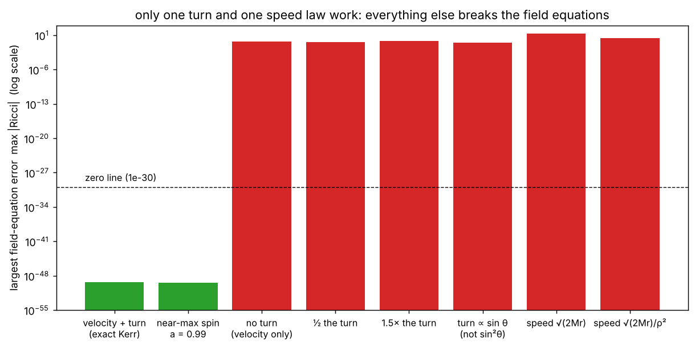

# DRAFT: The spinning river, and every idea of a frame (Nov 26, 2026)

Asked by Brennan (voice call). He said "Yeah, that is a, a good idea" to giving each river cell a rotation as well as a
velocity. He added: "And I'd also like to figure out if there's any other concept of frame. I feel like procession is
where we started talking about frame dragging at first." He then said "Yes" to widening the search to frame-dragging
look-alikes outside gravity: Larmor's theorem, spinning fluids and Foucault's pendulum.

Follows `../jet-river/` (the river as a jet field).

## The result in plain words

**Yes: give each cell a turn as well as a velocity, and the spinning black hole (Kerr) comes out exactly.** Every field
equation of empty space holds, to 50 digits. The curvature is Kerr's own, not some other vacuum. The turn is forced:
no turn, half the turn, 1.5 times the turn, or a different shape all break the equations. The lattice the cells move
through stays flat. It is ordinary flat space laid out in the spinning body's natural shape, squashed spheres. Each
cell still obeys the same velocity rule as before: it falls freely from rest far away, carrying no angular
momentum.

The turn shows up in a measurable place. The cell's clock leg doesn't close around the spin axis: after one lap at
the equator it is off by 2πa. That is exactly the shift in Kerr's orbital periods: prograde orbits take 2πa longer,
retrograde ones 2πa shorter, at every radius. This is the known "gravitomagnetic clock effect". Reading it as the
cell's clock gap is ours.

**Frames.** Our pages already hold 17 ideas of a frame. Foucault's pendulum, Larmor precession and the Berry phase
were on the precession page all along. They line up along the dial with one law, turn per loop = d × area. Of the
three outside-gravity look-alikes:

- **Larmor's theorem (new here):** a magnetic field acts on charges exactly like a turning frame. Its ½ is the same
  ½ as in the gyroscope rule of frame dragging.
- **Spinning fluids:** sound in a flowing fluid sees exactly our river. A draining, spinning bathtub drags waves the
  way a spinning star drags light. It does so with negative energy in our Q layer, though, and a fluid can't make
  the turn, so no fluid can make full Kerr.
- **Foucault:** this one was already ours. Earth's own frame dragging adds only 4.6 × 10⁻¹⁰ to the pendulum's turn,
  at every latitude.

**Update, round 7 (Part 3): the turn is now derived, not tested.** Two assumptions do it: each lattice shell turns
rigidly, and a falling ring of cells keeps its clock gap. Add Sagnac's area law and frame dragging's far field, and
the turn's shape sin²θ and its size a = J/M both come out. Reading the dial's edge as light speed at the innermost
shell's rim ties the lattice's ring to the turn. The field equations then only confirm. The speed law is still put in.

*Fig 1. Left: a non-spinning hole. Each cell's radial leg is pushed by v along its time leg, which is one shear.
Right: a spinning hole. The radial leg is also pushed by −v·α along the azimuth leg: the turn, a second shear. The
two shears commute. Both sit at the dial's flat middle, where boosts and turns both become shears.*

All numbers are from `checks.py` (**33/33 pass**, about 30 seconds). Curvature is computed with exact symbolic
derivatives and 50-digit arithmetic at sample points (`numgr.py`).

---

## Part 1. The spinning river

### 1.1 The lattice: flat space in the shape of a spinning body (fundamental)

A spinning body is squashed at the poles, so the natural lattice is made of squashed spheres (oblate spheroids).
Their semi-axes are √(r² + a²) across and r along the axis, where a = J/M is the spin per unit mass. At r = 0 they
shrink to a ring of radius a. This is still ordinary flat space, only labeled differently:

> x = √(r²+a²) sin θ cos φ, y = √(r²+a²) sin θ sin φ, z = r cos θ  gives dx² + dy² + dz² exactly (K1b)

Every curvature component of this lattice is zero (K1a).

*Fig 2. The lattice in a slice through the spin axis. Black ellipses are the squashed spheres; dotted curves run
outward. The red curve is the horizon, the orange dots are the ring, and the shading shows how much each cell turns.*

### 1.2 Each cell: a velocity and a turn

The cell's legs are the lattice's legs, changed in one place. The radial leg picks up

> e_r = (lattice radial leg) + v·(time leg) − v·α·(azimuth leg),  v = √(2Mr)/ρ,  α = a sin θ / √(r² + a²)

with ρ² = r² + a² cos²θ. The first push is the river's boost, unchanged from the non-spinning case. The second is the
turn: the radial leg leans toward the azimuth by α. The map has the form I + (shear) with (shear)² = 0, and the two
shears commute (K5a; Lean `shear_sq`, `cellMap_mul`). That is the dial's flat middle, q = 0, the dual numbers, where
a boost and a turn are both shears and simply add.

### 1.3 Kerr comes out, exactly

| check | result |
|---|---|
| every field equation of empty space (Ricci = 0), a = 0.7 M | max error 4.5 × 10⁻⁵⁰ (K2a) |
| the same near the fastest spin, a = 0.99 M | 3.3 × 10⁻⁵⁰ (K2b) |
| curvature invariant R_abcd R^abcd vs Kerr's formula | agree to every digit shown (K2c) |
| horizon: g^rr ρ² = r² − 2Mr + a² | Kerr's horizon, r₊ = M + √(M² − a²) (K6b) |
| slow spin: the turn's first-order part | the swirl 2J/r³ of `jet-river` (K6a) |

This metric is known: it is Doran's form of Kerr (2000). Hamilton and Lisle (2008) read it as a river whose cells
carry a Lorentz transformation, a boost plus a rotation. What is ours is the reading at the dial's flat middle, two
commuting shears on a flat spheroidal lattice, and the forcing tests below.

### 1.4 The turn is forced

*Fig 3. Largest field-equation error for each variant (log scale). Only the right turn with the right speed law is
zero (green). Velocity alone fails, any other size or shape of turn fails, and any other speed law fails (red).*

| variant | max error |
|---|---|
| velocity only, no turn | 0.53 (K3a) |
| half the turn / 1.5× the turn | 0.40 / 0.66 (K3b) |
| turn ∝ sin θ instead of sin²θ | 0.26 (K3b) |
| speed √(2Mr) or √(2Mr)/ρ² instead of √(2Mr)/ρ | 22.8 / 2.4 (K3c) |

So the turn isn't decoration. On this lattice, a spinning hole needs it, at exactly this size.

### 1.5 The velocity rule is unchanged

The cell's 4-velocity is u = −dt, and g^tt = −1 (K4a). So u has unit length and is a gradient, which makes it a free
fall. Its energy is E = 1, starting from rest far away, and it carries no angular momentum (K4b). This is the same
rule as in `velocity-lines` and `jet-river`: every cell is a zero-energy free faller. The speed law v² = 2Mr/ρ² is
that rule with the squashed-sphere "radius" ρ²/r in place of r.

### 1.6 The turn is a clock gap: Kerr's clock effect

The cell's time leg is dt − a sin²θ dφ. It does not close: going once around the axis, the clocks disagree by
2πa sin²θ.

Circular orbits in the equatorial plane have periods (K7a; Lean `kerr_period`)

> T± = 2π (r^(3/2)/√M ± a)  (prograde +, retrograde −)

So each orbit is shifted by exactly 2πa from Kepler's period, at every radius. That is the clock gap of one lap at
the equator (K7b). Their difference T₊ − T₋ = 4πa (4πJ/Mc² in ordinary units) is the known gravitomagnetic clock
effect (Cohen & Mashhoon, 1993). It doesn't depend on the radius, or even on G.

*Fig 4. Left: clocks carried around the spin axis fail to agree after one lap. Right: prograde and retrograde orbital
periods differ from Kepler's by +2πa and −2πa at every radius.*

### 1.7 What this changes from the last page

`jet-river` said full spin needed "cells that carry a rotation and a lattice that curves". The first half holds. The
second half needs a correction: the lattice the cells move through stays flat. What curves is the slice the cells
themselves see, the curvature 3R = 2Ma²(3 sin²θ − 2)/r⁵ found there. The input list is the same as for the non-spinning
case, a flat lattice and cells that are free fallers. The new structure is that each cell carries a turn as well as a
velocity.

Still not covered: gravitational waves. A wave is a ripple that travels, and a fixed lattice with fixed cell maps
can't carry one. It would need the cell maps themselves to change in time.

---

## Part 2. Every idea of a frame

### 2.1 Pass one: our own pages

The precession page is where frame dragging first came up. Its swap rule says b ∘ a = X⁻¹(a ∘ b)X: swapping the
inputs turns the answer and keeps its size. Over a loop that becomes **turn = d × area**. The precession page then
named frame dragging as "the only precession here that the theory can't produce on its own". Part F of the gravity
page closed that gap. This page closes it for full spin.

Here are all 17 frame ideas on our pages, sorted by the dial (survey of the repository):

*Fig 5. Every idea of a frame in our work, by dial setting. Left, d = +1, turning: Foucault, Coriolis, the tumbling
body, Larmor and Berry, Fuller's coil. Middle, d = 0, the flat middle: Galilean boosts (nothing precesses), the river
cells, the acoustic metric. Right, d = −1, relativity: Thomas–Wigner, geodetic, Lense–Thirring, rotating BTZ, Kerr's
clock effect. Purple: added on this page.*

| idea | where on our pages | dial | tie to frame dragging |
|---|---|---|---|
| swap rule, turn = d × area | precession §1 (A1–A7, Lean `swap_is_turn`) | any | the parent rule |
| holonomy ω (an output reading) | twisted-boosts; affine-names §6 | any | frame dragging's turn is a holonomy |
| Thomas–Wigner rotation | precession §2; twisted-boosts (36/36) | −1 | added to the drag in the double pulsar |
| geodetic (de Sitter) precession | twisted-boosts GP-B | −1 | frame dragging's sister effect |
| Foucault's pendulum, Coriolis | precession §4 (C5–C7) | +1 | turning frame, the everyday version |
| tumbling body's phase | precession §5 (D1–D3) | +1 | none |
| torqued gyroscope | precession §6 (E1–E6) | +1 | the 90° of the swap rule |
| Larmor precession, Berry phase | precession §7 (F1–F4) | +1 | half the d = +1 twist |
| Fuller's coil twist | fusion-magnets §3.5 | +1 | none |
| rotating BTZ drag (Fermi–Walker cross-check) | precession §8 (41/41) | −1 | a 2+1 frame dragging, exact |
| Lense–Thirring from boosting Newton | gravity-from-theory Part F (26/26) | −1 | derives frame dragging |
| river swirl 2J/r³ | jet-river J7 | 0 and −1 | slow-spin frame dragging |
| teleparallel tetrad, torsion | gr-bridges Part T | 0 | the river's frame and its defects |
| gauge connection, Aharonov–Bohm | electromagnetism | commuting case | same loop law, phases commute |
| Purcell: magnetism from a moving frame | electromagnetism | −1 | B as a frame effect |
| Bargmann phase m·area/ħ | bridge-survey (prediction) | 0 | the d = 0 version of the loop law |
| perihelion turn ≈ 6 × area/c² | river-rebuild §6 | −1 | shaped like the swap rule (observation) |

Missing before this page: Larmor's theorem, analogue gravity (spinning fluids), the Sagnac effect, and the Hannay
angle (cited once, never used).

### 2.2 Pass two: the literature, and the three look-alikes outside gravity

**Larmor's theorem (1897).** A charge in a weak magnetic field moves exactly as it would with no field, watched from
a frame turning at −qB/2m, up to terms of order B². Our check: the leftover error grows 4.18 times when B doubles, as a
B² error should, while without the turn it grows only 2 times (F1a).

- Our tools express it: the magnetic force qv × B has the Coriolis form 2m v × Ω, and Coriolis is the swap rule at
  d = +1 (precession page).
- The ½ in −qB/2m is the same ½ as in Part F's gyroscope rule, Ω = −½ curl h. In gravity, the field B_g = curl h plays
  the magnetic role. This is the known gravitational Larmor theorem (Mashhoon). Ours: the line through the swap rule.
- **Lead?** Modest. It explains a factor we already had, rather than opening something new.

*Fig 6. Left: a charge orbiting in a magnetic field (blue) and the field-free orbit watched from a frame turning at
Larmor's rate (dashed orange) lie on top of each other. Right: Foucault's turn against latitude (green). Earth's own
frame dragging (dashed purple) has the same shape, at 4.6 × 10⁻¹⁰ of the size.*

**Spinning fluids (analogue gravity).** Sound in a moving fluid travels on the metric −c²dt² + (dx − u dt)². That is
exactly our river, with the fluid's velocity as the river's (Unruh 1981; Visser 1998). A draining, spinning bathtub
has u_r = −A/r and u_φ = B/r. Sound is trapped inside r = A, and between r = A and r = √(A² + B²) waves must move
with the spin, as light must inside a spinning hole's ergoregion. Spinning water tanks have shown waves being
amplified this way (Torres et al., 2017).

- **Ours, the field-law side:** for any 2D flow, the energy density the river's cells measure is the Q layer of the
  strain, G_nn = det(sym ∇u) (F2a). For the bathtub that is −(A² + B²)/r⁴, which is negative (F2b). So the vortex
  drags waves like a spinning star, but in gravity's terms it would need negative energy. The analogy is in the
  velocities, not in the field law.
- **Ours, the Kerr side:** a fluid has only a velocity per point, no turn. By K3a, velocity alone can't make Kerr.
  This matches the known result that fluid vortices reproduce Kerr only in the equatorial plane (Visser & Weinfurtner,
  2005). The turn is the reason.
- **Lead?** Yes, a small one. "Fluids lack the turn" is a sharp, testable statement in our language. A system whose
  cells carry an internal turn, such as a fluid with a spin field (micropolar fluids, superfluid helium-3 textures),
  is where a full Kerr analogue might live. That is untested.

*Fig 7. Left: streamlines of a draining, spinning bathtub, with its sound horizon (black) and ergoregion edge (red
dashed). Right: the vortex's swirl rate B/r² and a spinning mass's swirl rate 2J/r³ both drag waves. The vortex's Q
layer is negative, though, while gravity's empty space has Q = 0.*

**Foucault's pendulum as a geometric phase.** Foucault's turn, 360° × sin(latitude) per sidereal day, is the
holonomy of carrying a direction around a circle of latitude on the sphere: d = +1 times the enclosed area. This was
already checked on our precession page (C5–C7), with the Berry and Hannay phases as its family (Berry 1984; Hannay
1985).

- New here: Earth's own frame dragging adds a vertical turn 2 sin(lat)·GJ/(c²R³). That is the fraction
  2(I/MR²)(GM/Rc²) = 4.6 × 10⁻¹⁰ of Foucault's turn, the same at every latitude, about 155 mas/yr at 45° (F3a).
- **Lead?** No. It is a nice number, but known physics with nothing new to test.

**Sagnac effect (from the survey's gap).** Light sent both ways around a turning loop returns with a time difference
4ΩA/c², a frame effect proportional to area: the same loop law again. The Kerr clock effect in §1.6 is gravity's
Sagnac effect, and here it is the cell clock's gap.

- **Lead?** Yes. The clock gap is a direct, quantitative reading of "the turn each cell carries". If the theory can say
  why the gap is a sin²θ per radian, it would derive the turn instead of finding it. (Done in Part 3.)

## Part 3. Deriving the turn (round 7)

Asked by Brennan, who answered "Yes" to: "Should I try to derive the turn's size from the dial, so Kerr's clock gap
becomes an output instead of something we found by testing?"

**Result: the turn's shape and size come out of four short steps, and the field equations then only confirm.** It
takes two assumptions, one known law, one far-field match and one reading. Kerr's a = J/M is an output, and so is its
clock gap, 2πJ/M per lap. Nothing is fitted. What is still put in by hand: the flat spheroidal lattice, and the speed
law v² = 2Mr/ρ² from Part 1, which is still matched by the field equations rather than derived.

*Fig 8. The chain. Blue: the area law gives the shape. Purple: the circulation law gives the rate in each shell.
Green: frame dragging far away gives the size. Orange: the rim at light speed ties the lattice's ring to the turn.
Red: the output, Kerr, with every empty-space field equation satisfied.*

### 3.1 Shape: the area law (D1)

Suppose each lattice spheroid turns as a whole, at its own rate Ω(r) (assumption 1: rigid shells). At the dial's flat
middle, the turning shell's time leg is the lattice time leg pushed sideways by the shell's speed: one more shear.
Around a latitude circle, that leg's clock gap is exactly 2 × Ω × (the circle's area). This is Sagnac's law, known,
and at q = 0 it holds exactly, with no γ factor (D1a). The circle's area is π(r² + b²) sin²θ, so

  turn f = Ω(r) · (r² + b²) · sin²θ.

**The sin²θ shape is just the area of a latitude circle.** And Part 1's turn amount, α = a sinθ/√(r² + a²), turns out
to be exactly the speed of the shell at that point (D1b). So the "turn" is the cell being pushed along the turning
shell's own time leg.

### 3.2 Rate per shell: the circulation law (D2)

For any turn function, the cells fall along cones of fixed θ (D2a). A latitude ring of cells therefore stays a
latitude ring as it falls. The ring's clock gap changes at the rate −2π u^r ∂f/∂r (D2b). Assumption 2 is that a
falling ring keeps its gap. This is a circulation law, like Kelvin's for a swirling fluid. It holds exactly when f
doesn't depend on r. With 3.1 that forces

  Ω(r) = κ / (r² + b²),  f = κ sin²θ.

### 3.3 Size: frame dragging far away (D3)

Far out, this cell gives g_tφ → −2Mκ sin²θ / r. Part F derived frame dragging's far field, −2J sin²θ / r, and checked
it against Gravity Probe B and LAGEOS. Matching the two gives **κ = J/M**.

### 3.4 The ring: the rim at light speed (D4)

The innermost shell, r = 0, is a flat disk of radius b. Its rim moves at κ/b. Reading the dial's edge as the fastest
a shell can go puts the rim at light speed, which gives **b = κ**. The lattice's ring and the turn are then the same
length, and every other shell moves slower than light: 1 − α² = ρ²/(r² + κ²) ≥ 0, which is zero only on the ring.
This matches a known picture of Kerr's source: Israel (1970) read it as a flat disk of radius a spanning the ring,
with its material reaching light speed at the rim (and with negative energy density, so it isn't a realistic star).
Our r = 0 shell is a lattice shell in flat space, not Israel's material disk. The match is in the radius and the rim
speed.

### 3.5 The field equations confirm, and every step matters (D5, D6)

The derived cell is identical to Part 1's tested one, with a = J/M (D5a). It solves every empty-space field equation,
max |Ricci| = 5 × 10⁻⁵⁰ (D5b). Change any step and empty space breaks (D5c):

*Fig 10. The largest field-equation error for the derived chain (green) and for five changes to it (red). Those are
a rim faster or slower than light, two ways of letting the clock gap change between shells, and a gap that drifts
with r. Log scale; the dotted line is the 10⁻³⁰ "zero" threshold.*

There is also a bonus, which is a check we didn't aim for. At the horizon, Kerr's dragging rate −g_tφ/g_φφ equals the
derived shell rate a/(r₊² + a²) (D6b). That is Kerr's known horizon spin, Ω_H. It is also the rate of Carter's frame.
The t–φ block closes exactly there: g_tφ² − g_tt g_φφ = sin²θ (r² − 2Mr + a²) (D6a).

*Fig 9. Left: the flat lattice, each spheroid turning rigidly at Ω(r) = a/(r² + a²). The arrows show each shell's
equator speed, and only the r = 0 disk's rim reaches c. Right: one curve carries the light-speed rim at r = 0, Kerr's
horizon spin at r₊, and frame dragging's 2J/r³ far away.*

### 3.6 What is still assumed, plainly

| step | status |
|---|---|
| flat spheroidal lattice | put in (Part 1.1) |
| speed v² = 2Mr/ρ² | put in, matched by the field equations (K3c); not derived |
| shells turn rigidly | **assumption 1** |
| clock gap = 2 Ω × area | known law (Sagnac), exact at q = 0 |
| a falling ring keeps its gap | **assumption 2** (circulation law) |
| κ = J/M | derived, from Part F's far field |
| rim at light speed, b = κ | a **reading** of the dial's edge; the field equations confirm only b = κ works |
| Kerr, a = J/M, clock gap 2πJ/M, Ω_H | **output**, checked |

The next gap is the speed law. If it can be derived too, perhaps as a Gauss law on the spheroids the way rv² = 2Gm
came out of the jet river, then Kerr would follow from the lattice shape plus the two assumptions.

## Verdict, on its own merits

- **Holds:** full Kerr comes out of a flat lattice plus cells that each carry a velocity and a turn. The equations
  hold to 50 digits, the curvature is Kerr's own, and the turn's size, shape and speed law are all forced. The cells
  obey the same zero-energy rule as before. Brennan's "more structure than velocity" is exactly one extra shear per
  cell.
- **Opens a lead:** the turn is visible as a clock gap, 2πa per lap, equal to Kerr's clock effect. Deriving that gap
  from the dial, rather than reading it off Doran's metric, would make the turn an output. A second, smaller lead: no
  fluid can make full Kerr because fluids lack the turn.
- **Derived since (Part 3):** the turn's form a sin²θ and its size a = J/M now come from rigid shells, the circulation
  law, Sagnac's area law and frame dragging's far field. That makes the clock gap 2πJ/M an output. Kerr's horizon spin
  comes out as a bonus.
- **Not derived:** the speed law v² = 2Mr/ρ² and the spheroidal shape of the lattice are still put in. The light-speed
  rim is a reading. Gravitational waves are still out of reach.
- **Frames:** one area law runs through all of them, turn = d × area. Thomas, geodetic, Lense–Thirring and Kerr sit at
  d = −1; Foucault, Coriolis, Larmor and Berry at d = +1; the river and the acoustic metric at d = 0. Larmor's theorem
  explains the ½ in frame dragging's gyroscope rule.

## Files

- `checks.py`: 33 checks (K1–K7 the spinning river, F1–F3 frames, D1–D6 deriving the turn), writes `checks_output.txt`, `results.json`.
- `numgr.py`: curvature at a point, exact derivatives and 50-digit arithmetic.
- `grtools.py`: symbolic helper shared with the earlier pages.
- `figures.py`: the ten figures in `figures/`.
- `lean/SpinningRiver.lean`: `shear_sq`, `cellMap_mul`, `shear_layers`, `kerr_period`; round 7 adds `area_law`,
  `rim_at_light`, `tphi_block`, `horizon_rate`. All eight are compiled in the shared library as
  `FusedAlgebra.Topics.SpinningRiver` (as written; namespace `CircleOp.SpinningRiver`); it builds on `FusedAlgebra.Topics.JetFields`.

## Known vs ours

| piece | status |
|---|---|
| Kerr metric (1963); Doran's river form (2000); Hamilton–Lisle river with boost + rotation (2008) | known |
| oblate spheroidal coordinates are flat space | known |
| reading the cell map as two commuting shears at the dial's flat middle | **ours** |
| forcing tests: no turn, other sizes, other shapes, other speed laws all fail | **ours** (checks) |
| cells are zero-energy, zero-angular-momentum fallers | known (Doran); **ours** as "the velocity rule, unchanged" |
| clock effect T₊ − T₋ = 4πa | known (Cohen & Mashhoon 1993); **ours** as the cell clock's gap per lap |
| Larmor's theorem; gravitational Larmor theorem | known (Larmor 1897; Mashhoon); **ours**: the ½ tied to the swap rule and Part F |
| acoustic metric = river; bathtub horizon and ergoregion | known (Unruh 1981; Visser 1998) |
| G_nn = det(sym ∇u) for any 2D acoustic river; the bathtub's Q < 0 | **ours** as the Q-layer reading (the energy constraint itself is known) |
| fluids can't make full Kerr | known (Visser & Weinfurtner 2005); **ours**: the reason is the missing turn |
| Foucault as holonomy; Earth's drag at 4.6 × 10⁻¹⁰ of it | known physics; the ratio's form 2(I/MR²)(GM/Rc²) worked out here |
| sin²θ shape as the area of a latitude circle; α as the turning shell's speed | **ours** (D1); Sagnac's law known |
| circulation law for the cell clock gap, forcing Ω(r) = κ/(r²+b²) | **ours** (D2), an assumption, modelled on Kelvin |
| κ = J/M from the far field | **ours** as a derivation step; a = J/M itself known |
| light-speed rim of a flat disk of radius a | known picture (Israel 1970); **ours** as the lattice's r = 0 shell and as the reason b = κ |
| horizon spin Ω_H = a/(r₊²+a²) = the shell rate; Carter's frame rate | known values; **ours** as the derived shell rate |
