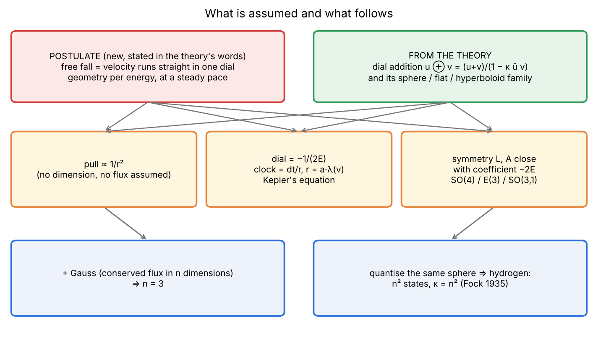
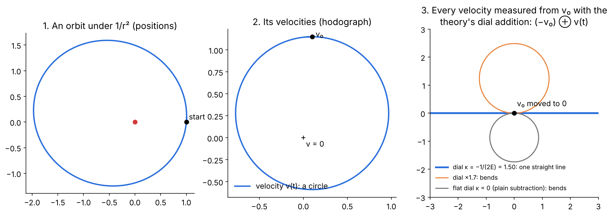
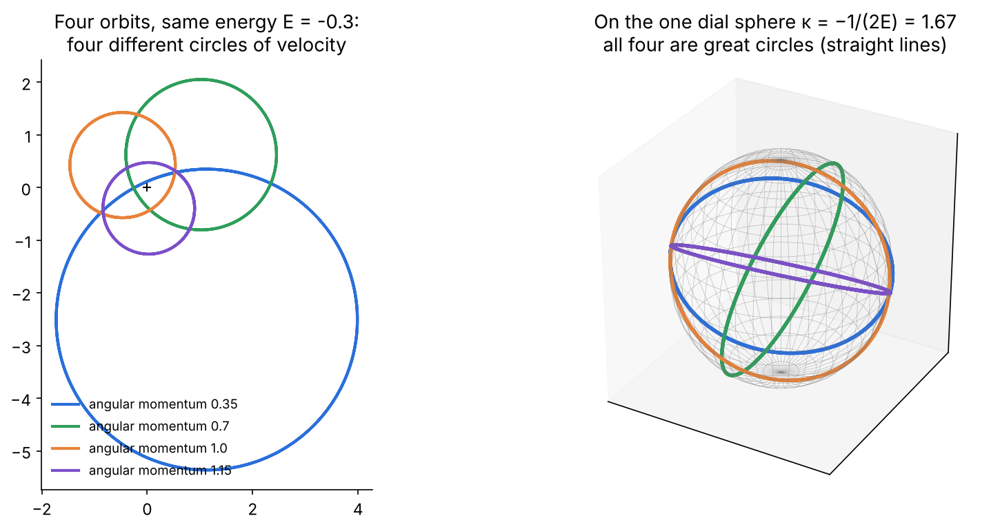
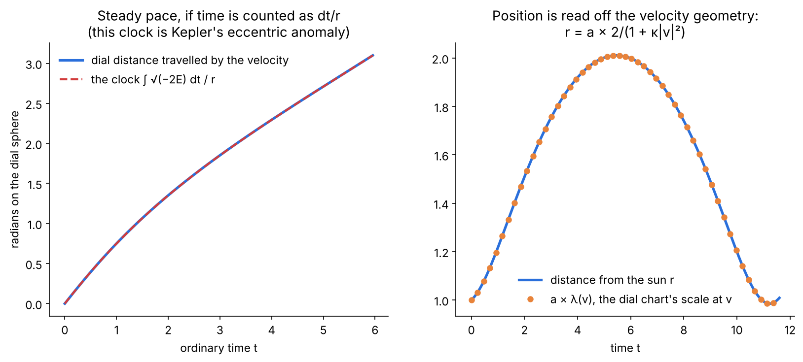
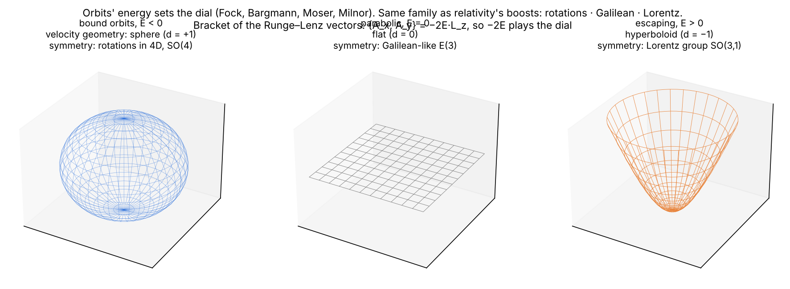
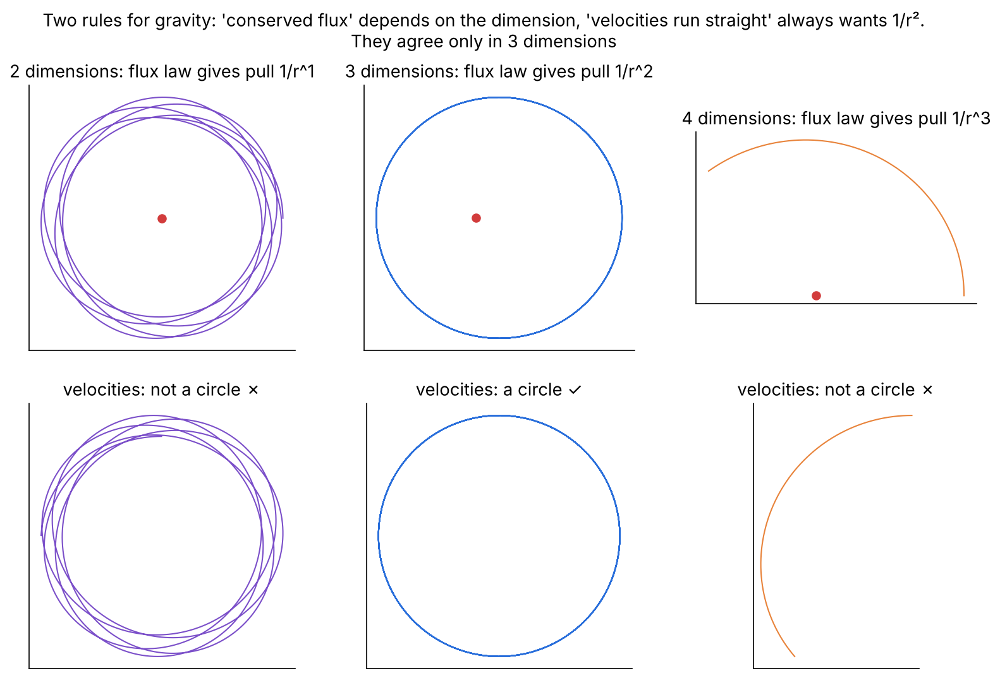
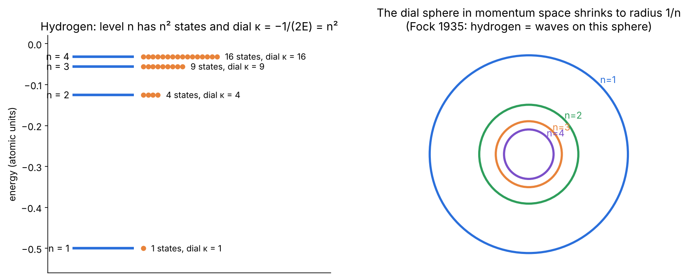

# DRAFT: Why do orbits' velocities run straight in the dial geometry? (Nov 26, 2026)

> **Names:** some words or symbols on this page (⊕, twist) also mean something else in standard math, physics or computing, or inside this project. [NAMING-COLLISIONS.md](../../../NAMING-COLLISIONS.md) says which meaning is in play.

Asked by Brennan (voice call), answering "should I look for a reason in the theory why orbits follow those straight
lines? That would turn the 1/r² link into a real derivation": "That is what I want to look at."

Follows `../README.md` (Part N.3), where 1/r² was shown to be equivalent to "orbit velocities run along straight
lines of the dial's geometry, with dial κ = −1/(2E)".

## The result in plain words

We did not find a reason inside the operation itself that forces this. What we found is the cleanest way to say it
in the theory's own words, and it works as a new starting rule: **in free fall, measure every velocity from the
starting velocity with the theory's dial addition, and they all point one way.** That one rule gives the
inverse-square law without assuming three dimensions or a conserved flux, it fixes the dial to the orbit's energy,
it hands back Kepler's clock and Kepler's equation, and the same sphere, quantised, is the hydrogen atom. So 1/r² is
now derived **from a postulate stated in the theory**, not from the operation alone. The postulate is the honest
gap.

*Fig 7. Red: the one new assumption. Green: what the theory already had (the dial addition and its sphere, flat and
hyperboloid ends). Orange: what follows. Blue: what it connects to.*

All numbers are from `checks.py` (**13/13 pass**). Units GM = 1, velocities as complex numbers.

---

## 1. The rule, in the theory's own operation (fundamental)

*Fig 1. Left: an orbit under 1/r². Middle: its velocities trace a circle. Right: take each velocity v(t) and
"subtract" the starting velocity v₀ with the theory's dial addition, (−v₀) ⊕_κ v(t), where
u ⊕_κ v = (u + v)/(1 − κ·ū·v) (the twisted-boosts page's velocity law). With κ = −1/(2E) every result lies on one
straight line through 0 (blue). With any other dial, including plain subtraction (κ = 0), the path bends.*

- Bound orbit: spread of directions 5×10⁻⁹ rad with κ = −1/(2E); 3.1 rad with κ × 1.7 or κ = 0 (V2a).
- Escaping orbit: the same with the negative dial κ = −1/(2E) < 0, the boost end (V2b, 2×10⁻¹¹).

So free fall under 1/r² is "inertia in velocity space": a straight line, where "straight" is measured with the
theory's dial addition rather than plain subtraction.

**Status.** The geometry is known: Hamilton's hodograph (1846–47), Fock (1935), Moser (1970), Milnor, "On the
geometry of the Kepler problem" (1983). Ours: stating it with the dial addition ⊕_κ, and identifying Milnor's
metric with the theory's dial chart.

## 2. The rule fixes the dial: one geometry per energy

*Fig 3. Four orbits with the same energy and different angular momentum: four different velocity circles (left).
On the one dial sphere κ = −1/(2E) all four are great circles (right).*

- Every 1/r² velocity circle has "power" |centre|² − radius² = 2E at v = 0 (V1, 12 random orbits, error 5×10⁻¹¹).
  A circle is a straight line of the κ-chart exactly when that power is −1/κ, so the dial is forced:
  **κ = −1/(2E)**, nothing else chosen.
- Orbits that share an energy share one dial, whatever their angular momentum or orientation (V1b).
- Bound orbits (E < 0) live on the sphere end (d = +1), escaping ones (E > 0) on the hyperboloid end (d = −1),
  and the parabola (E = 0) on the flat middle (d = 0).

## 3. What the rule gives back

*Fig 2. Left: the velocity moves along its dial line at a steady pace if time is counted as √(−2E)·dt/r; that clock
is Kepler's eccentric anomaly. Right: the distance from the sun is a × the dial chart's scale at the current
velocity, r = a·2/(1 + κ|v|²).*

- **Steady pace.** Dial distance travelled = change in eccentric anomaly (V3, 2×10⁻⁹), at rate √(−2E)/r (V3b).
- **Position from velocity.** r = a·λ(v) with λ = 2/(1 + κ|v|²) (V4, 10⁻⁹). The geometry of the velocities
  already knows where the body is.
- **Kepler's equation.** Together these give n·t = s − e·sin s with s the dial distance (V5).
- **1/r² itself.** The rule says velocities lie on circles. For a central pull F(r), the velocity circle's centre
  stays put only if F = −K/r² (V7, symbolic: d(centre)/dt ∝ K + F(r)·r²; Hamilton's converse). Other power laws
  fail (V6).

## 4. Symmetry: the same dial family as relativity

*Fig 4. The orbit's energy picks the end of the dial: sphere (bound), flat (parabolic), hyperboloid (escaping). The
symmetry groups are rotations in 4D, a Galilean-like group, and the Lorentz group: the same three ends as the
theory's boosts (turns, Galilean, relativity).*

- The extra conserved vector (Runge–Lenz, A) and angular momentum L close with
  **{A_x, A_y} = −2E·L_z** (V8, symbolic). The coefficient −2E plays the dial: positive gives the sphere's
  rotations SO(4), zero the flat E(3), negative the Lorentz group SO(3,1). The general-relativity page found the
  theory's boosts close on "−q × a rotation": the same structure.
- A conserved vector of this form exists for V = −K/r (V9). (Tested weights fail for V = −K/r²; the full
  uniqueness is V7.)

**Status.** Known: Pauli (1926), Fock (1935), Bargmann (1936); scattering states and SO(3,1) are standard. Ours: the
reading of −2E as the theory's dial, with the energy's sign choosing the end.

## 5. Dimensions: why 3 might come out

*Fig 5. Top: the conserved-flux rule gives 1/r, 1/r², 1/r³ in 2, 3, 4 dimensions. Bottom: only the 3D one draws a
velocity circle. The velocity-line rule wants 1/r² in any dimension.*

The velocity-line rule never mentions the dimension (orbits are flat, so it works the same in any space). Gauss's
conserved-flux rule gives 1/r^(n−1) in n dimensions. **Asking for both forces n = 3** (V6: misfits 10⁻¹, 2×10⁻¹,
8×10⁻¹², 5×10⁻¹, 10⁻² for n = 2, 2.5, 3, 3.5, 4).

**Status.** In spirit this is known: Bertrand's closed orbits plus Gauss also single out n = 3 (Ehrenfest 1917 asked
the same question). Ours: the version with the dial's straight lines.

## 6. The quantum side: hydrogen is this sphere

*Fig 6. Left: hydrogen's levels E_n = −1/(2n²) have n² states each, and at those energies the dial is κ = n². Right:
in momentum space the dial sphere has radius 1/n.*

Fock (1935) showed that hydrogen's wave equation is exactly waves on this same sphere (in momentum space). Waves of
degree n − 1 on the 3-sphere number n², hydrogen's degeneracy (V10), and at E_n the dial is the whole number
κ = n². So the one rule "velocities run straight in the dial geometry" covers planets (classical) and the hydrogen
atom (quantum).

**Status.** Known (Fock 1935). Ours: dial κ = n² as the theory's reading.

---

## Verdict, on its own merits

- **Is 1/r² derived?** From the operation alone, no. From one new rule stated in the theory's terms, yes: "free
  fall = a straight line in velocity space, with straightness measured by the dial addition." That rule is
  equivalent to Hamilton's circle law, so the content is not new; the theory gives it a home and a name.
- **Is it worth following? Yes**, for three concrete reasons. (1) It replaces two inputs, "three dimensions" and
  "conserved flux", with one, and together with flux it picks n = 3. (2) Its symmetry is the theory's own dial
  family, with energy setting the dial, the same three ends as relativity. (3) The same sphere is the hydrogen atom,
  which puts planets and atoms under one rule, the direction of the North Star.
- **The gap.** Nothing yet says why free fall should be straight in the dial geometry. One concrete next step: the
  general-relativity page's river flows at the escape speed, and here |v|² − v_esc² = 2E, so the river's speed is
  the scale of this velocity geometry (r = a·λ(v) is the same statement). Building the river on this rule instead of
  on Newton would leave the rule (and G) as gravity's only input. A second step: the relativistic orbit (Mercury)
  precesses, so its velocity line must slowly turn; whether that turn is the swap rule's "turn = dial × area" is
  testable.

## Files

- `checks.py` → `checks_output.txt`, `results.json`: **13/13 pass** (sympy, numpy, scipy), about 1 minute.
- `figures.py` → `figures/fig1` to `fig7` (labeled PNGs).
- No Lean file: no Lean toolchain in this container. Lean candidates: the dial-addition line identity for a circle
  of power −1/κ (rational), the bracket {A_x, A_y} = −2H·L_z is beyond core Lean without calculus.

## Known vs ours

| Piece | Status | Source |
|---|---|---|
| Hodographs of 1/r² are circles, and only for 1/r² | known | Hamilton 1846–47 |
| Velocity space of fixed energy is a sphere / plane / hyperboloid; orbits are its geodesics; clock dt/r | known | Fock 1935, Moser 1970, Milnor 1983 |
| L and A close with coefficient −2E: SO(4), E(3), SO(3,1) | known | Pauli 1926, Fock 1935, Bargmann 1936 |
| Hydrogen = waves on the sphere, n² states | known | Fock 1935 |
| (−v₀) ⊕_κ v(t) stays on one line with the theory's dial addition | ours (statement) | V2 |
| Milnor's metric = the theory's dial chart, κ = −1/(2E); −2E as the dial | ours (identification) | V1, ../N9 |
| r = a·λ(v): position as the dial chart's scale | known in substance (Fock's change of variables); wording ours | V4 |
| Velocity-line rule + conserved flux ⇒ n = 3 | known in spirit (Bertrand, Ehrenfest); this version ours | V6 |
| κ = n² at hydrogen's levels | ours (reading) | V10 |
