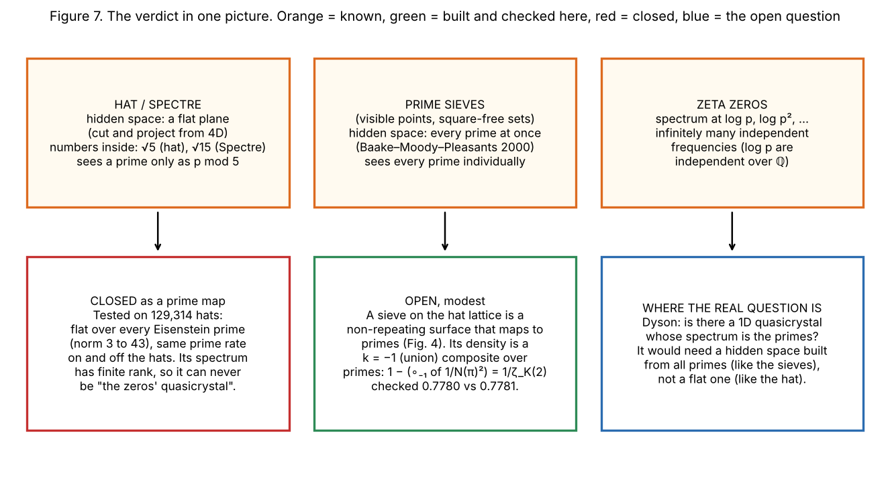
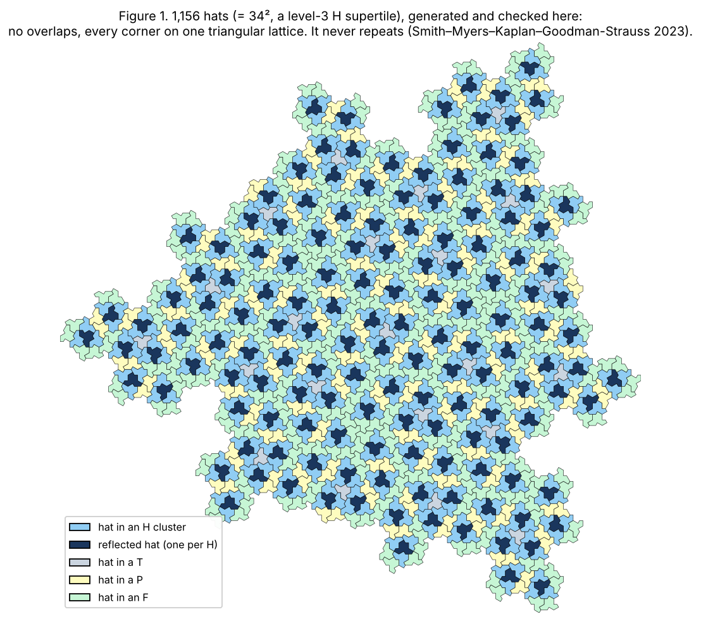
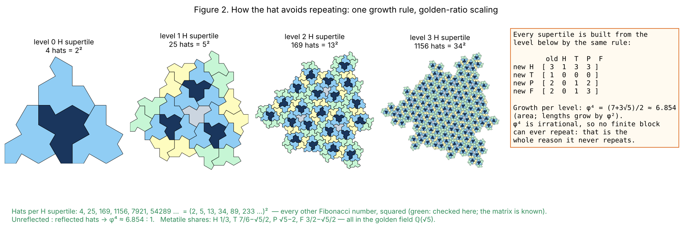
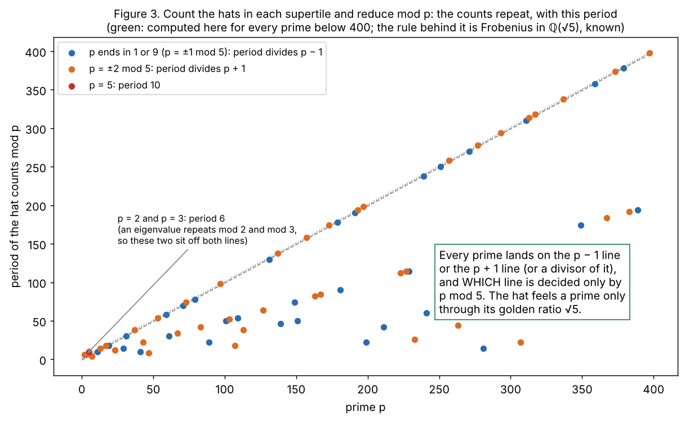
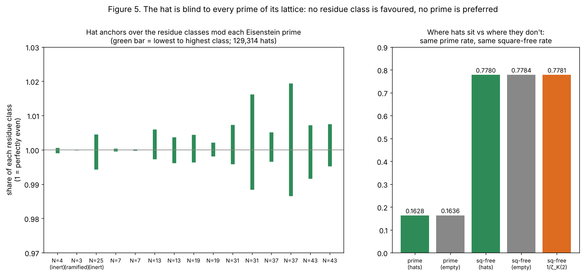
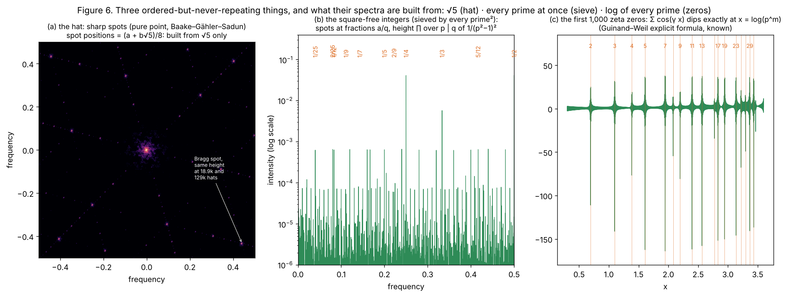
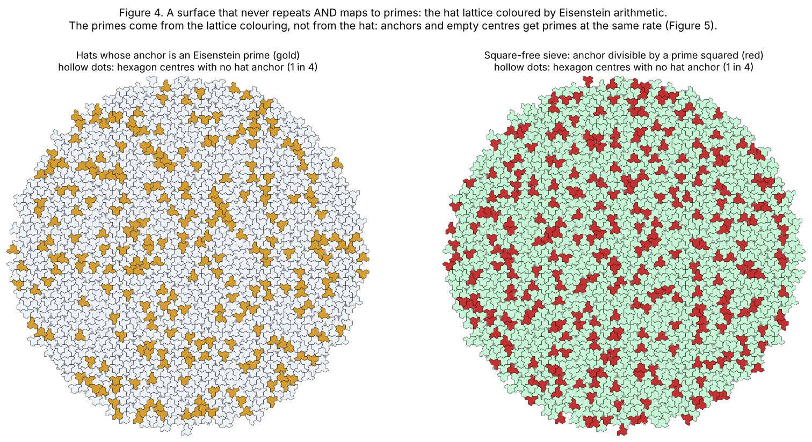

# DRAFT · The hat tile and the primes: can a never-repeating surface map to the primes?

**DRAFT, Nov 27 2026.** Part of Affine Composition Theory, built on Fused Hyperoperation Algebra. Not reviewed.
Asked for by Brennan (Nov 27): "I want to look at the hat tile to see if there is any use for such a shape to help us
create a non repeating surface that can map to prime numbers in some way."

Checks: [`checks.py`](checks.py) → [`checks_output.txt`](checks_output.txt), **18 of 18 pass** in about 3.5 minutes
(numpy, sympy, matplotlib only). Numbers: [`substitution.py`](substitution.py) → `substitution.json`,
[`lattice_primes.py`](lattice_primes.py) → `lattice_primes.json`, [`spectra.py`](spectra.py) → `spectra.json`.
Hat generator: [`hatgen.py`](hatgen.py). Pictures: [`figures.py`](figures.py) → [`figures/`](figures/).
Lean: [`lean/HatPrimes.lean`](lean/HatPrimes.lean), 7 statements in core Lean, **not compiled here** (no Lean toolchain).
Colour key in every picture: **green = built and measured here, blue = our earlier pieces, orange = known, red = closed.**

## The answer first

**The hat itself does not map to the primes, and we can say why.** We built 129,314 real hats and tested them against
every small prime of their own lattice: the hats are spread perfectly evenly over every residue class, and they sit on
primes exactly as often as the gaps between them do. The only number the hat "knows" is the golden ratio √5, so it can
tell a prime apart only by its last digit pattern mod 5 (Figure 3). Its spectrum is built from √5 alone, so it can never
be the never-repeating pattern behind the zeta zeros that Dyson asked about.

**But the surface you asked for does exist, and it is easy to build:** put the hats on their lattice and colour each one
by the arithmetic of its position (Figure 4). That surface never repeats twice over: once because of the hat, once
because of the primes. The primes part is a known kind of object, a *prime sieve* (the visible points and the
square-free numbers of Baake, Moody and Pleasants 2000), and its density comes out of **our union rule (k = −1)**
applied prime by prime: we measured 0.7780 against the exact 1/ζ_K(2) = 0.7781.

**Is it a lead?** The hat as a prime map: **no, closed** (reasons below). The sieve-on-a-tiling surface: **a modest,
honest lead**, because its numbers are Euler products, which are our hyper integrals on the primes, and the open
question it points at (Dyson's) needs exactly the kind of "hidden space built from every prime" that the sieves have and
the hat lacks.

*Figure 7. The verdict in one picture.*

## 1. How the hat avoids repeating (all known; generator built and checked here)

The hat is a 13-sided shape made of 8 kites from the hexagon grid (Smith, Myers, Kaplan, Goodman-Strauss 2023). Copies
of it (and its mirror image) cover the plane, but never in a repeating way.

*Figure 1. 1,156 hats made by our generator (a port of Kaplan's metatile construction). Checked: no two overlap, every
corner lies on one triangular lattice.*

**The mechanism is a growth rule.** Hats group into four clusters, called H, T, P, F. Each cluster grows into a bigger
cluster of the same four kinds by one fixed rule (the matrix in Figure 2), and repeating this forever fills the plane.
Each step multiplies area by φ⁴ = (7 + 3√5)/2 ≈ 6.854. Because φ⁴ is irrational, the tilings this rule builds cannot
repeat: a repeating tiling has rational proportions of each cluster, but here the proportions are irrational
(H 1/3, T 7/6 − √5/2, P √5 − 2, F 3/2 − √5/2). That *every* tiling by hats is built this way, so that no periodic hat
tiling exists at all, is the harder theorem of Smith et al.

*Figure 2. The growth rule, levels 0 to 3.*

One small thing we noticed: **the hats in a level-n H supertile number 4, 25, 169, 1156, 7921, … = F(2n+3)², the
squares of every other Fibonacci number.** Proof (check 6): both sequences obey s(n+3) = 8s(n+2) − 8s(n+1) + s(n)
(the matrix's eigenvalue −1 is never used) and start the same. We did not find this stated in print; it is an easy
consequence of the known matrix. The ratio of unreflected to reflected hats tends to φ⁴ (check 7).

**The deeper known picture.** Baake, Gähler and Sadun (2023, arXiv 2305.05639) showed that every hat tiling is a
slightly deformed **cut-and-project set**: a slice of a 4-dimensional lattice, viewed through a window in a flat
2-dimensional "hidden space". That is why its diffraction is pure point (sharp spots only). The Spectre, the mirror-free
cousin (Smith et al. 2023, arXiv 2305.17743), works the same way with area factor 4 + √15, so its number is √15.

## 2. Does the hat see primes? Three tests

### Test A: its counts mod p

Take the hat counts of each supertile and reduce them mod a prime p. They repeat, and the period is controlled by
whether √5 exists mod p: for p = ±1 mod 5 the period divides p − 1, for p = ±2 mod 5 it divides p + 1. That is the
Frobenius rule in the golden field ℚ(√5) (known; Wall 1960 for Fibonacci numbers). Checked for every prime below 400.

*Figure 3. Each prime lands on one of two lines, chosen by p mod 5 alone.*

**So the hat sees a prime only through one bit: is p = ±1 or ±2 mod 5?** Half the primes give each answer (Dirichlet).
That is far too coarse to encode primes.

### Test B: its positions on its own lattice

Every hat corner sits on the triangular lattice, which is the Eisenstein integers ℤ[ω], a number system with its own
primes. We wrote each hat's anchor corner as an Eisenstein integer. The anchors turn out to be exactly hexagon centres
of the kite grid (check 10), and in hexagon-centre coordinates:

- the anchors are spread **evenly** over the residue classes of every Eisenstein prime of norm 3 to 43 (worst class
  off by 2%, and more even than random dots would be; check 11);
- **hats sit on Eisenstein primes exactly as often as the empty hexagon centres do** (16.28% vs 16.36%; check 12);
- the square-free share of the anchors is 0.7780, the same as for every lattice point, 1/ζ_K(2) = 0.7781 with
  K = ℚ(√−3) (check 13).

*Figure 5. The hat favours no residue class and no prime.*

### Test C: its spectrum

The hat's diffraction has sharp Bragg spots whose height stays the same as the patch grows 7 times (check 17), as
Baake–Gähler–Sadun proved. Every strong spot we refined sits at a point (a + b√5)/8 in lattice units, within the
patch's resolution. So the spectrum is made from √5 alone.

*Figure 6. (a) The hat: spots from √5. (b) The square-free numbers: spots at fractions a/q, each height a product over
the primes dividing q (check 15). (c) The zeta zeros: the sum Σ cos(γx) over the first 1,000 zeros dips at
x = log 2, log 3, log 4, log 5, log 7, … (check 16; this is the Guinand–Weil explicit formula).*

**Why the hat can never be "the zeros' quasicrystal".** A cut-and-project set from a 4-dimensional lattice has its
spectrum inside a set generated by at most 4 numbers (the projected dual lattice). The zeros' spectrum contains log p for
every prime p, and the log p are independent over the rationals (unique factorisation; check 18 for the first four), so
no finite set generates them. This holds for the whole hat family and the Spectre. (The observation is standard in
the Dyson discussion; see Lagarias 2000.)

## 3. The surface you asked for: the hat lattice with a prime sieve

Since the hat is blind to primes, the primes have to be painted on. The natural paint is the arithmetic of the lattice
it lives on:

*Figure 4. Left: hats whose anchor is an Eisenstein prime. Right: the square-free sieve (red = the anchor is divisible
by the square of an Eisenstein prime).*

This surface never repeats, and it maps to the primes in a precise sense: every red hat names a prime π with π² dividing
its position, and every gold hat **is** a prime of ℤ[ω]. Rational primes show up as follows: p = 3 is one prime
(ramified), p = 1 mod 3 splits into two (norm p), p = 2 mod 3 stays prime (norm p²).

**Where our algebra enters.** Removing the positions divisible by π² for each prime π is an "at least one of these
happens" rule, and independent events combine by **the union rule a ∘₋₁ b = a + b − ab** (k = −1 on probabilities;
see the set-operations page and the new-ties union fractal). The local removal rate for π is 1/N(π)², the primes act
independently (Chinese remainder theorem), so

  share removed = ∘₋₁ over all primes π of 1/N(π)²,  share kept = ∏(1 − 1/N(π)²) = 1/ζ_K(2).

On the hat anchors the union composite of the measured local rates gives 0.7786 against the measured 0.7780 (check 14),
and both sit on 1/ζ_K(2) = 0.77809. This is inclusion–exclusion written in our notation: **known**, but it is a clean
place where k = −1 does real work on the primes, and the same product is a hyper integral on the primes in the sense of
the Euler-product pages.

## 4. Why this is (and isn't) a lead

- **Closed: the hat as a prime code.** Three independent tests, all negative, each with a reason. The reason is
  structural, not a failure of search: the hat's hidden space is a flat plane and its only number is √5.
- **Open, modest: sieve surfaces.** A surface that maps to primes needs a hidden space built from every prime at once.
  The sieves have exactly that (their hidden space is a product over all primes, Baake–Moody–Pleasants 2000;
  Baake–Huck–Strungaru 2017), and their spectra are Euler products. The next honest step would be to write the
  sieve's diffraction heights, ∏ over p | q of 1/(p² − 1)², as our ∘ₖ composites and see whether a dial move (changing
  k, or the exponent 2) lands on another known sieve (k-free numbers, B-free sets) or on something new.
- **Where the real question is: Dyson.** Dyson (2009) asked for a classification of 1D quasicrystals, hoping the zeros
  are one. Our tests show which kind it would have to be: not a flat-hidden-space one like the hat or the Fibonacci chain
  (Pisot numbers), but one whose hidden space carries every prime, like the sieves. That narrows where to look; it does
  not open a road to the Riemann hypothesis by itself, and the Riemann page's verdict stands.

## Assumptions

- The hat patches come from our port of Kaplan's metatile construction (hatviz). We check them directly: no overlaps
  (a lattice-invariant sampling test that does catch the one overlap in Kaplan's scaffolding patch), all corners on one
  lattice, counts matching the known substitution matrix. We use only the four genuine next-level metatiles of each
  patch; seven scaffolding pieces are dropped.
- "Anchor" means the image of the hat's corner hexPt(0,0); it is always a hexagon centre, and one hat per anchor.
- Tests B and C are numerical, on one patch of 129,314 hats (and an 18,867-hat patch for the Bragg comparison). The
  statements that the hat is a model set with pure point spectrum and a flat 2D hidden space are Baake–Gähler–Sadun's
  theorems, not ours. The spot positions (a + b√5)/8 are fitted to within the patch's resolution, not proved here.
- The origin used for "is this anchor prime" is a hat anchor near the patch centre. The arithmetic depends on that
  choice; the evenness results do not.
- Check 6 (Fibonacci squares) is a proof for all n; the Lean file checks n ≤ 11 by computation.

## Known vs new

| Piece | Status | Source |
|---|---|---|
| Hat, metatiles H/T/P/F, inflation φ² (area φ⁴) | known | Smith, Myers, Kaplan, Goodman-Strauss, *An aperiodic monotile* (2023), arXiv 2303.10798 |
| Substitution recurrences on hat counts | known | Schirmann, Franca, Flicker, Grushin (2023), arXiv 2307.11054 |
| Hat family = deformed cut-and-project sets, 2D Euclidean hidden space, pure point | known | Baake, Gähler, Sadun (2023), arXiv 2305.05639; diffraction: arXiv 2502.03268 |
| Spectre, area factor 4 + √15 | known | Smith, Myers, Kaplan, Goodman-Strauss, *A chiral aperiodic monotile* (2023), arXiv 2305.17743 |
| Periods mod p split by p mod 5 | known in kind (Frobenius; Wall 1960 for Fibonacci) | checked here for the hat matrix |
| Visible points / k-free integers: pure point diffraction, Euler-product heights | known | Baake, Moody, Pleasants (2000), arXiv math/9906132 |
| Zeros' explicit formula; Dyson's quasicrystal question | known | Guinand (1948), Weil (1952); Dyson, *Birds and Frogs*, Notices AMS (2009); Lagarias (2000) |
| Hats per H supertile = F(2n+3)² | **not found in print in a quick search**; easy from the known matrix | proved here (check 6) |
| Hat anchors are even over every Eisenstein prime; hats and gaps hit primes equally | **new as a measurement** (expected from the model-set picture) | measured here |
| Sieve density as a k = −1 (union) composite over primes | known (inclusion–exclusion), our notation | checked here |

## Files

`hatgen.py` (generator) · `substitution.py` (matrix, periods) · `lattice_primes.py` (+ `lattice_primes_helpers.py`;
Eisenstein tests) · `spectra.py` (diffraction, sieve, zeros) · `figures.py` · `checks.py` · `lean/HatPrimes.lean` ·
saved outputs `*.json`, `*_output.txt`, `spectra_curves.npz`. Uses `../primes/zeta_zeros_1000.npy`. Run order `lattice_primes.py`, `spectra.py`, `figures.py`; the first two also write two large caches (`patch_level4.npz`, `hat_diffraction_L4.npy`, 7 MB together) that `figures.py` reads and that are not kept in the repo. `checks.py` needs neither.

## Sources

- D. Smith, J. S. Myers, C. S. Kaplan, C. Goodman-Strauss, An aperiodic monotile, arXiv:2303.10798 (2023); A chiral
  aperiodic monotile, arXiv:2305.17743 (2023).
- M. Baake, F. Gähler, L. Sadun, Dynamics and topology of the Hat family of tilings, arXiv:2305.05639 (2023).
- M. Baake, F. Gähler, J. Mazáč, L. Sadun, On the long-range order of the Spectre tilings, arXiv:2411.15503 (2024);
  Diffraction of the Hat and Spectre tilings, arXiv:2502.03268 (2025).
- J. Schirmann, S. Franca, F. Flicker, A. G. Grushin, Physical properties of an aperiodic monotile, arXiv:2307.11054 (2023).
- J. E. S. Socolar, Quasicrystalline structure of the Hat monotile tilings, arXiv:2305.01174 (2023).
- M. Baake, R. V. Moody, P. A. B. Pleasants, Diffraction from visible lattice points and kth power free integers,
  Discrete Math. 221 (2000), arXiv:math/9906132.
- M. Baake, C. Huck, N. Strungaru, On weak model sets of extremal density, arXiv:1512.07129.
- F. J. Dyson, Birds and Frogs, Notices of the AMS 56 (2009).
- J. C. Lagarias, Mathematical quasicrystals and the problem of diffraction, in *Directions in Mathematical
  Quasicrystals* (2000).
- D. D. Wall, Fibonacci series modulo m, Amer. Math. Monthly 67 (1960).
