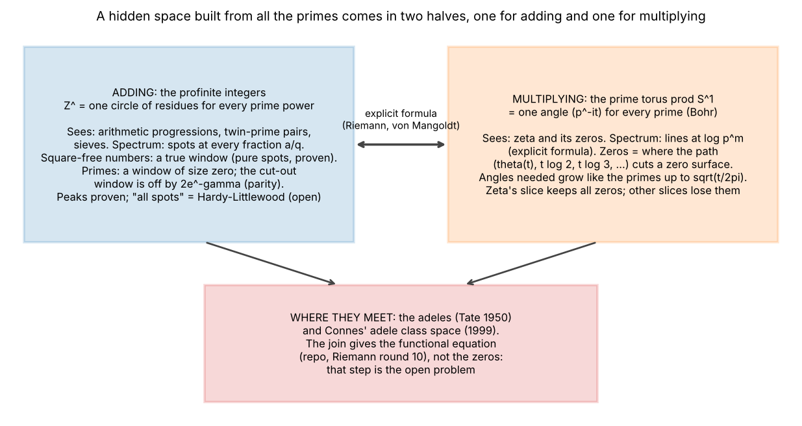
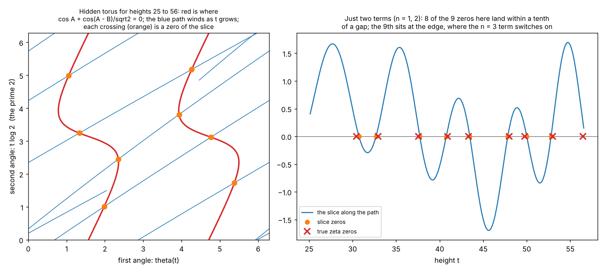
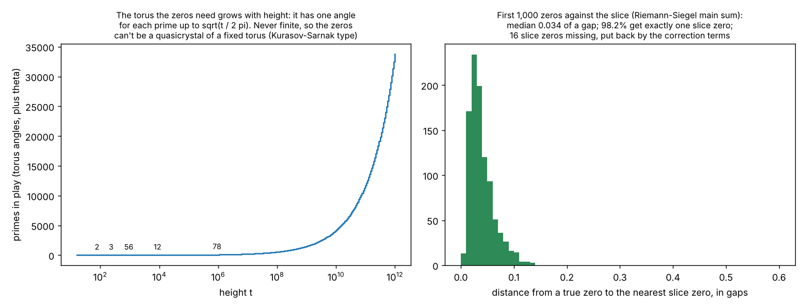
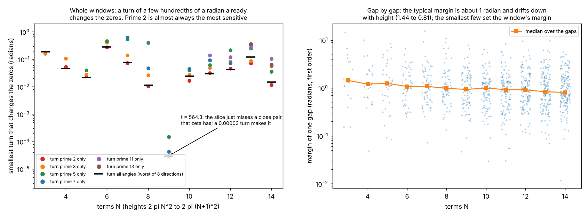
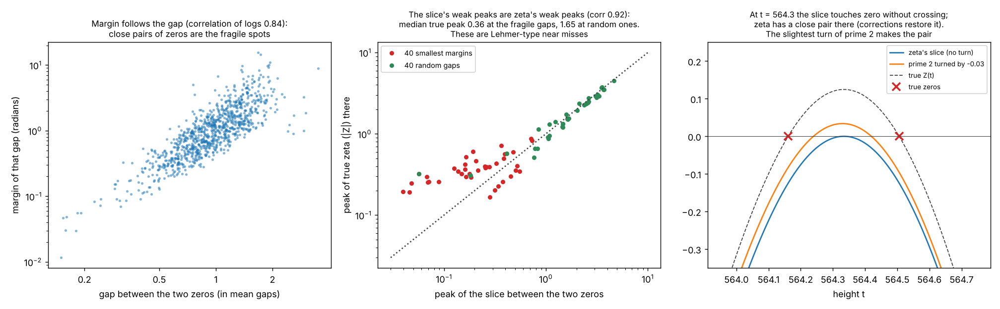
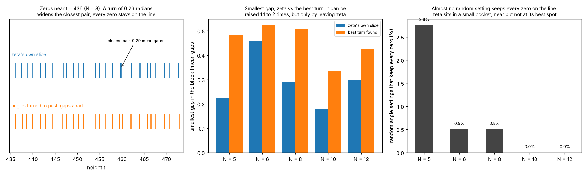
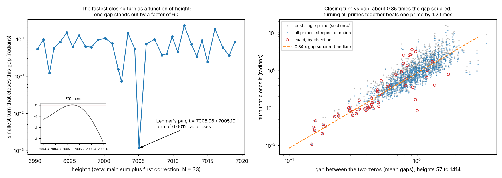
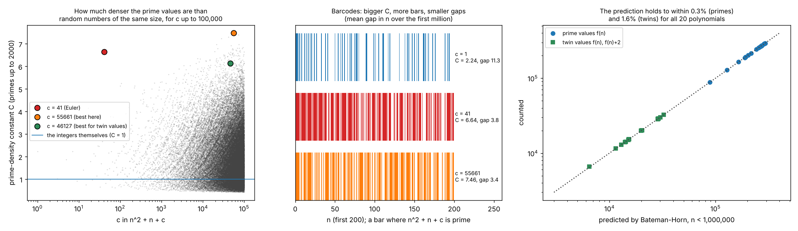

# DRAFT: a hidden space built from all the primes

> **Names:** some words or symbols on this page (twist) also mean something else in standard math, physics or computing, or inside this project. [NAMING-COLLISIONS.md](../../../NAMING-COLLISIONS.md) says which meaning is in play.

*Follow-up to [the hat tile and primes](../README.md). Nov 27 2026. Numbers are evidence, not proofs;
29 of 29 checks pass (`checks.py`); `lean/HiddenSpace.lean` has 2 statements, not yet compiled.*

## The answer first

**The hidden space exists, and it comes in two halves: one for adding, one for multiplying.** Both are
known mathematics. Built and tested here, they give a clear picture but **no new lead on the primes or
the zeros**:

- **Adding half (the profinite integers, one circle of residues per prime power).** The primes sit in a
  window of size zero. Their bright spots at every fraction a/q are proven; that the spots are *all* there
  is would be the Hardy–Littlewood conjecture. A window cut by finitely many primes stays 12% too big
  forever (2e^−γ, Mertens): this is the sieve's parity problem. So the primes are not a model set of it.
- **Multiplying half (the prime torus, one angle per prime).** The zeta zeros are where a path through
  this torus crosses a surface. The number of angles the zeros need grows with height (the primes up to
  √(t/2π)), so no fixed torus holds them: Dyson's "zeros as a quasicrystal" can only be read in an
  infinite torus.
- **One striking picture, probably known in spirit:** zeta's path sits at a sharp point. Turn any prime's
  angle away from zeta's own and zeros go missing (they move off the line). That is RH pictured as a
  stability fact, tied to zeta's functional equation; Davenport–Heilbronn (1936) shows that tie alone
  can't prove it.
- **Its stability margin (asked for next) is Lehmer's phenomenon.** A typical gap survives a turn of
  about one radian, but the fragile ones go at a few hundredths, and they are exactly where zeta has
  two zeros unusually close together. Known in spirit (Lehmer 1956; Rodgers and Tao 2020 proved that if RH
  holds, it holds with no room to spare); no lead.
- **Functions that minimize gaps (asked for last), three ways, none a lead.** Turning the prime
  angles can push zeta's closest zeros apart, but only by leaving zeta. The turn that closes a gap
  fastest is a clean detector: it picks out Lehmer's famous pair at t = 7005 by itself. And quadratics
  n² + n + c can make prime values 12% denser than Euler's n² + n + 41 (3.3 times denser than
  n² + n + 1), and twin prime values 15 times denser than among the integers, exactly as the Bateman–Horn prediction says (section 5).
- **Where the halves meet** is the adeles (Tate 1950) and Connes' adele class space (1999). The repo's
  Riemann rounds 9 and 10 already found that this join gives the functional equation and needs every
  prime, but not the zeros.

For the hat work this closes the question the first draft left open: the zeros need a hidden space that
is infinite and keeps growing, not a finite one like the hat's.

## 1. The adding half: the profinite integers

Write each whole number by its remainders: mod 2, mod 3, mod 4, mod 5, … one circle of residues for
each prime power. All of them together is the profinite integers Ẑ. Every number is one point; nearby
points share many remainders. It is the hidden space the square-free numbers already use (Baake, Moody,
Pleasants 2000; Baake, Huck, Strungaru 2017 call these weak model sets).

**A finite piece.** Through 2, 3, 5, 7 the space is the 210 residues mod 210. The primes above 7 land
only in the 48 cells coprime to 210 and fill them evenly (within 0.3% for primes to 10^8):

**The window has size zero.** Each new prime p keeps a share 1 − 1/p of the space open. The product
goes to 0, so in the full space the primes are a window of size zero. Cutting the window with every
prime up to √x nearly gives the primes up to x, but always overshoots by the factor 2e^−γ = 1.1229
(Mertens 1874). A window can't tell a prime from a number with two large factors. That is the sieve's
parity problem (Selberg). Measured: 1.1225 at x = 10^9.

**The spectrum.** Weight each prime power by log p (von Mangoldt's Λ). Its Fourier coefficient at a/q is
μ(q)/φ(q), which is the prime number theorem in progressions, so proven. Measured to 10^7, every q up
to 40 matches within 10⁻³. The pair correlations of the primes match the Hardy–Littlewood singular
series (within 1% for gaps up to 60), and the spots add up exactly to that series (Ramanujan's
expansion). Whether the spectrum is *only* spots is the Hardy–Littlewood conjecture, open even for
twin primes. Torquato and co-workers (2018–19) found these spots numerically and proved them
conditionally. The spots with q up to about N/10 already carry all the brightness the primes up to N
have (measured: log Q + 1.3325 against log N − 1).

**A caution on scale.** Counted plainly, with no log weights, over [−n, n], the primes' spectrum is
flat (Humeniuk, Ramsey, Strungaru 2024). The primes thin out, so pairs per prime fall
(0.167, 0.128, 0.104 twin pairs per prime to 10^4, 10^5, 10^6). The spots live at each scale, not over
the whole line. So the primes are not a model set of Ẑ, unlike the square-free numbers.

## 2. The multiplying half: the prime torus

Give every prime its own angle, p^−it. Then n^−it is the product of its primes' angles, so zeta at
height t is a function on the torus with one circle per prime, read along the path the angles trace as t
grows (Bohr's lift, about 1913). The angles move at speeds log p. Those speeds have no whole-number
relations, so the path never closes.

**The zeros as a slice.** On the critical line the Riemann–Siegel main sum
Z_N(t) = 2 Σ_{n ≤ N} n^−½ cos(θ(t) − t log n), with N = ⌊√(t/2π)⌋, uses only the primes up to N. At
heights 25 to 56 that is one prime angle (t log 2) plus the angle θ(t): a 2-torus. The zeros are where
the path crosses the red curve. Two terms already put 8 of the 9 zeros there within a tenth of a gap:

**The torus keeps growing.** At height t the slice needs one angle per prime up to √(t/2π): 5 at
t = 1,000, 78 at 10^6, 33,776 at 10^12. Over the first 1,000 zeros the slice gives 98.2% of them exactly
one partner (median error 0.034 of a gap). Riemann–Siegel's correction terms put the 16 missing ones
back. Kurasov and Sarnak (2020) build exact Fourier quasicrystals as slices of a fixed finite torus; the
zeta zeros can't be one, because their torus is never finite (and their spacing shrinks with height).

**Zeta's slice is a sharp point.** Keep the same torus but give each prime's angle a fixed extra turn.
Every other slice loses zeros: about 12 per window at N = 8 with random turns, against at most 2 for
zeta's own slice (which the correction terms restore). Turning only the prime-2 angle, by any of 11
other amounts, already loses 3 to 9 zeros at N = 6. With one or two terms nothing can be lost (the first
term dominates). Our reading: only zeta's slice ties θ(t), which comes from the functional equation, to
the prime angles; break the tie and zeros leave the line. That is RH pictured as a stability fact. It
proves nothing. Davenport and Heilbronn (1936) give functions with a functional equation and zeros off
the line, and the repo's round 9 found every prime's place must be present.

## 3. Is it a lead?

No new lead. The hidden space built from all the primes is real and known: Ẑ for adding, the prime
torus for multiplying, the adeles where they meet. The tests show what each half can and can't see:

1. Ẑ sees the primes' arithmetic (progressions, pairs) but holds them only in a window of size zero,
   with the parity gap 2e^−γ. The square-free numbers are its true quasicrystal; the primes aren't.
2. The prime torus holds the zeros as a slice, but only in infinitely many dimensions, growing like the
   primes up to √(t/2π).
3. The join (adeles) gives the functional equation, which is exactly what makes zeta's slice the sharp
   point that keeps its zeros. Turning that into a proof is the open problem.

## 4. The stability margin of zeta's slice

Brennan asked how far the prime angles can turn before zeros leave the line. Two ways to measure it,
over heights 57 to 1,414 (N = 3 to 14 terms, 948 gaps between zeros):

- **Whole windows** (one height band at a time): the smallest turn of one prime's angle that loses or
  makes a pair of zeros is 0.01 to 0.27 radians, and prime 2 is almost always the most sensitive
  (it touches the most terms). One band (N = 9) has a margin of 0.00003: at t = 564.3 the slice touches
  zero without crossing, exactly where zeta has two close zeros (564.16 and 564.51) that the slice
  misses and Riemann–Siegel's corrections put back.
- **Gap by gap** (first order: the peak between two zeros, divided by how fast a turn moves it): the
  typical margin is about one radian, drifting down with height (median 1.44 at N = 3, 0.81 at N = 14).

**What sets it: close pairs.** A gap's margin follows how close its two zeros are (correlation of logs
0.84). The slice's weak peaks are zeta's own weak peaks (correlation 0.92): at the 40 most fragile gaps
the true peak of |Z| has median 0.36, against 1.65 at random gaps. These are Lehmer's near misses: two
zeros so close that Z barely gets across the axis between them (Lehmer 1956).

**Is it a lead? No.** The margin is the Lehmer phenomenon seen through the torus. What it would take
for the margin to stay above zero forever is known to be delicate: in the de Bruijn–Newman heat flow,
Rodgers and Tao (2020) proved Λ ≥ 0, so if RH holds it holds with no room to spare, and close pairs keep
pushing the margin toward zero. The repo's Riemann rounds 4 and 8 already worked with that flow. The
fresh part is only the reading: the slack in RH, measured as a turn of a prime's angle, is about a
radian per gap and a few hundredths at the worst gaps up to t = 1,414, with prime 2 the weak direction.

## 5. Functions that minimize the gaps

Brennan asked for a function that minimizes gaps, and to try three readings of that.

### 5a. Push zeta's zero gaps apart

Take the twisted slice F(t; d) = Σ_{n≤N} n^−½ cos(θ(t) − t log n + Σ_p v_p(n) d_p), where d = 0 is zeta's own
main sum. In each height band (N = 5 to 12) we searched the angles d for the point whose smallest gap is as
wide as possible, with the rule that no zero may leave the line (`gaps/apart.py`).

- **It can be done, a little:** the smallest gap rises 1.1 to 2 times (for example 0.29 → 0.51 mean gaps
  at N = 8), from a turn of only 0.1 to 0.3 radians. The spread of the gaps barely changes: fixing the worst
  pair makes another pair the worst.
- **Almost nowhere else works:** only 0 to 3% of random angle settings keep every zero on the line. Zeta
  sits inside a small pocket where all zeros are real, close to but not at the pocket's widest point.
- **Why it doesn't help:** the pushed-apart function isn't zeta, so its zeros say nothing about zeta's or
  the primes'.

### 5b. Close the gaps as fast as possible

Near the peak P between two zeros, a turn d changes the slice by d · S, with S_p = ∂Z/∂d_p. The fastest
closing direction is −sign(Z)·S/|S|, and the pair meets after a turn of about

  **m(t) = P / |S|₂**, which works out to about **0.85 × s²** (s = the gap in mean gaps)

(`gaps/closing.py`; first order agrees with exact bisection, median ratio 0.97). Turning all primes at once
beats turning the best single prime by 1.2 times. Read as a function of height, m(t) is a map of where RH
is most fragile. Run on zeta itself near t = 7,000 (main sum plus the first Riemann–Siegel correction), its
minimum is **Lehmer's pair at 7005.06 / 7005.10**, which closes after a turn of 0.0012 radians, 60 times
smaller than any other gap in the window. Lehmer found that pair in 1956; close pairs like it are what
Csordas, Smith and Varga (1994) used to bound the de Bruijn–Newman constant. So this is a working
detector for a known thing, not a lead.

### 5c. Prime values with small gaps

For f(n) = n² + n + c, the Bateman–Horn conjecture (Hardy–Littlewood's Conjecture F, 1923, for quadratics)
predicts #{n ≤ M : f(n) prime} ≈ C(f) Σ 1/log f(n), with C(f) = Π_p (1 − w(p)/p)/(1 − 1/p) and w(p) the roots
of f mod p. The average gap between n's with prime values is about log f(n)/C(f), so **the function that
minimizes the gaps is the one with the biggest C**. In the hidden space of section 1, C measures how much
of the prime window f's values keep: f avoids the class 0 mod p whenever w(p) = 0. Euler's n² + n + 41
avoids it for every p below 41, because −163 is a non-residue there (class number one; Rabinowitsch 1913).

We ranked c ≤ 100,000 and sieved n < 1,000,000 for 20 polynomials (`gaps/polys.py`):

- **Best single:** n² + n + 55661, C = 7.46 (3.73 in the usual Hardy–Littlewood units), against Euler's
  6.64 (3.32, matching OEIS A221712). Mean gap in n: 3.4, against 3.8 for Euler and 11.3 for n² + n + 1.
- **Best for twin values** f(n), f(n) + 2: n² + n + 46127, twin constant 20.8, which is 15 times the
  integers' own 1.32.
- **The prediction holds** to within 0.3% for prime values and 1.6% for twin values, in all 20.

Far bigger constants are known (Jacobson and Williams 2003 found quadratics with much higher prime
density using huge c), and no quadratic is proven to take even infinitely many prime values. For the
smallest gaps between primes themselves the real theory is sieve weights: Zhang (2014), Maynard (2015)
and Polymath (2014) proved infinitely many prime gaps of at most 246. Nothing here touches that.

**Is any of it a lead? No.** 5a only shows that zeta isn't at the best spot of its pocket. 5b is a tidy
function that maps where RH is most fragile, and it finds Lehmer's pair unaided, but the mechanism is
known. 5c confirms a 1923 conjecture to 0.3% and recovers known record-type polynomials. The most useful
by-product is the closing-turn function m(t) ≈ 0.85 s², a quick way to flag Lehmer pairs.

## Assumptions

- Spectra use the von Mangoldt weights on [1, N] and normalise by N; plain counting gives a flat
  spectrum instead (section 1).
- The torus slice is the Riemann–Siegel main sum with θ(t) from its asymptotic series (matches mpmath to
  10⁻¹¹ for t ≥ 30); the first 1,000 zeros come from `topics/primes/zeta_zeros_1000.npy`.
- "Zeros lost" counts sign changes along the real t-line against θ/π over a window; a lost zero is one
  that left the line.

## Known vs new

| Result | Status | Who |
|---|---|---|
| Ẑ, residues of every prime power, as hidden space for sieve sets | known | Baake, Moody, Pleasants (2000); Baake, Huck, Strungaru (2017) |
| Prime window overshoot 2e^−γ | known | Mertens (1874); parity problem, Selberg |
| Spots at a/q with coefficient μ(q)/φ(q) | known (proven) | prime number theorem in progressions |
| Pure spots ⇔ singular series | conjecture | Hardy, Littlewood (1923); Ramanujan sums (1918); Torquato et al. (2018–19), conditional |
| Plain counting spectrum of the primes is flat | known | Humeniuk, Ramsey, Strungaru (2024) |
| Zeta as a function on the infinite prime torus | known | Bohr (about 1913); Hedenmalm, Lindqvist, Seip (1997) |
| Riemann–Siegel main sum | known | Siegel (1932) |
| Finite-torus Fourier quasicrystals | known | Kurasov, Sarnak (2020) |
| Torus dimension π(√(t/2π)) as the size of the zeros' hidden space | **framing**; likely known in spirit | read off Riemann–Siegel here |
| Zeta's slice is a sharp point: other slices lose zeros | **measurement**, not found in a quick search; explanation known in spirit | measured here; Davenport–Heilbronn (1936) for the limit |
| Margin of zeta's slice (turn of a prime angle that loses zeros): ~1 rad per gap, set by close pairs | **measurement**; not found in a quick search; mechanism known | measured here; Lehmer (1956); Csordas, Smith, Varga (1994) |
| RH, if true, has no slack (Λ ≥ 0) | known | Rodgers, Tao (2020) |
| Pushing zero gaps apart by turning prime angles: 1.1 to 2 times, inside a small pocket | **measurement**; not found in a quick search; no bearing on zeta | measured here |
| Steepest closing turn m(t) ≈ 0.85 s², finds Lehmer's pair at 7005 | **measurement**; mechanism known | Lehmer (1956); Csordas, Smith, Varga (1994) |
| Prime density of n² + n + c set by C(f); Euler's 41 and class number one | known (conjectured density) | Euler (1772); Rabinowitsch (1913); Hardy, Littlewood (1923); Bateman, Horn (1962) |
| High-density quadratics | known; far higher records exist | Jacobson, Williams (2003) |
| Bounded gaps between primes (246) | known (proven) | Zhang (2014); Maynard (2015); Polymath (2014) |
| Adeles join the halves; gives the functional equation | known | Tate (1950); Connes (1999); repo Riemann rounds 9–10 |

## Files

`additive.py` (Ẑ measurements, writes `additive.json`) · `multiplicative.py` (torus measurements, writes
`multiplicative.json`, `mult_curves.npz`) · `figures.py` · `margin.py` (window margins, writes `margin.json`, `margin_output.txt`) ·
`margin_local.py` (gap margins, writes `margin_local.json`, `margin_local.npz`) · `figures_margin.py` ·
`gaps/apart.py`, `gaps/closing.py`, `gaps/polys.py` (section 5, each writes its `.json` and `.npz`; `polys.py` takes about 2 minutes) · `gaps/figures_gaps.py` ·
`checks.py` (29 checks, about 20 s) ·
`lean/HiddenSpace.lean`.

## Sources

- M. Baake, R. V. Moody, P. A. B. Pleasants, *Diffraction from visible lattice points and k-th power free
  integers*, Discrete Math. 221 (2000).
- M. Baake, C. Huck, N. Strungaru, *On weak model sets of extremal density*, Indag. Math. (2017),
  arXiv 1512.07129.
- R. Zhang, F. Martelli, S. Torquato, *Structure factor of the primes*, J. Phys. A 51 (2018), arXiv
  1801.01541; S. Torquato, G. Zhang, M. de Courcy-Ireland, *Uncovering multiscale order in the prime
  numbers via scattering* (2018), arXiv 1802.10498, and *Hidden multiscale order in the primes*,
  J. Phys. A 52 (2019).
- A. Humeniuk, C. Ramsey, N. Strungaru, *Diffraction of the primes and other sets of zero density*
  (2024), arXiv 2406.13687.
- G. H. Hardy, J. E. Littlewood, *Partitio numerorum III* (1923); S. Ramanujan (1918), trigonometric sums.
- F. Mertens (1874); A. Selberg, parity problem in sieve theory.
- H. Bohr (about 1913), Dirichlet series on the infinite torus; H. Hedenmalm, P. Lindqvist, K. Seip,
  Duke Math. J. 86 (1997).
- C. L. Siegel, *Über Riemanns Nachlaß zur analytischen Zahlentheorie* (1932).
- P. Kurasov, P. Sarnak, *Stable polynomials and crystalline measures* (2020), arXiv 2004.05678; the
  Lee–Yang torus picture of these, arXiv 2307.13498.
- H. Davenport, H. Heilbronn (1936), functions with a functional equation and zeros off the line.
- J. Tate, thesis (1950); A. Connes, *Trace formula in noncommutative geometry and the zeros of the
  Riemann zeta function* (1999).
- D. H. Lehmer, *On the roots of the Riemann zeta-function*, Acta Math. 95 (1956) (close pairs of zeros).
- G. Csordas, W. Smith, R. S. Varga, *Lehmer pairs of zeros, the de Bruijn–Newman constant Λ, and the
  Riemann hypothesis*, Constr. Approx. 10 (1994).
- B. Rodgers, T. Tao, *The de Bruijn–Newman constant is non-negative*, Forum Math. Pi 8 (2020), arXiv 1801.05914.
- F. Dyson, *Birds and Frogs*, Notices AMS (2009); J. C. Lagarias, *Mathematical quasicrystals and the
  problem of diffraction* (2000).
- L. Euler (1772), n² + n + 41; G. Rabinowitsch, J. reine angew. Math. 142 (1913).
- P. T. Bateman, R. A. Horn, *A heuristic asymptotic formula concerning the distribution of prime numbers*,
  Math. Comp. 16 (1962).
- M. J. Jacobson Jr., H. C. Williams, *New quadratic polynomials with high densities of prime values*,
  Math. Comp. 72 (2003), 499–519.
- OEIS A221712, Hardy–Littlewood constant for x² + x + 41.
- Y. Zhang, *Bounded gaps between primes*, Ann. of Math. 179 (2014); J. Maynard, *Small gaps between
  primes*, Ann. of Math. 181 (2015); D. H. J. Polymath, *Variants of the Selberg sieve, and bounded
  intervals containing many primes*, Res. Math. Sci. 1 (2014).
