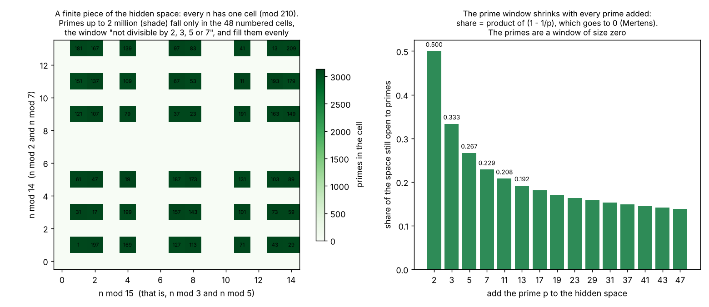
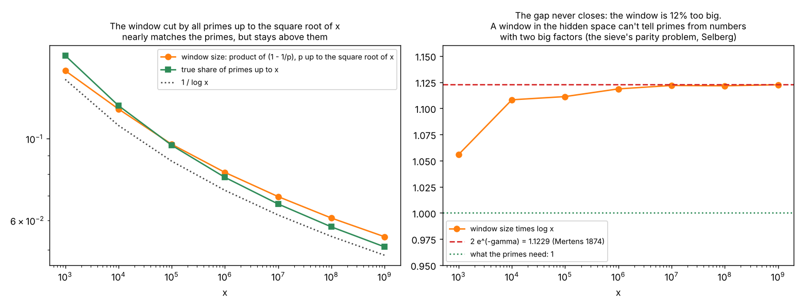
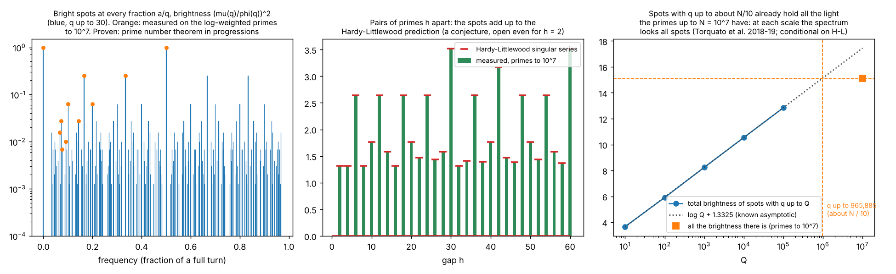
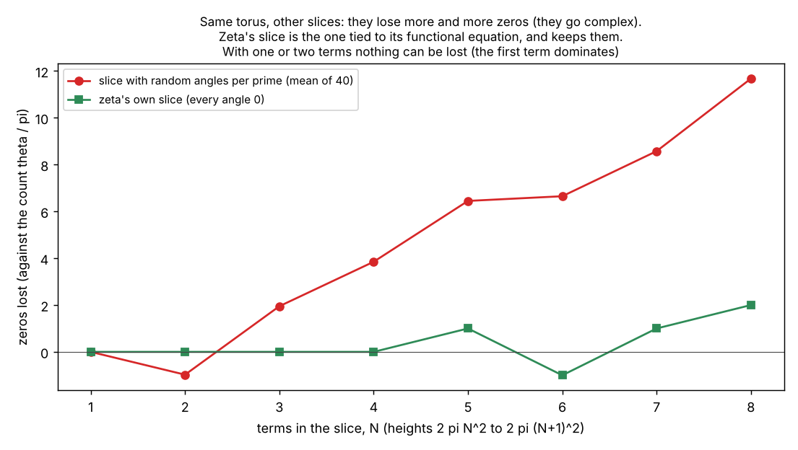

# DRAFT: a hidden space built from all the primes

*Follow-up to [the hat tile and primes](../README.md). Nov 27 2026. Numbers are evidence, not proofs;
18 of 18 checks pass (`checks.py`); `lean/HiddenSpace.lean` has 2 statements, not yet compiled.*

## The answer first

**The hidden space exists, and it comes in two halves: one for adding, one for multiplying.** Both are
known mathematics. Built and tested here, they give a clear picture but **no new lead on the primes or
the zeros**:

- **Adding half (the profinite integers, one circle of residues per prime power).** The primes sit in a
  window of size zero. Their bright spots at every fraction a/q are proven; that the spots are *all* there
  is would be the Hardy–Littlewood conjecture. A window cut by finitely many primes stays 12% too big
  forever (2e^−γ, Mertens): this is the sieve's parity problem. So the primes are not a model set of it.
- **Multiplying half (the prime torus, one angle per prime).** The zeta zeros are where a path through
  this torus crosses a surface. The number of angles the zeros need grows with height (the primes up to
  √(t/2π)), so no fixed torus holds them: Dyson's "zeros as a quasicrystal" can only be read in an
  infinite torus.
- **One striking picture, probably known in spirit:** zeta's path sits at a sharp point. Turn any prime's
  angle away from zeta's own and zeros go missing (they move off the line). That is RH pictured as a
  stability fact, tied to zeta's functional equation; Davenport–Heilbronn (1936) shows that tie alone
  can't prove it.
- **Where the halves meet** is the adeles (Tate 1950) and Connes' adele class space (1999). The repo's
  Riemann rounds 9 and 10 already found that this join gives the functional equation and needs every
  prime, but not the zeros.

For the hat work this closes the question the first draft left open: the zeros need a hidden space that
is infinite and keeps growing, not a finite one like the hat's.

## 1. The adding half: the profinite integers

Write each whole number by its remainders: mod 2, mod 3, mod 4, mod 5, … one circle of residues for
each prime power. All of them together is the profinite integers Ẑ. Every number is one point; nearby
points share many remainders. It is the hidden space the square-free numbers already use (Baake, Moody,
Pleasants 2000; Baake, Huck, Strungaru 2017 call these weak model sets).

**A finite piece.** Through 2, 3, 5, 7 the space is the 210 residues mod 210. The primes above 7 land
only in the 48 cells coprime to 210 and fill them evenly (within 0.3% for primes to 10^8):

**The window has size zero.** Each new prime p keeps a share 1 − 1/p of the space open. The product
goes to 0, so in the full space the primes are a window of size zero. Cutting the window with every
prime up to √x nearly gives the primes up to x, but always overshoots by the factor 2e^−γ = 1.1229
(Mertens 1874). A window can't tell a prime from a number with two large factors. That is the sieve's
parity problem (Selberg). Measured: 1.1225 at x = 10^9.

**The spectrum.** Weight each prime power by log p (von Mangoldt's Λ). Its Fourier coefficient at a/q is
μ(q)/φ(q), which is the prime number theorem in progressions, so proven. Measured to 10^7, every q up
to 40 matches within 10⁻³. The pair correlations of the primes match the Hardy–Littlewood singular
series (within 1% for gaps up to 60), and the spots add up exactly to that series (Ramanujan's
expansion). Whether the spectrum is *only* spots is the Hardy–Littlewood conjecture, open even for
twin primes. Torquato and co-workers (2018–19) found these spots numerically and proved them
conditionally. The spots with q up to about N/10 already carry all the brightness the primes up to N
have (measured: log Q + 1.3325 against log N − 1).

**A caution on scale.** Counted plainly, with no log weights, over [−n, n], the primes' spectrum is
flat (Humeniuk, Ramsey, Strungaru 2024). The primes thin out, so pairs per prime fall
(0.167, 0.128, 0.104 twin pairs per prime to 10^4, 10^5, 10^6). The spots live at each scale, not over
the whole line. So the primes are not a model set of Ẑ, unlike the square-free numbers.

## 2. The multiplying half: the prime torus

Give every prime its own angle, p^−it. Then n^−it is the product of its primes' angles, so zeta at
height t is a function on the torus with one circle per prime, read along the path the angles trace as t
grows (Bohr's lift, about 1913). The angles move at speeds log p. Those speeds have no whole-number
relations, so the path never closes.

**The zeros as a slice.** On the critical line the Riemann–Siegel main sum
Z_N(t) = 2 Σ_{n ≤ N} n^−½ cos(θ(t) − t log n), with N = ⌊√(t/2π)⌋, uses only the primes up to N. At
heights 25 to 56 that is one prime angle (t log 2) plus the angle θ(t): a 2-torus. The zeros are where
the path crosses the red curve. Two terms already put 8 of the 9 zeros there within a tenth of a gap:

**The torus keeps growing.** At height t the slice needs one angle per prime up to √(t/2π): 5 at
t = 1,000, 78 at 10^6, 33,776 at 10^12. Over the first 1,000 zeros the slice gives 98.2% of them exactly
one partner (median error 0.034 of a gap). Riemann–Siegel's correction terms put the 16 missing ones
back. Kurasov and Sarnak (2020) build exact Fourier quasicrystals as slices of a fixed finite torus; the
zeta zeros can't be one, because their torus is never finite (and their spacing shrinks with height).

**Zeta's slice is a sharp point.** Keep the same torus but give each prime's angle a fixed extra turn.
Every other slice loses zeros: about 12 per window at N = 8 with random turns, against at most 2 for
zeta's own slice (which the correction terms restore). Turning only the prime-2 angle, by any of 11
other amounts, already loses 3 to 9 zeros at N = 6. With one or two terms nothing can be lost (the first
term dominates). Our reading: only zeta's slice ties θ(t), which comes from the functional equation, to
the prime angles; break the tie and zeros leave the line. That is RH pictured as a stability fact. It
proves nothing. Davenport and Heilbronn (1936) give functions with a functional equation and zeros off
the line, and the repo's round 9 found every prime's place must be present.

## 3. Is it a lead?

No new lead. The hidden space built from all the primes is real and known: Ẑ for adding, the prime
torus for multiplying, the adeles where they meet. The tests show what each half can and can't see:

1. Ẑ sees the primes' arithmetic (progressions, pairs) but holds them only in a window of size zero,
   with the parity gap 2e^−γ. The square-free numbers are its true quasicrystal; the primes aren't.
2. The prime torus holds the zeros as a slice, but only in infinitely many dimensions, growing like the
   primes up to √(t/2π).
3. The join (adeles) gives the functional equation, which is exactly what makes zeta's slice the sharp
   point that keeps its zeros. Turning that into a proof is the open problem.

If Brennan wants one thing to push: measure how far the prime angles can turn before the first zero is
lost, as N grows. That gives a "stability margin" for zeta's slice. It is a numerical study and most
likely ties to known Gram's-law statistics, so check the literature before calling anything new.

## Assumptions

- Spectra use the von Mangoldt weights on [1, N] and normalise by N; plain counting gives a flat
  spectrum instead (section 1).
- The torus slice is the Riemann–Siegel main sum with θ(t) from its asymptotic series (matches mpmath to
  10⁻¹¹ for t ≥ 30); the first 1,000 zeros come from `topics/primes/zeta_zeros_1000.npy`.
- "Zeros lost" counts sign changes along the real t-line against θ/π over a window; a lost zero is one
  that left the line.

## Known vs new

| Result | Status | Who |
|---|---|---|
| Ẑ, residues of every prime power, as hidden space for sieve sets | known | Baake, Moody, Pleasants (2000); Baake, Huck, Strungaru (2017) |
| Prime window overshoot 2e^−γ | known | Mertens (1874); parity problem, Selberg |
| Spots at a/q with coefficient μ(q)/φ(q) | known (proven) | prime number theorem in progressions |
| Pure spots ⇔ singular series | conjecture | Hardy, Littlewood (1923); Ramanujan sums (1918); Torquato et al. (2018–19), conditional |
| Plain counting spectrum of the primes is flat | known | Humeniuk, Ramsey, Strungaru (2024) |
| Zeta as a function on the infinite prime torus | known | Bohr (about 1913); Hedenmalm, Lindqvist, Seip (1997) |
| Riemann–Siegel main sum | known | Siegel (1932) |
| Finite-torus Fourier quasicrystals | known | Kurasov, Sarnak (2020) |
| Torus dimension π(√(t/2π)) as the size of the zeros' hidden space | **framing**; likely known in spirit | read off Riemann–Siegel here |
| Zeta's slice is a sharp point: other slices lose zeros | **measurement**, not found in a quick search; explanation known in spirit | measured here; Davenport–Heilbronn (1936) for the limit |
| Adeles join the halves; gives the functional equation | known | Tate (1950); Connes (1999); repo Riemann rounds 9–10 |

## Files

`additive.py` (Ẑ measurements, writes `additive.json`) · `multiplicative.py` (torus measurements, writes
`multiplicative.json`, `mult_curves.npz`) · `figures.py` · `checks.py` (18 checks, about 15 s) ·
`lean/HiddenSpace.lean`.

## Sources

- M. Baake, R. V. Moody, P. A. B. Pleasants, *Diffraction from visible lattice points and k-th power free
  integers*, Discrete Math. 221 (2000).
- M. Baake, C. Huck, N. Strungaru, *On weak model sets of extremal density*, Indag. Math. (2017),
  arXiv 1512.07129.
- R. Zhang, F. Martelli, S. Torquato, *Structure factor of the primes*, J. Phys. A 51 (2018), arXiv
  1801.01541; S. Torquato, G. Zhang, M. de Courcy-Ireland, *Uncovering multiscale order in the prime
  numbers via scattering* (2018), arXiv 1802.10498, and *Hidden multiscale order in the primes*,
  J. Phys. A 52 (2019).
- A. Humeniuk, C. Ramsey, N. Strungaru, *Diffraction of the primes and other sets of zero density*
  (2024), arXiv 2406.13687.
- G. H. Hardy, J. E. Littlewood, *Partitio numerorum III* (1923); S. Ramanujan (1918), trigonometric sums.
- F. Mertens (1874); A. Selberg, parity problem in sieve theory.
- H. Bohr (about 1913), Dirichlet series on the infinite torus; H. Hedenmalm, P. Lindqvist, K. Seip,
  Duke Math. J. 86 (1997).
- C. L. Siegel, *Über Riemanns Nachlaß zur analytischen Zahlentheorie* (1932).
- P. Kurasov, P. Sarnak, *Stable polynomials and crystalline measures* (2020), arXiv 2004.05678; the
  Lee–Yang torus picture of these, arXiv 2307.13498.
- H. Davenport, H. Heilbronn (1936), functions with a functional equation and zeros off the line.
- J. Tate, thesis (1950); A. Connes, *Trace formula in noncommutative geometry and the zeros of the
  Riemann zeta function* (1999).
- F. Dyson, *Birds and Frogs*, Notices AMS (2009); J. C. Lagarias, *Mathematical quasicrystals and the
  problem of diffraction* (2000).
