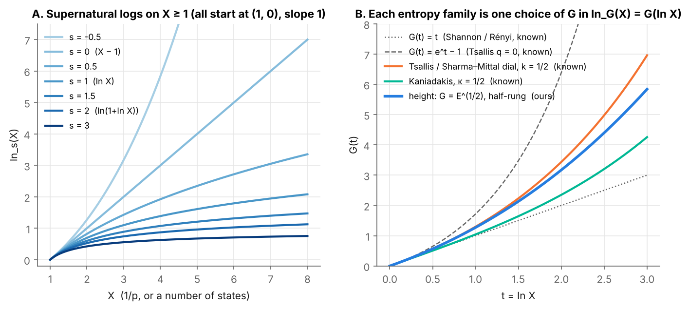
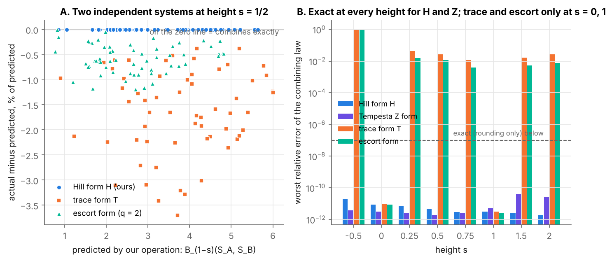
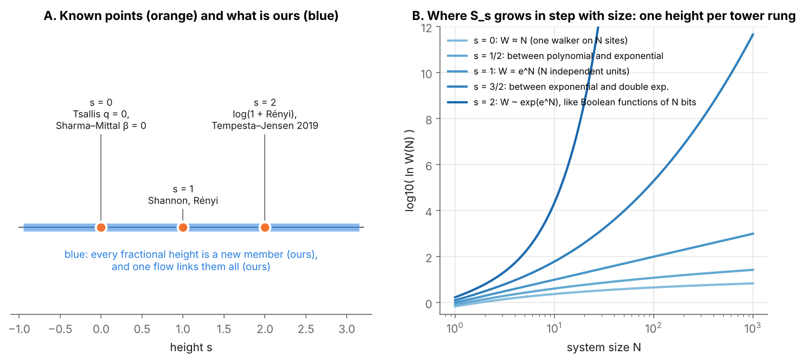
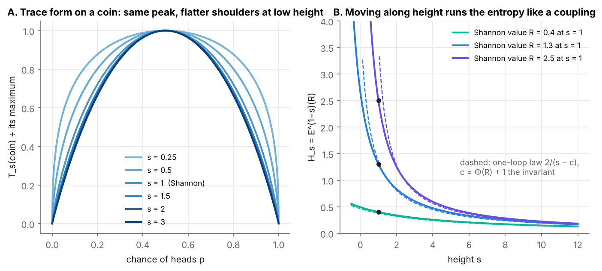
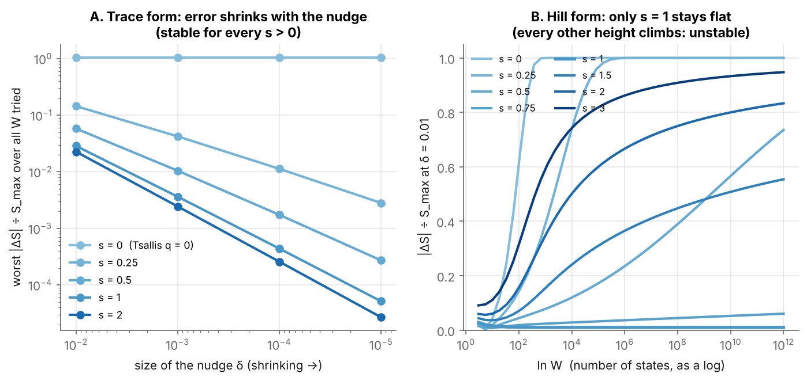
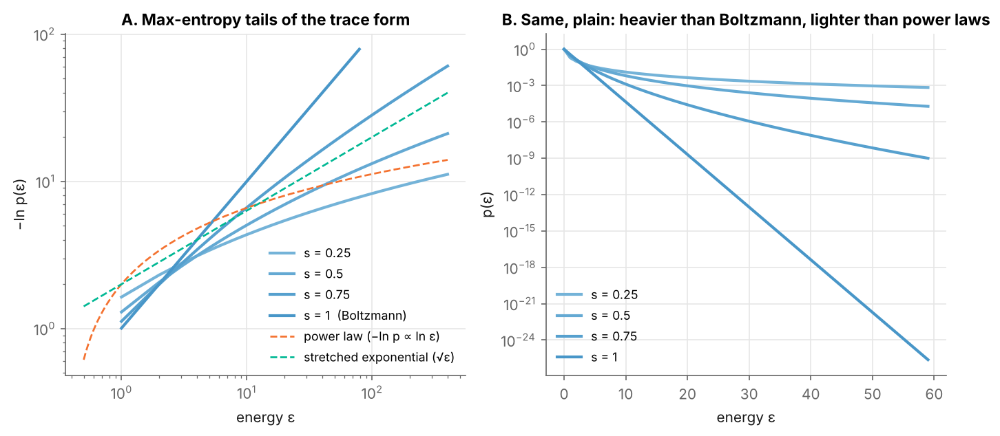
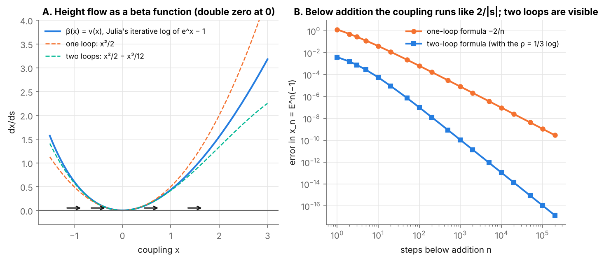
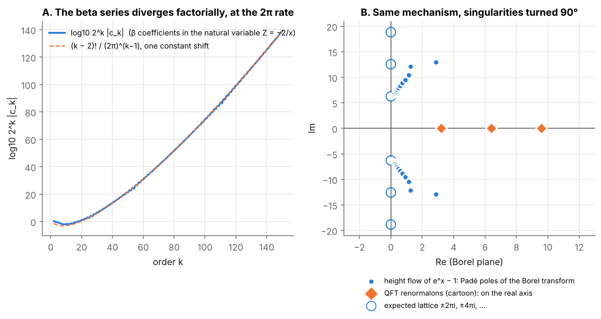
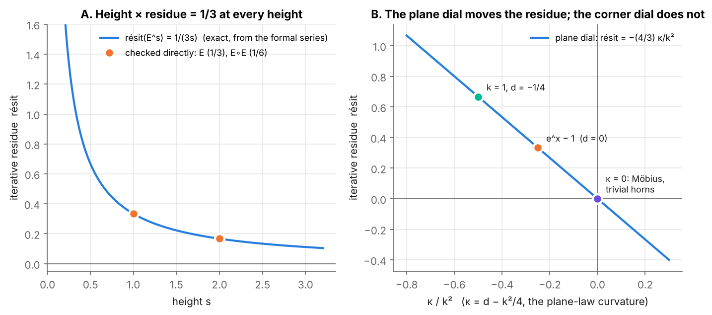
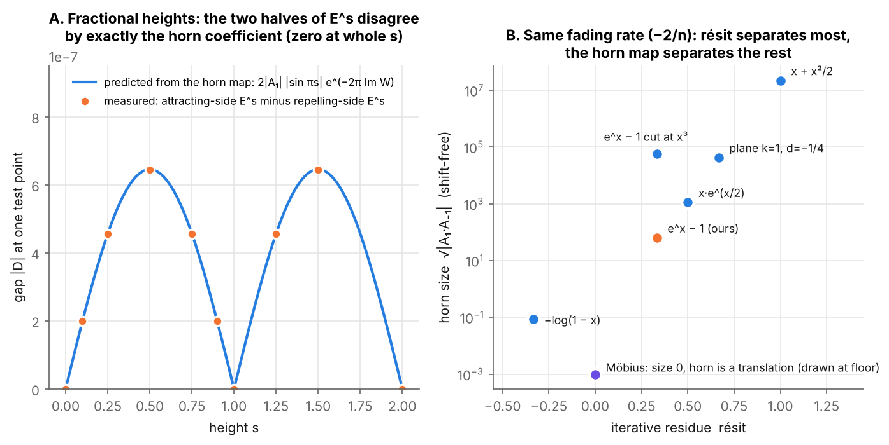

# Height flow: entropy family, running coupling and invariants

> **Partly DRAFT.** The invariants part (iterative residue and horn maps) is a first pass: its numbers are checked, its write-up isn't final. The entropy family and the running coupling are done.

*Merged stream. Folder renamed from `height-entropy/`. The earlier running-coupling folder
`../height-running-coupling/` is left where it was; its numbers are reused here.*

## Verdict first

**One clean result, everything else is known machinery seen from our side.**

- **The clean result (ours, checked):** along the rung height s, the two-loop invariant
  of e^x − 1 scales exactly as **résit(E^s) = 1/(3s)**. At fractional heights the
  half-rung E^s comes in two versions, one from each side of the fixed point, and
  they differ by **exactly** the Écalle–Voronin horn coefficient, as
  2|A₁| |sin πs| (matched to 8 digits, zero only at whole heights). That ties the
  height directly to a classical invariant.
- **Entropy family:** a real family, but it sits inside Tempesta's group-entropy
  framework. Exact composition is automatic there, not a discovery. Integer heights
  are already-named entropies. What is ours is the fractional members, the single
  flow across heights, and the tie to the running coupling. Modest: a catalogue entry.
- **Running coupling:** exactly right but generic for any double-zero flow. No
  physics test was found.
- **Does any of this tell our operation apart from other maps with the same
  fading rate?** Partly. The residue 1/3 separates many such maps but not all; the
  horn map separates the rest. That full classification is the known
  Écalle–Voronin theorem, so it tells *e^x − 1* apart, as any map can be told
  apart. It does not single out our operation as special.

**Is it worth following on its own merits?** The invariants part is the most solid
and the most clearly tied to height. It is a nice, citable fact about a classical
map, not a new theory. The entropy and running-coupling parts are worth keeping as
dictionary entries, not as a lead to push.

| Piece | Status | Checks |
|---|---|---|
| Entropy family | done | 32 / 32 (`height_entropy.py`) |
| Running coupling | done (from handoff) | 14 / 14 (`../height-running-coupling/running_coupling.py`) |
| Iterative residue and horn maps | **DRAFT**: numbers checked, write-up first pass | 14 / 14 (`horn_invariants.py`) |

Notation: E(x) = e^x − 1, E^s its regular iterate (Szekeres, Écalle), and
B_r(a,b) = E^r(E^{-r}a + E^{-r}b) the rung-r operation. Colour key in every
picture: **orange = known, blue = ours** unless a legend says otherwise.

---

## Part 1. The entropy family

### What it is

The supernatural logarithm ln_s(X) = E^{−s}(X − 1) = E^{1−s}(log X).
In Tempesta's language it is a **group logarithm** with G = E^{1−s}, and its law is
our operation one rung down: **ln_s(XY) = B_{1−s}(ln_s X, ln_s Y)** (checked).

*f1. A: the logs for several heights; all start at (1, 0) with slope 1. B: each
known entropy family is one choice of G in ln_G(X) = G(ln X).*

Three ways to build an entropy from it:

- **Trace form** T_s = Σ p ln_s(1/p).
- **Hill form** H_{s,α} = E^{1−s}(R_α), with R_α the Rényi entropy.
- **Tempesta Z form** ln_s(Σ p^α)/(1 − α).

### Composition for independent systems

*f2. The Hill and Z forms compose exactly at every height (errors ~1e-11). The trace
and escort forms compose exactly only at s = 0 and 1. That is Tempesta's theorem
(only Tsallis is strongly composable in trace form), so it is expected, not new.*

### Where it sits among known entropies

*f4. A: the known points (orange) are the whole heights. B: each height is
extensive on one rung of the tower of exponentials.*

| Height | Is | Source |
|---|---|---|
| s = 0 | Tsallis q = 0, i.e. Sharma–Mittal β = 0 (counts W − 1) | known |
| s = 1 | Shannon (trace) / Rényi (Hill) | known |
| s = 2 | log(1 + Rényi) | Tempesta–Jensen 2019, arXiv 1912.10907 |
| fractional s | C^∞ but not analytic G (Baker's theorem), so outside the analytic G's Tempesta lists | **ours** |

Against the others:

- **Sharma–Mittal:** agrees to second order and parts at third, by r(r−1)/12 · R³.
- **Kaniadakis:** ruled out by E^r's quadratic term, since Kaniadakis is odd.
- **Hill form:** Rényi in other units, with the same ordering and the same
  max-entropy distribution. So the Hill form adds nothing physical by itself.

**Ours:**

- the fractional members;
- the **single flow** S_{s−t} = E^t(S_s), which the Tsallis/Sharma–Mittal dial lacks
  (checked: the dial does not compose with itself);
- the **power-set step** ln_{s+1}(e^{W−1}) = ln_s(W);
- extensivity on W(N) = exp(E^{s−1}(N)), one height per tower rung. Example:
  Boolean functions on N bits are extensive at s = 2.

### The set-apart properties

*f3. A: trace form on a coin: same peak, flatter shoulders at low height.
B: moving along height runs the entropy like a coupling (Part 2).*

- **Concavity:** ln_s is concave on X ≥ 1 for s ≥ 0, and the trace form is concave
  for s ≥ 0. Both fail for s < 0.
- **Lesche stability (f5):** the trace form is stable for every s > 0. The Hill form
  is stable only at s = 1, so it is unstable at every other height. That instability
  only shows at enormous W (ln W ~ 10⁴ to 10¹²).
- **Max-entropy (f6):** trace-form tails for 0 < s < 1 sit between Boltzmann and
  power laws.

*f5. Lesche stability. A: trace form, the error shrinks with the nudge for s > 0.
B: Hill form, only s = 1 stays flat as the state count grows.*

*f6. Maximum-entropy tails of the trace form: heavier than Boltzmann, lighter than power laws.*

**Natural system?** None found for fractional heights; it would need half-exponential
growth of the state count. The super-exponential cases known in physics, such as
N^{γN}, sit at height 1 asymptotically.

---

## Part 2. The running coupling

The height flow obeys dx/ds = v(x), with v Julia's iterative logarithm of e^x − 1:
v = x²/2 − x³/12 + …. Read v as a beta function with a double zero at 0.

*f7. A: the beta function and its one- and two-loop truncations. B: below addition
the coupling runs like 2/|s|, and the two-loop term (the ρ = 1/3 log) removes
most of the remaining error.*

- **Entropy tie (checked):** dH_s/ds = −v(H_s). So the entropy family *is* a
  running-coupling trajectory. Its RG-invariant scale is Φ(R) + 1, where Φ is the
  Fatou (Abel) coordinate, and every entropy runs to 0 like 2/s far above Shannon.
- **Scheme-free two-loop number:** ρ = Res(dx/v) = 1/3.
- **Renormalons:** the beta series diverges factorially at the 2π rate, but the
  Borel singularities sit on the **imaginary** axis (±2πi, ±4πi, …), not the real
  axis as in QFT (f8). Same mechanism, turned 90°.
- **Prior work:** Curtright–Zachos 2011 (arXiv 1010.5174) already treats RG flow as
  functional conjugation. This is close to what we do.
- **Testable consequence:** none found. The log-periodic idea (Derrida–Itzykson–Luck)
  is probably tiny here and was not pursued.

*f8. A: coefficients in the natural variable Z = −2/x against (k−2)!/(2π)^{k−1}.
B: Padé poles of the Borel transform on the imaginary axis; QFT renormalons
(cartoon) on the real axis.*

---

## Part 3. Iterative residue and horn maps — DRAFT

> **DRAFT.** All numbers below are checked (14/14). The write-up and the
> literature comparison are a first pass.

### The two invariants, in one paragraph

Every map with f(x) = x + a₁x² + a₂x³ + … fades to 0 like −1/(a₁n). Two
invariants tell such maps apart:

- **Iterative residue:** résit = 1 − a₂/a₁². This is a formal invariant: no smooth
  change of variable alters it.
- **Horn maps** h± (Écalle 1981; Voronin 1981): an analytic invariant. They are
  translations exactly when f sits in an analytic flow. Together with résit they
  classify the map completely.

### Results

| Map | résit | Horn map | Known or ours |
|---|---|---|---|
| e^x − 1 | **1/3** = the two-loop ρ of Part 2 | not a translation: \|A₁⁺\| = 0.0890584364122, shift-free size √(A₁A₋₁) = 64.1531845185 | résit: direct from the known formula. Horn numbers: ours; I did not find them published. |
| E^s (height s) | **1/(3s)** | for whole n: \|A_n(Eⁿ)\| = \|A₁(E)\|/n (n = 2 checked) | 1/(3s) follows from known theory (iterates divide résit); stating it along our height is ours |
| corner dial (e^{kx} − 1)/k | 1/3 for every k | same as E | conjugate to E by x → kx, so the dial is invisible locally |
| plane dial (a+b+kab)/(1−dab) | **−(4/3)κ/k²**, κ = d − k²/4 | trivial at κ = 0 (Möbius) | ours (simple algebra); plane law is Coleman–McGuinness 1991 |

*f9. A: height times residue is 1/3 at every height. B: the plane dial moves the
residue along a line in κ/k² and reaches 0 at κ = 0, where the map is Möbius
and every height is analytic.*

Also checked:

- the horn constants obey A₀⁺ = 0 and A₀⁻ = 2πi/3 = 2πi·résit (known relation);
- for a real map the lower horn mirrors the upper once that 2πi/3 shift is undone:
  |A₋₁| = |A₁| e^{4π²/3}, and the product A₁A₋₁ = 4115.631 is real;
- as a consistency check, −log(1 − x), which is E's inverse flipped by x → −x, gets
  E's two horn sizes swapped.

### Tie to height: the clean part

At whole heights the horn map just rescales (h_n(W) = h(2W − c)/2 + c for n = 2).

At **fractional** heights E^s is not an analytic map (Baker's theorem). The
dynamical picture shows exactly how:

- Build E^s from the Fatou coordinate on the attracting side.
- Build it again from the repelling side.
- The two differ by **exactly 2|A₁| |sin πs| e^{−2π Im W}**.

So the horn coefficient *is* the size of the half-rung's failure to be analytic.

*f10. A: measured gap between the two half-rungs (dots) against the horn-map
prediction (line), zero only at whole heights. B: maps with the same fading
rate −2/n. The residue separates most of them, but e^x − 1 and its own cubic
truncation share résit = 1/3; only the horn size tells them apart.*

**Known:** Baker's theorem; the Écalle embedding criterion (analytic flow exactly
when the horn maps are translations); the classification.

**Ours:** the explicit numbers for e^x − 1, and the explicit sin πs form of the gap
along our height.

### Does it distinguish our operation?

- **Fading rate:** shared by every map with this second-order term.
- **résit:** separates e^x − 1 from Möbius, x·e^{x/2}, x + x²/2 and the dialed plane
  laws, but **not** from e^x − 1 cut at x³ (both 1/3).
- **Horn maps:** separate everything tested (f10 B).

That is exactly the known classification at work, so it does not make our
operation special. It does give the operation a fingerprint: the pair
(1/3, 64.153).

### Still DRAFT

- I found no published horn-map numbers for e^x − 1 to compare against. The values
  rest on two independent checks:
  - stable across three strips (spread 2e-23);
  - the A₀⁻ relation and the mirror relation hold.
- The sin πs gap formula is derived and checked numerically but not written as a proof.
- Horn maps for the plane dial with κ ≠ 0 are computed for one point only.

---

## Sources

**Entropy**
- Tempesta: group entropies, arXiv 1507.07436 and 1407.3807
- Jensen–Tempesta: arXiv 1809.06718
- Tempesta–Jensen: arXiv 1912.10907
- Lesche (stability); Hanel–Thurner (classes)

**Running coupling**
- Curtright–Zachos: arXiv 1010.5174
- Beneke (renormalons)

**Iteration**
- Szekeres; Baker; Erdős–Jabotinsky (regular iteration and its divergence)
- Écalle; Voronin (horn maps, classification)
- Milnor, *Dynamics in One Complex Variable* §12
- Dudko–Sauzin: arXiv 1307.8095
- Résit formula: arXiv 1909.10782 and 2302.13182

**Plane law**
- Coleman–McGuinness 1991

## Files

| File | What |
|---|---|
| `height_entropy.py` → `height_entropy_output.txt`, `.json` | entropy family and running-coupling tie, 32 checks |
| `horn_invariants.py` → `horn_invariants_output.txt`, `.json` | résit and horn maps, 14 checks (about 3 minutes, 34-digit arithmetic) |
| `figures.py` | f1 to f8 (reruns the entropy checks first) |
| `figures_horn.py` | f9, f10 (reads `horn_invariants.json`) |
| `../height-running-coupling/` | running-coupling handoff, 14 checks, reused here |
| `../fractional-rungs/regular_iteration.py` | E^s and B_r, reused |
