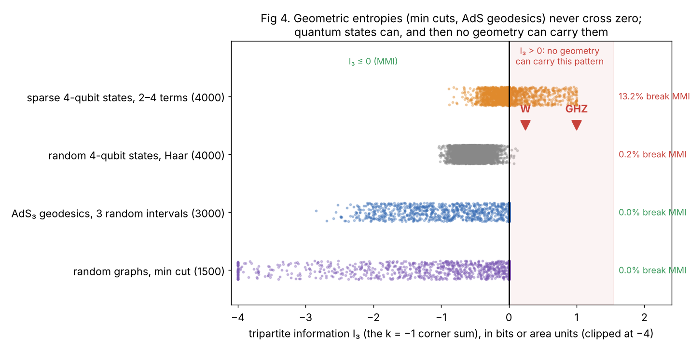

# DRAFT · Free exploration: spacetime is the entanglement pattern that passes a hypercube test

Nov 25, 2026. Open exploration, asked for by Brennan ("come back with something you find interesting... the goal is
finding this North Star"). Checks: `checks.py` → `checks_output.txt` (23/23 pass). Pictures: `figures.py` →
`figures/`. Pushed Nov 25 as a draft (working folder `exploration/`). The 2025 "necessary as well as sufficient" result was read from its abstract and summary only, not the full proof. Marked DRAFT: the computations reproduce known results; the "ours" items below are
readings and proposals, not theorems yet.

## The finding in two spoken sentences

When a quantum system has a geometric spacetime behind it, the entanglement of its pieces sits on the corners of a
hypercube, and our corner sum at k = −1 is exactly the quantity that tells "has a geometry" apart from "doesn't".
And as of 2025 there is a proof that an entanglement rule holds for every geometry exactly when one hypercube can be
mapped onto another without stretching a single edge, so in this corner of quantum gravity, proofs are maps between
cubes.

## Why I picked it

Three things made me stop.

1. **It is the North Star's best-tested bridge.** Ryu–Takayanagi (2006) says that in a quantum system with a gravity
   dual, the entanglement entropy of a region equals the area of the smallest surface in the curved spacetime that
   hangs off that region, divided by 4G. Quantum information on one side, geometry on the other, one equation.
   From it, people derived Einstein's equations themselves (linearized) from the first law of entanglement
   (Faulkner, Guica, Hartman, Myers, Van Raamsdonk 2013), and in 2019 its quantum version (the "island" formula)
   solved the black-hole information paradox's Page curve. If quantum mechanics and general relativity meet anywhere
   we can compute, it is here.
2. **Its natural coordinates are our cube.** With n regions, the entropies S_T of all the unions T are a function on
   the corners of the n-cube. The quantities that physicists actually use (mutual information, tripartite
   information I₃) are our n-fold cube sum with corner weight k^(rank−1), at k = −1.
3. **The proofs are pictures of hypercubes.** Which entanglement patterns can come from a geometry is an open
   problem (the "holographic entropy cone", fully known only up to five regions). The standard proof method maps one
   Boolean cube into another while never increasing Hamming distance. In 2025 Bao, Furuya and Naskar argued that
   this cube-map test is not just sufficient but necessary. That is about as close to "Hypercube Composition Theory
   applied to quantum gravity" as the literature gets, and nobody has said it in those words.

## The pictures

### Fig 1. Entropies on the cube; I₃ is our corner sum at k = −1

Each corner of the 3-cube is a union of regions; the empty corner has S = 0. Weight each corner by k^(rank−1) and
add: at k = −1 you get the tripartite information I₃ = S_A+S_B+S_C − S_AB−S_AC−S_BC + S_ABC (check A2). This is the
same sum that, fed product weights, gives a ∘ₖ b ∘ₖ c (check A1, all k).

### Fig 2. Where the entropies come from: shortest curves in the hyperbolic disk

A time slice of three-dimensional anti-de Sitter space is the hyperbolic disk; its boundary circle is where the
quantum system lives. The entropy of a boundary arc is the length of the shortest curve (a geodesic, a circle meeting
the edge at right angles) that ends on the arc's two ends. For two arcs, two pairings compete: (b) far apart, each arc
keeps its own curve and they share no information; (c) close together, the curves reconnect, the shaded region (the
entanglement wedge) becomes one piece, and mutual information turns on. That jump is a geometric phase transition.

### Fig 3. Proof by hypercube

The monogamy of mutual information, MMI: S_AB + S_BC + S_AC ≥ S_A + S_B + S_C + S_ABC, equivalently **I₃ ≤ 0**
(Hayden, Headrick, Maloney 2011). It holds for every geometry and fails for many quantum states.

The proof (Bao et al. 2015): give each term on the left a bit and each term on the right a bit. Each region (A, B, C
and the "rest of the universe" O) marks a corner on both cubes. If you can map the left 3-cube into the right 4-cube,
sending each region's corner to its own corner, without ever stretching a distance, the inequality holds for every
minimal-cut geometry. `checks.py` searched all maps: **there is exactly one**, and it is strikingly simple (panel a):
the four region corners go where they must, and the four other corners all collapse to the single point 0001. All 12
edges land on edges.

Panel (b) shows why the reverse inequality is false: one corner of its domain is a single step from A, B, C and O at
once, and no corner of the target cube is within one step of all four. Some edge must stretch, and Bao, Furuya and
Naskar (2025) show that a forced stretch can always be turned into a geometry that breaks the inequality.

The same search finds the map for the five-region cyclic inequality (a 5-cube into a 6-cube) and finds none for its
reverse (check B).

### Fig 4. The test separates geometric states from quantum ones

- 1,500 random weighted graphs, entropy = minimal cut (the discrete version of Ryu–Takayanagi): I₃ ≤ 0 every time.
- 3,000 random triples of arcs on the AdS₃ boundary, entropy = geodesic length: I₃ ≤ 0 every time.
- Random 4-qubit states: 0.2% of typical (Haar) states and 13% of sparse states have I₃ > 0. The GHZ state has
  I₃ = +1 bit exactly; the W state +0.245. A perfect tensor (the 4-qutrit absolutely maximally entangled state, the
  building block of holographic codes) passes with I₃ = −2.
- A state with I₃ > 0 cannot be the boundary of any classical geometry. GHZ-type entanglement (everyone correlated
  through one shared bit) is the wrong shape for spacetime; perfect-tensor entanglement is the right one.

### Fig 5. The k = −1 sums are finite where single entropies are not

A single region's entropy diverges as you resolve the boundary more finely (it grows like log(1/cutoff)). The k = −1
sums over a face (mutual information) and over the whole cube (I₃) don't move at all (check E: identical to 1e-14 at
two cutoffs a thousand times apart).

### Fig 6. Why k = −1, and no other dial value

The divergent part of each entropy belongs to one region at a time (it is "one-body", a sum over the regions'
endpoints). For a one-body function the cube sum is n(1+k)^(n−1) times its average, which vanishes only at k = −1
(checks A3, A4). So k = −1 is forced: it is the only dial setting at which the cube sum forgets the cutoff and keeps
only the shared, geometric information.

## How it might touch the North Star

The open question "which quantum states have a spacetime?" has a partial, checkable answer: their entropy cube must
pass every hypercube-contraction test. MMI is the first test (three regions), and five regions are fully mapped;
for six regions, Hernández-Cuenca, Hubeny and Jia (2024) found more than 1,800 new inequalities. Each one is a
statement about one Boolean cube mapping into another. A framework whose home is the hypercube, with a Lean library
that already proves finite cube facts, is suited to this work in a concrete way: a contraction map is a finite object,
so each inequality's proof is decidable by computation.

This does not give a quantum theory of gravity. It gives a sharp necessary condition that any such theory's states
must meet when they look classical, phrased in our cube's own terms, inside the one framework (holography) where
quantum states and curved geometry are already known to be the same thing.

## Known vs ours

| Piece | Status | Source |
|---|---|---|
| Entropy = minimal area / 4G | Known | Ryu & Takayanagi 2006 (hep-th/0603001) |
| MMI, I₃ ≤ 0 for holographic states | Known | Hayden, Headrick, Maloney 2011 (arXiv:1107.2940) |
| Holographic entropy cone; contraction-map proof method | Known | Bao, Nezami, Ooguri, Stoica, Sully, Walter 2015 (arXiv:1505.07839) |
| Five-region cone complete | Known | Hernández-Cuenca 2019 (arXiv:1903.09148) |
| Over 1,800 new six-region inequalities | Known | Hernández-Cuenca, Hubeny, Jia, JHEP 08 (2024) 238 (arXiv:2309.06296) |
| Deterministic filling of contraction maps; partial-cube reformulation | Known | Bao, Furuya, Naskar, JHEP 06 (2024) 039 (arXiv:2403.13283); JHEP 03 (2025) 117 (arXiv:2409.17317) |
| Contraction map necessary as well as sufficient | Known (2025 claim; I read the abstract and summary, not the full proof) | Bao, Furuya, Naskar, JHEP 12 (2025) 140 (arXiv:2506.18086) |
| Einstein's equations from entanglement | Known | Faulkner, Guica, Hartman, Myers, Van Raamsdonk 2013 (arXiv:1312.7856) |
| Multipartite information as alternating (Möbius) sums over subsets | Known | McGill 1954; standard |
| I₃ and the other multipartite informations are our cube sum at k = −1 | **Ours (reading)** | this note, checks A1–A2 |
| k = −1 is the only dial value that removes the one-body (cutoff) part; cube sum of a one-body function is n(1+k)^(n−1)·mean | **Ours (elementary, but stated in our terms)**; the cutoff-freedom of "balanced" inequalities is known | checks A3–A4, Fig 6 |
| MMI's contraction map is unique, and collapses all four non-region corners to one point | Computed here; may be noted in the literature, I didn't find it said | check B |
| Lean-verified contraction maps as a route into the six-region cone | **Ours (proposal)** | next steps |

## Next steps (proposals, nothing started)

1. Put MMI and the five-region cyclic inequality into the core-Lean library as decidable statements (a map on
   `Fin 2^m → Fin 2^n`, checked by `decide`). No mathlib needed.
2. Ask whether other dial values mean something here: Rényi entropies in holography are areas of "cosmic branes"
   (Dong 2016), and the Tsallis form already composes by our ∘ₖ. A k-deformed MMI could be a lead or a dead end.
3. Run our proof engine on a handful of the six-region inequalities and compare with the published contraction maps.

## Runners-up

- **Gravity as the square of electromagnetism (Kerr–Schild double copy).** Schwarzschild's metric is flat space plus
  φ·kk with φ = 2M/r, which is the square of our river speed v² = 2M/r, and its "single copy" φk is the Coulomb field;
  it would join our general-relativity and electromagnetism pages.
- **Curvature from counting (causal sets).** The Benincasa–Dowker action gets spacetime curvature by counting small
  causal intervals with fixed alternating integer weights, close kin to our corner weights.
