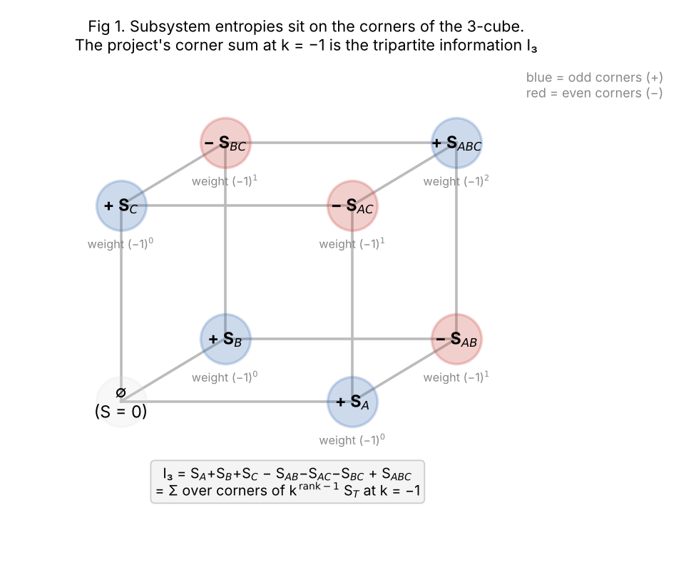
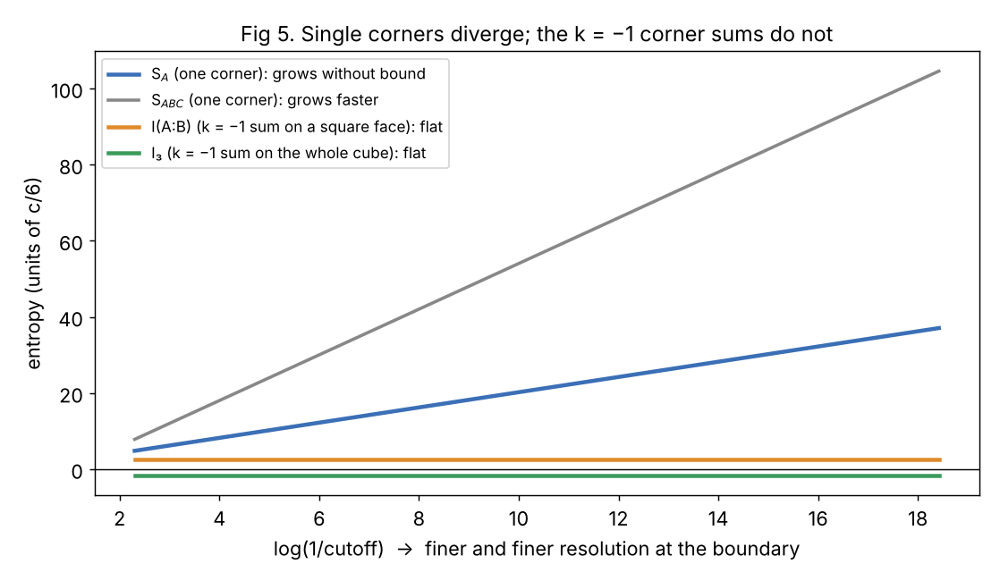
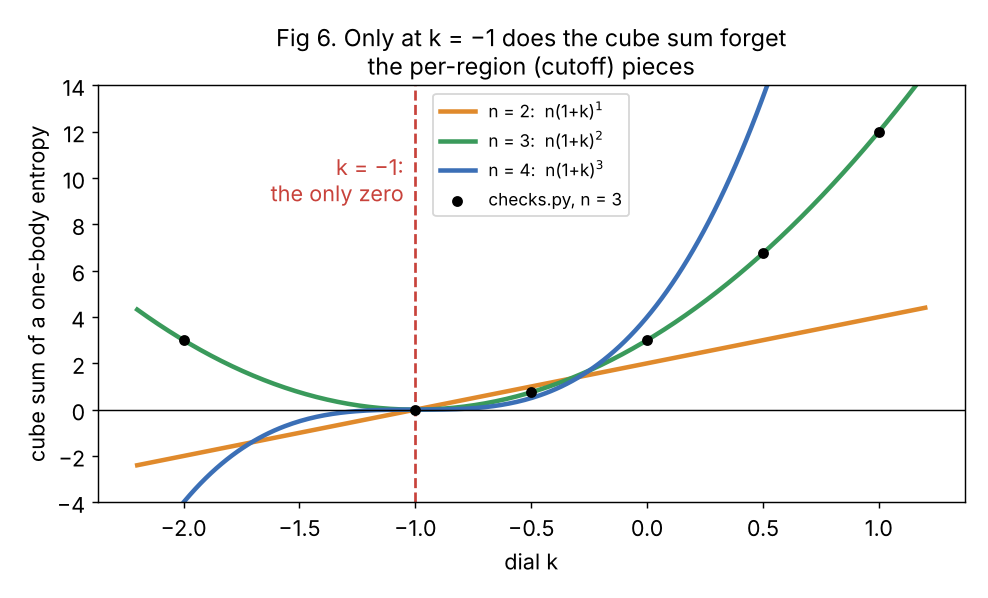
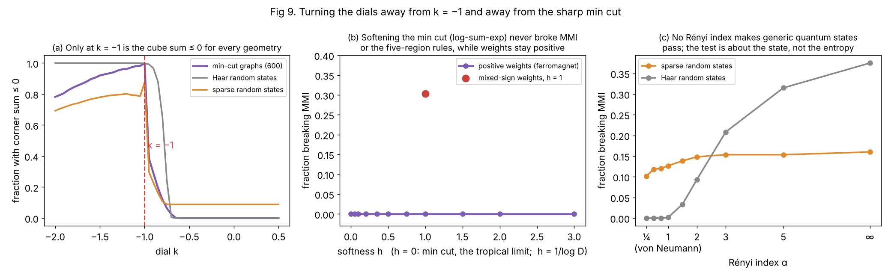
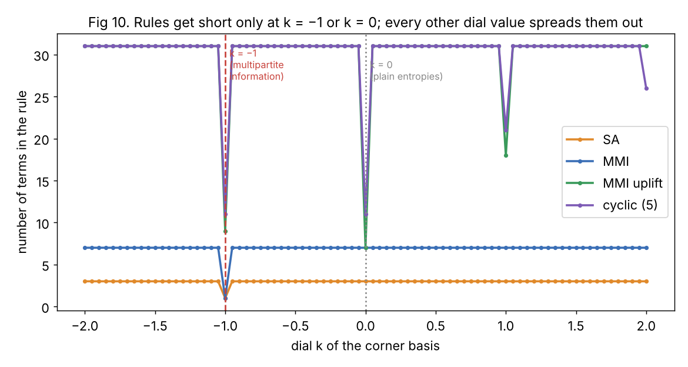

# DRAFT · Free exploration: spacetime is the entanglement pattern that passes a hypercube test

Nov 25, 2026. Open exploration, asked for by Brennan ("come back with something you find interesting... the goal is
finding this North Star"). Checks: `checks.py` → `checks_output.txt` (23/23 pass). Pictures: `figures.py` →
`figures/`. Second pass: `checks2.py` → `checks2_output.txt`, pictures from `figures2.py`. Pushed Nov 25 as a draft (working folder `exploration/`). Marked DRAFT: the computations reproduce known results; the "ours" items below are
readings and proposals, not theorems yet.

## The finding in two spoken sentences

When a quantum system has a geometric spacetime behind it, the entanglement of its pieces sits on the corners of a
hypercube, and our corner sum at k = −1 is exactly the quantity that tells "has a geometry" apart from "doesn't".
And as of 2025 there is a proof that an entanglement rule holds for every geometry exactly when one hypercube can be
mapped onto another without stretching a single edge, so in this corner of quantum gravity, proofs are maps between
cubes.

## Why I picked it

Three things made me stop.

1. **It is the North Star's best-tested bridge.** Ryu–Takayanagi (2006) says that in a quantum system with a gravity
   dual, the entanglement entropy of a region equals the area of the smallest surface in the curved spacetime that
   hangs off that region, divided by 4G. Quantum information on one side, geometry on the other, one equation.
   From it, people derived Einstein's equations themselves (linearized) from the first law of entanglement
   (Faulkner, Guica, Hartman, Myers, Van Raamsdonk 2013), and in 2019 its quantum version (the "island" formula)
   solved the black-hole information paradox's Page curve. If quantum mechanics and general relativity meet anywhere
   we can compute, it is here.
2. **Its natural coordinates are our cube.** With n regions, the entropies S_T of all the unions T are a function on
   the corners of the n-cube. The quantities that physicists actually use (mutual information, tripartite
   information I₃) are our n-fold cube sum with corner weight k^(rank−1), at k = −1.
3. **The proofs are pictures of hypercubes.** Which entanglement patterns can come from a geometry is an open
   problem (the "holographic entropy cone", fully known only up to five regions). The standard proof method maps one
   Boolean cube into another while never increasing Hamming distance. In 2025 Bao, Furuya and Naskar argued that
   this cube-map test is not just sufficient but necessary. That is about as close to "Hypercube Composition Theory
   applied to quantum gravity" as the literature gets, and nobody has said it in those words.

## The pictures

### Fig 1. Entropies on the cube; I₃ is our corner sum at k = −1

Each corner of the 3-cube is a union of regions; the empty corner has S = 0. Weight each corner by k^(rank−1) and
add: at k = −1 you get the tripartite information I₃ = S_A+S_B+S_C − S_AB−S_AC−S_BC + S_ABC (check A2). This is the
same sum that, fed product weights, gives a ∘ₖ b ∘ₖ c (check A1, all k).

### Fig 2. Where the entropies come from: shortest curves in the hyperbolic disk

A time slice of three-dimensional anti-de Sitter space is the hyperbolic disk; its boundary circle is where the
quantum system lives. The entropy of a boundary arc is the length of the shortest curve (a geodesic, a circle meeting
the edge at right angles) that ends on the arc's two ends. For two arcs, two pairings compete: (b) far apart, each arc
keeps its own curve and they share no information; (c) close together, the curves reconnect, the shaded region (the
entanglement wedge) becomes one piece, and mutual information turns on. That jump is a geometric phase transition.

### Fig 3. Proof by hypercube

The monogamy of mutual information, MMI: S_AB + S_BC + S_AC ≥ S_A + S_B + S_C + S_ABC, equivalently **I₃ ≤ 0**
(Hayden, Headrick, Maloney 2011). It holds for every geometry and fails for many quantum states.

The proof (Bao et al. 2015): give each term on the left a bit and each term on the right a bit. Each region (A, B, C
and the "rest of the universe" O) marks a corner on both cubes. If you can map the left 3-cube into the right 4-cube,
sending each region's corner to its own corner, without ever stretching a distance, the inequality holds for every
minimal-cut geometry. `checks.py` searched all maps: **there is exactly one**, and it is strikingly simple (panel a):
the four region corners go where they must, and the four other corners all collapse to the single point 0001. All 12
edges land on edges.

Panel (b) shows why the reverse inequality is false: one corner of its domain is a single step from A, B, C and O at
once, and no corner of the target cube is within one step of all four. Some edge must stretch, and Bao, Furuya and
Naskar (2025) argue that a forced stretch can always be turned into a geometry that breaks the inequality (see the
corrections below for the exact scope).

The same search finds the map for the five-region cyclic inequality (a 5-cube into a 6-cube) and finds none for its
reverse (check B).

### Fig 4. The test separates geometric states from quantum ones

- 1,500 random weighted graphs, entropy = minimal cut (the discrete version of Ryu–Takayanagi): I₃ ≤ 0 every time.
- 3,000 random triples of arcs on the AdS₃ boundary, entropy = geodesic length: I₃ ≤ 0 every time.
- Random 4-qubit states: 0.2% of typical (Haar) states and 13% of sparse states have I₃ > 0. The GHZ state has
  I₃ = +1 bit exactly; the W state +0.245. A perfect tensor (the 4-qutrit absolutely maximally entangled state, the
  building block of holographic codes) passes with I₃ = −2.
- A state with I₃ > 0 cannot be the boundary of any classical geometry. GHZ-type entanglement (everyone correlated
  through one shared bit) is the wrong shape for spacetime; perfect-tensor entanglement is the right one.

### Fig 5. The k = −1 sums are finite where single entropies are not

A single region's entropy diverges as you resolve the boundary more finely (it grows like log(1/cutoff)). The k = −1
sums over a face (mutual information) and over the whole cube (I₃) don't move at all (check E: identical to 1e-14 at
two cutoffs a thousand times apart).

### Fig 6. Why k = −1, and no other dial value

The divergent part of each entropy belongs to one region at a time (it is "one-body", a sum over the regions'
endpoints). For a one-body function the cube sum is n(1+k)^(n−1) times its average, which vanishes only at k = −1
(checks A3, A4). So k = −1 is forced: it is the only dial setting at which the cube sum forgets the cutoff and keeps
only the shared, geometric information.

## How it might touch the North Star

The open question "which quantum states have a spacetime?" has a partial, checkable answer: their entropy cube must
pass every hypercube-contraction test. MMI is the first test (three regions), and five regions are fully mapped;
for six regions, Hernández-Cuenca, Hubeny and Jia (2024) found more than 1,800 new inequalities. Each one is a
statement about one Boolean cube mapping into another. A framework whose home is the hypercube, with a Lean library
that already proves finite cube facts, is suited to this work in a concrete way: a contraction map is a finite object,
so each inequality's proof is decidable by computation.

This does not give a quantum theory of gravity. It gives a sharp necessary condition that any such theory's states
must meet when they look classical, phrased in our cube's own terms, inside the one framework (holography) where
quantum states and curved geometry are already known to be the same thing.

## Known vs ours

| Piece | Status | Source |
|---|---|---|
| Entropy = minimal area / 4G | Known | Ryu & Takayanagi 2006 (hep-th/0603001) |
| MMI, I₃ ≤ 0 for holographic states | Known | Hayden, Headrick, Maloney 2011 (arXiv:1107.2940) |
| Holographic entropy cone; contraction-map proof method | Known | Bao, Nezami, Ooguri, Stoica, Sully, Walter 2015 (arXiv:1505.07839) |
| Five-region cone complete | Known | Hernández-Cuenca 2019 (arXiv:1903.09148) |
| Over 1,800 new six-region inequalities | Known | Hernández-Cuenca, Hubeny, Jia, JHEP 08 (2024) 238 (arXiv:2309.06296) |
| Deterministic filling of contraction maps; partial-cube reformulation | Known | Bao, Furuya, Naskar, JHEP 06 (2024) 039 (arXiv:2403.13283); JHEP 03 (2025) 117 (arXiv:2409.17317) |
| Contraction map necessary as well as sufficient | Known (2025 claim, read in full on the second pass; scope and caveats under "Corrections") | Bao, Furuya, Naskar, JHEP 12 (2025) 140 (arXiv:2506.18086) |
| Einstein's equations from entanglement | Known | Faulkner, Guica, Hartman, Myers, Van Raamsdonk 2013 (arXiv:1312.7856) |
| Multipartite information as alternating (Möbius) sums over subsets | Known | McGill 1954; standard |
| I₃ and the other multipartite informations are our cube sum at k = −1 | **Ours (reading)** | this note, checks A1–A2 |
| k = −1 is the only dial value that removes the one-body (cutoff) part; cube sum of a one-body function is n(1+k)^(n−1)·mean | **Ours (elementary, but stated in our terms)**; the cutoff-freedom of "balanced" inequalities is known | checks A3–A4, Fig 6 |
| MMI's contraction map is unique, and collapses all four non-region corners to one point | Computed here; may be noted in the literature, I didn't find it said | check B |
| Lean-verified contraction maps as a route into the six-region cone | **Ours (proposal)** | next steps |

## Next steps (proposals, nothing started)

1. Put MMI and the five-region cyclic inequality into the core-Lean library as decidable statements (a map on
   `Fin 2^m → Fin 2^n`, checked by `decide`). No mathlib needed.
2. Ask whether other dial values mean something here: Rényi entropies in holography are areas of "cosmic branes"
   (Dong 2016), and the Tsallis form already composes by our ∘ₖ. A k-deformed MMI could be a lead or a dead end.
3. Run our proof engine on a handful of the six-region inequalities and compare with the published contraction maps.

## Runners-up

- **Gravity as the square of electromagnetism (Kerr–Schild double copy).** Schwarzschild's metric is flat space plus
  φ·kk with φ = 2M/r, which is the square of our river speed v² = 2M/r, and its "single copy" φk is the Coulomb field;
  it would join our general-relativity and electromagnetism pages.
- **Curvature from counting (causal sets).** The Benincasa–Dowker action gets spacetime curvature by counting small
  causal intervals with fixed alternating integer weights, close kin to our corner weights.

---

# Second pass (Nov 25, evening): following it deeper

Brennan: "Whoa that is a great find!!! Follow it deeper." Checks: `checks2.py` → `checks2_output.txt` (32/32 pass),
helpers in `checks_lib.py`. Pictures: `figures2.py` → figures 7–12. Still DRAFT.

## The result in plain words

The project's own operations show up inside holographic entanglement. In the simplest curved space (AdS₃), when you
glue two neighbouring regions together, their cross-ratios combine by our union rule ∘₋₁; the flip φ₋₁ turns that
into ∘₁, the height-flow law E(a+b) = E(a) ∘₁ E(b); and holographic mutual information is just the log of that
flipped number. For three neighbouring regions, monogamy of mutual information then comes down to one line:
X ∘₁ Y ≥ X·Y, and the slack in the inequality is exactly the "+X+Y" of the circle operation. The formulas are
known; reading them through ∘₋₁, φ₋₁, E and ∘₁ is ours.

## Corrections from reading the 2025 paper in full

Bao, Furuya and Naskar, "On the completeness of contraction map proof method for holographic entropy inequalities"
(arXiv:2506.18086, JHEP 12 (2025) 140):

- The theorem is for **linear rules with whole-number (so also rational) coefficients**. It uses plain Hamming
  distance, with a term that appears twice counted as two bits. (Bao et al. 2015 used a weighted version; our search
  handles both.)
- "Valid" means: holds for every geometry obeying Ryu–Takayanagi. The proof **assumes every such geometry has a graph
  model**, which the authors say they expect but don't prove. Nonlinear rules are not ruled out.
- The necessity step builds a violating graph by giving a stretched edge infinite (or very large) weight. Some steps
  are informal and a couple of equations look mistyped; the idea is clear, the rigour is not complete.
- Their worked examples, a "deformed MMI" and a five-region candidate, have no contraction map in our search either
  (checks F). Our search also finds maps for the published five-region facets "MMI uplift" and "cyclic" (checks F).

So in the first-pass text, "show" is now "argue", and the necessity result should be cited with these caveats.

## Fig 7. The ladder: union rule → flip → height flow

Take a boundary region A and two side-by-side regions B₁, B₂. The cross-ratio x(A,B) is the one Möbius-invariant
number of four boundary points. Exact identity (sympy, check H1): **x(A, B₁B₂) = x(A,B₁) ∘₋₁ x(A,B₂)**. That is the
union rule ("at least one"), the project's k = −1. The flip φ₋₁(x) = x/(1−x) (the project's odds) carries ∘₋₁ to ∘₁
(H2). Writing the odds as X = E(t) = eᵗ − 1 with t = −log(1−x) (H4) makes gluing plain addition of t, and
E(t₁+t₂) = E(t₁) ∘₁ E(t₂) is the height-flow law (H3). Ryu–Takayanagi gives I(A:B) = (c/3)·max(0, log X), checked
against direct geodesic computations in 3,000 configurations, in vacuum and at finite temperature (BTZ black hole),
error below 10⁻¹¹ (H5).

## Fig 8. Monogamy is ∘₁ beating multiplication

I₃(A:B₁:B₂) = log X₁⁺ + log X₂⁺ − log(X₁ ∘₁ X₂)⁺ (⁺ means "or 0 if negative"). Since X₁ ∘₁ X₂ = X₁X₂ + X₁ + X₂ ≥ X₁X₂,
and also ≥ each of X₁, X₂, I₃ ≤ 0 in every phase. When all three pairs are connected, I₃ = −(c/3)·log(1 + 1/X₁ + 1/X₂)
exactly (H7, 274 configurations): the "+X+Y" of the circle operation is MMI's slack. This covers one family (three
neighbouring intervals in AdS₃), not MMI in general.

## Fig 9. Turning the dials

- **(a) The corner-sum dial k.** On a grid from −2 to 0.5, the only k at which the cube sum is ≤ 0 for every
  min-cut geometry is k = −1. For k ≥ −½ it is ≥ 0 for everything (it follows from subadditivity). No other dial
  value carves out a known cone.
- **(b) Softening the min cut** (log-sum-exp at softness h, the Maslov / tropical dial the operations catalog already
  lists under "rescale"). h = 0 is the min cut. For h > 0 these are Ising free energies, which is what the averaged
  Rényi-2 entropy of a random tensor network with bond dimension D = e^(1/h) becomes (Hayden et al. 2016; I did not
  check our normalization against theirs exactly). **Numerical observation:** with positive weights, no violation of
  subadditivity, MMI, the MMI uplift or the five-region cyclic rule at any h tested (up to h = 100 for MMI and h = 10 for the five-region rules, in side probes beyond checks.py); with
  mixed-sign weights 30% break MMI. I did not find this stated in the literature. Subadditivity here looks like the
  FKG inequality for ferromagnets; I have no proof for MMI or the five-region rules. **This is a lead worth
  following**: if true in general, the holographic cone would hold for a whole family of "fuzzy" geometries, not
  just the sharp classical limit.
- **(c) Rényi index.** Generic random states break MMI at every α from ¼ to ∞; sparse states about 10–16% of the time.
  Changing the entropy doesn't rescue them.

## Fig 10. Which basis makes the rules short?

Rewriting each rule in the dial-k corner basis: SA and MMI become a single term only at k = −1. The MMI uplift is
shortest at k = 0 (7 terms vs 9 at k = −1), because it is I₃ of merged parties (A, BC, DE), and the cyclic rule ties
at k = −1 and 0. Every other k spreads all of them out to every corner. So k = −1 is the natural basis for the
"atoms" (Hernández-Cuenca, Hubeny and Jia work in this basis), but not uniformly the shortest.

## Fig 11. The concrete North Star link

- **First law of entanglement, checked from Ryu–Takayanagi in d = 2, 3, 4, 5, 6** (sympy, check J1): for a ball of
  radius R in a slightly heated state, the change in the minimal surface's area gives δS = m R^d / (8G(d+1)) per unit
  solid angle, which equals the change in modular energy δ⟨H⟩ exactly.
- Faulkner, Guica, Hartman, Myers and Van Raamsdonk (2013) proved the converse: if δS = δ⟨H⟩ holds for every ball,
  the bulk obeys the linearized Einstein equations. So Einstein's equations (to first order) are the statement
  that entanglement obeys a first law.
- At the next order the two sides separate, and the gap is relative entropy, which is never negative (BTZ, exact,
  J2). Lashkari, Lin, Ooguri, Stoica and Van Raamsdonk (2016) read that positivity as gravitational positive energy.
- **Where our operation enters, honestly:** the first law itself is linear, so ∘ₖ adds nothing there. What survives
  at finite temperature is the gluing structure: the ∘₋₁ law for cross-ratios holds in the BTZ black hole too (the
  distances become sinh's, and the identity still holds; check H5, BTZ). That is checkable but not yet a new
  prediction.

## Fig 12. GHZ, the state with no geometry

Every entropy of an n-party GHZ state is 1 bit, so its entropy function is the all-ones product and its cube sum is
the n-fold circle product 1 ∘ₖ 1 ∘ₖ … ∘ₖ 1 = ((1+k)ⁿ − 1)/k (the q-number [n] with q = 1 + k). Every n passes
through the same point at k = −1, value 1: GHZ breaks the k = −1 test by exactly one bit at every size (check I4).

## Did the cube-map proofs match our structure?

Partly. What matched: the k = −1 corner basis (the multipartite informations), the union rule ∘₋₁ on cross-ratios,
the flip φ₋₁, the height-flow law E, and the tropical "rescale" dial. What did not: the contraction maps themselves
use the cube as a **metric space** (Hamming distance; image graphs are "partial cubes"), which the project has not
used. Our corner weights k^rank are distances from the empty corner, and a contraction map that fixes the purifier
corner never increases rank, but I found nothing deeper than that. The curvature dial (the plane dial) d and the soliton pair weights did
not show up.

## Known vs ours (second pass)

| Piece | Status | Source |
|---|---|---|
| Holographic mutual information in AdS₃ as a function of the cross-ratio, with the phase transition at x = ½ | Known | Headrick 2010 (arXiv:1006.0047) |
| Cross-ratio product identity under gluing | Known (standard cross-ratio algebra) | — |
| Reading it as x₁ ∘₋₁ x₂, flipping to ∘₁, and MI = log E(t) with E the height-flow generator | **Ours (reading)** | checks H1–H5, Fig 7 |
| MMI for neighbouring intervals as X ∘₁ Y ≥ XY, slack −log(1 + 1/X + 1/Y) | **Ours (short proof for this family)**; MMI itself known | check H7, Fig 8 |
| Only k = −1 makes the cube sum sign-definite on geometries | **Ours (numeric, grid)** | check I1 |
| Soft min cut (Ising free energy, ferromagnetic) obeys MMI and the five-region rules at every h tested | **Ours (numeric observation, unproven, literature not found)** | checks I2, I2c |
| Random tensor networks: Rényi-2 ↔ Ising free energies | Known | Hayden, Nezami, Qi, Thomas, Walter, Yang 2016 (arXiv:1601.01694) |
| First law from RT in d dimensions; converse gives linearized Einstein | Known | Blanco, Casini, Hung, Myers 2013; Faulkner et al. 2013 (arXiv:1312.7856) |
| Relative entropy positivity ↔ positive energy | Known | Lashkari, Lin, Ooguri, Stoica, Van Raamsdonk 2016 (arXiv:1605.01075) |
| GHZ cube sum = n-fold ∘ₖ of 1 | **Ours (one line)** | check I4 |

## What looks worth following next

1. **The soft-min observation (strongest lead).** Try to prove MMI for ferromagnetic Ising free energies with boundary
   conditions, or find a counterexample on larger graphs. Check the literature on correlation inequalities (GKS,
   FKG) first. If it holds, it says the holographic cone survives "1/D corrections" in this model.
2. **Lift the ladder beyond three intervals.** For n neighbouring intervals the cross-ratios still glue by ∘₋₁; test
   whether the five-region rules reduce to ∘₁ inequalities in the same way.
3. **Lean.** Both the contraction maps (finite) and the X ∘₁ Y ≥ XY step are small enough for the core-Lean library.
