# Homothety-dial survey: which proved laws slide into one another (DRAFT)

> **Names:** some words or symbols on this page (⊕, fused, rung, wall, Tsallis q) also mean something else in standard math, physics or computing, or inside this project. [NAMING-COLLISIONS.md](../../NAMING-COLLISIONS.md) says which meaning is in play.

Page: https://claude.ai/artifact/L7wqpXJgPKsqV9QorZ23TU

**DRAFT, Nov 26 2026.** Part of Affine Composition Theory (repo: fused-hyperoperation-algebra). Asked for by Brennan:
"I'd like similar surveys for the other dials as well", after the shape-dial survey, whose ask was "a survey of all of
our laws that we've proven to see if the shape dial is able to move from one to another", then "check all laws ... to
see if a new law emerges and what it might be for", with "a polishing step ... as long as it doesn't take too much
effort from the computer". This page turns the homothety k (the circle operation a ∘ₖ b = a + b + k·ab) with the
curvature dial d held at 0 and every other dial fixed.
Checks: `checks.py` → `checks_output.txt`, **67 of 67 pass** (numpy, scipy, sympy, mpmath; about 2 seconds), including
5 polish checks at 30 digits that cost **0.03 seconds in all**. Law list: `laws.py` → `laws.json`. Pictures:
`figures.py` → `figures/`. No Lean in this pass. Colour key: **blue = our reading, orange = already known, grey =
endpoints and background.**

## The result

**First, the plain fact the whole survey rests on.** Rescaling a ↦ λa sends k to k/λ (check A1), and a ↦ −a swaps
k and −k (A2). So on the bare number line the k dial has only **three stops: k < 0, k = 0, k > 0**, and the two outer
stops are mirror images. Every "slide along k" of a law on the bare line is a slide between those three stops; k = 0 is
reached as a limit, because every coefficient is a polynomial in k. The sign itself only means something when the sign
of the values does (chances, counts, sizes).

**Second, the useful fact.** k stops being a unit choice the moment something pins the scale: a top value 1 (chances,
fuzzy measures), whole numbers (bits, copies, counts), a graph (an edge weight at fixed site weight), a fixed spectrum (a
matrix), or a fixed curvature. Then k is a real dial and **whole-number stops appear**: −1/m, −q/(q − 1), −1, −2, q − 1,
and the threshold k = 1 on graphs. On the negative side each stop is where the wall −1/k lands on a pinned value (m
copies, the scrambled error (q − 1)/q, the top value 1, one half).

With d = 0, the 65 law groups of `dial-catalog/` sort into:

- **20 slide** into another proved law, with the carrying formula exact along the whole dial.
- **5 survive on part of the dial** (Lee–Yang on graphs, holographic corner sums, Boolean logic, the prime gas, the
  logic/algebra group).
- **2 are the dial itself** (the core law; the proof that k is units). **2 are the odds dial t in disguise.**
- **0 plausible.** **36 don't slide**: they live on d, p, q or t, or k is only a unit there.

The leads, judged each on its own merits, in order:

1. **One-mode counts are the Katz–Panjer (a, b, 0) class (C2).** The law with coefficients ∏_{j<e}(1 + jk)/e! is binomial
   at k = −1/m, Poisson at 0, negative binomial (r = 1/k) for k > 0. That list is exactly the (a, b, 0) class (Katz 1965;
   Panjer 1981; Sundt and Jewell 1981 proved there is nothing else), with a = kz. The rule "k < 0 only at −1/m" is their
   termination rule, and it is the same arithmetic as Shirai–Takahashi's α = −1/m. **Confirmed; known pieces.** The
   one-line identification wasn't found stated. Worth one paragraph in `dial-point-processes/` and `repetition-dial/`,
   because it gives those pages their standard name.
2. **Fused calculus slides from ordinary to product calculus (C5).** D_k F = F′/(1 + kF) keeps the product rule and the
   fundamental theorem at every k: ordinary calculus at 0, Volterra's product integral and Grossman–Katz's geometric
   derivative at 1, and the hazard calculus of survival analysis at −1. The grain of a difference calculus is k (Hilger's
   time scales, Fisher's rule with a period, jets R[ε]/(ε² − kε)). **Known; a clean organising slide.**
3. **The alphabet ladder (C10).** Error rates of q-letter symmetric channels compose by ∘ₖ with k = −q/(q − 1): bits and
   Haldane's map at −2, DNA (Jukes–Cantor) and qubit depolarizing at −4/3, erasure at −1. The cure model k = −1/π fills
   every gap. On values in [0, 1] the line splits at k = −1: chance "or" laws live at k ≤ −1, Sugeno measures at k > −1.
   **Known pieces; the reading is ours.** Useful as a map, not a theorem.
4. **Tunnelling is a k slide, not a d reading (C7).** Averaged over the angle, the law of cosines composes by ∘ₖ with
   k = −2K: piling-up lemma (sphere), variances add (flat), mean resistance (hyperbolic). The background curvature enters
   through k; the law's own reading −Δ/4 = −k²/4 loses the sign. **Known pieces, ours as one formula (from `tunnelling/`).**
5. **Lee–Yang survives only for k ≥ 1 on graphs (C8).** Here k is an edge weight and is not a unit. **Known (Lee and Yang 1952).**
6. **The prime gas keeps its continuation only at k = ±1 (C6).** **Known (Dahlquist 1952), as `dial-survey/wall/` found.**
7. Tsallis–Rényi–Shannon (C3), Sugeno's belief and plausibility sides (C4), the counting stops (C9) and the corner
   expansion (C1) all slide and are all known.
8. **Holographic corner sums (C11)** give the one new in-between number: the weighted sum of three regions' entropies is
   ≥ 0 for every quantum state exactly when k ≥ √6 − 3 ≈ −0.551 (proved in two lines, sharp at the perfect tensor). Not
   found in print, but at three regions it says nothing about geometry. **A small sharp fact, not a lead.** Pushed to
   more regions (`new-facts-levers/`, Nov 26): −1/φ² at four, and at five it splits geometric states (−0.382) from all
   quantum states (−0.354, a Reed–Solomon GHZ state), though the numbers are read off known cones.

**New laws at in-between settings (section N).** The in-between values that matter are the pinned-scale ladders above,
and all but one are known. The one I found no print for is the holographic threshold √6 − 3 (N3). The three
whole-number ladders form one orbit of the order-3 map k ↦ −1/(1 + k) (N5). That map has a name: it is ST, the standard
order-3 element of the modular group PSL(2, ℤ), and in λ = −k it is λ ↦ 1/(1 − λ), the order-3 rotation of the cross-ratio
(anharmonic) group. So the three ladders are one cross-ratio with its four points cycled. Known group; the reading is ours.

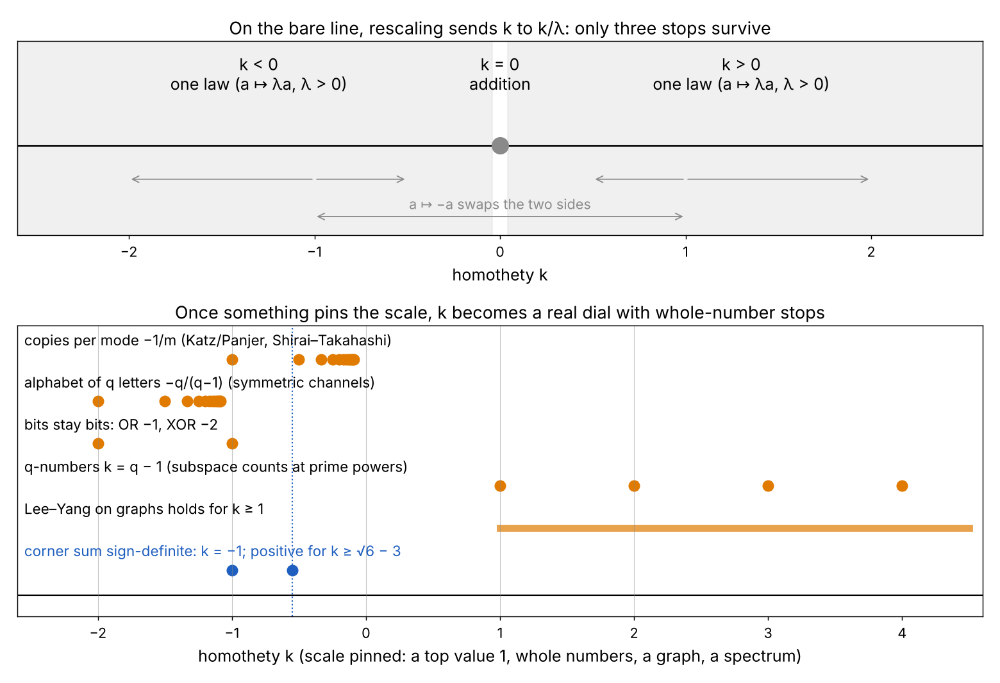

*Figure 0. Top: on the bare line, rescaling moves k toward or away from 0 but never across it, and a ↦ −a swaps the
sides, so the stops are k < 0, k = 0 and k > 0. Bottom: the stops that appear once a value is pinned. Orange is known;
blue is the one new number (C11).*

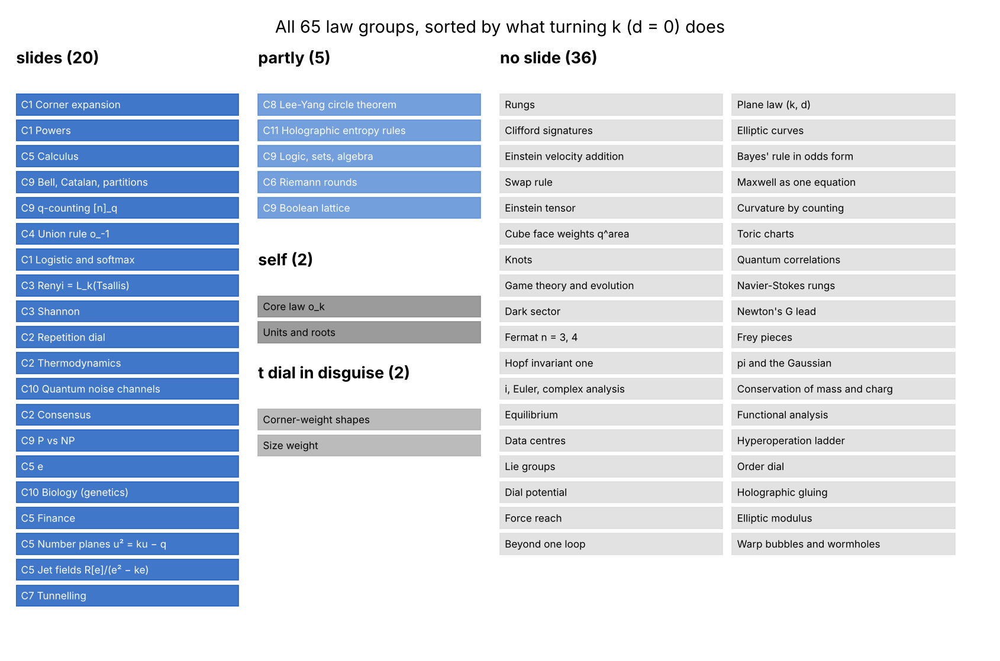

*Figure 12. All 65 groups, sorted by verdict.*

---

## How I tested a slide

For each group I held d = 0 (and the shape, order, odds and ratio dials fixed) and turned k. A group **slides** when both
ends are proved (a Lean module or a checked page) and the formula that carries one into the other is exact for every k.
Because only three stops survive rescaling, "every k" here means: the formula is a polynomial or analytic in k, holds at
k < 0, at k = 0 and at k > 0, and, where the scale is pinned, at every special value too. A move that only rescales
another dial's weight is the **t dial in disguise**. Where k is only a unit (every k ≠ 0 is the same law), the verdict
is **no**, with the reason.

---

## C1. Corner expansion: inclusion–exclusion → sums → products — slides

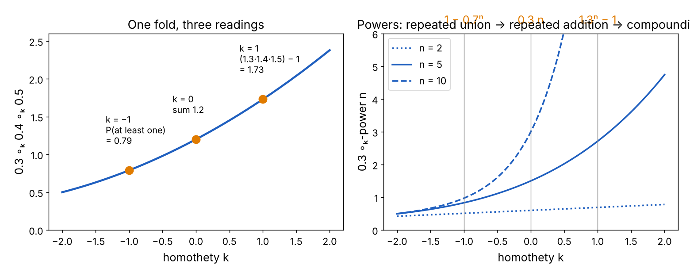

*Figure 1. Left: one fold of three chances along the dial. Right: ∘ₖ-powers of 0.3; repeated union at −1, repeated
addition at 0, compounding at 1.*

- **The formula.** 1 + k(x₁ ∘ₖ … ∘ₖ xₙ) = ∏(1 + k·xᵢ), and the fold is the sum over the cube's corners with weight
  k^(|S|−1) (checks B1, B2; Lean `circK_lift`, `Combinatorics.kfold_lift`, `one_add_foldCirc_eq_corners` at k = 1).
- **Stops.** k = −1: P(at least one) of independent events, the union rule (B3, `circK_either`). k = 0: the sum. k = 1:
  the product minus one. Powers: 1 − (1 − a)ⁿ, n·a, (1 + a)ⁿ − 1 (B4, `wpow_lift`, `wpow_neg_one`).
- **Matrices.** With a matrix in place of a number the fold is det(I + kA), and the walls sit at k = −1/λ for each
  eigenvalue λ (B5; `mathlib-map/` proves this is the quasispectrum). Here k is not a unit, because A is fixed.
- **Logistic and softmax.** The normaliser 1 + (∏(1 + kxᵢ) − 1)/k runs from softmax with a "none" option (k → 0) to
  independent yes/no logits (k = 1) (B6).
- **Known:** inclusion–exclusion, Sugeno's and Banon's Möbius masses, Fredholm determinants. **Ours:** reading the
  three as one fold. **Verdict: slides; known.**

## C2. One-mode counts: binomial → Poisson → negative binomial — slides

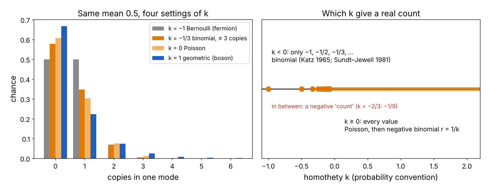

*Figure 2. Left: the chance of 0 to 6 copies in one mode at the same mean. Right: which k give real counts: every k ≥ 0,
but only −1, −1/2, −1/3, … below 0.*

- **The law.** One mode with weight z has generating factor (1 − kz)^(−1/k), so P(e copies) ∝ zᵉ ∏_{j<e}(1 + jk)/e!.
  (Probability convention of `dial-survey/` and `DialSurvey.lean`; `repetition-dial/` uses the weight convention with
  the opposite sign, `Conventions.weight_prob_flip`.)
- **It is the (a, b, 0) class.** p_e/p_{e−1} = a + b/e with **a = kz, b = z(1 − k)** (C1). Binomial at k = −1/m (C2),
  Poisson at 0 (C3), negative binomial with r = 1/k and success 1 − kz for k > 0, geometric at k = 1 (C4). The wall
  z < 1/k is the negative binomial's convergence condition.
- **k < 0 only at −1/m.** The binomial row of the table has b/a = −(m + 1), and (1 − k)/k = −(m + 1) forces k = −1/m
  (C8). At k = −2/3 the x³ coefficient is −1/9 (C5). This is Katz's and Sundt–Jewell's termination rule, the same
  arithmetic as Shirai–Takahashi's existence rule for α-determinantal processes (α = −1/m), and Lean's `kRise_fermi`,
  `kRise_parafermi`, `two_thirds_negative`.
- **Physics.** Mean copies z/(1 − kz) = **1/(e^x − k)** with z = e^(−x): Fermi–Dirac at k = −1, Maxwell–Boltzmann at 0,
  Bose–Einstein at +1 (C6). Spread n(1 + kn) (C7). In the weight convention of `repetition-dial/` the same formula reads
  1/(e^x + k), with Fermi at +1. Lean: `fermion_lift`, `boson_mode`, `boson_fermion_dual`.
- **Known (orange):** the (a, b, 0) class: Katz (1965), Panjer (1981), Sundt and Jewell (1981, the "only these three"
  theorem); α-determinantal processes: Shirai and Takahashi (2003); Fermi/Bose interpolation is textbook.
- **Ours (blue):** saying that the dial's one-mode law *is* the (a, b, 0) class with a = kz, so the −1/m rule of point
  processes and of claim counts is one rule. I didn't find it stated in two searches (queries listed under Known vs new);
  it is a one-line observation, so it may be folklore.
- **Verdict: slides; the strongest confirmation in the survey, worth one paragraph** on the two pages that use it.

## C3. Tsallis → Shannon → Tsallis on the other side, with Rényi as the ruler — slides

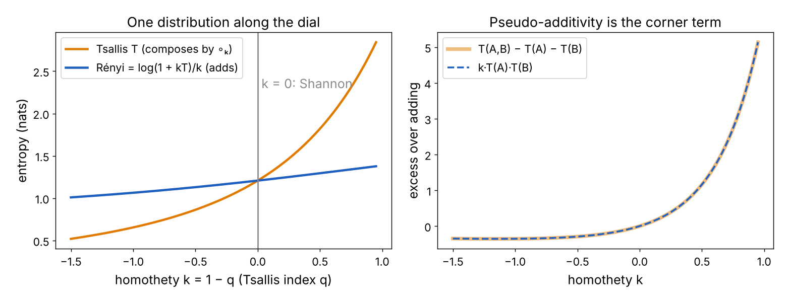

*Figure 3. Left: Tsallis and Rényi entropy of one distribution along k = 1 − q. Right: the excess over adding is exactly
k·T(A)·T(B).*

- Tsallis' q-logarithm is the dial's logarithm with k = 1 − q (D1). For independent parts, T(A, B) = T(A) ∘ₖ T(B) (D2),
  and Rényi = log(1 + kT)/k adds (D3). At k = 0 both become Shannon (D4). Lean: `tsallis_engine`, `renyi_additive`,
  `qlog_dual`.
- **Known:** Rényi (1961), Tsallis (1988), Sharma–Mittal (1975). **Ours:** nothing new beyond `information-theory-full/`.
- **Verdict: slides; known.**

## C4. Sugeno measures: plausibility → probability → belief — slides

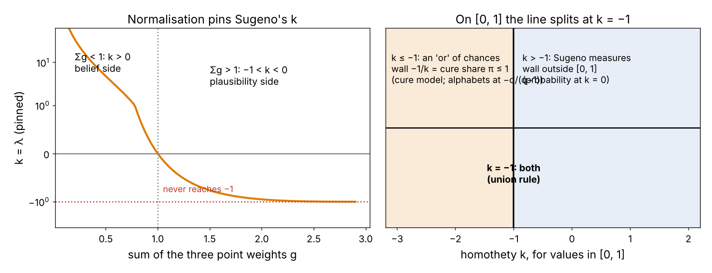

*Figure 4. Left: the normalisation μ(X) = 1 fixes k = λ from the point weights. Right: on values in [0, 1] the line
splits at k = −1.*

- Sugeno's λ-measure, μ(A ∪ B) = μA ∘λ μB for disjoint sets, is the dial with k = λ. **Normalisation pins k** (E1): Σg < 1
  gives λ > 0, where the Möbius masses λ^(|S|−1)∏g are all ≥ 0 (a belief function, E2); Σg > 1 gives −1 < λ < 0, where
  the masses change sign (the plausibility side, whose dual measure has weight −λ/(1 + λ) > 0, E3); Σg = 1 gives a
  probability (E4). Lean: `lam_lift`, `lam_corners`, `lam_neg_one`, `no_norm_past_wall`, `dual_weight`.
- **The split at −1.** λ never reaches −1: the wall −1/λ must stay outside [0, 1]. The "or" laws of chances do the
  opposite: they need the wall inside [0, 1], at the cure share π = −1/k (`where-k-moves/`), so k ≤ −1. k = −1, the union
  rule, is the one value that is both.
- **Known:** Sugeno (1974); Banon (1981) on belief and plausibility; the Sugeno–Weber t-conorm min(1, a + b + λab)
  (Sugeno; Weber 1983). **Ours:** the split picture. **Verdict: slides; known.**

## C5. Calculus: ordinary → product calculus, with the grain as k — slides

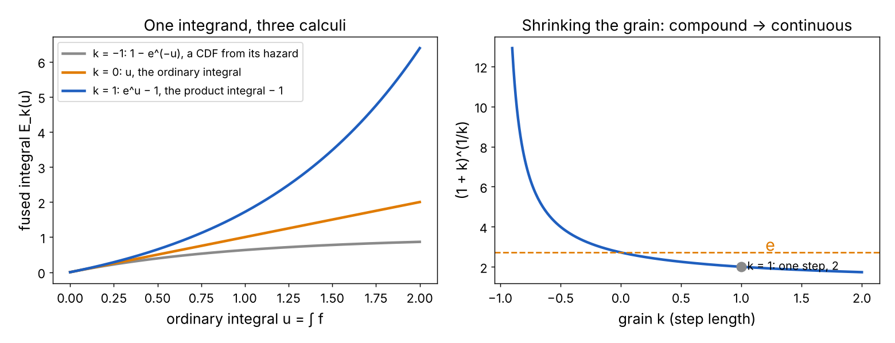

*Figure 5. Left: the same ordinary integral read through E_k(u) = (e^(ku) − 1)/k. Right: (1 + k)^(1/k) → e as the
grain k shrinks.*

- **Do the theorems hold for general k? Yes.** With D_k F = F′/(1 + kF): the product rule D_k(F ∘ₖ G) = D_k F + D_k G
  (F1) and the fundamental theorem D_k(E_k(∫f)) = f (F2) hold at every k. The Lean module proves the discrete version at
  k = 1 (`ftc`, `ftc_box`, `mint_lift`) and the grain-h rules at every h (`rate_product`, `ts_exp`, `ts_exp_mul`); the
  rest follows by `circK_scale`.
- **Stops.** k = 0: ordinary calculus. k = 1: 1 + (fused integral) = ∏(1 + f dx) = e^(∫f), Volterra's product integral
  (1887), and D₁F is the logarithmic derivative of 1 + F, the log of Grossman and Katz's geometric derivative (1972)
  (F3). k = −1: D₋₁F = F′/(1 − F) is the hazard rate, and F = 1 − e^(−∫h) (F4).
- **The grain.** On a grid of step μ, (1 + μr)(1 + μi) = 1 + μ(r ∘_μ i) (F5): Hilger's time-scale calculus, and Fisher's
  rule for interest with a period of length μ. Shrinking the grain gives e (F6). The jet planes R[ε]/(ε² − kε) are the
  same slide: dual numbers (the derivative) at k = 0, two points a step k apart (the difference quotient) at k ≠ 0 (F7;
  Lean `units_circK`, `ofTwoPt_twoPt`, `dual_units_add`, `split_point`, `dual_point`).
- **Known:** Volterra (1887); Grossman and Katz (1972); Hilger (1988), Bohner and Peterson (2001); Pap's g-calculus.
  **Ours:** nothing beyond `calculus/`. **Verdict: slides; known, and the cleanest picture of what "turning k" means:
  changing the grain.**

## C6. The prime gas Z_k(s) — partly

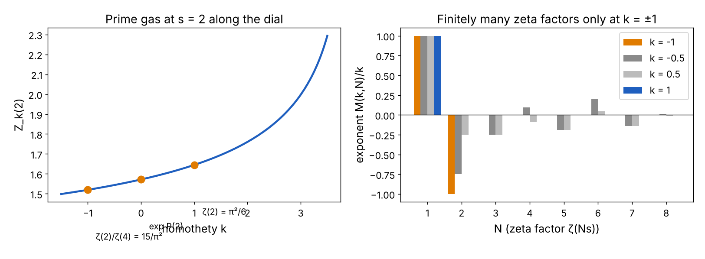

*Figure 6. Left: Z_k(2) along the dial. Right: the exponents of ζ(Ns) in Z_k(s); they stop after N = 2 only at k = ±1.*

- Z_k(s) = ∏_p (1 − k p^(−s))^(−1/k) = ∏_N ζ(Ns)^(M(k,N)/k), M the necklace counts, for every k (G1). k = −1 gives
  ζ(s)/ζ(2s), k = 1 gives ζ(s) (G2, polished in G5), k = 0 gives exp of the prime zeta function (G4). Every other k needs
  infinitely many factors (G3), and Re s = 0 is a natural boundary.
- **Known:** Dahlquist (1952) for the boundary; Landau–Walfisz (1920) at k = 0; Julia and Spector (1990) for the primon gas.
  Here k is not a unit: the primes pin the scale. **Verdict: partly** (the product identity slides, the continuation
  survives only at the two stops); closed lead, as `dial-survey/wall/` found.

## C7. Tunnelling averages: piling-up → variances add → mean resistance — slides

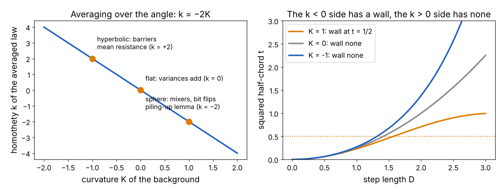

*Figure 7. Left: the averaged law sits at k = −2K. Right: the squared half-chord t; the sphere has a wall at t = 1/2,
flat and hyperbolic space have none.*

- Average the law of cosines over the angle: the squared half-chord t = (1 − cos √K D)/(2K) composes by ∘ₖ with
  **k = −2K**, exactly, for every curvature (H1, polished in H4). Sphere (k = −2): bit flips and the piling-up lemma (H2).
  Flat (k = 0): variances add (H3). Hyperbolic (k = +2): barriers' mean resistance.
- **Is it a k slide or a d reading?** A k slide. The law itself sits at d = 0 for every K; the background curvature
  enters through k. The law's own curvature reading −Δ/4 = −k²/4 is negative on both sides and loses the sign. And since
  rescaling lengths moves K and k together, only the sign of K (sphere, flat, hyperbolic) is invariant: the three stops
  again.
- **Known:** each average in its own field (Anderson et al. 1980; Matsui 1993; Flory). **Ours:** k = −2K as one formula
  (`tunnelling/`). **Verdict: slides.**

## C8. Lee–Yang on graphs — partly

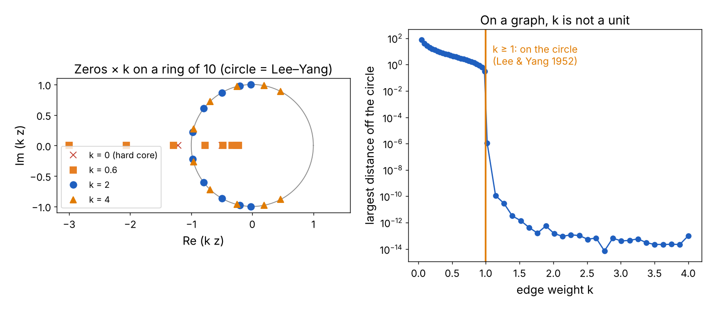

*Figure 8. Left: zeros of the dial gas on a ring of 10, scaled by k. Right: distance off the Lee–Yang circle against the
edge weight k.*

- The dial gas Z = Σ_S z^|S| k^(edges inside S) (`lee-yang/`) has **k as an edge weight, which no rescaling of z
  removes**. For k > 1 (attraction) every zero lies on |z| = k^(−deg/2) (I1, ring and 3-cube; polished at k = 2 in I4);
  k = 1 is the free gas (1 + z)ⁿ. For k < 1 the zeros leave the circle (I2), and at the hard-core point k = 0 they sit on
  the negative real axis (I3).
- **Known:** Lee and Yang (1952), via the lattice-gas ↔ ferromagnet map (coupling log k / 4 ≥ 0 iff k ≥ 1).
  **Verdict: partly**; nothing new.

## C9. Counting with a pinned input: parity → OR → count → subsets — slides

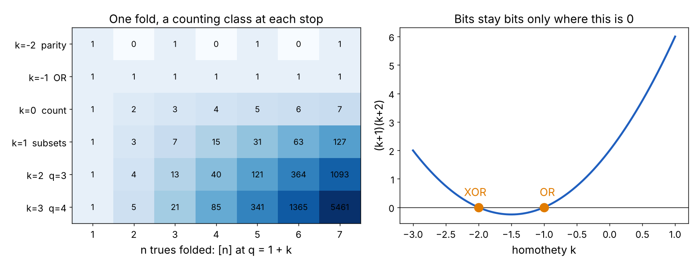

*Figure 9. Left: n trues folded at each whole k; the counting class at each stop. Right: the idempotent defect
(k + 1)(k + 2).*

- [n]_q is n copies of 1 under ∘ₖ with **k = q − 1** (J1; Lean `qnum_eq_wpow`). The input 1 pins the scale. Stops: k = −2
  parity (⊕P), k = −1 OR (NP), k = 0 the count (#P), k = 1 the nonempty subsets (J2; `fold_xor_trues`, `fold_or_trues`,
  `witness_fold`). At whole k = q − 1 with q a prime power, Gaussian binomials count subspaces of F_qⁿ (J3).
- Touchard polynomials T_n(k) give Bell numbers at 1 and the complementary Bell numbers at −1 (J4; `dial_blocks_minus_one`),
  and 1 + k(1 ∘ₖ 2 ∘ₖ … ∘ₖ m) = ∏(1 + jk), the rising product behind C2 (J5).
- **Bits stay bits only at k = −1 and k = −2**: (a ∘ₖ b)² − (a ∘ₖ b) = (k + 1)(k + 2)ab on idempotents (J6; Lean
  `idem_defect`, `bits_closed_iff`). That is why the logic group and the Boolean-lattice group are "partly".
- **Known:** Gauss; Tits (1957) on q → 1; Stone (1936); Uppuluri and Carpenter (1969); Wilf's conjecture that the
  complementary Bell numbers vanish only at n = 2 is still open (De Wannemacker, Laffey and Osburn 2007 settle most n).
  **Verdict: slides; known.**

## C10. The alphabet ladder on [−2, −1] — slides

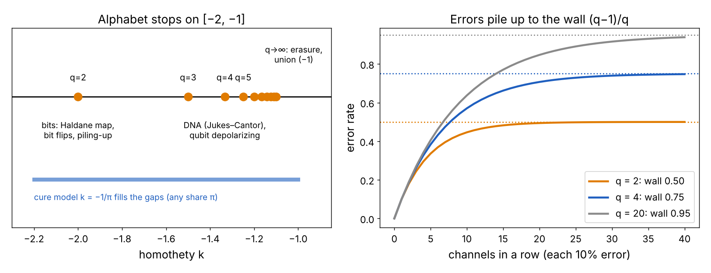

*Figure 10. Left: the stops k = −q/(q − 1) and the cure-model band. Right: error rates of channels in a row pile up to
the wall (q − 1)/q.*

- A q-letter symmetric channel that errs with chance e sends the letter to each wrong letter with chance e/(q − 1). Two
  in a row err with chance e₁ ∘ₖ e₂, **k = −q/(q − 1)** (K1; Lean `qary_cascade` with c = 1/(q − 1)). The wall
  (q − 1)/q is full scrambling, and it absorbs (K2).
- Stops (K3, K4): q = 2, k = −2: Haldane's map, bit and phase flips, the piling-up lemma (`haldane`, `bit_flip`,
  `piling_up`). q = 4, k = −4/3: Jukes–Cantor for DNA and the depolarizing qubit channel (`depolarizing`). q → ∞, k = −1:
  erasure, amplitude damping, the union rule (`amplitude_damping`).
- Between the stops, the cure model k = −1/π (`where-k-moves/`) gives a law at every k ≤ −1, with the wall at the share π.
- **Known:** Jukes and Cantor (1969); symmetric channels; Haldane (1919). **Ours:** reading the alphabet size as a stop
  of k. **Verdict: slides; a useful map, not a theorem.**

## C11. Holographic corner sums — partly

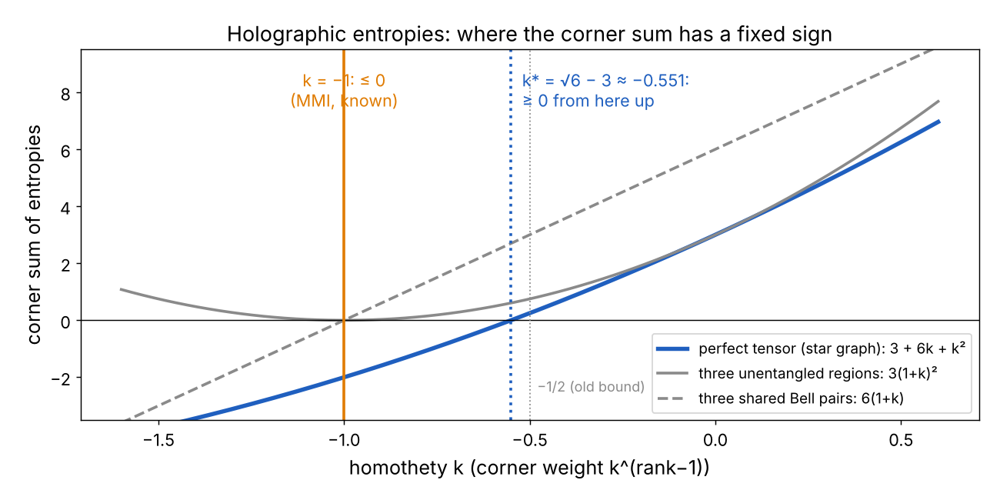

*Figure 11. The corner sum S_A + S_B + S_C + k(S_AB + S_AC + S_BC) + k²S_ABC for three entropy vectors. MMI is the
statement at k = −1; the perfect tensor sets the threshold k* = √6 − 3.*

- `holographic-entropy-cube/` found that k = −1 is the only setting where the corner sum is ≤ 0 on every geometry
  (monogamy of mutual information), and that it is ≥ 0 for k ≥ −1/2.
- **Sharper:** it is ≥ 0 for every k ≥ **√6 − 3 ≈ −0.5505**, and this is sharp. Proof: write s, P, T for the sums of
  single, pair and triple entropies. Subadditivity gives P ≤ 2s; Araki–Lieb on the purification gives 3T ≥ P − s. For
  −3 < k < 0 the sum is at least s + kP + k²(P − s)/3, which falls as P grows, so P = 2s is worst, leaving
  (s/3)(k² + 6k + 3) ≥ 0 exactly when k ≥ √6 − 3 (L6; if P ≤ s the sum is ≥ s(1 + k) > 0). The four-party perfect tensor,
  realised by a star graph (L1), meets it (L2). An LP over every vector obeying SA and SSA agrees (L3), and 60 random
  min-cut graphs obey both signs (L4). Polished in L5.
- **Verdict: partly.** The new threshold holds for **every** quantum state, not just geometric ones, so it says nothing
  about geometry. A small sharp fact; not a lead.
- **Follow-up (Nov 26, `new-facts-levers/`).** Tried against quantum gravity and the Millennium problems. With more
  regions the threshold moves: n = 4 gives (√5 − 3)/2 = −1/φ² for every quantum state; at **n = 5 geometric and quantum
  states split**: every geometric state is ≥ 0 for k ≥ −0.382, while a Reed–Solomon GHZ state (any two parties hold the
  whole secret) goes negative up to k = −0.354. So a negative corner sum in that window rules out a geometric dual. Both
  numbers are exact (LPs met by real states). Literature: the numbers were not found, but they are read straight off the
  symmetrized quantum and holographic cones (Pippenger; Fadel and Hernández-Cuenca 2022; Czech and Shuai 2021), so this is
  a small diagnostic, not new physics. No Millennium problem is touched. **Verdict unchanged: not a lead.**

---

## N. New laws at in-between settings

I swept the dial between the stops in every group that slides. On the bare line nothing can happen between the stops,
because rescaling carries any k to any other of the same sign. So every in-between law needs a pinned scale. What came out:

| In-between setting | Law | Status |
|---|---|---|
| k = −1/m (between −1 and 0) | at most m copies; binomial counts; α-determinantal processes exist | **Known** (Katz 1965; Sundt–Jewell 1981; Shirai–Takahashi 2003). Proved in Lean (`kRise_parafermi`) |
| k = 2/m (between 0 and 2) | permanental processes from m real Gaussian fields always exist | **Known** (Shirai–Takahashi 2003); checked by simulation in `dial-point-processes/` |
| k = −q/(q − 1) (between −2 and −1) | q-letter symmetric channels; Jukes–Cantor at −4/3 | **Known**; proved in Lean (`qary_cascade`) |
| k = −1, −2 | the only places where bits stay bits (OR, XOR) | **Known** (Stone 1936); proved (`idem_defect`) |
| k = q − 1, q a prime power | Gaussian binomials count subspaces of F_qⁿ | **Known** (Gauss; Tits 1957); checked (J3) |
| k = 1 on graphs | Lee–Yang threshold | **Known** (Lee–Yang 1952); checked (I1–I3) |
| k = √6 − 3 | corner sum of three regions' entropies turns sign-definite | **Proved** here (two lines, L6); **not found in my search** |
| k = n(n + 1), −ℓ(ℓ + 1) | the tunnelling page's rewind ladder | From `tunnelling/`, not re-checked here |
| the three ladders | one orbit of ST: k ↦ −1/(1 + k), the cross-ratio's order-3 rotation | **Checked algebra** (N1, N3, N4); known group, reading ours |

### N1. The −1/m ladder

The rule that k < 0 is allowed only at −1/m is one fact seen four ways: claim counts (the (a, b, 0) class), point
processes (α-determinantal existence), copies (Lean `kRise_parafermi`), and the coefficients ∏(1 + jk), which must stop
before they turn negative (C5). **Known; worth stating once in the repo under its standard name.**

### N2. The alphabet ladder

See C10. The alphabet size is a setting of k on [−2, −1], accumulating at −1. **Known pieces.**

### N3. The holographic threshold √6 − 3

See C11. **Proved; not found in print; small.** What it might be for: a quick sanity test of entropy data from three
regions (a negative value at some k ≥ −0.5505 means the numbers can't come from any quantum state). That is weaker than
subadditivity itself, so the use is mostly as a sharp constant.

**Follow-up (Nov 26).** The same family at five regions is a geometry test: a negative value for k between −0.382 and
−0.354 means the numbers can't come from a geometric (holographic) state, though they can come from a quantum one. The
thresholds follow from known cones, so "not found in print" now reads "not found as stated; a corollary of known
structure". See `new-facts-levers/` section 2.

### N4. What k = ±2 are

On the bare line ±2 are not special. They become special when a chance is pinned: k = −2 is the binary alphabet (wall
at 1/2, XOR), and k = +2 is the hyperbolic average at unit curvature (no wall). The cluster of laws at k = 2 that
`lee-yang/` found (leverage, Euler cusp, rung 2) are not d = 0 laws or are unit choices, as that page said.

### N5. One orbit of ST, the cross-ratio's order-3 rotation

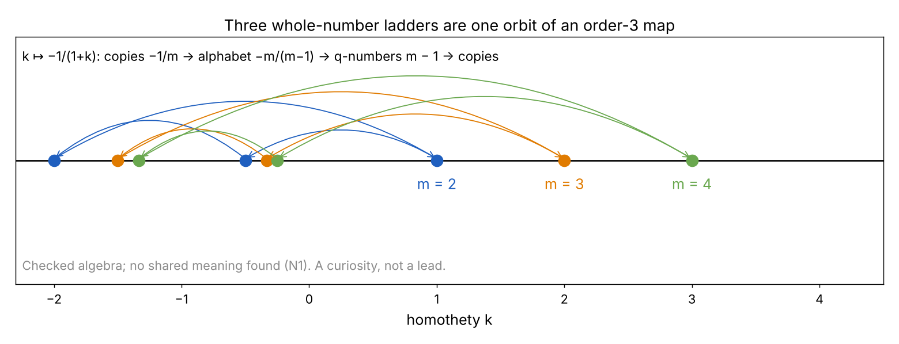

*Figure 13. k ↦ −1/(1 + k) has order 3 and sends copies −1/m to alphabet −m/(m − 1) to q-numbers m − 1 and back.*

**Its name.** As a Möbius map, k ↦ −1/(1 + k) has matrix [[0, −1], [1, 1]] = ST, with S = [[0, −1], [1, 0]] and
T = [[1, 1], [0, 1]], the standard generators of the modular group PSL(2, ℤ). (ST)³ = −I, so it has order 3 there (check
N3). Written in λ = −k it is λ ↦ 1/(1 − λ), the order-3 rotation of the anharmonic group: the six values λ, 1 − λ, 1/λ,
1/(1 − λ), (λ − 1)/λ, λ/(λ − 1) that one cross-ratio takes when its four points are permuted. The ladders become 1/q,
q/(q − 1) and 1 − q, one orbit of that rotation (check N4). So the three ladders are one cross-ratio with its four points
cycled. **Known:** the modular group and the anharmonic group (both classical; the anharmonic group goes back to
Cayley's and Klein's study of the cross-ratio). **Ours:** that the copies, alphabet and q-number ladders are one such
orbit.

The map also acts on the wall w = −1/k as w ↦ 1 − 1/w, the same order-3 rotation. I looked for a map that
carries one ladder's law to another's with its meaning attached and found none (N2: the copies law and the alphabet law
disagree on the same inputs, and every k ≠ 0 is isomorphic to every other by scaling, so an isomorphism alone says
nothing). **Checked; not a lead unless such a map turns up.**

---

## The polishing step

Five checks are recomputed with mpmath at 30 digits: the negative-binomial series (C9), ζ(2)/ζ(4) = 15/π² (G5), the
hyperbolic average (H4), the ring zeros at k = 2 (I4) and the threshold root (L5). Cost: **0.03 seconds in all**. The
rest of the checks are exact (sympy) or at machine precision.

## Assumptions

- d = 0 throughout; every other dial fixed. Laws that live at d ≠ 0 (relativity, the plane law, conics) are marked "no"
  here and belong to the curvature-dial survey.
- "Only three stops" assumes the values can be rescaled freely. Where a value is pinned (a top 1, whole numbers, a graph,
  a spectrum, a curvature) k is a real parameter; each candidate says which pin it uses.
- C2 uses the probability convention (Fermi at k = −1). The weight convention of `repetition-dial/` flips the sign.
- C5's continuous statements are symbolic (sympy) and numeric limits; the Lean module covers the discrete statements at
  k = 1 and the grain-h rules.
- C6 is numeric at s = 2 for five values of k, with primes up to 2·10⁶; the boundary claim is Dahlquist's theorem as
  quoted by secondary sources (the original was behind a bot check for `dial-survey/wall/`).
- C8 is checked on two small graphs; the general statement is Lee–Yang's theorem.
- C11's threshold is proved for three regions only, from subadditivity and Araki–Lieb; the LP and random graphs are
  extra checks. Four or more regions were not done.
- The verdicts are judgements grounded in the named Lean theorems and pages; no Lean was built in this pass.

## Known vs new

| Item | Status | Source |
|---|---|---|
| Rescaling makes k a unit; only the stops survive | Known in the repo | `dial-survey/` finding 2, `shape-directions/`, Lean `units_change_weight` |
| Corner expansion; union rule; Fredholm determinant walls | Known | inclusion–exclusion; `mathlib-map/` |
| One-mode law = (a, b, 0) class with a = kz; −1/m rule = termination rule | Pieces known (Katz 1965; Panjer 1981; Sundt–Jewell 1981; Shirai–Takahashi 2003); the identification **not found** in two searches | this page, C2 |
| Fused calculus at every k; product calculus at 1; hazard calculus at −1 | Known | Volterra 1887; Grossman–Katz 1972; Hilger 1988; Pap |
| Tsallis/Rényi/Shannon slide | Known | Rényi 1961; Tsallis 1988 |
| Sugeno belief/plausibility sides | Known | Sugeno 1974; Banon 1981; Weber 1983 |
| Prime gas boundary | Known | Dahlquist 1952 |
| k = −2K for averaged laws | Pieces known; formula from `tunnelling/` | Matsui 1993; Anderson et al. 1980 |
| Lee–Yang for k ≥ 1 on graphs | Known | Lee–Yang 1952 |
| Alphabet ladder −q/(q − 1) | Pieces known; reading ours | Jukes–Cantor 1969; symmetric channels |
| Split of [0, 1] laws at k = −1 | Ours, elementary | this page, C4 |
| Holographic threshold √6 − 3; at five regions −0.382 (geometric) vs −0.354 (quantum) | **Ours as stated, proved; a corollary of the symmetrized cones** (Fadel–Hernández-Cuenca 2022; Czech–Shuai 2021) | this page, C11; `new-facts-levers/` |
| Order-3 orbit of the ladders | ST in PSL(2, ℤ), the cross-ratio's order-3 rotation (known); that the ladders are one orbit is ours | this page, N5 |

Searches run (Nov 26, 2026): "Sundt Jewell 1981 (a,b,0) class only Poisson binomial negative binomial Katz 1965
recursion"; "Panjer class (a,b,0) Sundt Jewell 1981 Further results on recursive evaluation of compound distributions";
"Katz 1965 unified treatment of a broad class of discrete probability distributions"; "alpha-determinantal point process
number of points binomial negative binomial Panjer class"; "Shirai Takahashi 2003 alpha-determinantal ... −1/m";
"Sugeno-Weber t-conorm min(1, x+y+λxy)"; "Banon 1981 distinction between several subsets of fuzzy measures"; "Grossman
Katz 1972 non-Newtonian calculus ... Volterra 1887"; "Lee-Yang circle theorem lattice gas attractive interaction";
"Wilf conjecture complementary Bell numbers"; "Jukes-Cantor 1969 ... q-ary symmetric channel"; "holographic entropy
inequality perfect tensor ... tripartite information". Search could not reach the full texts of Katz (1965), Sundt–Jewell
(1981) or Shirai–Takahashi (2003); their statements here come from the (a, b, 0) article, the abstracts and the
authors' project summary.

## Files

- `laws.py` → `laws.json`: 65 rows (law, modules, verdict, candidate, reason). Counts: slides 20, partly 5, self 2,
  disguise 2, plausible 0, no 36.
- `checks.py` → `checks_output.txt`, `checks.json`: 65 checks (A units, B corner expansion, C counts, D entropies, E
  Sugeno, F calculus, G primes, H tunnelling, I Lee–Yang, J counting, K alphabets, L holographic, N curiosities).
- `figures.py` → `figures/fig0` to `fig13`.
- `index.html`: built by `python3 ../dial-catalog/page_build.py . index.html ...`.

## Sources

- Katz, L. (1965). Unified treatment of a broad class of discrete probability distributions. In G. P. Patil (ed.),
  *Classical and Contagious Discrete Distributions*, Pergamon, 175–182.
- Panjer, H. H. (1981). Recursive evaluation of a family of compound distributions. *ASTIN Bulletin* 12(1), 22–26.
- Sundt, B. and Jewell, W. S. (1981). Further results on recursive evaluation of compound distributions. *ASTIN
  Bulletin* 12(1), 27–39.
- Shirai, T. and Takahashi, Y. (2003). Random point fields associated with certain Fredholm determinants I. *J. Funct.
  Anal.* 205, 414–463.
- Sugeno, M. (1974). Theory of fuzzy integrals and its applications. PhD thesis, Tokyo Institute of Technology.
  Banon, G. (1981). Distinction between several subsets of fuzzy measures. *Fuzzy Sets and Systems* 5, 291–305.
  Weber, S. (1983). A general concept of fuzzy connectives, negations and implications. *Fuzzy Sets and Systems* 11.
- Rényi, A. (1961). On measures of entropy and information. Tsallis, C. (1988). *J. Stat. Phys.* 52, 479.
- Volterra, V. (1887). Sui fondamenti della teoria delle equazioni differenziali lineari. Grossman, M. and Katz, R.
  (1972). *Non-Newtonian Calculus*. Hilger, S. (1988), PhD thesis, Würzburg. Bohner, M. and Peterson, A. (2001).
  *Dynamic Equations on Time Scales*.
- Dahlquist, G. (1952). On the analytic continuation of Eulerian products. *Ark. Mat.* 1, 533–554.
- Lee, T. D. and Yang, C. N. (1952). Statistical theory of equations of state and phase transitions II. *Phys. Rev.* 87, 410.
- Jukes, T. H. and Cantor, C. R. (1969). Evolution of protein molecules. In *Mammalian Protein Metabolism*.
  Haldane, J. B. S. (1919). *J. Genetics* 8. Matsui, M. (1993). Linear cryptanalysis method for DES cipher.
- Gauss (Gaussian binomials); Tits, J. (1957) on q → 1; Stone, M. H. (1936); Uppuluri, V. R. R. and Carpenter, J. A.
  (1969); De Wannemacker, S., Laffey, T. and Osburn, R. (2007), On a conjecture of Wilf, arXiv math/0608085.
- Web page read: Wikipedia, "(a,b,0) class of distributions". Seen only as search results: Cambridge/RePEc records of
  the two 1981 ASTIN papers; Shirai's KAKENHI project summary; arXiv 1510.03975 (Maunoury); arXiv 1704.02084 (Panjer
  counts in tracking filters).
