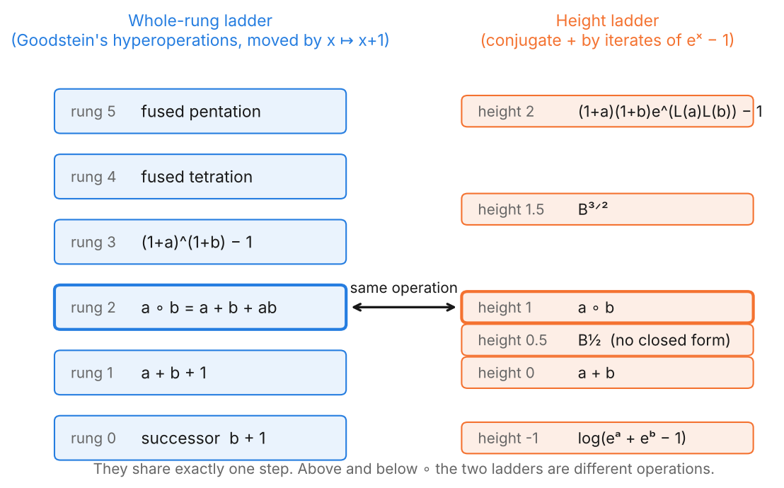
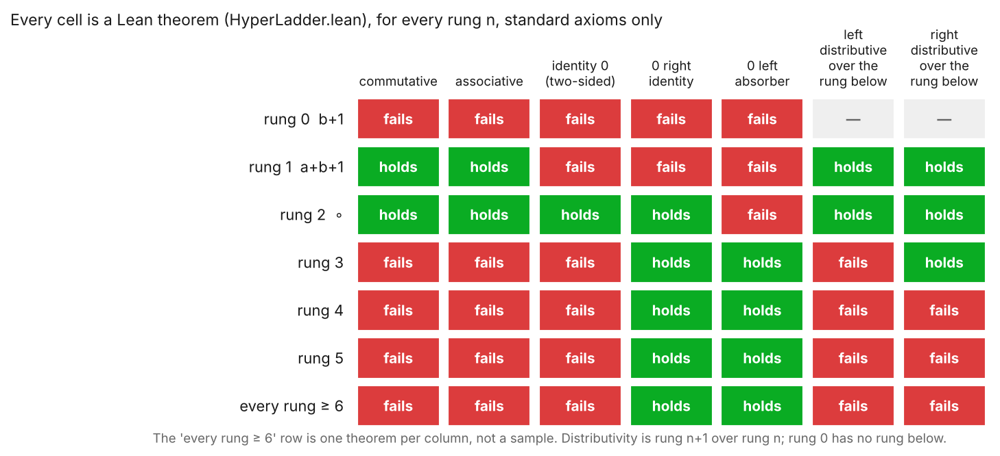
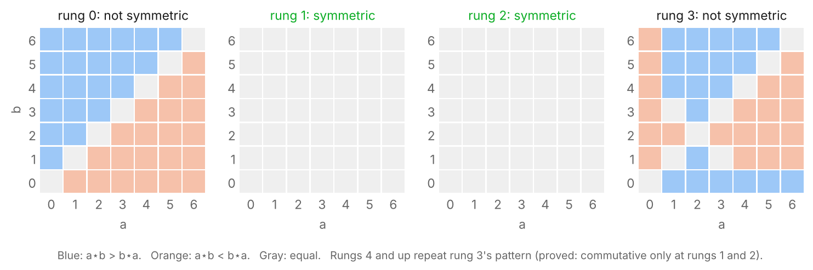
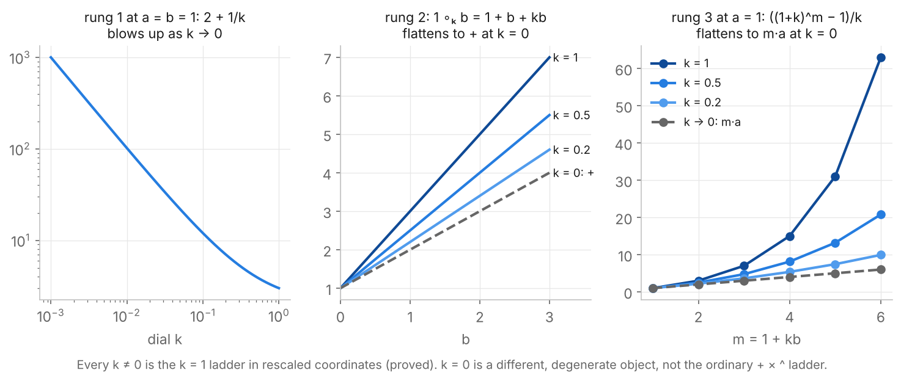
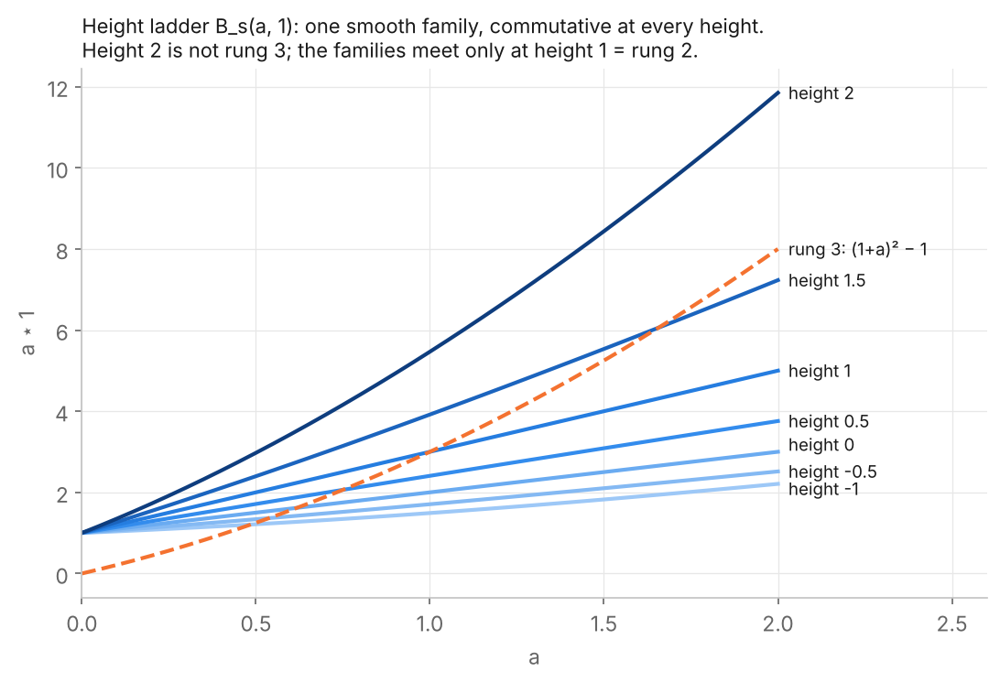

# The hyperoperation ladder, made complete (DRAFT)

*Nov 26, 2026. Brennan asked to make the word "hyperoperation" rigorous and complete. Lean: [`lean-library/FusedAlgebra/Topics/HyperLadder.lean`](../../lean-library/FusedAlgebra/Topics/HyperLadder.lean), **80 theorems, core Lean only, no sorry, standard axioms only**. Checks: [`checks.py`](checks.py), **26 of 26 pass** ([`checks_output.txt`](checks_output.txt)). Pictures: [`figures.py`](figures.py).*

## The answer

**The name is earned, for whole rungs, at every dial k ≠ 0.** Rung n of the fused ladder *is* Goodstein's hyperoperation H_n, read through x ↦ x + 1, for every n at once, and nothing else satisfies the same recursion. Every basic law at every rung is now a Lean theorem, including the giant rungs, whose values no computer can write down.

**It is not earned by the fractional "rungs".** The operations at fractional height are a second, different ladder (commutative at every height, like Bennett's 1915 ladder). It meets the hyperoperation ladder at exactly one step, a + b + ab. So: say **rung** for whole rungs and **height** for the fractional family.

*Figure 1. Left: the whole-rung ladder, which is the hyperoperation sequence. Right: the height ladder B_s. They agree only at a ∘ b (rung 2 = height 1). Height 0 is + but rung 1 is a + b + 1; height 2 is not rung 3.*

## Every law, every rung

*Figure 2. Each cell is a theorem that covers the whole row, not a sample. The last row is a single theorem for all rungs from 6 up.*

What the board says, in words:

- **Commutative and associative exactly at rungs 1 and 2** (`lad_comm_iff`, `lad_assoc_iff`). One witness, (1, 0, 1), breaks associativity on every rung from 3 up.
- **A two-sided identity only at rung 2**, and it is 0 (`lad_identity_iff`). Rung 1's identity is −1, outside the whole numbers.
- **0 is a right identity from rung 2 up and a left absorber from rung 3 up** (`lad_right_id_iff`, `lad_left_absorb_iff`). This is Goodstein's x # 1 = x and 1 # y = 1, moved down by one.
- **Distributivity over the rung below, exactly:** on the left only for rungs 1 and 2 (`lad_left_dist_iff`); on the right for rungs 1, 2 and 3 (`lad_right_dist_iff`). Rung 3 over rung 2 on the right is the power law (ab)^c = a^c b^c in fused form.
- **A fixed corner:** 1 ⋆ 1 = 3 on every rung from 1 up (`lad_one_one`), which is Goodstein's 2 # 2 = 4 fused.

*Figure 3. Where a ⋆ b and b ⋆ a differ. Only rungs 1 and 2 are all gray. The gray cells off the diagonal at rung 3 are 2⁴ = 4².*

### How the giant rungs were settled: remainders mod 7

Right distributivity fails at rung 4 over rung 3 by direct computation. From rung 5 up the numbers are towers too tall to compute, so the proof compares remainders instead. With the witness (1, 2, 1) the two sides become, in Goodstein's coordinates,

- left side: H_n(P, P) with P = H_n(2, 3),
- right side: H_n(4, H_n(3, 3)).

Three facts, each a short induction in Lean:

1. H_n(2, y) leaves 16 on division by 42 for every n ≥ 4 and y ≥ 3 (`hyp_two_mod42`). So P leaves 2 on division by 7.
2. A base that leaves 1 on division by 3 keeps doing so on every rung from 3 up (`hyp_mod3`).
3. A base x with x ≡ 1 (mod 3) and x³ ≡ 1 (mod 7) passes its remainder mod 7 up every rung from 4 (`hyp_mod7`).

Both P and 4 qualify, so the left side leaves 2 and the right side leaves 4. They are different numbers (`hyp_right_dist_fails`). The check script found the modulus first (`A5` lines in `checks_output.txt`); Lean then proved it for all rungs.

## The claim ledger

Every claim the repo makes about the ladder, with its status. "Lean" means a theorem in `HyperLadder.lean` unless another file is named.

| Claim | Status | Where |
|---|---|---|
| Rung n is H_n read through x ↦ x + 1: lad n a b + 1 = H_n(a + 1, b + 1), every n | Lean | `lad_lift` (FusedPeano), `lad_eq_transport` |
| The fused recursion and its three starting values determine the ladder (uniqueness) | Lean | `lad_unique` |
| The named rungs a + b + 1, ∘, fused exponent, fused tetration, fused pentation are rungs 1 to 5 | Lean | `lad_eq_sadd` … `lad_eq_fpent`, `hyp_four`, `hyp_five` |
| H_(m+3) is Knuth's m + 1 up-arrows | Lean | `hyp_arrow`, `lad_arrow`, `arrow_values` |
| Commutative, associative, identity, right identity, left absorber: exact rung sets above | Lean | `lad_*_iff` |
| Left and right distributivity over the rung below: exact rung sets above | Lean | `lad_left_dist_iff`, `lad_right_dist_iff` |
| No rung except 1 and 2 is any commutative operation transported by any maps | Lean | `not_transport_of_comm` |
| Height ladder, for any flow E_s (E_s E_t = E_(s+t), E_s 0 = 0): commutative, associative, identity 0 at every height; B_0 = +; heights climb by conjugation | Lean (abstract flow) | `Flow.B_comm`, `B_assoc`, `B_id`, `B_zero_height`, `B_climb` |
| If E_1 turns + into ∘, then B_1 = ∘, the hypernatural log turns ∘ into height 1 − s, logs compose, and B_(s+1) distributes over its partner (E_s)₊(rung 1) | Lean (abstract flow) | `B_one`, `lnh_circ`, `lnh_compose`, `B_partner_dist` |
| Neighbouring heights do not distribute (∘ over +) | Lean | `circ_not_dist_add` |
| Rung 1 (a + b + 1) is no height of any flow | Lean | `sadd_not_height` |
| The flow E^s for E = eˣ − 1 exists at every real height on [0, ∞) | Literature (Szekeres 1958), numeric | `../fractional-rungs/regular_iteration_output.txt` (16/16) |
| At heights −1/2, 1/2, 3/2 the concrete B_s is commutative and associative with identity 0 | Numeric | `checks.py` B2 |
| Height 2 is not rung 3; height 2 is not Bennett's height 2 | Numeric (exact forms differ: B_2(1, 1) = 4e^((ln 2)²) − 1 ≈ 5.467 against 3) | `checks.py` B3 |
| Every dial k ≠ 0 is the k = 1 ladder rescaled by x ↦ kx (rungs 1 to 3) | Lean | `saddK_scale`, `circK_scale` (Base), `fexpK_scale` |
| The same for rungs 4 and up at dial k | Follows by the same transport; not stated in Lean | |
| At k = 0 the lift 1 + kx is not one-to-one, so there is no ladder; rung 1 blows up and rungs 2, 3 flatten | Lean (no ladder), numeric (limits) | `lift_zero_not_injective`, `checks.py` C2 |
| Fractional *whole* rungs (an operation strictly between ∘ and the fused exponent in Goodstein's sense) | **Open.** Nothing in the repo constructs one, and we know of no standard construction | |

## Is "hyperoperation" the right word?

| Use of the word | Earned? | Why |
|---|---|---|
| Whole rungs 0, 1, 2, … at k = 1 | **Yes** | Literally Goodstein's sequence in shifted coordinates, every n, with uniqueness |
| Whole rungs at any dial k ≠ 0 | **Yes** | Rescaling of k = 1 (rungs 1 to 3 in Lean, the rest by the same map) |
| Whole rungs at k = 0 | **No** | The lift collapses; the ordinary + × ^ ladder is *not* the k = 0 case |
| Fractional heights B_s | **No, as a hyperoperation; yes, as a commutative ladder** | Every height is commutative and associative; hyperoperations from rung 3 up are neither. It is Bennett's kind of ladder, built with a different conjugating flow |

**Against the standard ladders.** Goodstein (1947) defines H_0 = successor, H_1 = +, H_2 = ×, H_3 = power, and H_(n+1)(x, y + 1) = H_n(x, H_(n+1)(x, y)), with starting values x, 0, 1, 1, … . Our whole rung n is exactly his H_n conjugated by x ↦ x + 1, with the same index: our rung 2 sits where his multiplication sits. Knuth's arrows (1976) are H_(m+3) = ↑^(m+1), proved here for every m. Mathlib's `Nat.hyperoperation` follows Goodstein's starting values. What the fused version adds is a change of coordinates, not a new ladder: the laws in Figure 2 are Goodstein's laws moved down by one (for example his x # 1 = x becomes our 0 as right identity). We have not found the exact characterizations "commutative iff n ∈ {1, 2}" and "right-distributive over the rung below iff n ≤ 2" stated as theorems in the literature, though each piece is elementary; treat them as a clean formal statement, not a new fact about numbers.

## The dial

*Figure 4. Moving the dial toward 0. Rung 1 runs off to infinity, rung 2 flattens to +, rung 3 flattens to m·a. The ordinary ladder is not what you get at k = 0.*

## The height ladder, for comparison

*Figure 5. B_s(a, 1) for heights −1 to 2 (blue, darker is higher) against rung 3 (orange, dashed). The heights form one smooth family; rung 3 cuts across it, because it is not a height.*

## Assumptions

- Part A (whole rungs) carries no hypotheses: natural numbers, core Lean, standard axioms.
- Part B (heights) is proved for an abstract flow: a family E_s, indexed by a commutative ring of heights, with E_0 = id, E_s E_t = E_(s+t) and E_s 0 = 0, acting on a type with + and 0. Commutativity needs + commutative, associativity needs + associative, the identity needs x + 0 = x. That such a flow exists for E = eˣ − 1 at real heights is Szekeres's theorem (1958), cited and checked numerically, not proved in Lean. On the two sides of 0 the regular iterates differ (the Écalle–Voronin obstruction), so "every real height" means on [0, ∞) here.
- Part C (dial) is over any field, with k ≠ 0. Rung 3 at dial k is stated for whole exponents m = 1 + kb.
- The claims marked Numeric in the ledger are evidence, not proofs.

## Known vs new

- **Known:** the hyperoperation sequence (Goodstein 1947; Ackermann 1928 for the underlying recursion), up-arrows (Knuth 1976), the circle operation a + b + ab (Perlis 1942, Jacobson 1945), commutative hyperoperations (Bennett 1915, cited in `../operations-catalog/`), regular iteration of eˣ − 1 (Szekeres 1958; Écalle; Lévy 1928), Mathlib's `Mathlib.Data.Nat.Hyperoperation`.
- **Ours (formal):** the exact law board in Figure 2 as Lean theorems for every rung, the uniqueness statement, the abstract-flow treatment of the height ladder with its partner distributivity, the proof that rung 1 is no height of any flow, and the mod-7 argument that settles right distributivity on the giant rungs. The mod-7 trick (towers mod m via Euler's theorem) is standard; using it for this distributivity question is, as far as we know, new.
- **Open:** fractional whole rungs in Goodstein's sense.

## Files

- [`checks.py`](checks.py), [`checks_output.txt`](checks_output.txt): 26 checks (whole rungs, residues for the giant rungs, heights, dial).
- [`figures.py`](figures.py), [`figures/`](figures/): the five figures above.
- [`lean-library/FusedAlgebra/Topics/HyperLadder.lean`](../../lean-library/FusedAlgebra/Topics/HyperLadder.lean): the proofs.
- Names: see [NAMING-COLLISIONS.md](../../NAMING-COLLISIONS.md), row "rung (two meanings inside the project)".
