# DRAFT · Starting from the hypersphere: which laws come out, and are polar coordinates simplest there?

**DRAFT, Nov 26 2026.** Part of Affine Composition Theory, the theory built on Fused Hyperoperation Algebra (repo:
fused-hyperoperation-algebra). The algebra supplies the circle operation a ∘ₖ b = a + b + k·ab (called mult-add before
1.0); the theory supplies the shapes and dials. The hypersphere is the round setting of the ℓp exponent, **p = 2**
(between the cross-polytope at p = 1 and the cube at p = ∞).
Asked for by Brennan on a call: "that hypersphere, that is the what I'd like to look and see if we can derive all of
the fundamental laws from", and whether polar coordinates are simpler on a hypersphere than on the other shapes. He
added: "I think I and pie both would be easier to derive that way", and then said yes to adding e.

Builds on `polar-coordinates/` and `polar-recast/` and does not repeat them; compares with `why-i/e-i-pi/` (the k route
to e, i and π: chaining small steps of the circle operation at homothety k). Checks: `checks.py` → `checks_output.txt`, **57 of 57 pass** (numpy, scipy). Pictures:
`figures.py` → `figures/`. Colour key: **orange = known, blue = ours** (a reading or bridge, not a new theorem),
red = does not work. Lean: `lean/Hypersphere.lean`, compiled in the shared library as `FusedAlgebra.Topics.Hypersphere`: all 33 theorems, no sorry. To compile, the Nov 27 version took back the library's earlier proofs for 14 Rat facts (`unfold …; grind` or `grind`, since `decide` can't evaluate Rat in core Lean), opens `CircleOp` and uses the library's own ◯ notation; no statement changed.

## The short answer

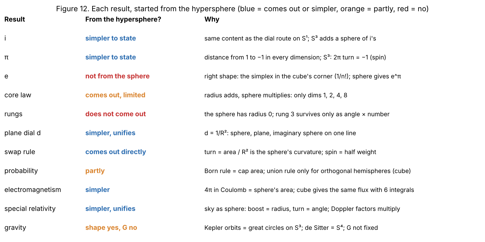

*Figure 12. Each result, started from the hypersphere.*

- **Orbits and hydrogen (new section at the end).** They share one 3-sphere (known, Fock 1935). What breaks it is one
  area on relativity's velocity sphere: exactly the electric orbit's turn per lap, Dirac's fine structure and the
  Thomas turn of a gyroscope. Gravity's 1 − 6M/r splits exactly into curved space (1 − 2M/r) times a velocity disc
  at twice the orbital speed (1 − (2v)²); the gyroscope gets the same space factor times a disc at the speed itself.
  The 6 is 2 (space) + 1 (special relativity) + 3 (gravity pulling on energy). Through string theory's double copy
  it is 2 + 2²: gravity's coupling is the electric one squared, and the 2 in 2v is the 2 of that square.
- **i and π** come out of the sphere in one line each: i is the step that stays on the sphere (its tangent at 1), and
  π is the distance from 1 to the opposite point −1. That is the same content as the k route, stated more simply.
  The new content comes from the 3-sphere: there i becomes a whole sphere of i's that do not commute, which is where
  spin and the swap rule live.
- **e** does not come from the sphere. Its right shape is the **simplex in the cube's corner**: that corner piece has
  volume 1/n!, and adding them over every dimension gives e. The sphere gives e^π instead, and the e inside it is the
  same simplex, hidden in the sphere's squared radii.
- **Brennan's hunch holds for round things, with a hard limit.** Polar coordinates split the circle operation cleanly
  (radius adds, sphere multiplies) only in 1, 2, 4 and 8 dimensions (Hurwitz). And in polar coordinates the sphere
  and the simplex are the same object; the cube is a different one (the polydisc).
- **Why only 1, 2, 4, 8 (new section near the end).** It is one fact with the superstring's spacetimes 3, 4, 6, 10:
  the size-keeping product, plus relativity's 2-dimensional plane. The same theorem forces the round shape, so
  gravity is not more complete in any other ℓp shape: only p = 2 keeps rotations and angular momentum.
- **Comes out of the sphere, or simpler there:** the curvature (1/radius², which is the curvature dial d at k = 0), the
  swap rule (turn = curvature × area is the sphere's curvature), Coulomb's 4π, special relativity (on the sky, a boost is a radius and a turn is an angle) and the shape
  of Newton's orbits (great circles on S³).
- **Does not come out:** the rungs (the sphere has no radius to climb), the union rule except on orthogonal
  hemispheres, and Newton's G.

---

## 0. Setting the hypersphere up in our polar coordinates

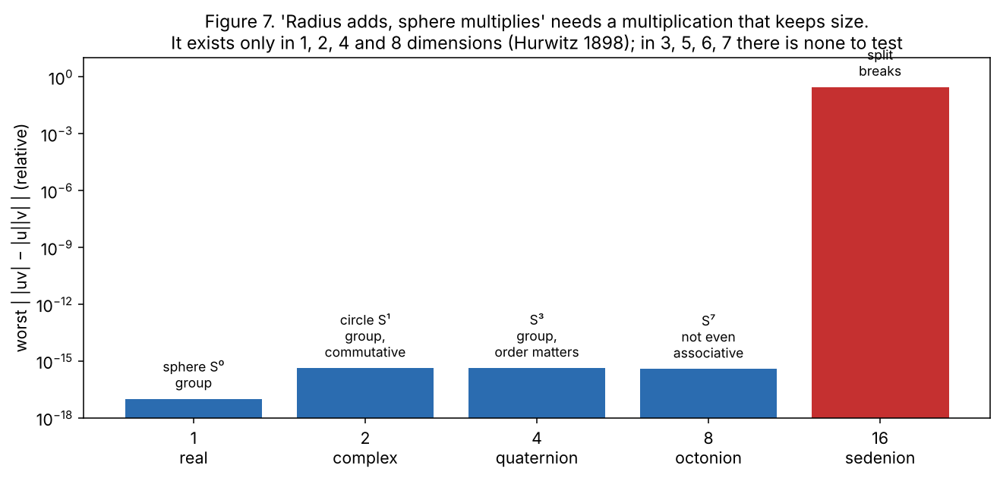

*Figure 7. "Radius adds, sphere multiplies" needs a multiplication that keeps size. It exists only in 1, 2, 4 and 8
dimensions.*

Our polar coordinates take the lift u = 1 + kx, which turns the circle operation into multiplication, and read it as a
radius and an angle. With inputs that are points in n dimensions, the natural polar form is **u = r·ω: one radius r
and one point ω on the unit hypersphere S^(n−1).** The hypersphere is exactly the set where the radius log r is 0.

For this to split the circle operation into two independent pieces, the multiplication must keep size, |uv| = |u||v|. Then
log r adds and the sphere points multiply (checks H0a, H0c). That happens only for the real numbers, complex numbers,
quaternions and octonions, dimensions 1, 2, 4 and 8 (Hurwitz 1898). Check H0b finds sedenions (16) missing by 45%.

| Dimension | Sphere | The sphere under the circle operation |
|---|---|---|
| 1 | S⁰ (two points) | the sign; commutative |
| 2 | S¹ (circle) | a group, commutative: our usual angle |
| 4 | S³ | a group, but order matters (H0e) |
| 8 | S⁷ | not even associative (H0d) |
| 3, 5, 6, 7, 16 … | — | no size-keeping product, so no clean split |

**Known:** Hurwitz's theorem; Adams's Hopf-invariant-one theorem (our library already has that family) says only
S⁰, S¹, S³, S⁷ carry any continuous multiplication with a unit. **Ours:** reading it as the exact list of dimensions
where the circle operation has a polar form of "one radius plus one sphere".

## 1. i and π: Brennan's first test

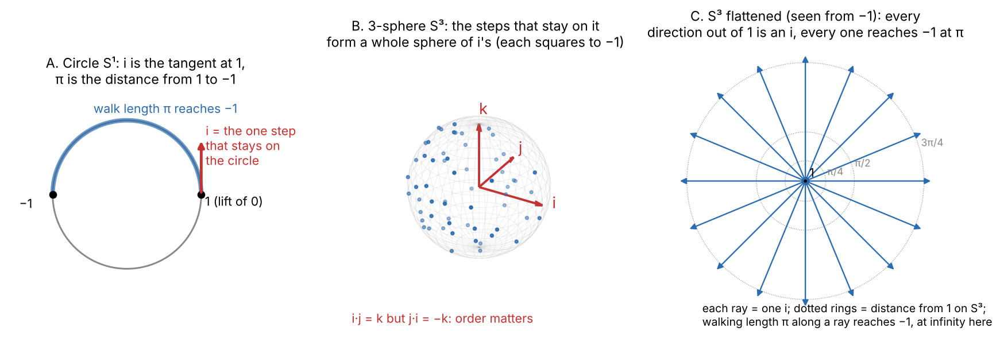

*Figure 1. A: on the circle, i is the one step that stays on it, and the walk to −1 has length π. B: on S³ the steps
that stay on it form a whole sphere of i's. C: S³ flattened from −1: every direction out of 1 is an i, and each reaches
−1 after length π.*

**i.** On the unit sphere of the lift, the steps that keep size are the tangent directions at 1, the ones with no real
part. In every size-keeping algebra such a step of length 1 squares to −1 (check I1). So "i² = −1" is not an extra
rule: it is what "a step tangent to the sphere" means. The k route said the same thing in another way: a step of size
1 + Re(k)·ε keeps size only when Re k = 0. Check I1b shows the two conditions are identical.

**π.** Walk along any i: exp(t·i) = cos t + i sin t stays on the sphere at unit speed and first reaches −1 at t = π
(I2), and half a great circle has length π on every sphere S¹ to S⁷ (I3). Euler's identity by chaining also works on
S³ along any i: N steps of size π/N land on −1 with error falling like 1/N (I4).

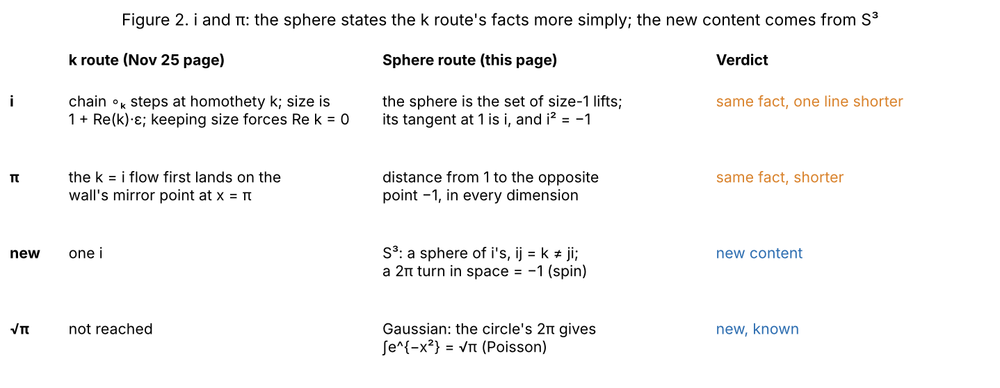

*Figure 2. The two routes side by side.*

**Simpler, or just a restatement? Said plainly:** on the circle it is a restatement. The sphere route is shorter
because the sphere is, by definition, the set of size-1 lifts, so the size-keeping condition is built in instead of
derived. It proves nothing the k route did not.

What the sphere adds, beyond the circle:

1. **A sphere of i's (S³).** Every unit quaternion with no real part squares to −1, and they fill a 2-sphere
   (I1). They do not commute: ij = k but ji = −k (I7). One i becomes many, and the order you take them in matters.
2. **π and spin.** A full 2π turn in space is a half great circle on S³: the unit quaternion goes from 1 to −1 while
   every vector comes back unchanged (I6). That is the spinor sign, and π is its distance on S³.
3. **√π.** The circle's length 2π gives the Gaussian integral: (∫e^(−x²)dx)² = ∫∫e^(−r²) r dr dθ = π (I5, Poisson's
   trick), and the area of every sphere, 2π^(n/2)/Γ(n/2), follows (I5b). The k route never reached this π.

**Known:** all of it (Hamilton; the quadratic identity of composition algebras; Poisson). **Ours:** the comparison with
the k-route page. **Verdict: simpler to state, same content on the circle; real new content only on S³.**

## 2. e: the cube, the simplex and the sphere

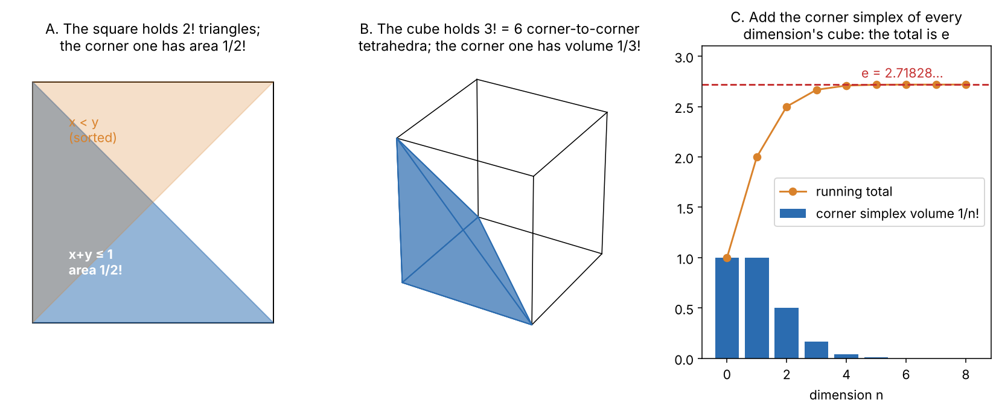

*Figure 3. A: the square holds two triangles, and the corner one has area 1/2. B: the cube holds six tetrahedra, and the
corner one has volume 1/6. C: adding the corner simplex of every dimension gives e.*

**From the cube and the simplex.** Cut the unit n-cube from corner to corner: it splits into n! equal simplices, one
for each order the n coordinates can come in. The corner one, x₁ + … + xₙ ≤ 1, has volume 1/n!. Both are checked by
sampling for n = 1 to 6 (E1). Adding over every dimension: 1 + 1 + 1/2 + 1/6 + … = e (E2).

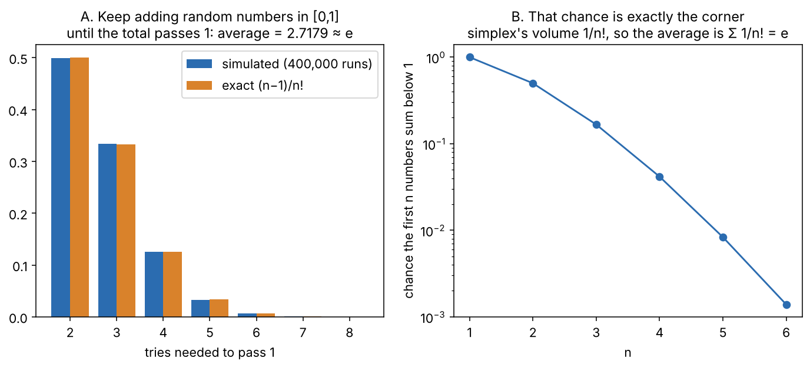

*Figure 4. Keep adding random numbers between 0 and 1 until the total passes 1: on average it takes e tries.*

The same fact is a puzzle: keep adding random numbers in [0, 1] until the total passes 1. The chance that the first n
have not passed it yet is exactly the corner simplex's volume 1/n!, so the average number of tries is Σ 1/n! = e.
Two million runs give 2.71839 ± 0.00062 (E3).

**From the sphere.**

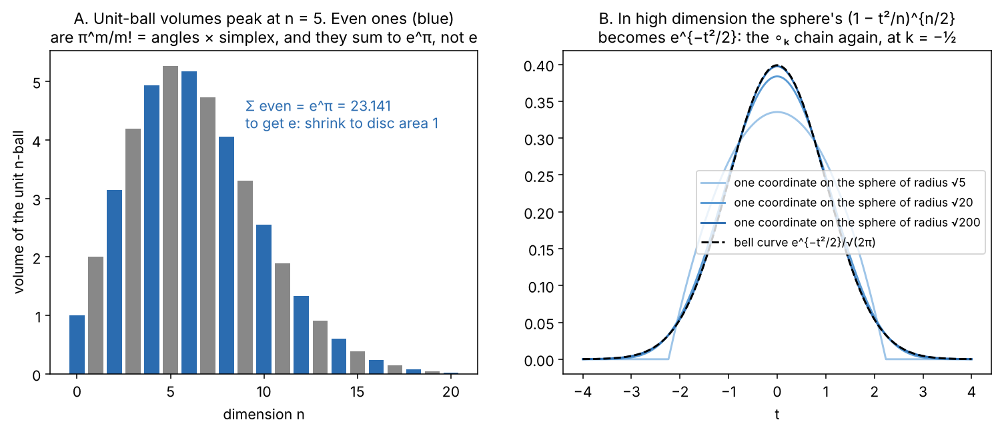

*Figure 5. A: unit-ball volumes; the even ones are π^m/m! and add to e^π. B: one coordinate of a random point on a
high-dimensional sphere follows the bell curve.*

- Ball volumes give **e^π, not e.** The 2m-dimensional unit ball has volume π^m/m!, and adding the even ones gives
  e^π = 23.1407 (E4). To get e itself you must shrink the balls until a disc has area 1 (E4b).
- The 1/m! inside π^m/m! is the simplex again. In polar coordinates a ball's squared radii fill the corner simplex,
  and the π^m comes from the angles (section 3). So the sphere only reaches e by borrowing the simplex.
- In high dimension, one coordinate of a random point on the sphere of radius √n follows the bell curve e^(−t²/2)
  (E5, Poincaré and Borel). The sphere's (1 − t²/n)^(n/2) is the circle operation's chain (1 + kx/N)^N at k = −½
  (E5b). So this is e by the k route, seen on the sphere.

**Which shape is right for e?** The **simplex, sitting in the cube's corner.** The cube is what you cut, and its
n! pieces are why 1/n! appears; the simplex is the piece. The sphere gives e^π, and its e comes from that simplex. So
Brennan's sense that e comes from the hypercube is right; the route is the cube's corner simplex, and it is short.

**Known:** the n! simplices of the cube (the "staircase" or Freudenthal triangulation), the random-sum puzzle, ball
volumes summing to e^π, Poincaré–Borel. **Ours:** the sorting of the three constants by shape: i and π belong to the
sphere, e to the simplex.

## 3. The sphere is the simplex with angles; the cube is the polydisc

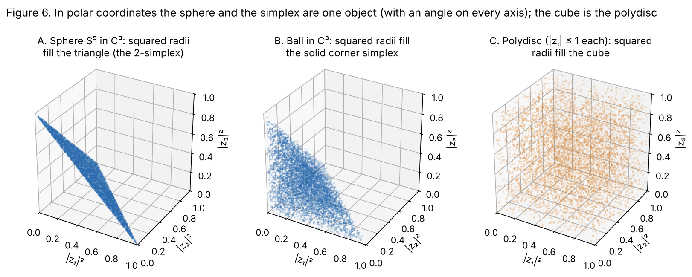

*Figure 6. Points in three complex dimensions. A: on the sphere, the squared radii |zᵢ|² lie on a triangle. B: in the
ball they fill the solid corner simplex. C: in the polydisc they fill the cube.*

This settles the earlier question of whether the hypertriangle or the hypercube is more basic. In polar coordinates,
with one radius and one angle per complex axis:

- **the sphere** |z₁|² + … + |zₙ|² = 1 has its squared radii on the simplex, spread evenly (Q4);
- **the ball** has them filling the solid corner simplex (Q4b);
- **the polydisc** (each |zᵢ| ≤ 1 on its own) has them filling the cube (Q4b).

The angles are the same torus every time. So **sphere and simplex are one object** (the simplex of squared radii with
an angle on every axis), and the cube is the other kind (independent axes). This is also the geometry of quantum
states: the squared radii are probabilities on the simplex, the angles are phases. **Known:** moment maps and
Reinhardt domains; Archimedes' hat-box theorem is the smallest case (Q1). **Verdict: unifies.**

## 4. The circle operation and the rungs

**The circle operation: comes out, limited** (section 0). On the hypersphere itself the radius is 0, so composing points of the
sphere is pure angle; in dimension 2 that is our usual angle, in 4 it is S³ where order matters, in 8 it is not
associative.

**Rungs: do not come out.** Each rung is one more radius taken (polar-recast, section 2). On the sphere the radius is
0, so the rung-3 law "take the radius twice" has nothing to act on (R1). Rung 3 survives only as "angle times a real
exponent", (q^s)^t = q^(st) (R2). The rung tower needs a radius, and the sphere is where there is none.

## 5. Curvature is the sphere's 1/radius²

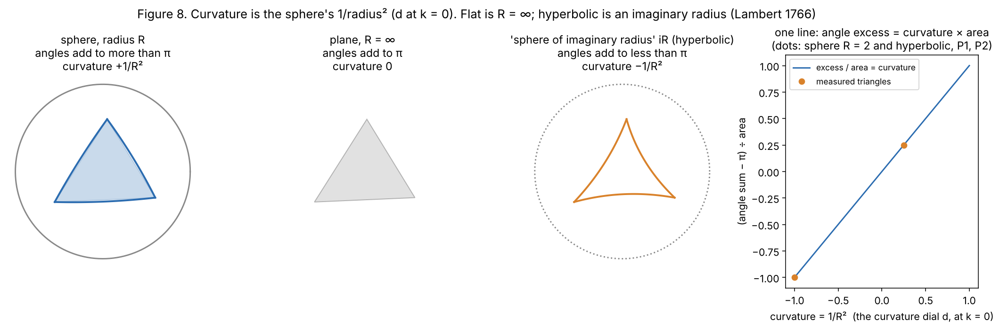

*Figure 8. Sphere, plane and the "sphere of imaginary radius" (hyperbolic). The angle excess of a triangle is
curvature × area.*

Draw a triangle on a sphere of radius R: its angles add to more than π, by exactly area/R² (P1, measured by sampling).
On the hyperbolic plane they add to less, by area/R² (P2, measured). So the curvature is **+1/R²** for the sphere,
**0** for the plane and **−1/R²** for hyperbolic space, which Lambert in 1766 called a sphere of imaginary radius: putting R = i into
the spherical law of cosines gives the hyperbolic one exactly (P3).

In the theory's names (as on `affine-names/`), the curvature is a reading of two dials, d − k²/4, the homothety k and
the curvature dial d. At k = 0 it is d itself, so there **d = 1/R²**. This is simpler than any other starting point:
the whole curvature is one number, the sphere's radius, including an imaginary radius. It also matches the earlier
pages: Λ sets the de Sitter radius, d = Λ/3 at k = 0 (G3).
**Known:** Gauss–Bonnet, Girard, Lambert, Cayley–Klein. **Verdict: simpler, unifies.**

## 6. The swap rule is the sphere's curvature

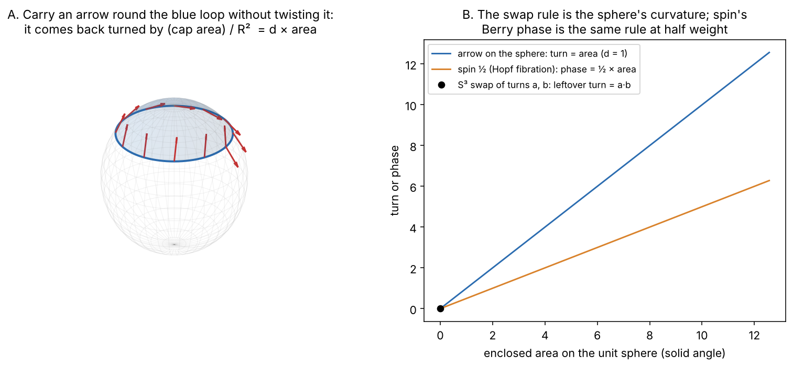

*Figure 9. A: carrying an arrow round a loop without twisting it brings it back turned by area/R². B: the same law for
an arrow, for spin ½ at half weight, and for swapping two small turns on S³.*

- **Arrow on the sphere:** carried round a latitude, it comes back turned by the cap's area over R² (W3).
- **Swapping two turns on S³:** turn a about x, then b about y, then undo both; what is left is a turn about z of size
  a·b, the area of the little rectangle (W1: ratio 0.99999).
- **Spin ½:** the Berry phase round a loop on the Bloch sphere is −½ × the solid angle (W2). This is the Hopf
  fibration S¹ → S³ → S²: the circle above each point of S² is the phase, the i direction.

So the swap rule "turn = curvature × area", which the precession page found, is simply the sphere's curvature, and it comes
out directly. **Known:** Gauss–Bonnet, Lie brackets, Berry 1984, Hopf 1931. **Verdict: comes out directly.**

## 7. Probability

- **Born rule = cap area.** A random point on S² has a height spread evenly between −1 and 1 (Q1, Archimedes), so the
  spin-½ probability (1 + n·m)/2 is the area fraction of a cap (Q2). Known (Archimedes; used in Bell's 1966 hidden-variable model).
- **The union rule ∘₋₁ holds for orthogonal hemispheres** (Q3): the 2ⁿ orthants of the sphere are the cube's corners,
  so independence is the cube living inside the sphere. For smaller caps it fails (Q3b). So the cube stays the right
  shape for independent events. **Verdict: partly.**

## 8. Physics

### Electromagnetism: the 4π is the sphere's area (simpler)

A point charge's flux is the same through any closed surface. Through the cube it takes six double integrals that come
to 4π (EM1); on the sphere it is 4πr² × 1/r², one line. In n space dimensions the field is 1/(|S^(n−1)| r^(n−1))
(EM2). **Known** (Gauss). **Verdict: simpler.**

### Special relativity: on the sky, a boost is a radius and a turn is an angle (simpler, unifies)

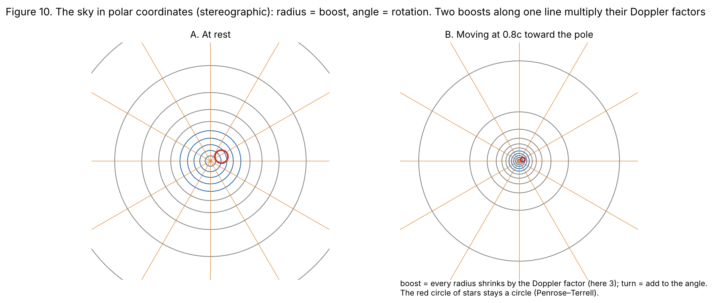

*Figure 10. The sky drawn in polar coordinates (stereographic). Moving toward the pole shrinks every radius by the
Doppler factor; a circle of stars stays a circle.*

Draw the sky as a sphere and flatten it stereographically. Then a boost along the line of sight multiplies every
radius by the Doppler factor, and a turn about that line adds to every angle (SR1). Two boosts along one line multiply
their Doppler factors, which is velocity addition; written as x = D − 1 it is the circle operation ∘₁ (SR2). A circle of
stars stays a circle after any boost (SR3, Penrose–Terrell).

**Known:** the Lorentz group acting on the sky as Möbius maps (Penrose 1959; Penrose–Rindler); Doppler factors
multiplying (Bondi's k-calculus). **Ours:** that this is exactly our polar split, radius = boost and angle = turn.
**Verdict: simpler; it puts relativity on the sphere's polar grid.**

### Gravity: the shape of orbits, yes; G, no

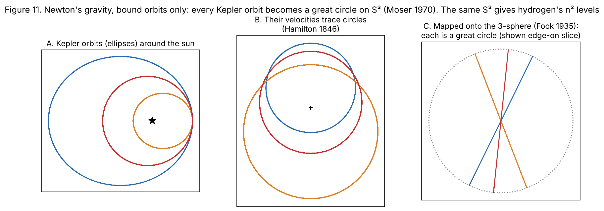

*Figure 11. A: Kepler ellipses. B: their velocities trace circles. C: mapped onto S³, each orbit's momenta lie on one
great circle.*

- **Orbits:** every bound Kepler orbit, mapped onto S³ by Fock's stereographic map of momentum, lies on one great
  circle (G1: rank 2, a plane through the centre). That is Moser's 1970 result that Newtonian orbits are the straight
  lines (geodesics) of the 3-sphere. The same S³ gives hydrogen's n² states per level (G2, Fock 1935). So one sphere
  carries classical gravity's orbits and the quantum atom's levels.
- **de Sitter:** with Λ, empty space in imaginary time is a 4-sphere of radius √(3/Λ); its temperature is one over the
  length of a great circle, 2.2 × 10⁻³⁰ K for our universe (G3, Gibbons–Hawking 1977).
- **G:** the sphere gives the 4π in Gauss's law for gravity and the shape of orbits, but G only sets their scale.
  The sphere does not fix G, which matches every earlier G pass.

**Verdict: shape yes, G no.**

---

## Brennan's hunch: are polar coordinates simplest on the hypersphere?

**Yes for anything round or turning, no for independent switches, and the clean form only exists in 1, 2, 4 and 8
dimensions.** Concretely:

- On the sphere, polar coordinates are one radius plus one point of the sphere, and the circle operation splits into
  "radius adds, sphere multiplies". In 2 dimensions that is the ordinary polar form. In 4 it is S³, which is where spin, the
  sphere of i's and the swap rule live. In 3, 5, 6 and 7 dimensions there is no such split at all.
- The cube's polar form is a radius and an angle per axis; it works in every dimension, but its angles never mix, so
  it has no swap rule. That is why the cube is right for independent switches and wrong for rotation.
- The simplex and the sphere are the same object in polar coordinates (section 3).

## Why only 1, 2, 4 and 8, and is gravity better in another shape?

Brennan noticed that the circle operation's 1, 2, 4, 8 are the quaternion and octonion sizes, asked whether that and
the superstring's spacetime sizes 3, 4, 6, 10 are the same fact, guessed that "properties like associativity only
exist at those levels", and asked: "Is gravity more complete in any other shape?" Checks:
`division-algebras/checks_div.py` (identities proved symbolically up to 8 dimensions, exact counterexamples at 16)
and `division-algebras/checks_shape.py`; both pass.

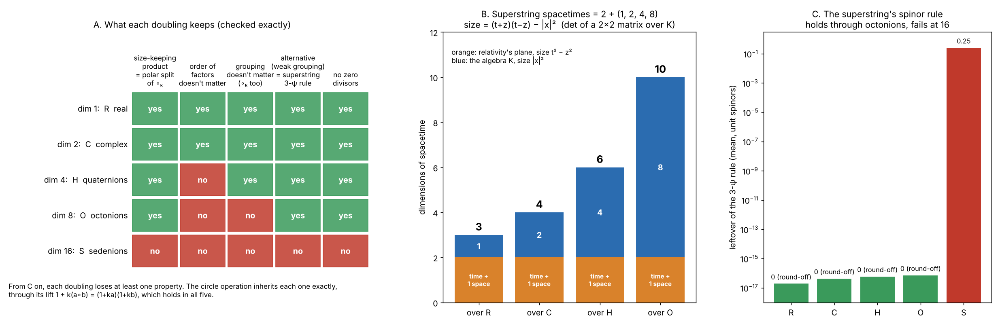

*Figure D1. A: what each doubling of the numbers keeps (R → C → H → O → S). B: superstring spacetimes are
relativity's plane (orange) plus the algebra (blue). C: the superstring's spinor rule, measured in each algebra.*

**Yes, it is one fact, used twice.** The fact is the size-keeping product, |xy| = |x||y|, which exists only in the
reals, complex numbers, quaternions and octonions (Hurwitz 1898).

- **The polar split uses it directly.** The circle operation lifts exactly to a product,
  1 + k(a ∘ₖ b) = (1 + ka)(1 + kb), in all five algebras (checked; note under Fig D1 A). So "radius adds, sphere multiplies" works
  exactly when the product keeps size: yes in 1, 2, 4, 8, no in 16 (Fig D1 A, first column).
- **The superstring uses it to build spacetime.** Write a spacetime point as a 2×2 matrix with t ± z on the diagonal
  and an element x of the algebra off it. Its determinant is (t + z)(t − z) − |x|² = t² − z² − |x|², the
  spacetime size, with 2 + n dimensions: 3, 4, 6, 10 (Fig D1 B, checked). The extra 2 is relativity's plane, the
  time and one space direction whose size is t² − z², the setting our earlier pages reach at k = 0, d = −1/c².
  The superstring also needs one spinor rule (the "3-ψ rule"). It holds exactly in R, C, H, O and fails in the
  sedenions by about 0.25 (Fig D1 C). **Known:** Baez and Huerta 2009, building on Kugo–Townsend 1983, Sudbery 1984
  and Evans 1988.

**Brennan's guess, refined.** It is one notch narrower than associativity. Grouping (associativity) is already lost
at 8: octonions keep only a weaker form called alternativity, and that weaker form is exactly what the spinor rule
needs (Baez and Huerta say so too). Associativity also exists in other sizes, for example in square matrices, just
without a size-keeping product. What exists only at 1, 2, 4, 8 is the size-keeping product. The circle operation
inherits each property from its algebra exactly, through the lift (D1 A).

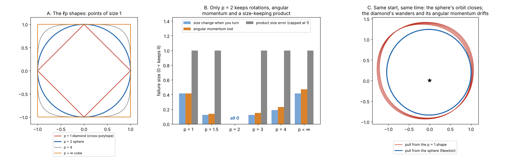

*Figure D2. A: the ℓp shapes. B: three things gravity needs, tested for each p. C: one orbit pulled toward the
sphere's centre, and the same start pulled by the diamond's 1/size.*

**Is gravity more complete in another shape? No: only the sphere keeps what gravity needs.** For p = 1, 1.5, 3, 4
and ∞, the size of a point changes when you turn it (by 12% to 41%), a Kepler orbit loses 14% to 47% of its angular
momentum in one run, and no product keeps size (D2 B). At p = 2 all three are exact. The orbit picture shows it:
the sphere's orbit closes, the diamond's wanders (D2 C).
**Known:** for p ≠ 2 the only size-keeping linear maps are swaps and sign flips of the axes (Banach; Lamperti
1958), so there are no smooth rotations and no conserved angular momentum. And a size-keeping product with a unit
forces both the round shape and the sizes 1, 2, 4, 8 at once (Urbanik and Wright 1960). So in the theory's own
names, **p = 2 and the polar split's 1, 2, 4, 8 are one theorem**, and the superstring's 3, 4, 6, 10 is that theorem
plus relativity's plane. (If "shape" means the curvature dial instead, sphere against saddle, the sign is set by
what fills space, not chosen; the orbits section uses both.)

**Does it open a lead?** It closes one honestly: the sphere is not one choice among shapes for gravity, it is forced.
The new reading for us is that two of the theory's own settings, p = 2 and the 1, 2, 4, 8 of the polar split, are
the same constraint as the superstring's dimensions. Baez and Huerta's follow-up papers report a similar rule one
size up (spacetimes 4, 5, 7, 11, which includes M-theory's 11); not checked here.
**Verdict: unifies (known root, new reading for the theory).**

## Leads, judged on their own merits

1. **Gravity and the atom share S³ (section 8). Now tested: see the orbits section below (`orbits/README.md`).**
   The 3-sphere is real (Fock), but what breaks it is an area on relativity's velocity sphere, not on the 3-sphere.
   For the electric force that one area is exactly the orbit's turn per lap, Dirac's fine structure and the Thomas
   turn of a gyroscope. For gravity, 1 − 6M/r = (1 − 2M/r)(1 − (2v)²) exactly: the gyroscope's space factor times a
   velocity disc at twice the speed, and that 'twice' is 1 + 3: special relativity plus gravity pulling on energy.
   The double copy shows 1 + 3 is one square, 2², from the cross term of (E + p)² (orbits section 6).
2. **i, π and spin from S³ (section 1).** Worth following as structure, not as a new derivation: S³ is where one i
   becomes many and order starts to matter, which is the step from classical to quantum turning.
3. **Sphere = simplex with angles (section 3).** Settles the hypertriangle question and gives quantum states'
   geometry in our shape language. Known; useful for the write-up, not a new result.
4. **Relativity on the sky's polar grid (section 8).** A clean reading of known physics; no new prediction.

## Next (offered, not started)

- Try the double copy's three-piece split for a spinning black hole (Kerr); the non-spinning case is done (orbits section 6).
- Lean still to write: E1 (corner simplex = 1/n!) and SR2 (Doppler factors and the circle operation). The 33 written theorems (quaternions, Fock's map, Kepler's tilt, n² states, the orbit/gyroscope equality, Dirac's defect, the PPN coefficients, the exact split of 1 − 6M/r and its 2 + 1 + 3 budget, and the double copy's 2 + 2²) are compiled.

## Files

- `README.md`: this write-up
- `checks.py` → `checks_output.txt` (57/57)
- `figures.py` → `figures/fig1` … `fig12`
- `orbits/`: Newton's orbits and hydrogen on one 3-sphere (`README.md`, `checks_orbits.py` 23/23, `six/checks_six.py` 11/11, `twov/checks_twov.py` 8/8, `dcopy/checks_dcopy.py` 11/11, figures O1–O9)
- `division-algebras/` (DRAFT): why 1, 2, 4, 8 (`checks_div.py`, `checks_shape.py`, both pass; `figure_div.py` → figures D1, D2)
- `lean/Hypersphere.lean`: 33 theorems, compiled in the shared library as `FusedAlgebra.Topics.Hypersphere`

## References

- A. Hurwitz, "Über die Composition der quadratischen Formen", 1898; J. F. Adams, "On the non-existence of elements of
  Hopf invariant one", Ann. Math. 1960.
- K. Urbanik and F. B. Wright, "Absolute valued algebras", Proc. AMS 11 (1960) 861–866; J. Lamperti, "On the
  isometries of certain function-spaces", Pacific J. Math. 1958.
- J. C. Baez and J. Huerta, "Division Algebras and Supersymmetry I", arXiv:0909.0551 (2009); T. Kugo and
  P. Townsend, Nucl. Phys. B 1983; A. Sudbery, J. Phys. A 1984; J. M. Evans, Nucl. Phys. B 1988; J. C. Baez,
  "The Octonions", Bull. AMS 2002.
- W. R. Hamilton, quaternions, 1843; "The hodograph", 1846.
- J. H. Lambert, *Theorie der Parallellinien*, 1766.
- H. Hopf, 1931; M. V. Berry, "Quantal phase factors accompanying adiabatic changes", Proc. R. Soc. A 1984.
- V. Fock, "Zur Theorie des Wasserstoffatoms", Z. Phys. 1935; J. Moser, "Regularization of Kepler's problem and the
  averaging method on a manifold", CPAM 1970.
- R. Penrose, "The apparent shape of a relativistically moving sphere", 1959; J. Terrell, 1959; R. Penrose and
  W. Rindler, *Spinors and Space-Time*, vol. 1, 1984; H. Bondi, *Relativity and Common Sense*, 1964.
- G. W. Gibbons, S. W. Hawking, "Cosmological event horizons, thermodynamics, and particle creation", 1977.
- H. Poincaré / É. Borel on the sphere's marginal; P. Diaconis, D. Freedman, "A dozen de Finetti-style results", 1987.
- J. S. Bell, "On the problem of hidden variables in quantum mechanics", Rev. Mod. Phys. 1966.
