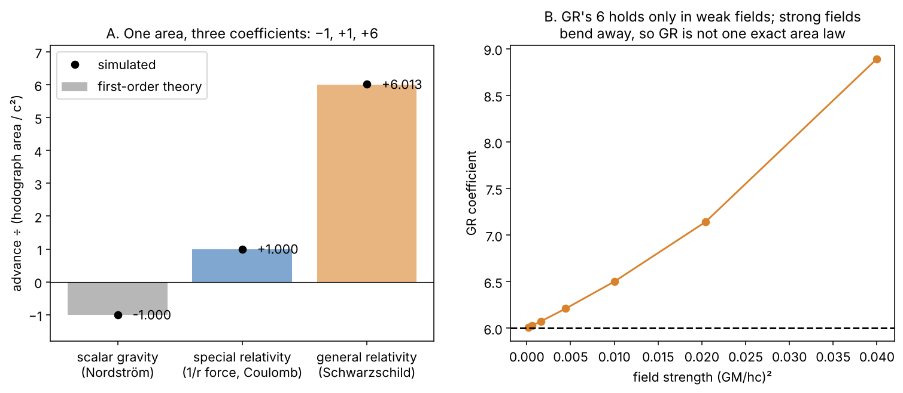

# DRAFT · Newton's orbits and hydrogen's levels on one 3-sphere: does the swap rule's area law give Mercury and fine structure?

**DRAFT, Nov 26 2026.** Part of Hypercube Composition Theory (repo: fused-hyperoperation-algebra), a section of
`hypersphere/`. Brennan asked to follow the lead "about Newton's orbits and hydrogen's energy levels": do GR's
perihelion shift (Mercury's 43″ a century) and hydrogen's fine structure both come out as the swap rule's area law
(turn = d × area) on the 3-sphere they share?

Checks: `checks_orbits.py` → `checks_orbits_output.txt`, **23 of 23 pass**, and `six/checks_six.py` →
`six/checks_six_output.txt`, **11 of 11 pass** (numpy, scipy; real orbit simulations, not
formulas fed back). Pictures: `figures_orbits.py` → `figures/`. Lean: `../lean/Hypersphere.lean` (§5–§8), compiled into the library as
`FusedAlgebra.Topics.Hypersphere` on Nov 26. Colour key as before: **orange = known, blue = ours**.

## The result in three sentences

1. **The 3-sphere they share is real and known** (Fock 1935): every Kepler orbit and every hydrogen level is a great
   circle on one 3-sphere, which is why the orbit closes and why level n holds n² states.
2. **For the electric force, what breaks that sphere is exactly one area, on a different sphere**: the relativistic
   orbit's turn per lap, and hydrogen's fine-structure splitting, are both the area of one disc in relativity's
   velocity space, and that is the same area that turns a gyroscope (Thomas precession).
3. **For gravity, Einstein's 1 − 6M/r splits exactly into two twists** (section 5): (1 − 2M/r) for curved space, times
   (1 − (2v)²), a velocity disc at **twice** the orbital speed. A gyroscope on the same orbit gets the same space
   factor times a disc at the orbital speed itself. So the 6 is 2 + 4: the gyroscope's 2 for space, and four times
   Thomas's area because the disc's radius is doubled. Mercury's 42.98″ follows, now from an exact law. What is
   still open is why gravity doubles the radius.

**Does it open a lead?** Yes. For the electric force it turns the Coulomb orbit and Dirac's fine structure into one
swap-rule area. For gravity the 6 is no longer put in by hand: it is an exact product of the same two twists the
Gravity Probe B page found for the gyroscope, with the velocity disc's radius doubled. That joins orbits and
gyroscopes into one swap-rule picture. The doubling is the next thing to explain.

## 1. Two spheres, not one

*Figure O1. A: a relativistic orbit; the ellipse turns a little each lap. B: on Fock's momentum sphere each lap is a
great circle, and the circle tilts lap by lap. C: the amount it tilts is the area of a disc in relativity's velocity
space (a sphere of imaginary radius c, the plane dial at d = −1/c²).*

**Known.** Fock (1935) mapped momentum p to the unit 3-sphere by stereographic projection with radius p0 = √(−2E)
(Lean `fock_on_sphere`). Each Kepler orbit's momenta then lie on one great circle (check K3), tilted by the
eccentricity: (h·p0)² + e² = 1 (Lean `kepler_tilt`). Rotating the 3-sphere is the hidden SO(4) symmetry carried by
the Runge–Lenz vector (Pauli 1926; Bargmann 1936; check K1); regularizing collisions on it is Moser (1970). Level n
holds 1 + 3 + … + (2n − 1) = n² orbital states (K2; Lean `deg_eq`).

**What we tested.** If the precession were an area on Fock's sphere, different orbits would enclose different
areas. They don't: on the unit Fock sphere every orbit is a great circle and bounds half the sphere, 2π, for all
orbits (P7). So **the precession's area is not on Fock's sphere**. Fock's sphere only shows the effect: the circle
turns round the energy axis by exactly the advance each lap (P8: 0.31000 vs 0.31001).

## 2. The electric orbit: the turn per lap is one disc's area

*Figure O2. A: eight simulated orbits with different eccentricities (dots) sit on one curve, the area of the velocity
disc of speed-radius k/L. B: that curve is identical to the Thomas turn of a gyroscope on the circular orbit with the
same angular momentum.*

**Known.** Sommerfeld (1916) found the relativistic Coulomb orbit's advance per lap,
2π(1/√(1 − (k/cL)²) − 1). Thomas (1926) found a gyroscope on a circular orbit turns 2π(γ − 1) per lap, and that this
is the curvature of velocity space times the area its velocity encloses (the swap rule, already on our
`precession/` page).

**Ours (as stated; check the literature).** Two exact facts tie them together:
- The advance is **exactly** the area of a disc of speed-radius k/L in velocity space (curvature −1/c²), at any
  eccentricity (P1, P2: simulated 0.31000577, area 0.31000577 at c = 3).
- The circular orbit with that L moves at speed exactly k/L (Lean `circular_L_v`), so **an orbit precesses exactly
  as much as a gyroscope on the circular orbit with the same angular momentum** (R1, exact at β = 0.1, 0.5, 0.9;
  Lean `sommerfeld_eq_thomas`).

**Literature check (Nov 26, at Brennan's request).** We found this equality **implied but not stated**:
- **Biedenharn (1983)**, "The Sommerfeld puzzle revisited and resolved", shows that Sommerfeld's rotating frame for
  the precessing orbit is exactly paralleled by the Dirac transformation that carries the electron's Thomas spin
  precession, and turns into it in the classical limit. That is the same correspondence in qualitative form. We read
  it through Vickers (2018), who quotes it; we could not open Biedenharn's paper here, and no source we read gives the
  equality as numbers.
- **Belloni and Reina (1986)** is about Sommerfeld's own geometric derivation of Thomas precession. Its abstract says
  nothing about the orbit, and its full text wouldn't open here.
- **Vankov (arXiv:1008.1811)** links Thomas precession to perihelion advance only to first order, in a non-mainstream
  argument that rejects general relativity. It does not state this equality.
- **Gibbons (2015)**, on Hamilton's hodograph in relativity, treats the same orbits without mentioning Thomas.
- Other searches (velocity-space area, same angular momentum, exact equality) found nothing.

So the exact statement (advance per lap = velocity-disc area = the Thomas turn of the circular orbit with the same
L) looks unstated in what we could read. It is a short calculation, though, so it should be called a small new
observation in a long-studied area, not a discovery. Reading Biedenharn's paper in full is the one check left.

## 3. Hydrogen: the same area gives Dirac's fine structure, exactly

*Figure O4. A: the 3-sphere makes each Bohr level n²-fold (grey); one area per κ splits it into Dirac's levels
(blue). B: the area for each κ = j + ½, the disc of speed-radius αc/κ.*

**Ours, as an exact rewrite of Dirac.** Take x = (the disc area for κ)/2π and the quantum defect δ = κx/(1 + x). Then
(κ − δ)² = κ² − α², which is exactly Dirac's defect (Lean `dirac_defect`), so E = mc²/√(1 + α²/(n − δ)²) is Dirac's
formula. Rebuilt this way, every level up to n = 7 matches Dirac to the last digit (F1), and 2P3/2 − 2P1/2 comes out
10.950 GHz, Dirac's value (F2).

**Limits, said plainly.** The measured splitting is 10.969 GHz; the 0.2% gap is QED (the electron's anomalous
moment), which this law doesn't contain. 2S1/2 and 2P1/2 share κ = 1, so the area law leaves them equal; the Lamb
shift (1.058 GHz) is outside it (F5). And this is a rewrite of Sommerfeld–Dirac, not a derivation from the sphere.

## 4. Gravity: one area, but a coefficient of 6, and only at first order

*Figure O3. A: advance ÷ (hodograph area/c²) from simulated orbits: scalar gravity −1, the electric force +1, general
relativity +6. B: GR's coefficient drifts away from 6 as the field gets stronger.*

*Figure O5. Mercury's velocities trace a circle of radius 48.9 km/s (Hamilton's hodograph). 6 × its area/c² per orbit
gives 42.98″ a century.*

**What holds.** Every theory's first-order perihelion shift is a whole number times the same area, the hodograph
disc over c² (P4): Nordström's scalar gravity −1, the electric force +1, Schwarzschild +6, at any eccentricity (P5).
For Mercury, 6 × area/c² = **42.98″ per century** (P6), the general-relativity value.

**What doesn't.** That number is GR's own first-order formula, rewritten; the 6 is put in, not derived. And GR is not
one exact area law: at stronger fields the coefficient drifts (8.89 at c = 5, P5b). So the honest answer to "does
Mercury come out as the swap rule's area law on the 3-sphere?" is **no, not exactly, and not on Fock's sphere**: it
comes out as 6 times an area on the velocity sphere, at first order.

**The sharpened question.** Compare the orbit with a gyroscope on it, both in units of that area (known PPN
formulas, R3; Lean §7):

| | orbit turns | gyroscope turns | ratio |
|---|---|---|---|
| electric force (exact) | 1 | 1 | 1 |
| Nordström scalar gravity (first order) | −1 | −1 | 1 |
| general relativity (first order) | 6 | 3 | 2 |

Brennan said to look for an exact split of 1 − 6M/r. Section 5 has it.

## 5. Gravity's 6, split exactly

*Figure O6. A: the orbit's factor 1 − 6M/r (blue dashed) is exactly the space factor 1 − 2M/r (grey) times
1 − (2v)² (blue), v being the local orbital speed. The gyroscope's 1 − 3M/r (orange dashed) is the same space factor
times 1 − v² (orange). Dots are simulated orbits. B: in velocity space the gyroscope turns by the disc of radius v,
and the orbit by the disc of radius 2v. In O6 and O7 the colours mark the gyroscope and the orbit, not known vs ours.*

**The result.** For a near-circular orbit, write T = (radial frequency ÷ angular frequency)²; the advance per lap is
2π(1/√T − 1). Measure v as a local observer at rest would. Then, exactly:

- **orbit:** T = 1 − 6M/r = (1 − 2M/r) · (1 − (2v)²) (S1; Lean `orbit_split`)
- **gyroscope:** 1 − 3M/r = (1 − 2M/r) · (1 − v²) (S2; Lean `gyro_split`, as on the Gravity Probe B page)

Both are products of factors, so in the theory's language the fractions fuse by the circle operation (called mult-add before 1.0): −6M/r = (−2M/r) ✳ (−4v²) (Lean
`orbit_fractions_fuse`). In area terms, the 6 = **2** (curved space, the same for orbit and gyroscope) + **4** (a
velocity disc of radius 2v has four times Thomas's area) (S8).

**Two landmarks fall out.** The orbit's disc reaches light speed (2v = c) exactly at r = 6M, the innermost stable
orbit; the gyroscope's disc reaches light speed (v = c) exactly at r = 3M, the photon sphere (S3, S4; Lean
`isco_two_v`, `photon_sphere_v`). This also explains Figure O3B: the coefficient drifts from 6 in strong fields
because the true law is a product, not a sum.

*Figure O7. A: one rule for circular orbits of three kinds. N is Newton's apsidal number, 3 + r·(force)′/(force),
which is 1 for the inverse square, so Newton's orbits close. B: simulated orbits for five electric-type potentials
and three metrics land on the line.*

**The general rule.** The split is not special to Schwarzschild. For **any** static round spacetime
(−A dt² + B dr² + r² dφ²), T = (N − 4v²)/B, where N is Newton's closure number built from the clock rate A (S5,
symbolic). For a relativistic particle in **any** potential, T = N − v² (S6). Simulated geodesics in Schwarzschild,
in a clock-warp-only spacetime (B = 1) and in a charged black hole (Reissner–Nordström) all match to a few parts in a
million (S7). The clock-warp-only case shows where each piece lives: 1/B (space) supplies the 2, and the clock rate
supplies N − 4v².

**Limits, said plainly.**
- This is the near-circular law, small wobbles about a circle. The electric result in section 2 holds at every
  eccentricity; for gravity, eccentric orbits have no closed form, and the 6 is only first order there.
- Mercury (S9) tests only the first order, which was already known to give 42.98″.
- The frequencies themselves are textbook; what we add is the grouping into twist factors and the reading.
  We have not searched the literature for this grouping yet.
- **Why 2v?** Electric orbits feel −v², gravity's clock warp gives −(2v)². One guess is that gravity pulls on energy,
  which grows with speed, while the electric pull doesn't. That is a guess, not tested.

## Known vs ours

- **Known:** Fock's 3-sphere and SO(4) (Fock 1935, Pauli 1926, Bargmann 1936), Moser regularization (1970),
  Runge–Lenz, Hamilton's hodograph (1847), Sommerfeld's advance (1916), Thomas precession (1926), Dirac's levels
  (1928), the PPN perihelion and geodetic formulas, Mercury's 43″.
- **Ours, exact, implied by Biedenharn (1983) but not stated as an equality in anything we read:** Sommerfeld's
  advance per lap = the velocity-disc area = the Thomas turn of the same-L circular orbit (R1, P2).
- **Ours, exact rewrite:** Dirac's fine structure from one disc area per κ (F1, F4).
- **Ours, first order, a reading:** every theory's perihelion shift is an integer times the hodograph area/c²
  (−1, +1, +6), and GR's orbit turns twice its gyroscope (R2, R3).
- **Ours as a grouping, exact (literature not yet checked):** 1 − 6M/r = (1 − 2M/r)(1 − (2v)²), beside the
  gyroscope's (1 − 2M/r)(1 − v²); the general rules T = (N − 4v²)/B and T = N − v² (S1–S7).
- **Known, now read as discs:** v = c/2 at the innermost stable orbit, v = c at the photon sphere.
- **Does not work:** the precession as an area on Fock's sphere (P7); GR's perihelion as one exact sum of areas
  (P5b); the split for eccentric orbits in closed form.

## Next (offered, not started)

1. Explain the doubling: why gravity's clock warp gives a velocity disc of radius 2v. Test the energy guess.
2. Read Biedenharn (1983) in full for the R1 equality, and search for the T = (N − 4v²)/B grouping.
3. ~~Compile `../lean/Hypersphere.lean` in the shared library (23 theorems).~~ Done Nov 26: all 23 compile as `Topics/Hypersphere`.

## Files

`checks_orbits.py`, `checks_orbits_output.txt`, `results.json`, `figures_orbits.py`, `figures/figO1…figO7`,
`six/` (`checks_six.py` 11/11, `checks_six_output.txt`, `results_six.json`, `figures_six.py`, `explore.py`,
`general.py`, `srnum.py`, `nordnum.py`), and `../lean/Hypersphere.lean`.

## References

V. Fock, Z. Phys. 98, 145 (1935). W. Pauli, Z. Phys. 36, 336 (1926). V. Bargmann, Z. Phys. 99, 576 (1936).
J. Moser, Comm. Pure Appl. Math. 23, 609 (1970). W. R. Hamilton, Proc. R. Irish Acad. 3, 344 (1847).
A. Sommerfeld, Ann. Phys. 51, 1 (1916). L. H. Thomas, Nature 117, 514 (1926). P. A. M. Dirac, Proc. R. Soc. A 117,
610 (1928). C. M. Will, Theory and Experiment in Gravitational Physics (PPN perihelion and geodetic formulas).
J. Bertrand, C. R. Acad. Sci. 77, 849 (1873) (closed orbits; the apsidal number). L. Belloni and C. Reina, Eur. J. Phys. 7, 55 (1986). A. A. Vankov, arXiv:1008.1811 (2010). L. C. Biedenharn, Found.
Phys. 13, 13 (1983). P. Vickers, Brit. J. Phil. Sci. (2018), arXiv:1912.04698. G. W. Gibbons, arXiv:1509.01286 (2015).
