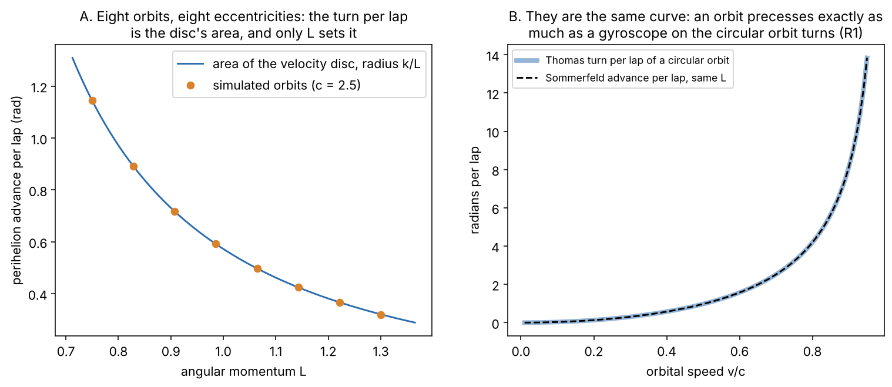
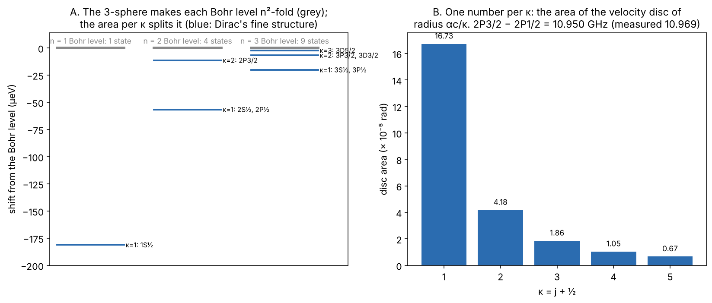
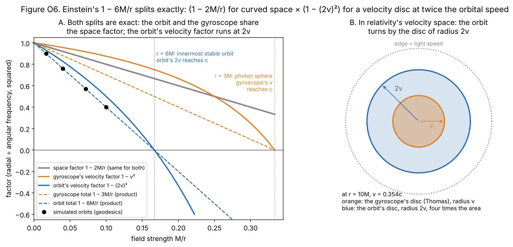
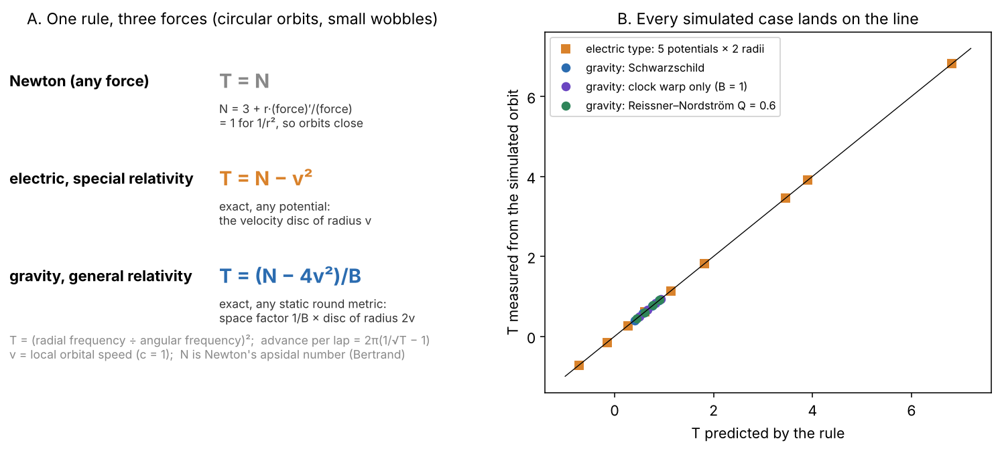
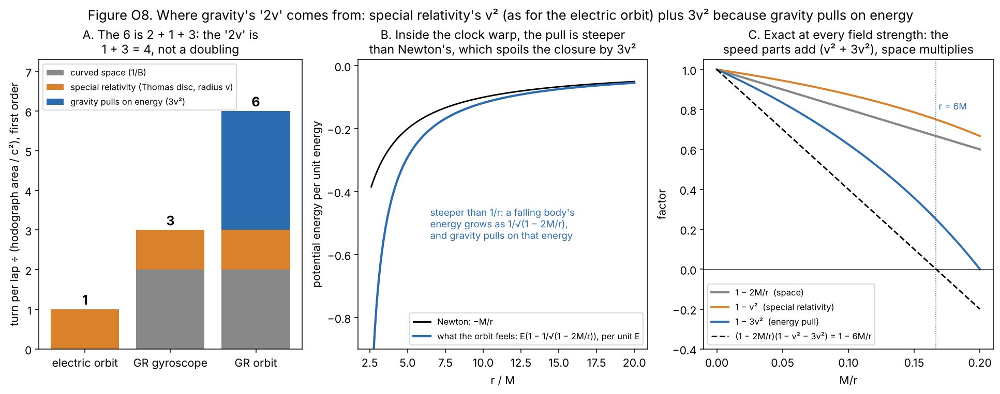
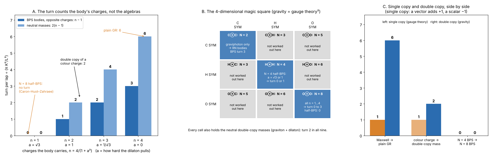
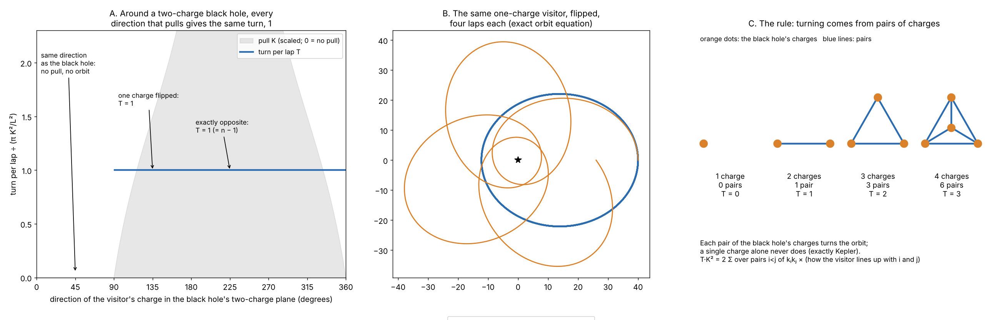
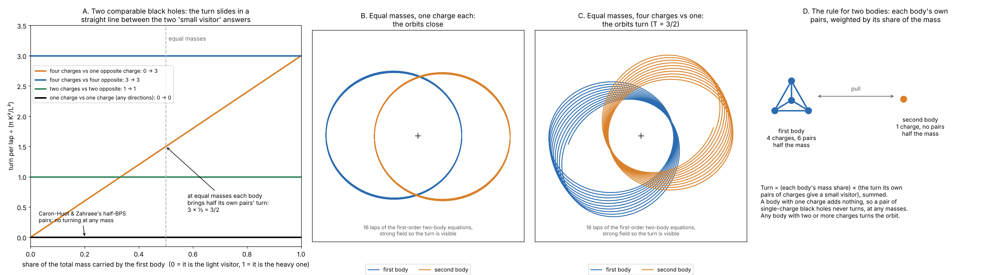
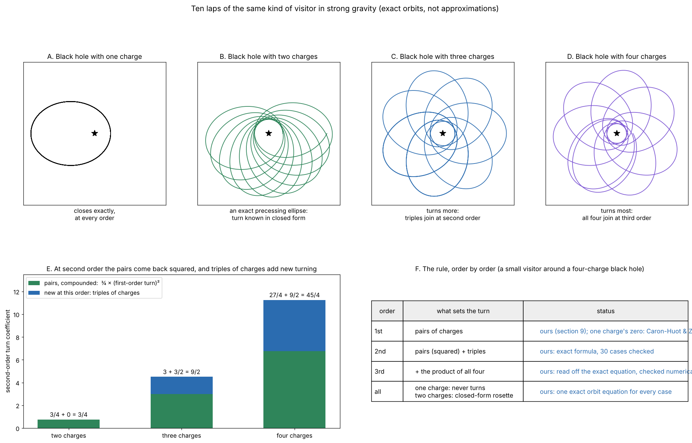
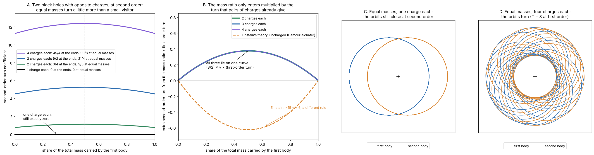

# DRAFT · Newton's orbits and hydrogen's levels on one 3-sphere: does the swap rule give Mercury and fine structure?

**DRAFT, Nov 26 2026.** Part of Affine Composition Theory, the theory built on Fused Hyperoperation Algebra (repo:
fused-hyperoperation-algebra); a section of `hypersphere/`. Brennan asked to follow the lead "about Newton's orbits and
hydrogen's energy levels": do GR's perihelion shift (Mercury's 43″ a century) and hydrogen's fine structure both come
out of the swap rule, **turn = curvature × area** (from `precession/`), on the 3-sphere they share?

Names, as on the dial map: the **curvature dial d** (formerly the plane dial) and the **homothety k**; the curvature
is the reading d − k²/4, which is d itself at k = 0. Relativity's velocity space sits at k = 0, d = −1/c².

Checks: `checks_orbits.py` → `checks_orbits_output.txt`, **23 of 23 pass**, and `six/checks_six.py` →
`six/checks_six_output.txt`, **11 of 11 pass**, and `twov/checks_twov.py` → `twov/checks_twov_output.txt`, **8 of 8 pass**, and
`dcopy/checks_dcopy.py` → `dcopy/checks_dcopy_output.txt`, **11 of 11 pass**, and
`../division-algebras/magic/checks_magic.py`, **7 of 7 pass** (section 8), and
`../division-algebras/magic/checks_misalign.py`, **6 of 6 pass** (section 9), and
`../division-algebras/magic/twobody/checks_twobody.py`, **6 of 6 pass** (section 10), and
`../division-algebras/magic/order2/checks_order2.py`, **7 of 7 pass** (section 11), and
`../division-algebras/magic/twobody2/checks_twobody2.py`, **6 of 6 pass** (section 12) (numpy, scipy; real orbit simulations, not
formulas fed back). Pictures: `figures_orbits.py` → `figures/`. Lean: `../lean/Hypersphere.lean` (§5–§9, 33 theorems),
compiled in the shared library as `FusedAlgebra.Topics.Hypersphere` (no sorry, no statement changed). Colour key as before: **orange = known, blue = ours**.

## The result

1. **The 3-sphere they share is real and known** (Fock 1935): every Kepler orbit and every hydrogen level is a great
   circle on one 3-sphere, which is why the orbit closes and why level n holds n² states.
2. **For the electric force, what breaks that sphere is exactly one area, on a different sphere.** The relativistic
   orbit's turn per lap and hydrogen's fine structure are both the area of one disc in relativity's velocity space
   (curvature −1/c²). It is the same area that turns a gyroscope (Thomas precession), so one swap rule covers all three.
3. **For gravity, Einstein's 1 − 6M/r splits exactly into two twists** (section 5): curved space (1 − 2M/r) times a
   velocity disc at **twice** the orbital speed (1 − (2v)²). A gyroscope on the same orbit gets the same space factor
   times a disc at v. The 6 reads two ways that agree (section 6): **2 + 1 + 3** in the clock-warp picture (space,
   special relativity, gravity pulling on energy) and **2 + 2²** in string theory's double copy, where gravity's
   coupling is the electric one squared and the 2 in 2v is the 2 of (E + p)². Mercury's 42.98″ follows.
4. **Across string theory's magic square of gravity theories (section 8)** the turn counts the bodies' charges, not
   the algebras: BPS bodies turn n − 1 per lap and neutral ones 2(n − 1), for n = 1 to 4 charges. GR's 6 is the n = 4
   neutral case; N = 8's known zero is the n = 1 BPS case.
5. **With charges pointing different ways (section 9)** the turn comes only from pairs of the black hole's charges:
   one charge alone never turns an orbit (exact Kepler, every order), and n − 1 is n(n − 1)/2 pairs added up.
6. **For two comparable black holes (section 10)** the pair rule survives at first order: each body's own pairs count,
   weighted by its share of the mass, and the orbit closes exactly when both bodies carry a single charge.
7. **At the next order (section 11)** the pair rule survives and becomes a ladder: pairs of charges act at first
   order, triples join at second, all four at third. Around a two-charge black hole the orbit is an exact
   precessing ellipse at every order; around a one-charge one it never turns.
8. **For two comparable black holes at second order (section 12)** one-charge pairs still close at every mass ratio,
   and the mass ratio only enters multiplied by the first-order turn from pairs (for bodies with n equal charges).

**Does it open a lead?** Yes. For the electric force it turns the Coulomb orbit and Dirac's fine structure into one
swap-rule area. For gravity the 6 is no longer put in by hand: it is an exact product of the same two twists the
Gravity Probe B page found for the gyroscope, with the velocity disc's radius doubled, and section 6 says where each
piece of the 6 comes from.

## 1. Two spheres, not one

*Figure O1. A: a relativistic orbit; the ellipse turns a little each lap. B: on Fock's momentum sphere each lap is a
great circle, and the circle tilts lap by lap. C: the amount it tilts is the area of a disc in relativity's velocity
space (a sphere of imaginary radius c, the curvature dial at d = −1/c²).*

**Known.** Fock (1935) mapped momentum p to the unit 3-sphere by stereographic projection with radius p0 = √(−2E)
(Lean `fock_on_sphere`). Each Kepler orbit's momenta then lie on one great circle (check K3), tilted by the
eccentricity: (h·p0)² + e² = 1 (Lean `kepler_tilt`). Rotating the 3-sphere is the hidden SO(4) symmetry carried by
the Runge–Lenz vector (Pauli 1926; Bargmann 1936; check K1); regularizing collisions on it is Moser (1970). Level n
holds 1 + 3 + … + (2n − 1) = n² orbital states (K2; Lean `deg_eq`).

**What we tested.** If the precession were an area on Fock's sphere, different orbits would enclose different
areas. They don't: on the unit Fock sphere every orbit is a great circle and bounds half the sphere, 2π, for all
orbits (P7). So **the precession's area is not on Fock's sphere**. Fock's sphere only shows the effect: the circle
turns round the energy axis by exactly the advance each lap (P8: 0.31000 vs 0.31001).

## 2. The electric orbit: the turn per lap is one disc's area

*Figure O2. A: eight simulated orbits with different eccentricities (dots) sit on one curve, the area of the velocity
disc of speed-radius k/L. B: that curve is identical to the Thomas turn of a gyroscope on the circular orbit with the
same angular momentum.*

**Known.** Sommerfeld (1916) found the relativistic Coulomb orbit's advance per lap,
2π(1/√(1 − (k/cL)²) − 1). Thomas (1926) found a gyroscope on a circular orbit turns 2π(γ − 1) per lap, and that this
is the curvature of velocity space times the area its velocity encloses (the swap rule, already on our
`precession/` page).

**Ours (as stated; check the literature).** Two exact facts tie them together:
- The advance is **exactly** the area of a disc of speed-radius k/L in velocity space (curvature −1/c²), at any
  eccentricity (P1, P2: simulated 0.31000577, area 0.31000577 at c = 3).
- The circular orbit with that L moves at speed exactly k/L (Lean `circular_L_v`), so **an orbit precesses exactly
  as much as a gyroscope on the circular orbit with the same angular momentum** (R1, exact at β = 0.1, 0.5, 0.9;
  Lean `sommerfeld_eq_thomas`).

**Literature check (Nov 26, at Brennan's request).** We found this equality **implied but not stated**:
- **Biedenharn (1983)**, "The Sommerfeld puzzle revisited and resolved", shows that Sommerfeld's rotating frame for
  the precessing orbit is exactly paralleled by the Dirac transformation that carries the electron's Thomas spin
  precession, and turns into it in the classical limit. That is the same correspondence in qualitative form. We read
  it through Vickers (2018), who quotes it; we could not open Biedenharn's paper here, and no source we read gives the
  equality as numbers.
- **Belloni and Reina (1986)** is about Sommerfeld's own geometric derivation of Thomas precession. Its abstract says
  nothing about the orbit, and its full text wouldn't open here.
- **Vankov (arXiv:1008.1811)** links Thomas precession to perihelion advance only to first order, in a non-mainstream
  argument that rejects general relativity. It does not state this equality.
- **Gibbons (2015)**, on Hamilton's hodograph in relativity, treats the same orbits without mentioning Thomas.
- Other searches (velocity-space area, same angular momentum, exact equality) found nothing.

So the exact statement (advance per lap = velocity-disc area = the Thomas turn of the circular orbit with the same
L) looks unstated in what we could read. It is a short calculation, though, so it should be called a small new
observation in a long-studied area, not a discovery. Reading Biedenharn's paper in full is the one check left.

## 3. Hydrogen: the same area gives Dirac's fine structure, exactly

*Figure O4. A: the 3-sphere makes each Bohr level n²-fold (grey); one area per κ splits it into Dirac's levels
(blue). B: the area for each κ = j + ½, the disc of speed-radius αc/κ.*

**Ours, as an exact rewrite of Dirac.** Take x = (the disc area for κ)/2π and the quantum defect δ = κx/(1 + x). Then
(κ − δ)² = κ² − α², which is exactly Dirac's defect (Lean `dirac_defect`), so E = mc²/√(1 + α²/(n − δ)²) is Dirac's
formula. Rebuilt this way, every level up to n = 7 matches Dirac to the last digit (F1), and 2P3/2 − 2P1/2 comes out
10.950 GHz, Dirac's value (F2).

**Limits, said plainly.** The measured splitting is 10.969 GHz; the 0.2% gap is QED (the electron's anomalous
moment), which this law doesn't contain. 2S1/2 and 2P1/2 share κ = 1, so the area law leaves them equal; the Lamb
shift (1.058 GHz) is outside it (F5). And this is a rewrite of Sommerfeld–Dirac, not a derivation from the sphere.

## 4. Gravity: one area, but a coefficient of 6, and only at first order

*Figure O3. A: advance ÷ (hodograph area/c²) from simulated orbits: scalar gravity −1, the electric force +1, general
relativity +6. B: GR's coefficient drifts away from 6 as the field gets stronger.*

*Figure O5. Mercury's velocities trace a circle of radius 48.9 km/s (Hamilton's hodograph). 6 × its area/c² per orbit
gives 42.98″ a century.*

**What holds.** Every theory's first-order perihelion shift is a whole number times the same area, the hodograph
disc over c² (P4): Nordström's scalar gravity −1, the electric force +1, Schwarzschild +6, at any eccentricity (P5).
For Mercury, 6 × area/c² = **42.98″ per century** (P6), the general-relativity value.

**What doesn't.** That number is GR's own first-order formula, rewritten; the 6 is put in, not derived. And GR is not
one exact area law: at stronger fields the coefficient drifts (8.89 at c = 5, P5b). So the honest answer to "does
Mercury come out as the swap rule's area law on the 3-sphere?" is **no, not exactly, and not on Fock's sphere**: it
comes out as 6 times an area on the velocity sphere, at first order.

**The sharpened question.** Compare the orbit with a gyroscope on it, both in units of that area (known PPN
formulas, R3; Lean §7):

| | orbit turns | gyroscope turns | ratio |
|---|---|---|---|
| electric force (exact) | 1 | 1 | 1 |
| Nordström scalar gravity (first order) | −1 | −1 | 1 |
| general relativity (first order) | 6 | 3 | 2 |

## 5. Gravity's 6, split exactly

*Figure O6. A: the orbit's factor 1 − 6M/r (blue dashed) is exactly the space factor 1 − 2M/r (grey) times
1 − (2v)² (blue), v being the local orbital speed. The gyroscope's 1 − 3M/r (orange dashed) is the same space factor
times 1 − v² (orange). Dots are simulated orbits. B: in velocity space the gyroscope turns by the disc of radius v,
and the orbit by the disc of radius 2v. In O6 and O7 the colours mark the gyroscope and the orbit, not known vs ours.*

**The result.** For a near-circular orbit, write T = (radial frequency ÷ angular frequency)²; the advance per lap is
2π(1/√T − 1). Measure v as a local observer at rest would. Then, exactly:

- **orbit:** T = 1 − 6M/r = (1 − 2M/r) · (1 − (2v)²) (S1; Lean `orbit_split`)
- **gyroscope:** 1 − 3M/r = (1 − 2M/r) · (1 − v²) (S2; Lean `gyro_split`, as on the Gravity Probe B page)

Both are products of factors, so in the theory's language the fractions combine by the circle operation:
−6M/r = (−2M/r) ∘₁ (−4v²), with a ∘₁ b = a + b + ab (Lean `orbit_fractions_fuse`). In area terms, the 6 = **2** (curved space, the same for orbit and gyroscope) + **4** (a
velocity disc of radius 2v has four times Thomas's area) (S8).

**Two landmarks fall out.** The orbit's disc reaches light speed (2v = c) exactly at r = 6M, the innermost stable
orbit; the gyroscope's disc reaches light speed (v = c) exactly at r = 3M, the photon sphere (S3, S4; Lean
`isco_two_v`, `photon_sphere_v`). This also explains Figure O3B: the coefficient drifts from 6 in strong fields
because the true law is a product, not a sum.

*Figure O7. A: one rule for circular orbits of three kinds. N is Newton's apsidal number, 3 + r·(force)′/(force),
which is 1 for the inverse square, so Newton's orbits close. B: simulated orbits for five electric-type potentials
and three metrics land on the line.*

**The general rule.** The split is not special to Schwarzschild. For **any** static round spacetime
(−A dt² + B dr² + r² dφ²), T = (N − 4v²)/B, where N is Newton's closure number built from the clock rate A (S5,
symbolic). For a relativistic particle in **any** potential, T = N − v² (S6). Simulated geodesics in Schwarzschild,
in a clock-warp-only spacetime (B = 1) and in a charged black hole (Reissner–Nordström) all match to a few parts in a
million (S7). The clock-warp-only case shows where each piece lives: 1/B (space) supplies the 2, and the clock rate
supplies N − 4v².

**Limits, said plainly.**
- This is the near-circular law, small wobbles about a circle. The electric result in section 2 holds at every
  eccentricity; for gravity, eccentric orbits have no closed form, and the 6 is only first order there.
- Mercury (S9) tests only the first order, which was already known to give 42.98″.
- **Is the split new? Not really.** Both ingredients are textbook: Ω_r² = Ω_φ²(1 − 6M/r), and a local orbital speed
  of c/2 at the innermost stable orbit. The split is a one-line rewrite of them. We did not find it written this way,
  nor the rule T = (N − 4v²)/B, but published epicyclic-frequency formulas for static spacetimes contain it. It is a new
  reading of known results; what section 6 builds on it is the useful part.
- **Why 2v?** Section 6.

## 6. Where the 6 comes from: two readings that agree

The two readings below split the same 6 in two coordinate pictures. Both give curved space its 2; they differ in how
they group the rest. How the 6 splits depends on the coordinates; only the total is the same in every frame.

### Reading 1: the clock warp, 2 + 1 + 3

*Figure O8. A: the first-order budget. The electric orbit has only special relativity (1). The gyroscope adds curved
space (2 + 1 = 3). The orbit adds gravity pulling on energy (2 + 1 + 3 = 6). B: the potential the orbit actually feels
is steeper than Newton's 1/r. C: the exact factors at every field strength.*

Inside the clock warp, a geodesic is exactly a special-relativity orbit in the potential E(1 − 1/√A) (D1; simulated
orbits agree to 3 parts in 100 million, D7), and that picture's speed is the local speed (D2). Two things then spoil
Newton's closed orbit:

- **Special relativity, −v²:** the same velocity disc as the electric orbit and the Thomas turn (section 2).
- **Gravity pulls on energy, −3v²:** a falling body's energy grows as 1/√(1 − 2M/r), and gravity pulls on that
  energy, so the pull is steeper than 1/r: 1 − 1/√(1 − 2M/r) = −M/r − (3/2)M²/r² − … (D6). That lowers Newton's
  closure number from 1 to exactly 1 − 3v², for any clock rate (D3, D4; Lean `energy_pull_closure`).

v² + 3v² = 4v² = (2v)², which is why it looked like a disc of radius 2v. Exactly,
**1 − 6M/r = (1 − 2M/r) · [(1 − 3v²) − v²]** (D5, D8; Lean `six_is_two_one_three`). The gyroscope gets only the first
two pieces, 2 + 1 = 3, because a gyroscope's turn doesn't care how steep the pull is.

### Reading 2: string theory's double copy, 2 + 2²

*Figure O9. A: gravity's coupling is the electric coupling squared, and the square (E + p)² has three pieces. B: the
same 6 in both readings: both give space 2, and the double copy turns 1 + 3 into one square. C: switching the pieces on
one at a time, exactly.*

**The setup (known).** In Kerr–Schild form, the double copy's own coordinates, Schwarzschild is flat space plus
(2M/r) k k, with k a light-like direction, and the inverse is exact (K1). So a falling body obeys
η(p, p) − (2M/r)(k·p)² = −1, with k·p = E + p (K2). The single copy, Coulomb, has the same k but one power:
η(p, p) − (2Q/r)(k·p) = −1. Gonzo and Shi (2021) use this map, which "replaces the color charge of the test particle by
its momentum", to rebuild Schwarzschild geodesics from charged orbits. (Here k is the light-like direction, not the
homothety.)

**What we added (ours).** Expand the square: (k·p)² = E² + 2E·p + p² (K3). Switching the pieces on one at a time,
exactly and in simulated orbits (K4–K10):

- **E², Newton's pull:** on its own, the orbit closes exactly, at every field strength (K4, K8).
- **p², space:** with Newton's pull it gives exactly 1 − 2M/r, the gyroscope's space factor (K5). It adds 2.
- **2E·p, the cross term:** in the single copy this term makes Sommerfeld's electric turn, the 1 (K9). In gravity the
  square doubles its strength, from M to 2M, so it gives 2² × 1 = 4 (K10).

So **6 = 2 (space) + 2² (the cross term)**, and all three together give exactly 1 − 6M/r = (1 − 2M/r)(1 − (2v)²) (K6;
Lean `ks_all`, `six_is_space_plus_square`). The 2 in 2v is the 2 of the binomial square.

### How the two fit

Both readings give space 2. The double copy shows that the clock-warp reading's special relativity (1) and energy pull
(3) are one square: **1 + 3 = 2²** (Lean `one_plus_three_is_square`). The Kerr–Schild frame is the natural one for this
because it is where the double copy is exact and linear.

## 7. What else string theory says

- **T-duality and open/closed strings:** nothing found that bears on orbits.
- **The double copy** (gravity = gauge theory squared, from string theory's KLT relations, 1986) is the frame used in
  section 6. Its known parts: Schwarzschild built from the Coulomb field (Monteiro, O'Connell and White 2014), charged
  orbits mapped onto geodesics (Gonzo and Shi 2021). Gonzo and Shi compute no precession, and we found no paper that
  splits the 6 into the pieces of (k·p)².
- **String theory's own gravity can remove the 6 entirely.** In N = 8 supergravity, its low-energy limit, orbits of
  extremal black holes don't precess at all: the extra scalar and vector forces cancel it (Caron-Huot and Zahraee
  2018–19). That fits the table in section 4: scalar forces push the coefficient negative (Nordström −1), and the
  budget can sum to zero. So the 6 is specific to pure general relativity.

## 8. Across the magic square: the turn counts charges, not algebras

*Figure D3. A: turn per lap for bodies carrying n charges. B: the 4-dimensional magic square, where each gravity
theory is two gauge theories (over C, H or O) multiplied. C: each gauge-theory orbit next to its gravity double.*

Brennan asked how the 1, 2, 4, 8 result could extend string-theory work, and said yes to the pick: work out how far
orbits turn in each cell of the **magic square**, the table of gravity theories made by multiplying two gauge
theories built on C, H or O (Borsten, Duff, Hughes and Nagy 2013; Anastasiou and others 2017). Checks:
`../division-algebras/magic/checks_magic.py`, **7 of 7 pass**: the black holes are verified as exact solutions, then a
small body is flown around each one (exact equations, plus simulated orbits). Turn per lap is in units of π K²/L²,
where K is the Newtonian pull, so plain GR gives 6 and Sommerfeld's electric orbit gives 1.

**The result: the turn is set by how many charges the bodies carry, not by which algebras built the theory.**
In these theories a black hole can carry n = 1, 2, 3 or 4 charges, which fixes how hard the dilaton (the scalar
partner of the graviton) pulls on it: a = √3, 1, 1/√3, 0, with n = 4/(1 + a²).

- **BPS bodies of opposite charge** (the most supersymmetric ones, which feel no force from their own kind) turn by
  **n − 1** per lap: 0, 1, 2, 3. The n = 1 case is the half-BPS black hole of N = 8 supergravity, and its 0 matches
  Caron-Huot and Zahraee 2018 (M4, M5).
- **Neutral masses** that the dilaton pulls with the same strength turn by **2(n − 1)**: 6, 4, 2, 0. Plain GR is
  n = 4 (no dilaton pull): 2 × 3 = 6, the same 6 as 2 + 2² in section 6. The double copy of a gauge charge has
  a = 1, so it turns by 2, in every cell of the square (M6).
- **The single copy agrees in shape:** in gauge theory a vector adds +1 and a scalar −1 per unit of coupling squared,
  so Maxwell gives 1 and N = 4's BPS particles give 0 (Caron-Huot and Henn 2014) (M7).

**Does the 2 + 2² split follow the two algebras? No.** The algebras only decide which charges a body *can* carry.
C ⊗ C (N = 2) has a single vector, so its charged black holes are Reissner–Nordström (a = 0), with BPS turn 3. In
N = 4 theories such as H ⊗ H, the half-BPS bodies have a = √3 or 1, so they turn 0 or 1. O ⊗ O (N = 8) holds all
four, so 0 to 3 (which a embed where: Khuri and Ortín 1995). The other cells are not worked out here.

**Is it new?** The ingredients are known: the black holes (Gibbons–Maeda, Garfinkle–Horowitz–Strominger), their
supersymmetry (Khuri–Ortín), the two-body dynamics of this theory at first order (Julié 2017; Khalil and others 2018)
and the N = 8 zero. I have not found the compact laws n − 1 and 2(n − 1), or the link from the n = 4 case to GR's 6,
written down, though they may follow from those papers' formulas.

**Does it open a lead?** A modest one. It explains why N = 8's zero is special: it is the n = 1 end of a straight line,
not a magic cancellation of N = 8 alone. Worth testing next: two black holes with different charge directions (the
case Caron-Huot and Zahraee also covered), to see whether the line n − 1 becomes a rule about the angle between charges.

## 9. Misaligned charges: turning comes from pairs of charges

*Figure D4. A: around a two-charge black hole, the turn for every direction of the visitor's charge. B: the same
visitor around a one-charge black hole (closes) and a four-charge one (turns). C: the rule, one pair per line.*

Brennan said yes to testing bodies whose charges point in different directions, to see whether n − 1 becomes a rule
about the angle between them. Setup: N = 8's four-charge black holes (the STU family), checked as exact solutions;
visitors made of up to four charge pieces, each pointing with or against the black hole's matching charge; all 185
combinations around 1-, 2-, 3- and 4-charge black holes, then the general rule solved exactly. Checks:
`../division-algebras/magic/checks_misalign.py`, **6 of 6 pass**.

**The result: n − 1 is not an angle rule; it is a pair rule.**

- **One charge never turns an orbit.** Around a one-charge (half-BPS) black hole, every visitor, whatever its charges
  point, moves on an exact Kepler ellipse, at every order (X4). This extends two known results: Caron-Huot and Zahraee
  2018 (half-BPS pairs, any misalignment) and de Neeling, Roest, Seri and Waalkens 2023 (a = √3, all orders).
- **Each pair of the black hole's charges turns it.** With the black hole's charges kᵢ, the visitor's share wⱼ on
  charge j, and xⱼ = 2wⱼ for a piece pointing opposite (0 for one pointing the same way):
  T·K² = 2 Σ over pairs i < j of kᵢkⱼ [xᵢ(1 − wⱼ) + xⱼ(1 − wᵢ) + xᵢxⱼ], with K = Σ kⱼxⱼ (X3). For n equal charges
  and a visitor exactly opposite, the n(n − 1)/2 pairs add up to n − 1.
- **Two charges: the angle does not matter.** Around a two-charge black hole, every direction of the visitor's
  charge that pulls at all gives the same turn, 1 (Fig D4 A).
- **One-charge visitor against charge j:** T = (sum of the other charges)/kⱼ (X5).

In section 1's picture: with one charge, everything the visitor feels is built from one field (one harmonic function
H), and the orbit keeps Fock's 3-sphere symmetry exactly. The product of two charges' fields is what breaks it.

**Limits.** Small visitor only (probe limit); visitors are pieces riding together, and pieces pointing opposite ways
are not stable bound states; charge directions within the four-charge family only, not all 56 of N = 8.
**Is it new?** The ingredients are known (as above, and section 8). I have not found the pair rule or the angle
independence at two charges written down. **Does it open a lead?** Yes, a concrete one: it says where the hidden
symmetry lives (one field keeps Kepler, pairs break it). Next would be two equal masses, using the known first-order
two-body formulas (Julié 2017; Khalil and others 2018), to see whether the pair rule survives beyond a small visitor.

## 10. Two comparable black holes: the pair rule survives, weighted by mass

*Figure D5. A: the turn per lap as the mass moves from one body to the other, for four pairs of black holes.
B and C: both bodies' paths at equal masses, from the first-order two-body equations (strong field, so the turn
shows). D: the rule.*

Section 9 used a small visitor. Here both bodies are four-charge black holes of any size, each charge pointing either
way. Method: the first-order (1PN) two-body Lagrangian for bodies that trade gravitons, scalars and vectors (Einstein–
Infeld–Hoffmann, Damour–Esposito-Farèse, Darwin), with every term where one body's field acts twice left general;
the periastron advance worked out exactly; those terms then fixed from the exact small-visitor orbits of section 9,
taken both ways round. Checks: `../division-algebras/magic/twobody/checks_twobody.py`, **6 of 6 pass**.

**The result: the pair rule holds for any masses, with each body's pairs weighted by its share of the mass.**

- **The turn slides in a straight line.** For any two bodies, T = X_A·T(B round A) + X_B·T(A round B), where X is
  each body's share of the mass and the two T's are section 9's small-visitor answers. Nothing else depends on the
  mass ratio (Y1). This is the structure of Damour and Esposito-Farèse's scalar-tensor formula, which the check
  reproduces exactly, two bodies and all (Y2).
- **So turning still comes from pairs of charges inside one body.** A body with one charge adds nothing. At equal
  masses, a four-charge black hole against a one-charge one turns at 3/2, half of the 3 a small visitor would see
  (Fig D5 A, C). Two charges against two opposite gives 1 at every mass ratio; four against four gives 3.
- **The orbit closes exactly when both bodies have a single charge**, whatever their directions and masses
  (251 attracting pairs, Y5). Any body with two or more charges makes the orbit turn. The single-charge case is
  Caron-Huot and Zahraee's no-precession result for half-BPS pairs, found here by a different route.
- **Simulated, not just derived.** Integrating the first-order two-body equations at equal masses gives 0.00, 3.00
  and 1.49 for the three test cases, against 0, 3 and 3/2 predicted (Y6).

**Limits.** First order only (1PN). The straight-line law is guaranteed there; at the next order (2PN) the mass
ratio enters in new ways; section 12 tests it for bodies with equal charges. The bodies are extremal (BPS-type) black holes modelled as point
particles, within the four-charge family.
**Is it new?** The straight-line structure is known (Damour and Esposito-Farèse 1992), and the single-charge case is
known (Caron-Huot and Zahraee 2019; Davis and Melville 2023 for the a = √3 tuning). I have not found the two-body
turn for multi-charge (1/4- and 1/8-BPS) black holes, or the closes-exactly-when-both-single statement, written down.
**Does it open a lead?** A modest one. It confirms the pair rule is not an artefact of a small visitor, but at
first order it follows from known structure, so the real test of the hidden symmetry is the second order.

## 11. The next order: the pair rule grows into a ladder

*Figure D6. A to D: ten laps of the same kind of visitor around black holes with one, two, three and four charges,
from the exact orbit equation in strong gravity (no approximation). E: the second-order turn split into the pairs
coming back squared (green) and the new part from triples of charges (blue). F: the rule, order by order.*

Brennan's go-ahead to follow the leads, and the coordinator's yes to "test the pair rule at the next order", since
section 10 named the second order as the real test of the hidden symmetry. Method: for a small visitor (section 9's
setup) the orbit around a four-charge black hole can be solved exactly, so the second order is read off an exact
equation rather than built up term by term. Checks: `../division-algebras/magic/order2/checks_order2.py`,
**7 of 7 pass**.

**The result: the rule survives, and it turns out to be the first rung of a ladder.**

- **One exact orbit equation.** With u = 1/r, the visitor's charge shares wⱼ, signs sⱼ = ±1 (with or against the black
  hole's charge j), D = E − Σ wⱼsⱼ and H = Π(1 + kᵢu):
  L²(du/dφ)² = D²H + 2D Σⱼ wⱼsⱼ H/Hⱼ + Σ over j ≠ l of wⱼwₗ(sⱼsₗ − 1) H/(HⱼHₗ) − L²u².
  The right side is a polynomial in u whose degree is the number of charges, and its coefficients are built from
  the charges one at a time, in pairs, in triples and all four together (Z2, all 16 sign patterns).
- **The ladder.** Pairs of charges first appear at first order (section 9's rule), triples at second order, and the
  product of all four at third order. At second order the turn per lap is
  π[T·K²/L² + (T₂ + T₂ₑ·w)·K⁴/L⁴], with **T₂ = ¾T² + 3·(triples)/K³** and T₂ₑ = −(how the pairs term changes with
  energy)/K². So the pairs come back squared and the triples are the only new ingredient (Z5, 30 cases). Three
  equal charges: 3 + 3/2 = 9/2. Four: 27/4 + 9/2 = 45/4 (Fig D6 E). The third rung was checked too: the product of
  all four charges first moves the turn at third order, by (product term)/K⁴ × (15/2 − 3w) × K⁶/L⁶; an exact
  orbit with four unequal charges gives 47.84, 47.40, 47.29 as L doubles, against 47.25 (Z7).
- **Two charges: the pair rule is the whole story, at every order.** The equation is then quadratic, so the orbit is
  an exact precessing ellipse with turn per lap 2π(1/√(1 − D²k₁k₂/L²) − 1), in closed form even in strong gravity
  (Z3, matched to 15 digits; Fig D6 B).
- **One charge: never turns, at any order** (Z4, strong gravity, turn below 10⁻¹⁹; Fig D6 A), as section 9 found.
- **Checked against Einstein.** The same second-order machinery gives Damour and Schäfer's test-mass result for
  Schwarzschild exactly (Z1), and integrating a three-charge orbit at large L lands on the predicted second-order
  coefficient, 35.03 then 35.006 as L doubles, against 35 (Z6).

In section 1's picture: the number of charges sets how far the orbit is from Fock's sphere. One charge keeps the
sphere (Kepler). Two charges keep a circle's worth of it (the orbit is still a sine wave in 1/r, just stretched).
Three or four make the orbit an elliptic function, the same kind as Schwarzschild's.

**Limits.** Small visitor only; section 12 takes up two comparable masses. Visitors are pieces riding together, as in
section 9.
**Is it new?** The black holes, the visitors and the second-order formula's Schwarzschild limit are known. I have not
found the polynomial orbit equation, the pairs-then-triples ladder, or the closed-form rosette around a two-charge
black hole written down. The nearest known results are the no-precession ones for single charges (Caron-Huot and
Zahraee 2019; de Neeling and others 2023).
**Does it open a lead?** Yes. It gives an exact reason why one charge keeps Kepler and two keep a rosette: the
degree of one polynomial. The natural next step was the comparable-mass second order (section 12).

## 12. Two comparable black holes at second order: one charge still closes

*Figure D7. A: the second-order turn coefficient as the mass moves from one body to the other, for two black holes
with opposite charges and 1, 2, 3 or 4 equal charges each. B: the part that depends on the mass ratio, divided by the
first-order turn; ν is the product of the two mass shares (1/4 at equal masses). C and D: both bodies' paths at
equal masses, simulated from the second-order equations.*

Brennan asked for the comparable-mass case after section 11 left it open, and had his Mac Studio fetch the published
second-order (2PN) two-body Lagrangian for charged dilaton black holes (Gupta 2026, arXiv:2609.07413), transcribed
in `sources/gupta-2609.07413.md` at the repo root. Method: replace the accelerations with the Newtonian
equations of motion, pass to the Hamiltonian with total momentum zero, solve for the radial momentum, and take the
periastron advance from the radial action, expanded around Kepler. Checks:
`../division-algebras/magic/twobody2/checks_twobody2.py`, **6 of 6 pass**.

**What the paper covers.** One vector field and one scalar, so each body carries charges all pointing the same
way. In the four-charge family that means black holes with n equal charges (dilaton coupling a = √3, 1, 1/√3, 0
for n = 1, 2, 3, 4). Here the two bodies have opposite charges, so they attract, as section 11's visitor did.

**The result: the pair rule survives at second order for comparable masses, in every case the paper covers.**

- **Two one-charge black holes still close, at every mass ratio** (W3, Fig D7 C). Nothing turns at first or second
  order.
- **The mass ratio enters only multiplied by the first-order turn.** For n = 2, 3, 4,
  T₂ = T₂(small visitor) + (3/2)·ν·T and T₂ₑ = T₂ₑ(small visitor) + ν·T, where T is the first-order turn from pairs
  (1, 2, 3). So all three fall on one curve when divided by T (Fig D7 B), and where pairs give nothing, the mass
  ratio adds nothing (W4). At equal masses the turn is a little larger than for a small visitor: 9/8 against 3/4 for
  two charges each, 99/8 against 45/4 for four.
- **This is special to these black holes.** In Einstein's theory the same term is −15ν, not (3/2)·6·ν (W5).
- **Three independent checks hold the pipeline in place.** It reproduces Einstein's second-order two-body advance
  (Damour and Schäfer) at four mass ratios (W1). In the small-visitor limit it reproduces section 11's exact results
  for n = 1, 2, 3, 4 (W2), which also checks the transcription's velocity and acceleration terms, the part the
  transcription could not check itself. Simulated equal-mass orbits land on the predicted coefficients, and the
  one-charge orbit's leftover turn falls about 64 times each time L doubles, the size of the third-order terms the
  equations leave out (W6).

**Limits.** Bodies with charges pointing different ways, or with different numbers of charges, need a second-order
Lagrangian with several vector fields, which is not available; the comparable-mass test of the full pair rule (and of
triples) is still open there. Extremal black holes as point particles; conservative dynamics only (no radiation).
The transcription's readings of δ₂, ε₂ and the exchanged Λ's do not matter here (β = β′ = 0 for these black holes).
**Is it new?** The Lagrangian is Gupta's. That two one-charge black holes do not precess is known in N = 8
supergravity (Caron-Huot and Zahraee 2019, from scattering), and fits Davis and Melville's cancellation argument.
I have not found the periastron advance for n = 2, 3, 4 at second order, or the ν·T rule, written down; I have not
checked whether Gupta's paper computes an advance, since the transcription records none.
**Does it open a lead?** Yes, a modest one. It says the hidden symmetry is tied to pairs of charges for comparable
masses too, not only for a small visitor. The sharp next test needs a several-field second-order Lagrangian, so that
misaligned and mixed-charge pairs can be tried.

## Known vs ours

- **Known:** Fock's 3-sphere and SO(4) (Fock 1935, Pauli 1926, Bargmann 1936), Moser regularization (1970),
  Runge–Lenz, Hamilton's hodograph (1847), Sommerfeld's advance (1916), Thomas precession (1926), Dirac's levels
  (1928), the PPN perihelion and geodetic formulas, Mercury's 43″.
- **Ours, exact, implied by Biedenharn (1983) but not stated as an equality in anything we read:** Sommerfeld's
  advance per lap = the velocity-disc area = the Thomas turn of the same-L circular orbit (R1, P2).
- **Ours, exact rewrite:** Dirac's fine structure from one disc area per κ (F1, F4).
- **Ours, first order, a reading:** every theory's perihelion shift is an integer times the hodograph area/c²
  (−1, +1, +6), and GR's orbit turns twice its gyroscope (R2, R3).
- **Known ingredients, our grouping (not found written this way):** 1 − 6M/r = (1 − 2M/r)(1 − (2v)²), beside the
  gyroscope's (1 − 2M/r)(1 − v²); the general rules T = (N − 4v²)/B and T = N − v² (S1–S7).
- **Ours, exact:** the 6 = 2 (space) + 1 (special relativity) + 3 (gravity pulling on energy), via the
  special-relativity picture of a clock-warp geodesic (D1–D8).
- **Known parts, our derivation:** the 6 = 2 (space) + 2² (the cross term 2E·p of the double copy's (k·p)²), with
  Newton's pull alone giving no turn at all; 1 + 3 = 2² (K1–K10). The Kerr–Schild form and the charge-to-momentum
  map are known; the split is not, in anything we found.
- **Known, string theory:** the double copy (KLT 1986; Monteiro–O'Connell–White 2014; Gonzo–Shi 2021); no precession
  in N = 8 supergravity (Caron-Huot–Zahraee 2019).
- **Known, now read as discs:** v = c/2 at the innermost stable orbit, v = c at the photon sphere.
- **Ours, exact (small visitor):** the polynomial orbit equation around a four-charge black hole; the ladder
  T₂ = ¾T² + 3·(triples)/K³; the closed-form rosette around a two-charge black hole (Z2–Z7).
- **Ours, from Gupta's published Lagrangian:** the second-order advance for two comparable black holes with n equal,
  opposite charges, T₂ = T₂(visitor) + (3/2)νT, T₂ₑ = T₂ₑ(visitor) + νT; one-charge pairs close (W1–W6).
- **Does not work:** the precession as an area on Fock's sphere (P7); GR's perihelion as one exact sum of areas
  (P5b); the split for eccentric orbits in closed form.

## Next (offered, not started)

1. Try the same three-piece split for a spinning black hole (Kerr), whose Kerr–Schild form is also exact.
2. Read Biedenharn (1983) in full for the R1 equality, and search for the T = (N − 4v²)/B grouping.

## Files

`checks_orbits.py`, `checks_orbits_output.txt`, `results.json`, `figures_orbits.py`, `figures/figO1…figO9`,
`six/` (`checks_six.py` 11/11, `checks_six_output.txt`, `results_six.json`, `figures_six.py`, `explore.py`,
`general.py`, `srnum.py`, `nordnum.py`), `twov/` (`checks_twov.py` 8/8, `checks_twov_output.txt`, `derive.py`,
`figure_twov.py`), `dcopy/` (`checks_dcopy.py` 11/11, `checks_dcopy_output.txt`, `results_dcopy.json`, `derive.py`,
`numcheck.py`, `figure_dcopy.py`), `../division-algebras/magic/twobody/` (`pn1.py`, `check_def_probe.py`, `stu2.py`,
`orbit1pn.py`, `checks_twobody.py` 6/6, `checks_twobody_output.txt`, `results_twobody.json`, `figure_twobody.py`),
`../division-algebras/magic/order2/` (`turn2.py`, `poly.py`, `explore2.py`, `checks_order2.py` 7/7,
`checks_order2_output.txt`, `results_order2.json`, `figure_order2.py`), `../division-algebras/magic/twobody2/`
(`gupta_halves.txt`, `pn2.py`, `orbit2pn.py`, `explore_pn2.py`, `checks_twobody2.py` 6/6, `checks_twobody2_output.txt`,
`results_twobody2.json`, `figure_twobody2.py`), and
`../lean/Hypersphere.lean`.

## References

Magic square and supersymmetric black holes (section 8): L. Borsten, M. J. Duff, L. J. Hughes, S. Nagy, PRL 112,
131601 (2014), arXiv:1301.4176; A. Anastasiou and others, "The Mile High Magic Pyramid", arXiv:1711.08476;
M. Khuri and T. Ortín, arXiv:hep-th/9512177; G. Gibbons and K. Maeda 1988; D. Garfinkle, G. Horowitz, A. Strominger
1991; S. Caron-Huot and Z. Zahraee, JHEP 07 (2019) 179, arXiv:1810.04694; S. Caron-Huot and J. Henn, PRL 113, 161601
(2014); W. Goldberger and A. Ridgway 2017, arXiv:1611.03493; F.-L. Julié, arXiv:1711.10769; M. Khalil and others,
arXiv:1809.03109; T. Damour and G. Esposito-Farèse, Class. Quantum Grav. 9, 2093 (1992); A.-C. Davis and
S. Melville, "Orbital precession and hidden symmetries in scalar-tensor theories", arXiv:2307.06331. D. de Neeling, D. Roest, M. Seri, H. Waalkens, "Extremal black holes as relativistic
systems with Kepler dynamics", Regul. Chaotic Dyn. 2024, arXiv:2303.13291 (section 9). T. Damour and G. Schäfer,
Nuovo Cimento B 101, 127 (1988) (second-order periastron advance); P. K. Gupta, arXiv:2609.07413 (second-order
two-body Lagrangian for Einstein–Maxwell–dilaton binaries, sections 11–12; transcribed in
`sources/gupta-2609.07413.md` at the repo root).

V. Fock, Z. Phys. 98, 145 (1935). W. Pauli, Z. Phys. 36, 336 (1926). V. Bargmann, Z. Phys. 99, 576 (1936).
J. Moser, Comm. Pure Appl. Math. 23, 609 (1970). W. R. Hamilton, Proc. R. Irish Acad. 3, 344 (1847).
A. Sommerfeld, Ann. Phys. 51, 1 (1916). L. H. Thomas, Nature 117, 514 (1926). P. A. M. Dirac, Proc. R. Soc. A 117,
610 (1928). C. M. Will, Theory and Experiment in Gravitational Physics (PPN perihelion and geodetic formulas).
J. Bertrand, C. R. Acad. Sci. 77, 849 (1873) (closed orbits; the apsidal number). L. Belloni and C. Reina, Eur. J. Phys. 7, 55 (1986). A. A. Vankov, arXiv:1008.1811 (2010). L. C. Biedenharn, Found.
Phys. 13, 13 (1983). P. Vickers, Brit. J. Phil. Sci. (2018), arXiv:1912.04698. G. W. Gibbons, arXiv:1509.01286 (2015).
H. Kawai, D. C. Lewellen and S.-H. H. Tye, Nucl. Phys. B 269, 1 (1986) (KLT). R. Monteiro, D. O'Connell and C. D. White,
JHEP 12, 056 (2014). R. Gonzo and C. Shi, Phys. Rev. D 104, 105012 (2021), arXiv:2109.01072. S. Caron-Huot and
Z. Zahraee, JHEP 07, 179 (2019), arXiv:1810.04694.
