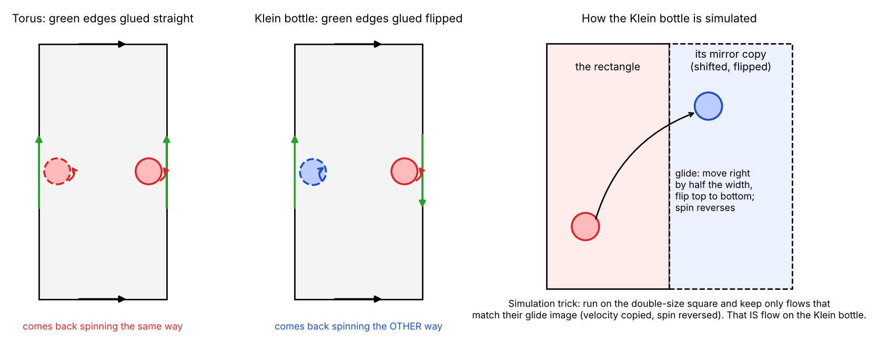
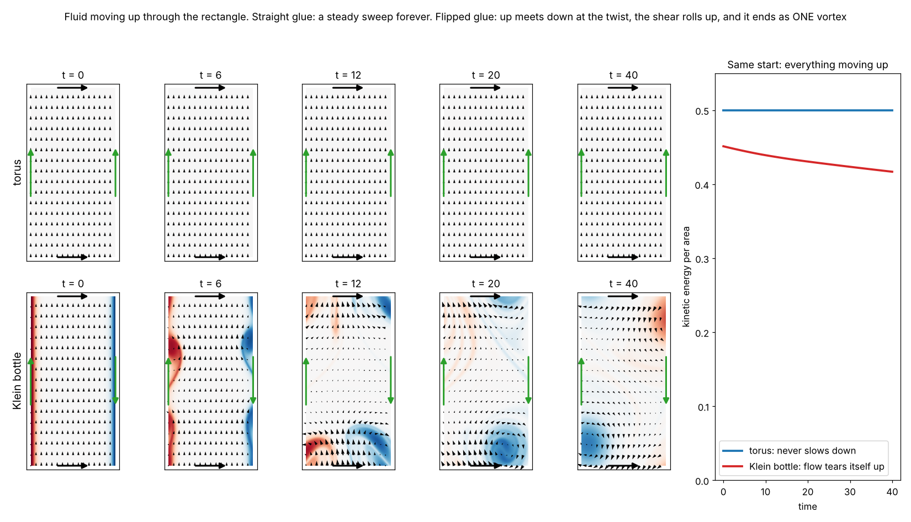
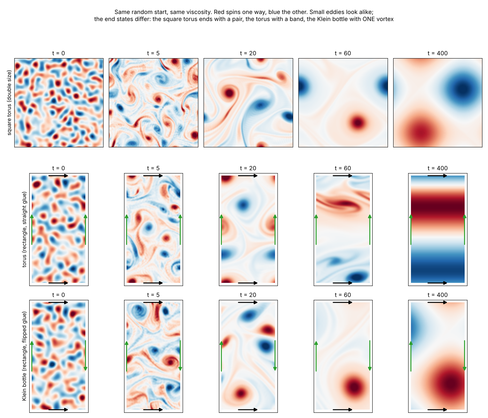
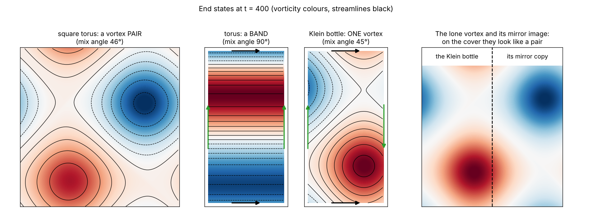
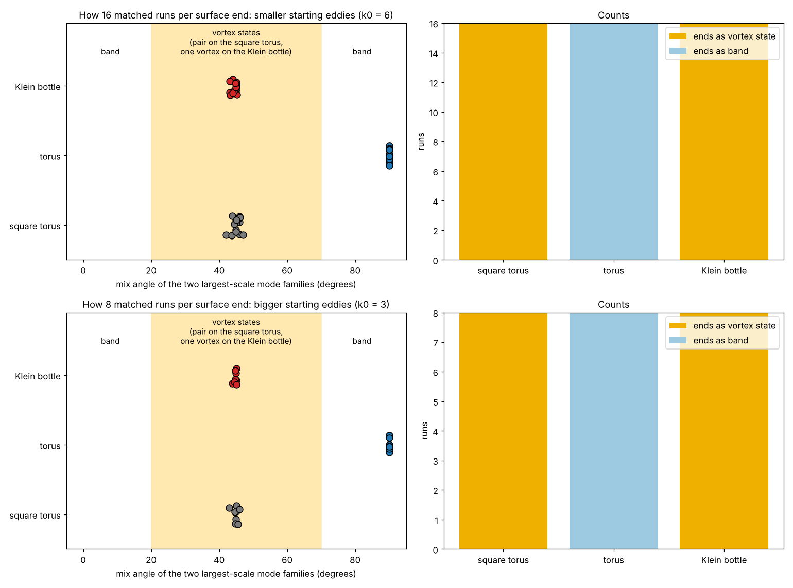
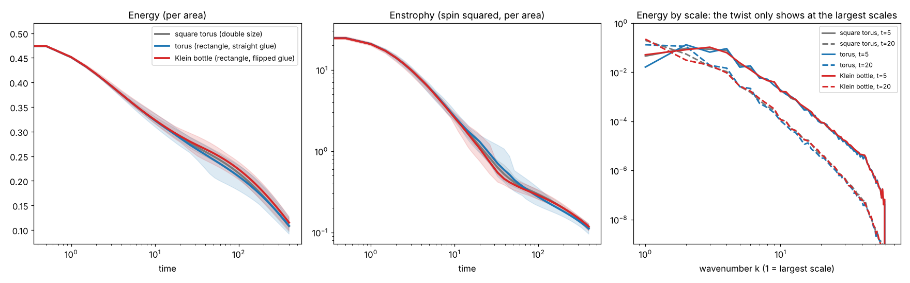
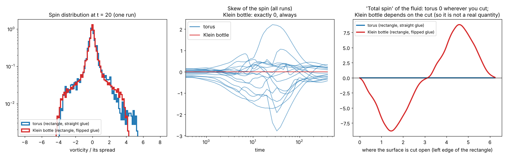
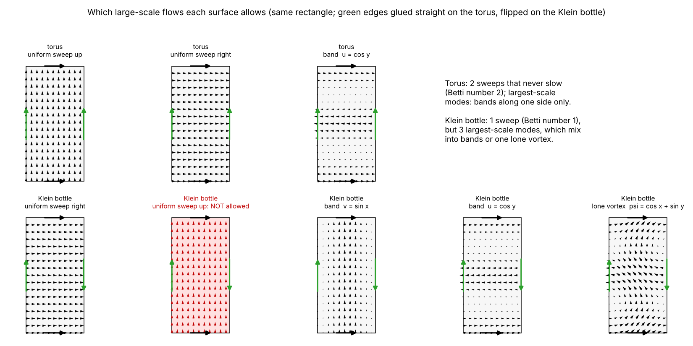
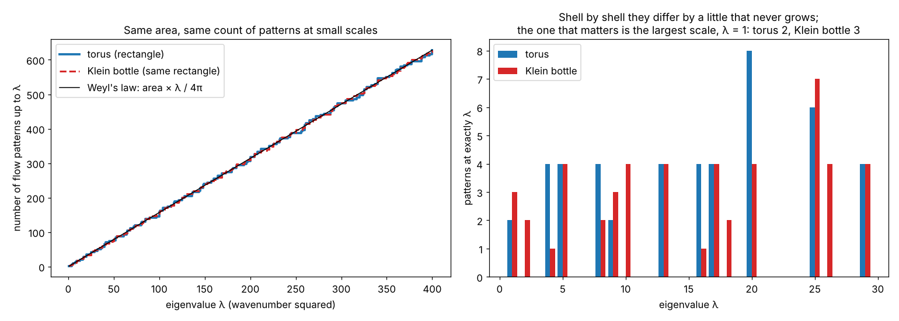

# DRAFT · Fluid flow on a Klein bottle: what one twist does

> **Names:** some words or symbols on this page (wall, twist) also mean something else in standard math, physics or computing, or inside this project. [NAMING-COLLISIONS.md](../../NAMING-COLLISIONS.md) says which meaning is in play.

**DRAFT, Nov 26 2026.** Part of Affine Composition Theory, built on Fused Hyperoperation Algebra.
Asked for by Brennan: "So it would be interesting to see if a twist yields a result in navier stokes", then
"Run Klein bottle flow". Follows section 7.4 of [shape dials](../shape-dials/README.md).

Checks: [`checks.py`](checks.py) → [`checks_output.txt`](checks_output.txt), **11 of 11 pass** (about 75 s, numpy). Runs:
[`ensemble.py`](ensemble.py) (decaying turbulence), [`upward.py`](upward.py) (the upward-flow test), solver
[`flow.py`](flow.py). Pictures: [`figures.py`](figures.py) → [`figures/`](figures/). Lean:
[`lean/KleinFlow.lean`](lean/KleinFlow.lean) (6 theorems, no `sorry`; compiles in the Mathlib CI, imported in cd17d0d).

**Follow-up (Nov 27):** [periodic-box/](periodic-box/README.md) dials this setup to Clay's periodic box: the twist unfolds into the box one way, the height dial's wall does not move with the twist, and the twist lets 3D disturbances in faster by keeping period-doubled ones.

## The plain result

**Not a lead for the Navier–Stokes Millennium problem, and not a lead for quantum gravity.** Two-dimensional
flow is known to stay smooth on every closed surface, twisted or not, and the runs agree. In three dimensions a
twisted space (Klein bottle × circle) is just one symmetry class inside Clay's periodic box, so it is a place to
search, not a new mechanism, and nothing here points at blowup. On the quantum-gravity side the twist does the
same algebra as the orientifold projection of unoriented string theory, which is known and predicts nothing new
here (section 6).

**What is real, checked and pictured:** the twist changes the fluid in four ways, and the clearest one is new to
me in print.

1. **One sweep instead of two.** A flat torus has two steady sweeping flows that never slow down; the Klein bottle
   has one. Fluid sweeping along the flipped edge would have to point up and down at once (figure 8).
2. **Spin loses its sign.** Going round the twist turns a clockwise eddy anticlockwise. So the total spin of the
   fluid is not a real quantity (it changes with where you cut the surface open), and every odd measure of the spin
   is forced to zero; only even ones like enstrophy survive (figure 7).
3. **A different set of largest-scale patterns.** Same rectangle, same area: the torus has 2 largest-scale
   patterns, the Klein bottle 3. Small eddies do not feel the twist (energy, enstrophy and small-scale spectra
   match); the largest scales do, and 2D turbulence sends its energy there (figures 6 and 9).
4. **It ends as one vortex.** Left alone, 2D turbulence passes its energy up to the largest scales. On the torus
   that ends as a band of flow, every time (24 of 24 runs, two kinds of start). On the Klein bottle, with the same
   starts, the same rectangle and the same viscosity, it ends as **a single round vortex**, every time (24 of 24). On an orientable
   closed surface a lone vortex is impossible, because total spin must add to zero; on the Klein bottle the lone
   vortex is its own opposite partner across the twist (figures 3 to 5).

The same thing shows with a cleaner start: fluid moving upward through the rectangle. Glued straight, it sweeps
forever. Glued with the flip, "up" meets "down" at the twist, the shear rolls up, and it too ends as one vortex
(figure 2).

**Lead or not, on its own merits:** a small, clean, true result with good pictures, built from known pieces
(section 5). It is worth keeping as a topic page. I do not see a path from it to the open problems, so I would not
chase it further for those.

*Figure 1. The same rectangle glued two ways. Torus: the green edges are glued straight, so an eddy that walks out
on the right comes back on the left spinning the same way. Klein bottle: the green edges are glued flipped, so it
comes back upside down and spinning the other way. Right: how it is simulated. Run on the double-size square and
keep only flows that equal their mirror image (moved half way across and flipped), with velocity copied and spin
reversed. That is exactly flow on the Klein bottle.*

## 1. The upward-flow test

*Figure 2. Top row, torus: fluid moving up everywhere (arrows) stays a uniform sweep; the colours are only the tiny
random nudge both runs got, and the energy (right, blue) never drops. Bottom row, Klein bottle: the same upward
flow in the rectangle is glued to downward flow at the flipped edge, which makes a thin shear layer (dark band at
t = 0). It wobbles (t = 6), rolls up into eddies (t = 12 to 20) and ends as one vortex (t = 40), losing energy as it
goes (right, red). At t = 40 the red patch at top right is the same vortex as the blue one at bottom left, seen
through the flipped edge. Grid 256², viscosity 5×10⁻⁴.*

## 2. Matched decaying turbulence

Sixteen random starts (plus 8 with bigger eddies in figure 5). Each one is drawn once on the double-size square and then kept to what each surface
allows, rescaled to the same energy, and run with the same viscosity (10⁻³) on a 128² grid to time 400 (about
400 turns of the largest eddies). Three surfaces: the **torus** and the **Klein bottle** share the same rectangle
and area and differ only in the flip; the **square torus** is their common double cover.

*Figure 3. One start, three surfaces. Early on (t = 5, 20) the eddies look alike everywhere, because small eddies
cannot feel the twist. Late (t = 400): square torus, a vortex pair; torus, a band of flow; Klein bottle, one vortex
(the blue patch at its top left is the same red vortex seen through the flipped edge, spin reversed).*

*Figure 4. The end states with streamlines. Right: the Klein bottle's lone vortex drawn on the double cover, where
it and its mirror image look like an ordinary pair. So the Klein bottle keeps the square torus's favourite end
state but halves it into one vortex; the same-size torus has no room for it and must end as a band.*

*Figure 5. Every run, placed by how its largest-scale energy splits between the two families of patterns (0° or
90° = all in one family = a band; 45° = an even mix = a round vortex). Top: 16 starts with smaller eddies. Bottom: 8 starts with bigger eddies. Klein bottle 24 of 24 end as one vortex (43° to 45°), square torus 24 of 24 as a pair, torus 24 of 24 as a band, its only option, since it has a single family at the largest scale. Not tried: starts built from large uniform patches, which on the square torus can end as a band (Yin 2004), so a band ending on the Klein bottle is not ruled out for every start.*

**Why 45°.** All three end states are steady flows built from the lowest patterns only. Among those mixes, the
round vortex (or pair) has the most peaked streamfunction: its fourth moment is 3/8 + 3/4·A²B², largest at A² = B²
(Lean `quartic_moment`, `lone_vortex_maximises`). On the square torus the pair-or-band choice is known to follow
maximum-entropy theory and the size of the starting eddies (Montgomery, Matthaeus, Stribling, Martinez and
Oughton 1992; Yin 2004). The Klein bottle inherits the pair as one vortex. One more constraint holds for any steady
state on the Klein bottle: if its vorticity is a function of its streamfunction, that function must be odd (Lean
`relation_odd_on_klein`), which is why the sinh-like shape fitted on tori is the natural one here.

*Figure 6. Energy and enstrophy fall almost identically on all three (shaded: spread over 16 runs), and the energy
spectra lie on top of each other at small scales. The twist only shows at wavenumbers 1 to 2.*

## 3. Spin loses its sign

*Figure 7. Left: the spread of spin values at t = 20; the Klein bottle's is exactly mirror-symmetric. Middle: the
skew of the spin over time for every run; on the torus it wanders (eddies of one sign can win), on the Klein bottle
it is exactly zero at every moment. Right: add up the spin inside the rectangle, for every place you could cut the
surface open. Torus: always 0 (a closed orientable surface has zero total spin). Klein bottle: the answer depends
on the cut and flips sign when the cut moves half way round, so "total spin" is not a quantity at all there (Lean
`sum_eq_zero_of_odd`, `sum_comp_eq_zero_of_odd`).*

The velocity itself is an ordinary arrow, so circulation round any loop, including the loop through the twist,
is still defined and Kelvin's theorem still holds for it. What fails is turning it into total spin.

## 4. Which large flows are allowed

*Figure 8. Torus: sweeps up and right (two, the first Betti number b₁ = 2) and bands along one side. Klein bottle:
one sweep (b₁ = 1; Lean `uniform_flow_klein_iff`); the upward sweep is impossible (red). Its three largest-scale
patterns are two kinds of band and their even mix, the lone vortex.*

*Figure 9. Left: up to any wavenumber, both surfaces hold the same number of flow patterns, set by area alone
(Weyl's law). Right: level by level the counts differ by a few, and that difference never grows. The count on the
Klein bottle is (patterns on the double cover + twisted trace) / 2, with twisted traces 2, 0, −2, 0, 0, 2 at
λ = 1, 2, 4, 5, 8, 9. The level that decides the end state is the largest scale, λ = 1: torus 2 patterns (one
band family), Klein bottle 3 (two band families, which can mix into one vortex). 2D turbulence sends its energy
there, which is why the twist shows at the end and not on the way.*

## 5. What is known and what is ours

| Piece | Status |
|---|---|
| Steady sweeping flows on a flat surface = first Betti number (torus 2, Klein bottle 1) | known (Hodge theory) |
| Vorticity is a pseudo-scalar on a non-orientable surface; no conservation of total vorticity or of odd functions of it; only even Casimirs | known (Vanneste, J. Fluid Mech. 2021, Möbius strip; Izosimov, Khesin and Kirillov, arXiv:2304.09354, non-orientable surfaces) |
| A single point vortex is allowed on the Klein bottle (its double-cover image has the opposite sign); it moves along one direction and is stationary on special lines | known (Balabanova 2022, arXiv:2202.06175; companion Balabanova and Montaldi, arXiv:2202.06160) |
| Decaying 2D turbulence on a square torus ends near maximum-entropy states, a pair or a band depending on starting eddy size | known (Montgomery et al. 1992, Phys. Fluids A 4, 3; Matthaeus et al. 1991; Yin 2004) |
| Glide reflection ("shift-reflect") as a symmetry of 2D Kolmogorov flow on a torus | known (e.g. Farazmand 2016, arXiv:1508.06363); I did not find runs kept inside that class, or the quotient called a Klein bottle |
| 2D Navier–Stokes stays smooth for all time on a closed surface | known (Leray, Ladyzhenskaya; standard on compact surfaces) |
| Helicity is a pseudo-scalar, so it vanishes for mirror-symmetric 3D flow | known (Moffatt 1969) |
| Decaying turbulence on the Klein bottle ends as one lone vortex (16 of 16), where the same-size torus must end as a band; the upward-flow test | **I found no source** (two searches for turbulence on a Klein bottle or non-orientable surface). Built from the known pieces above, so treat it as unprinted but unsurprising, not deep |
| Twisted spectrum: 3 lowest patterns on the Klein bottle against 2 on the same-size torus; the twisted-trace count | elementary; I found no source stating it for fluids |
| Steady ψ–ω relations must be odd on the Klein bottle | elementary consequence of the pseudo-scalar fact; I found no source stating it |

## 6. Against quantum gravity and the Navier–Stokes problem

Brennan's rule: if anything new turns up, try it on quantum gravity first, then on the Millennium problem.

**Quantum gravity.** The step used here, "keep only what matches its image under an orientation-reversing glide",
is the orientifold projection of unoriented string theory, where the Klein bottle appears as a worldsheet and its
amplitude is the torus amplitude with the orientation flip inserted (Sagnotti 1987; Pradisi and Sagnotti 1989;
Hořava 1989; Polchinski's textbook, chapter 7). Our mode count, (cover + twisted trace) / 2, is the same
arithmetic as (torus + Klein bottle) / 2 there. The lone vortex that is its own opposite has the familiar
counterpart that a pseudo-scalar charge carried round an orientation-reversing loop comes back reversed. Both are
known; neither gives a new prediction.

**Navier–Stokes (Clay).** The official problem allows two settings, all of space and the periodic box (Fefferman's
statement, options A to D). Flow on Klein bottle × circle is periodic-box flow with a glide symmetry, so global
smoothness on the box would give it there, and a blowup there would settle the periodic case (D). That makes the
twist a symmetry class to search in, like the high-symmetry Taylor–Green and Kida flows already searched without
finding blowup. The twist forces helicity to zero (known), which removes a quantity, not a source of trouble. So:
no bearing on the open problem that I can see.

## 7. Dial map, Mathlib, and the model's names

- **Dials.** No new dial. The twist stays a whole-number pick, as section 7 of shape dials settled; the flat
  Klein bottle has curvature d − k²/4 = 0, forced by χ = 0. The one neighbour worth noting: the holonomy reading
  (d with two directions, via Gauss–Bonnet) covers turns by an angle; the Klein bottle's holonomy round the twist is
  a mirror, which no turning of a dial reaches. That is why the twist is a pick and not a dial.
- **Mathlib.** It has Fourier series on `AddCircle` and `Equiv.sum_comp` (used here); nothing on the Klein bottle,
  non-orientable surfaces or Navier–Stokes to borrow.

## 8. Method and checks

Pseudo-spectral vorticity–streamfunction solver on the 2π × 2π square with 2/3 dealiasing, fourth-order
Runge–Kutta with an exact viscous factor, adaptive time step, and the uniform sweep carried exactly. The Klein
bottle is the square divided by the glide g(x, y) = (x + π, −y); the torus is the square divided by the shift
(x + π, y). Each run keeps its field in the right class (the equations keep it there to round-off on their own,
check C1).

| Check | Result |
|---|---|
| **C1** Trect: symmetry kept by Navier-Stokes without re-projection (t=10) | pass: max rel. error 0.0e+00 |
| **C1** K: symmetry kept by Navier-Stokes without re-projection (t=10) | pass: max rel. error 3.4e-12 |
| **C2** lone vortex cos x + sin y: allowed on K, steady (nonlinear term 0), decays exactly like e^(-nu t) | pass: glide-odd error 1.2e-15; nonlinear term 1.2e-14; amplitude at t=20 0.81873075 vs e^-0.2 = 0.81873075 |
| **C3** K: energy budget dE/dt = -2 nu * enstrophy | pass: max rel. mismatch 1.2e-04 |
| **C4** harmonic flows (first Betti number): T2 2, Trect 2, K 1 | pass: {'T2': 2, 'Trect': 2, 'K': 1} |
| **C5** lowest streamfunction shell (|k|=1): T2 4 modes, Trect 2, K 3 (cos x, sin x, sin y) | pass: {"T2": {"1": 4, "2": 4, "3": 0, "4": 4}, "Trect": {"1": 2, "2": 0, "3": 0, "4": 4}, "K": {"1": 3, "2": 2, "3": 0, "4": 1}} |
| **C6** K: mean and skewness of vorticity are 0 for every allowed field; Trect skewness free | pass: K mean 5.4e-20, K skew -8.3e-18, Trect skew -0.120 |
| **C7** integral of vorticity over a fundamental rectangle: Trect 0 for every cut; K depends on the cut and flips sign after half a turn | pass: Trect max |.| 6.4e-18; K range -0.041..0.041; K(a)+K(a+pi) max 1.4e-17 |
| **C8** Taylor-Green vortex on T2 decays exactly like e^(-2 nu t) | pass: 0.81873075 vs 0.81873075 |
| **C9** resolution: N=128 and N=256 agree (K, nu=1e-3, t=10) | pass: energy rel. diff 1.3e-04, enstrophy rel. diff 2.8e-03 |
| **C10** uniform flow along the flipped edge (v = 1) is not allowed on K (projection is 0) | pass: max |projection| 0.0e+00 |

**Finer grid.** Seeds 0 and 1 rerun on a 256² grid for the square torus and the Klein bottle end in the same state
at the same angle (square torus 46° and 45°, Klein bottle 44.9° and 45.1°; 128² gave 46°, 45°, 44.9°, 45.0°). Final
energies differ by up to 20%, as expected once a turbulent run's path diverges; the end state does not
(`results.json`, `grid_check_N256`).

## Files

`flow.py` solver · `ensemble.py` matched runs · `upward.py` upward-flow test · `checks.py` checks ·
`figures.py` pictures · `results.json` end states and mode counts · `lean/KleinFlow.lean` · run data are not
committed (re-run with the commands in each script's header).
