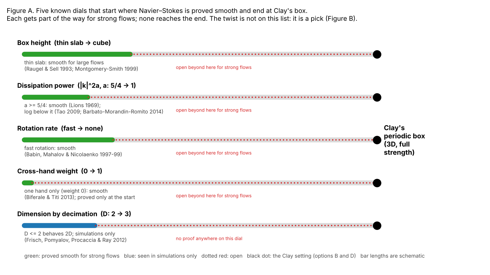
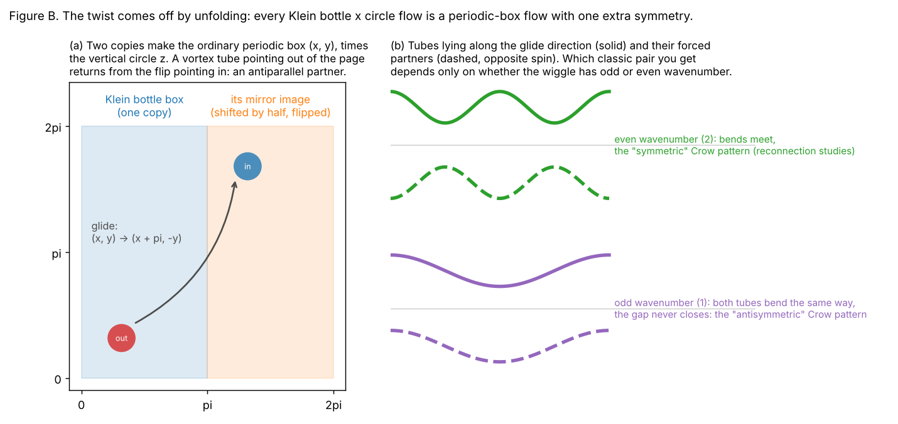
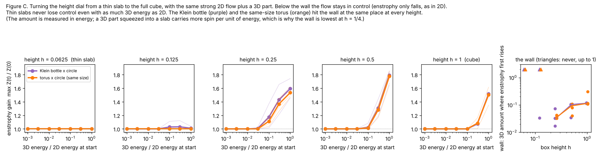
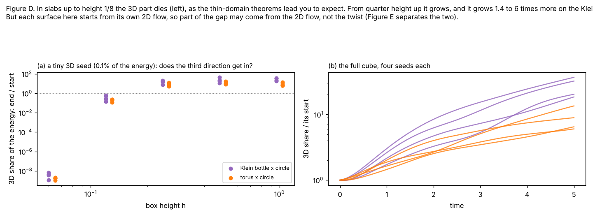
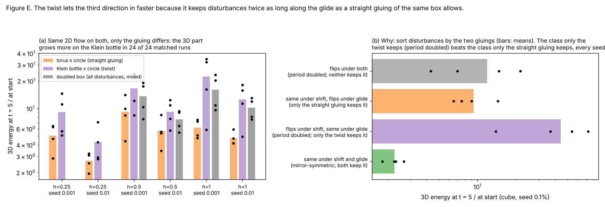

# DRAFT · Dialling the Klein bottle flow to Clay's periodic box

Nov 27, 2026. Asked for by Brennan, after the Klein bottle flow (`../README.md`): "Let's look at clay's periodic box and
see if that is something we can dial our way to", then "If so, maybe we can transform ours from the working space" and
"Does that make sense to you?"

Checks: `checks.py` → `checks_output.txt` (**11 of 11 pass**, numpy and scipy, about 12 minutes). Runs: `wall.py` (height scan), `wall.py … joint` (same 2D
flow on both gluings), `classes.py` (which disturbances grow). Pictures: `fig_concept.py`, `fig_scan.py`,
`fig_joint.py` → `figures/`. Lean: `lean/KleinBox.lean` (5 theorems). DRAFT: everything is known work unless marked
**ours**; the "ours" items are runs and readings, not theorems about Navier–Stokes.

## The result in plain words

**We can get from our working space to Clay's box, but only one way, and the twist is not the dial that matters.**

- The twist comes off exactly. Every flow on the Klein bottle times a circle is a periodic-box flow with one extra
  symmetry. So a blow-up found in our space would answer Clay's option D (breakdown in the periodic box), while a
  smoothness proof there would cover only the twisted flows, not option B.
- The dial that matters is dimension, here the height of the box. A thin slab is proved smooth even for strong flows
  (Raugel and Sell 1993); the full cube is the open problem. Turning the height from a thin slab to the full cube in 280
  runs, the twist does not move the place where the flow loses control.
- **ours:** the twist does one new thing. It lets the third direction in faster: with the very same 2D flow on both, a
  small 3D disturbance grows more on the Klein bottle than on the same-size torus in 24 of 24 matched runs, up to five
  times more in the cube. The cause is that the twist keeps disturbances twice as long along the glide, which a straight
  gluing of the same box throws away, and on these flows those period-doubled disturbances outgrow everything the
  straight gluing keeps.

## What this contributes, graded two ways

| | Verdict | Why |
|---|---|---|
| Worth following? | **Yes, as a search space for blow-up (option D), not as a proof route to smoothness** | The class is exact (Lean), costs half the doubled box, hard-wires antiparallel vortex pairs (section 1.2) and keeps period-doubled disturbances that outgrow those of the same-size torus (section 3). Every mirror-symmetric blow-up candidate, Kerr's antiparallel tubes among them, already sits inside it on a box doubled along the tubes. |
| Could it reach a proof? | **Only of option D, never of B** | A smooth answer for twisted flows says nothing about the rest. On the height dial the twist leaves the wall where it was, so it gives no better path for a smoothness proof. |
| What would make it a lead | A blow-up candidate resolved inside the twisted class (Hou–Luo-scale resolution, far beyond this page), or a proof that some class of flows the twist admits must break down. | |

## 1. Mapping the box onto the dials (fundamental)

*Figure A. Five known dials that start where Navier–Stokes is proved smooth and end at Clay's box. Green: proved
smooth for strong flows. Blue: seen in simulations only. Dotted red: open. Bar lengths are schematic. Each gets part of
the way; none reaches the end.*

### 1.1 The known dials (all known, with who proved what)

- **Box height (thin slab → cube).** Raugel and Sell, J. Amer. Math. Soc. 6 (1993) 503–568, "Navier–Stokes equations on
  thin 3D domains. I": global regularity on thin domains M × (0, ε) for large data, with a size condition that depends
  on ε. Montgomery-Smith (1999, arXiv:math/9811161) gave the periodic case with control "larger than that obtainable via
  small data estimates". At the full cube the allowed size shrinks to small data.
- **Dissipation power (|k|^2α, α from 5/4 down to 1).** α ≥ 5/4 is smooth in 3D (Lions 1969); Tao (Analysis & PDE 2009,
  arXiv:0906.3070) went a logarithm below; Barbato, Morandin and Romito (2014) proved Tao's sharper conjecture. Below
  that, down to ordinary viscosity α = 1, it is open.
- **Rotation rate (fast → none).** Babin, Mahalov and Nicolaenko (1997–99): regular solutions for all time on periodic
  domains when the rotation is fast enough for the data. Not checked against the original theorem statements here.
- **Cross-hand weight (0 → 1).** One-handed flow is smooth (Biferale and Titi 2013); already on `../../ns-same-shape/`.
- **Dimension by decimation (D from 2 to 3).** Frisch, Pomyalov, Procaccia and Ray, PRL 108 (2012) 074501: keep a random
  fraction of Fourier modes so the count grows like k^D. Simulations, not proofs.

### 1.2 Where the twist fits: a pick that unfolds one way

*Figure B. (a) Two copies of the Klein bottle box make the ordinary periodic box. A vortex tube pointing out of the page
comes back from the flip pointing in. (b) Tubes lying along the glide and their forced partners: odd wiggles give the
"antisymmetric" Crow pattern (both bend the same way), even wiggles the "symmetric" one (they bend toward each other,
the pattern used in reconnection studies).*

- The twist is a **pick, not a dial** (`../../shape-dials/` section 7): no number slides a torus into a Klein bottle.
  It cannot be turned to reach the box. It can only be unfolded.
- **Unfolding is exact.** The glide g(x, y, z) = (x + π, −y, z) done twice is the plain shift by 2π (Lean
  `glide_glide`), so the Klein bottle × circle is covered twice by a periodic box, and its flows are exactly the
  box flows that keep the glide (check P2: kept to 1e-15 for all time).
- **The partner spins the other way.** Vorticity is carried by det · D, and the glide's D = diag(1, −1, 1) has
  determinant −1 (Lean `glideLin_det`), so a tube along z or along x comes back reversed (`tube_z_flips`,
  `tube_x_flips`) and a tube along y keeps its sense (`tube_y_keeps`). In 2D this was the lone vortex: its partner is
  its own image. In 3D it means every tube has an antiparallel partner, the classic setup in blow-up searches (Kerr 1993;
  Hou and Li 2006; Bustamante and Kerr 2008).
- **Mirror-symmetric flows are inside.** A flow of period L along x that is symmetric under y → −y also keeps the glide
  on the box of length 2L (there the shift by L does nothing, so the glide acts as the mirror). That is elementary;
  **ours** as a remark: the twisted class contains every mirror-symmetric candidate, with no wall between the partners.
- 3D has ten closed flat manifolds, six orientable and four not (the Bieberbach classification); the Klein bottle ×
  circle is one of the four. Each is covered by a periodic box, so a blow-up on any of them is a periodic-box blow-up. I
  found no work on Navier–Stokes on the non-orientable ones by name (two searches).

## 2. Turning the height dial: thin slab to cube (ours, runs)

Setup: a strong 2D flow (energy 0.5, scales 2 to 4) plus a 3D part with a given share of energy, on boxes of height
h = 1/16, 1/8, 1/4, 1/2, 1 (h = 1 is the cube), viscosity 0.01, times up to 5, four seeds, both surfaces matched as in
the 2D page. In 2D the enstrophy (total spin squared) can only fall (check P4), so a rise means the third direction has
taken over from viscosity. "The wall" is the smallest 3D share at which the enstrophy rises. It is a measure of where
stretching first beats viscosity at this viscosity and time, not a blow-up.

*Figure C. Enstrophy gain against the 3D share, one panel per height, and the wall against height (right). Thin slabs
never lose control, even with as much 3D energy as 2D. The Klein bottle (purple) and the same-size torus (orange) hit
the wall at the same place at every height.*

- **Thin slabs stay 2D.** At h = 1/16 a 3D part as large as the 2D flow dies to a millionth of its share (check P7),
  and at h = 1/8 it still dies. This is the behaviour the thin-domain theorems describe.
- **The wall does not move with the twist.** At h = 1/4, 1/2 and 1 the Klein bottle and torus walls agree within the
  seed scatter (h = 1: 0.11 to 0.12 for both, one torus seed at 0.31).

*Figure D. A tiny 3D seed (0.1% of the energy). In slabs up to h = 1/8 it dies; from h = 1/4 up it grows, 1.4 to 6
times more on the Klein bottle (12 of 12 matched pairs). Each surface starts from its own 2D flow here; Figure E
removes that difference.*

## 3. Same 2D flow, only the gluing differs (ours, runs)

A 2D flow that keeps both the straight shift and the glide lives on both surfaces unchanged (check P5: identical to the
last digit). Starting both from it, only the allowed 3D disturbances differ.

*Figure E. (a) With the same 2D flow, the 3D part grows more on the Klein bottle in 24 of 24 matched runs (heights 1/4,
1/2, 1; seeds 0.1% and 1%). The doubled box, which allows every disturbance but starts them spread over all classes,
falls in between. (b) Sorting disturbances by how they behave under the two gluings. The class only the twist keeps
(period doubled: it flips under the straight shift) grows 14 to 72 times; the class only the straight gluing keeps grows
7 to 14 times; the larger one is the twist's in every seed. The mirror-symmetric class both keep barely grows (about 2).
The period-doubled class neither keeps grows 4 to 21 times.*

Reading (**ours**): the glide's square is the full 2π shift, so along the glide the Klein bottle box behaves like a box
twice as long, for half the modes. The 2D page found the same count (three lowest modes on the Klein bottle against
two on the same-size torus). In 3D it means the twist admits long, period-doubled disturbances, and on these flows they
outgrow everything the straight gluing allows. Subharmonic (period-doubling) instabilities being the strongest is a familiar pattern in shear flows
(vortex pairing in mixing layers); what is ours is only that the non-orientable gluing selects them.

## 4. Known and ours

| Item | Status |
|---|---|
| Klein bottle × circle flows are periodic-box flows with a glide symmetry | elementary; Lean here |
| Tubes come in antiparallel pairs across the twist | elementary (pseudovector rule); Lean here |
| Thin domains smooth for large data | known (Raugel–Sell 1993; Montgomery-Smith 1999) |
| Hyperdissipation, rotation, one-handed, decimation dials | known (Lions; Tao; Barbato–Morandin–Romito; Babin–Mahalov–Nicolaenko; Biferale–Titi; Frisch et al.) |
| Mirror-symmetric candidates sit in the twisted class on a doubled box | elementary; **ours** as a remark |
| Twist leaves the height-dial wall in place | **ours** (runs, 4 seeds, one viscosity) |
| Twist lets 3D in faster on the same 2D flow; cause is period-doubled disturbances | **ours** (runs, 24 of 24 plus the class split) |
| Navier–Stokes on non-orientable flat 3-manifolds by name | not found (two searches) |

## 5. Quantum gravity, Navier–Stokes, dials and Mathlib

- **Navier–Stokes (Millennium).** Section "graded two ways" above: a free, exact search space for option D, no route to
  option B.
- **Quantum gravity.** The period-doubled modes are the fluid version of a twisted sector: on an orbifold or with
  antiperiodic boundary conditions, the twisted sector carries half-integer momenta. That is standard in string theory
  and finite-temperature field theory, so it adds a picture, not a lead.
- **Dials.** The twist is a pick; box height is a size and aspect setting, which `../../shape-dials/` section 7.2
  already counts as no new dial; dimension is the informal dimension dial D. The dissipation power α is an exponent on
  the energy-loss density, the same kind of number as the flux exponent s; whether that match is more than a likeness is
  untested here. No new dial is proposed.
- **Mathlib.** `Matrix.det_diagonal`, `Matrix.mulVec_diagonal` and `Fin.prod_univ_three` carry the Lean file. Mathlib
  has no Navier–Stokes, so nothing deeper can be borrowed there yet.

## 6. Method and checks

Pseudo-spectral velocity form (u × ω with Leray projection), 2/3 dealiasing, integrating-factor RK4 for viscosity, CFL
step summed over directions, N = 64 across and 16 to 64 in height (`flow3d.py`). The twist is imposed by projecting the
initial field and is then kept by the equations.

| Check | What | Result |
|---|---|---|
| P1-K | inviscid energy kept (Klein) | PASS: inviscid energy drift over 40 steps = 2.3e-10 |
| P1-TR | inviscid energy kept (torus) | PASS: inviscid energy drift over 40 steps = 2.5e-10 |
| P2 | twist kept by the equations | PASS: glide defect after t = 2: 1.5e-15 |
| P3 | glide twice = identity on the grid | PASS: glide(glide(f)) == f on the grid |
| P4-K | pure 2D: enstrophy never rises (Klein) | PASS: 2D enstrophy monotone, gain 1.000000 |
| P4-TR | pure 2D: enstrophy never rises (torus) | PASS: 2D enstrophy monotone, gain 1.000000 |
| P5 | shared 2D flow identical on both | PASS: max |base_K - base_TR| = 0.0e+00 |
| P6 | divergence-free | PASS: max |k.u| / max |u| = 7.1e-17 |
| P7 | thin slab kills a large 3D part | PASS: h = 1/16, a = 1: 3D share 0.50 -> 2.5e-06, gain 1.000 |
| P8 | finer grid: enstrophy gain (cube, strong 3D) | PASS: cube, a = 1, t <= 2.5: gain 1.5042 (N=64) vs 1.5036 (N=96), diff 0.04% (238s) |
| P9 | finer grid: 3D growth (cube, small seed) | PASS: cube, small seed: 3D growth 32.098 (N=64) vs 32.051 (N=96) |

## Files

- `flow3d.py` solver; `wall.py` height scan and shared-flow runs; `classes.py` disturbance classes; `analyse.py`.
- `fig_concept.py`, `fig_scan.py`, `fig_joint.py` → `figures/figA` to `figE`.
- `checks.py` → `checks_output.txt`, `checks_results.json`.
- `lean/KleinBox.lean`: `glide_glide`, `glideLin_det`, `tube_z_flips`, `tube_x_flips`, `tube_y_keeps`.
- Run data (`runs/`) is not committed; every number above is regenerated by the scripts.
