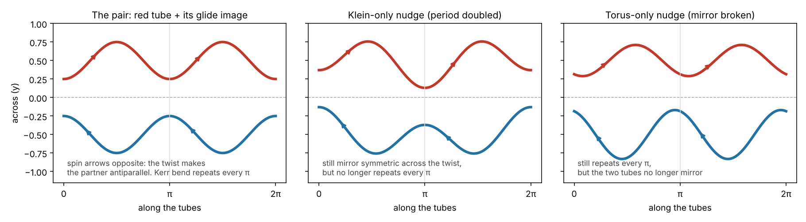
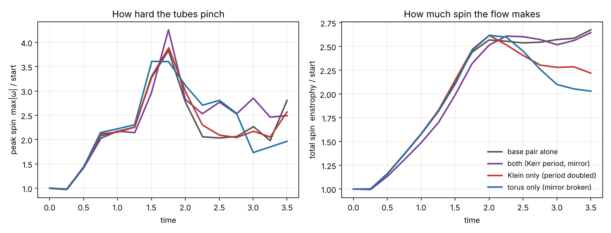
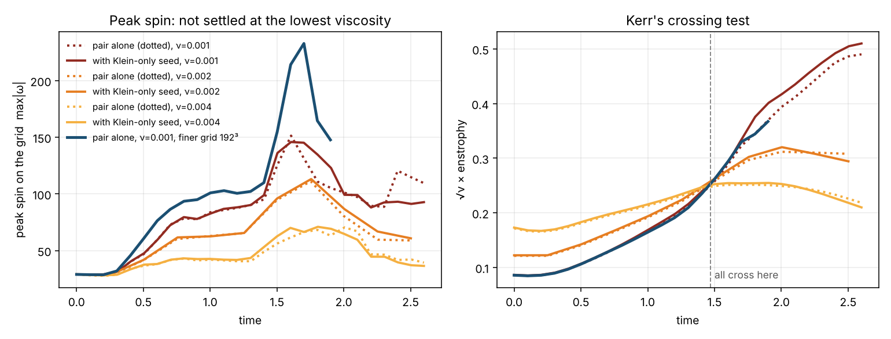

# DRAFT · Hunting for blow-up inside the twisted class

Nov 27, 2026. Asked for by Brennan, after the periodic-box round (`../README.md`): "And you said it could used for a
blow up proofso let's explore that as well". (The earlier round said the twisted class is a place to *search* for
blow-up, Clay's option D; it never offered a proof. This round runs that search on the best-known candidate.)

Checks: `checks_blowup.py` → `checks_blowup_output.txt` (**8 of 8 pass, 1 open**: B9, whether peak spin is settled between grids, is marked OPEN until the 256³ run decides it). Runs: `tubes.py` (one run), `batch.sh`,
`batch2.sh`. Pictures: `fig_pair.py`, `fig_classes.py`, `fig_nu.py` → `../figures/figF…figH`. DRAFT: everything is
known work unless marked **ours**; the "ours" items are runs, not theorems.

## The result in plain words

**The twist doesn't help the leading blow-up candidate. Inside the twisted class it pinches and then relaxes, the same
way it does in the plain box.**

- Kerr's antiparallel vortex tubes, the classic blow-up candidate, sit inside the twisted class exactly: one tube plus
  its glide image is an antiparallel pair (Figure F).
- **ours:** run inside the class at viscosity 0.002, the pair pinches to about four times its starting spin on the 128³ grid, peaks, and turns over. The
  nudges only the twist allows (period doubled along the tubes) move the peak by 0 to 2% in 3 of 3 seeds. Nudges only
  the plain torus allows move it by −6% to +12%.
- **ours:** across three viscosities, the curves of √viscosity × total spin all cross at one time (t ≈ 1.5), on both
  grids. That crossing is the signature Kerr (2018) found for vortex reconnection that does *not* blow up, and it shows
  up here with or without the twist.
- **One thing stays open.** At the lowest viscosity the peak spin read off the grid is not settled: 151 on the 128³
  grid, 233 on the 192³ grid, because the pinch gets thinner than the coarse grid can see. Total spin agrees on the two
  grids to 2%. So the verdict rests on total spin, and the peak itself needs a finer grid before anyone leans on it.

## What this contributes, graded two ways

| | Verdict | Why |
|---|---|---|
| Worth following? | **Not this candidate, as far as these grids can tell.** The twisted class stays a fair place to search, but antiparallel tubes are now tested there and look regular. | The twist's own disturbances do nothing to the pinch (Figure G), and total spin shows Kerr's convergent, non-singular crossing on two grids (Figure H), agreeing with Hou and Li's much larger runs of Kerr's data. The unsettled peak at the lowest viscosity is the one loose end. |
| Could it reach a proof? | **No.** | The one working route to a blow-up proof is computer-assisted: find a self-similar collapsing profile, then prove it stable (Chen and Hou, Euler with a boundary). Nothing here shows a collapsing profile, so there is none to prove. |
| What would make it a lead | A flow in the twisted class whose peak spin keeps speeding up as viscosity shrinks, settled on two grids, with the twist's own disturbances doing the work. The nearest check: rerun viscosity 0.001 on a 256³ grid and see whether the peak keeps climbing past 233. | |

What each piece contributes:

- **The pair as tube + image (fundamental, small):** a clean way to see that every mirror-symmetric antiparallel
  setup is a Klein-bottle-times-circle flow on a box doubled along the tubes. Known in substance (Kerr's runs use
  mirror symmetry), new only in the Klein-bottle wording.
- **The period-doubled nudge test (ours):** symmetry-reduced runs of Kerr's setup fix the bend's period along the
  tubes, so they cannot see disturbances twice as long (my reading of how those domains are set up, not checked
  against the original papers). The twisted class keeps exactly those, and at this resolution they don't matter.
- **The viscosity sweep (ours, reproduces known):** Kerr's crossing appears inside the class. It is a consistency
  check, not a discovery.

## 1. The pair is one tube and its glide image

*Figure F. Top view, x along the tubes. Left: the red tube and its glide image (shift by π, flip y). Spin is a
pseudovector, so the image tube spins the other way: the twist makes the partner antiparallel. Kerr's bend repeats
every π, so the pair is also kept by the straight shift and lies in both classes. Middle: a nudge only the Klein
bottle keeps; it stays mirror symmetric across the twist but repeats only every 2π. Right: a nudge only the torus
keeps; it repeats every π but breaks the mirror.*

Setup (`tubes.py`): cube of side 2π, two x-directed Gaussian tubes, circulation 8, core radius 0.3, half-gap 0.5,
bend amplitude 0.25 at wavenumber 2 (Kerr's symmetric bend toward each other). A random 3D nudge with 1% of the
pair's energy is projected into one of four classes by the straight shift τ and the glide g:

| Class | Kept by | Flow lives on |
|---|---|---|
| (τ−, g+) "Klein only" | glide, not shift | Klein bottle × circle |
| (τ+, g−) "torus only" | shift, not glide | torus × circle |
| (τ+, g+) "both" | both | either |
| none | — | either (pair alone) |

## 2. The twist's nudges don't change the pinch

*Figure G. Peak spin (left) and total spin (right) over time, viscosity 0.002, grid 128³, seed 0. Every class pinches
to about 4× and turns over near t = 1.75. Peak spin here is a same-grid reading, good for comparing classes, not an
exact value (section 3).*

| Peak spin (start 29) | seed 0 | seed 1 | seed 2 |
|---|---|---|---|
| pair alone | 111.2 | | |
| Klein-only nudge | 113.2 | 112.7 | 111.1 |
| torus-only nudge | 104.8 | 124.3 | 116.7 |
| both | 123.2 | | |

Total spin peaks at 2.6–2.7× in every run. Seed 0 was sampled every 0.25 time units, seeds 1 and 2 every 0.1, so
seed 0's peaks may read slightly low.

## 3. Viscosity sweep: the known non-blow-up pattern

*Figure H. Left: peak spin for viscosity 0.004, 0.002, 0.001, pair alone (dotted) and with the Klein-only nudge
(solid), and the finer 192³ grid at 0.001 (blue). Right: Kerr's test, √viscosity × total spin. The right curves all
cross near t = 1.47, Kerr's signature of a finite, viscosity-independent reconnection event, and the finer grid sits on
the coarse one. On the left the finer grid reads a much higher peak, 233 against 151: the peak is not settled.*

Resolution: at viscosity 0.004 and 0.002 the outer shell of the 128³ grid holds under 0.5% of the energy. At 0.001
it holds 1.8%, so that run was repeated on 192³ (outer shell 0.2%, 88 minutes): total spin agrees with 128³ to 2.2% at
every time, but peak spin on the grid does not. Check B9 records this as an open question, not a pass or a fail: a
256³ run is under way and will decide it. Until then, read the left panel's 0.001 curves as lower bounds.

## 4. Known and ours

| Piece | Status | Who |
|---|---|---|
| Kerr's antiparallel tubes suggested blow-up | known | Kerr, Phys. Fluids A 5 (1993) |
| Same data at up to 1536×1024×3072: no blow-up to t = 19; peak vorticity at most double exponential | known | Hou and Li, J. Nonlinear Sci. 16 (2006), [math-ph/0602051](https://arxiv.org/abs/math-ph/0602051) |
| √ν·Z crossing at a ν-independent time in reconnection; flows not singular | known | Kerr, J. Fluid Mech. (2018), [1610.00398](https://arxiv.org/abs/1610.00398) |
| Computer-assisted proof of Euler blow-up with smooth data and a boundary (axisymmetric) | known | Chen and Hou, PNAS (2025) |
| Numerical potential singularity for axisymmetric Navier–Stokes | known, numerical | Hou, Found. Comput. Math. (2022), [2107.06509](https://arxiv.org/abs/2107.06509) |
| Antiparallel pair = tube + glide image; inside K × S¹ | ours (wording) | this page |
| Klein-only nudges move the peak 0–2%; sweep shows the crossing inside the class | ours (runs) | this page |

## 5. Method and checks

Same solver as the periodic-box round (`../flow3d.py`: pseudo-spectral, 2/3 dealiasing, integrating-factor RK4, CFL
0.8). Runs are on the full cover with the class kept exactly by the initial data (check B3 confirms it to round-off
at the end of every run).

| Check | Result | Detail |
|---|---|---|
| B1 pair is in both the Klein and torus classes | pass | glide defect 2.6e-16, shift defect 5.7e-16 |
| B2 Klein-only seed keeps the glide, breaks the shift; torus-only the reverse | pass | K-only (2.1e-16, 0.07), TR-only (0.08, 5.7e-16) |
| B3 every run stays in its class to the end | pass | end defects 5e-14, 1e-14, 3e-14, 4e-14, 3e-14, 3e-14 |
| B4 energy never rises in any run | pass | largest step-to-step rise 0.0e+00 of start |
| B5 nu=0.002 runs resolved at N=128 | pass | outer-shell energy 4.1e-03 |
| B6 nu=0.001: N=128 and N=192 agree on total spin (enstrophy) within 5% at every time | pass | largest gap 2.2%, N=192 outer shell 1.9e-03 |
| B9 nu=0.001: is peak spin settled between grids? | **open** | peak spin not settled, 151.5 at 128 vs 232.8 at 192; the 256 run will decide |
| B7 Kerr crossing: the three viscosities meet at one time | pass | spread 2.1% at t = 1.46 |
| B8 same seed gives the same run | pass | peak 26.9567382447 twice |

## Files

`tubes.py` (setup and one run), `batch.sh`, `batch2.sh` (the runs; call with `bash`), `fig_pair.py`, `fig_classes.py`,
`fig_nu.py`, `checks_blowup.py`. Run data in `runs/` (not committed).
