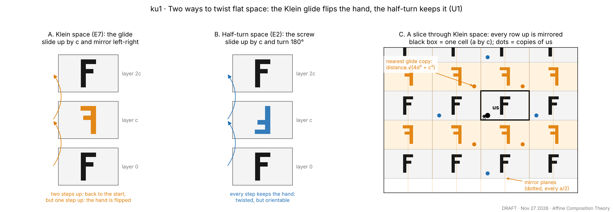
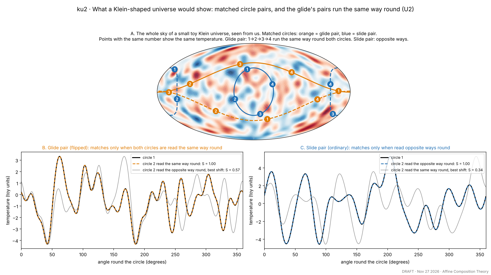
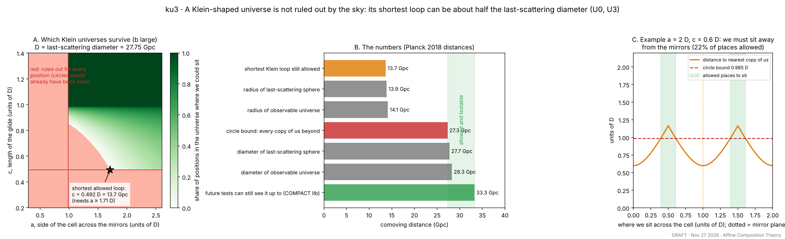
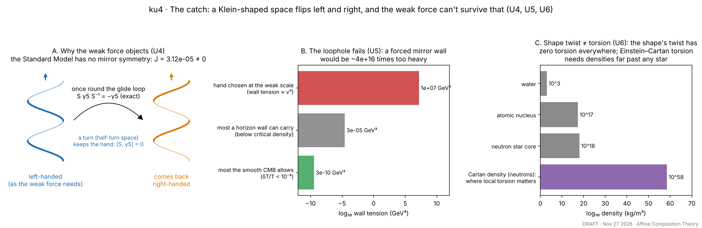
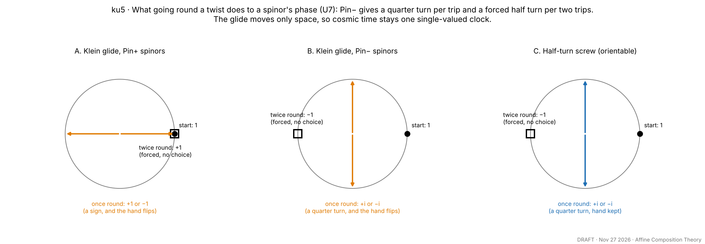

# DRAFT · Is space itself shaped like a Klein bottle, or twisted at all?

**DRAFT, Nov 27 2026. Not versioned, not proved in Lean.** Part of Affine Composition Theory. Asked for by Brennan:
"Did we determine if reality was really a Klein bottle?" / "This is my hypothesis that I want to check". On a call the same
evening he widened it to any twist of space, "Whether it's a Klein bottle or something else ... or a torsion to space ... that
kind of explains why everything doesn't fit together quite the way we think", and asked to tie it to "this one clock", time itself.

Checks: [`checks.py`](checks.py) → [`checks_output.txt`](checks_output.txt), **8 of 8 pass** (about 2 s; numpy, plus sympy for the
exact spinor algebra), results in [`results.json`](results.json). Pictures: [`figures.py`](figures.py) → [`figures/`](figures/)
ku1 to ku5. Colour key: **orange = the Klein glide (flips left and right); blue = slides and the half-turn (keep left and right);
green = allowed; red = ruled out; grey = reference; purple = Einstein–Cartan torsion.**

Follows [`klein-flow/`](../klein-flow/README.md) (a twist in a fluid's space), [`torsion-dial/`](../torsion-dial/README.md)
(torsion is derived), round 32 (the law is its own mirror) and round 33 (the weak force's one-handed pattern). None of those asked
whether the space we live in has a twisted shape.

## Verdict first

**Probably not a Klein bottle. The sky still allows one, but the weak force doesn't.**

1. **The sky allows it, if it is big enough (U0, U3; Vaudrevange et al. 2012, COMPACT 2023).**
   - A shape like this shows up as pairs of circles in the microwave sky with the same pattern on both. None are seen above 10° across,
     reading the pairs both ways round. So every copy of us must be farther than **0.985 × the last-scattering diameter = 27.3 Gpc**.
   - Klein space looks different from different places. If we sit away from its mirror planes, its shortest loop can be as short as
     **13.7 Gpc, about half that diameter**, and still hide from the circle searches.
   - Between 27.3 and about 33.3 Gpc for the nearest copy, a Klein-shaped universe is both allowed today and testable by the newer
     correlation methods (COMPACT, Part IIb).
2. **A Klein bottle flips left and right, and the weak force can't survive that (U4).**
   - Going once round the Klein loop turns a left-handed particle into a right-handed one (exact: the mirror's spinor map
     anticommutes with γ5). The weak force acts only on left-handed particles.
   - So the laws of physics would have to be unchanged by a mirror. They aren't: the weak force breaks mirror symmetry outright, and
     the Standard Model also breaks CP. The Jarlskog invariant, J = 3.1 × 10⁻⁵, doesn't depend on how the quarks are labelled, so
     no relabelling rescues it.
   - This is the long-standing reason cosmologists assume space is orientable (Zel'dovich and Novikov; Hawking and Ellis 1973).
3. **The one loophole fails too (U5).** If a field chose the hand, a Klein universe would need a wall somewhere where the field flips
   to its mirror. A wall from the weak scale or above would be **about 4 × 10¹⁶ times too heavy** for the smooth microwave sky
   (Zel'dovich, Kobzarev and Okun 1974). It could hide only beyond our horizon, and then the twist would be invisible too.
4. **Twists that keep left and right are still open.** The half-turn, quarter-turn, third-turn and sixth-turn spaces and the
   Hantzsche–Wendt space are all twisted, flat and orientable (ku1 B). They face no weak-force problem, and the same circle limits
   apply. COMPACT Part I found that their shortest loop can be 2 to at least 6 times shorter than the last-scattering diameter when
   it misses us. **If space is twisted, these are the shapes to bet on.**
5. **The law neither prefers nor forbids a mirror twist (round 32).** The law's sum reads the same backwards, so gluing space with a
   mirror is a symmetry of the law. What forbids the Klein bottle is the matter, not the law.
6. **A twist of the shape is not torsion (U1, U6).** A twisted shape has zero curvature and zero torsion at every point. Its twist
   shows only in what happens to things carried all the way round the universe. Einstein–Cartan torsion is a separate, local field
   tied to spin. It is zero in empty space and matters only near 3 × 10⁵⁸ kg/m³, about 10⁴⁰ times a neutron star's core. The
   repo's torsion is derived (`torsion-dial/`), and neither the law nor the shape adds torsion to empty space.
7. **For the one clock: a twist gives spinors a phase, but it doesn't touch time (U7).**
   - On Klein space, spinors come in two kinds, Pin+ and Pin−, each in 8 versions.
   - Going once round the twist multiplies a Pin+ spinor by ±1 and a Pin− spinor by ±i, a quarter turn of phase. Going twice round
     gives +1 for Pin+ and **−1 for Pin−, forced**, a half turn.
   - The half-turn space gives ±i once round and −1 twice round as well. That is the ordinary sign of a 360° turn.
   - The Klein glide moves only space, so cosmic time stays one single-valued clock. Twisting time itself would make a spacetime
     with no global arrow of time, which the same CP argument and the thermodynamic arrow both rule against.

**Does this open a lead?**
- **No new lead for the theory, on its own merits.** A Klein-bottle shape fails on physics the theory doesn't change: the weak force
  is one-handed and CP is broken. Every check here is textbook geometry, published sky limits and measured particle numbers.
- **Does any twist explain why things don't fit?** Not the gaps this program is chasing. A shape twist is invisible at every point, so
  it can't touch the Hubble tension or the clash between quantum theory and gravity. Near the horizon scale, an orientable twisted
  shape is a known, live candidate for the microwave sky's large-angle oddities: the weak largest-scale signal and a mild
  odd–even preference. COMPACT (Part IIIa) showed a shape can make parity-odd sky patterns without parity-breaking physics. That is
  real and testable, but it is COMPACT's programme, it doesn't need this theory, and this round doesn't compute those spectra.
- **What is ours:** the worked size window for the simplest Klein space, with the factor-of-two off-mirror loophole drawn out (U3,
  ku3). Also the toy sky that shows the glide's circles matching the same way round (U2, ku2), and the one-page tie between the law's
  mirror symmetry, the weak force's hand and the shape. None of it is a new theorem.
- **For the clock thread:** Pin− gives ±i per trip round a Klein twist and a forced −1 per two trips. The half-turn screw gives the same
  ±i and −1. That is a phase structure on space, not a clock: cosmic time is untouched.

*ku1 · Two ways to twist flat space. A: Klein space. Each step up by c mirrors left and right (orange F). Two steps bring you back as
you were, but one step flips the hand. B: the half-turn space. Each step up turns everything 180° (blue). That is twisted, but the
hand is kept, so the space is orientable. C: a slice through Klein space. Every row up is mirrored. The black box is one cell, and
the dots are copies of us: blue ones from plain slides, orange ones from the glide. The nearest glide copy is √(4d² + c²) away, where
d is our distance from the nearest mirror plane (dotted). (U1)*

*ku2 · What a Klein-shaped universe would show, as a toy (deliberately small so the circles are big). A: the whole sky seen from us,
with a random pattern built to respect the gluing. Each matched pair of circles carries the same pattern. Numbered points show the
same temperature. On the glide pair (orange) 1→2→3→4 run the same way round both circles. On the slide pair (blue) they run opposite
ways. B: the glide pair matches perfectly (S = 1.00) only when both circles are read the same way round. Read opposite ways it
reaches only S = 0.57 at the best shift. C: the slide pair is the other way about (S = 1.00 against 0.34). The circle searches test
both readings (Cornish et al. 2004; Vaudrevange et al. 2012), and neither turned anything up. (U2)*

*ku3 · How small a Klein-shaped universe can be (in units of D = 27.75 Gpc, the last-scattering diameter). A: which cell shapes
survive, with the third side b large. Red: ruled out wherever we sit. Green: the share of places in the universe where we could sit
without circles having been seen. The star is the shortest allowed loop, c = 0.4925 D = 13.7 Gpc, which needs the cell to be at
least 1.71 D = 47 Gpc across the mirrors. B: the distances in Gpc from Planck 2018. Shaded green is the window that is allowed today
and testable by correlation methods (nearest copy 27.3 to 33.3 Gpc). C: one example, a = 2 D and c = 0.6 D. Near a mirror plane our
glide copy is too close, so we must sit in the green bands, 22% of the universe. (U0, U3)*

*ku4 · The catch. A: once round the Klein loop, a left-handed particle comes back right-handed (exact). A turn, as in the half-turn
space, keeps the hand. B: the loophole. A hand chosen by a field forces a mirror wall, and a wall from the weak scale would outweigh
what the smooth microwave sky allows by about 4 × 10¹⁶. C: shape twist against torsion. The shape's twist has no local torsion at
all. Einstein–Cartan torsion matters only at the Cartan density, about 10⁵⁸ kg/m³, far past any star. (U4, U5, U6)*

*ku5 · What going round a twist does to a spinor's phase. A: Klein glide with Pin+ spinors. Once round gives a sign, ±1, and flips the
hand. Twice round gives +1. B: Klein glide with Pin− spinors. Once round gives a quarter turn, ±i. Twice round gives −1, forced. C:
the half-turn screw. Once round gives ±i with the hand kept. Twice round gives −1, the ordinary sign of a 360° turn. The glide moves
only space, so cosmic time stays one single-valued clock. (U7)*

## What the checks show

| Check | What it tests | Result |
|---|---|---|
| U0 | Distances from Planck 2018 ΛCDM | Last-scattering sphere 13.87 Gpc away from Planck's measured angle (13.87 by integration too), diameter D = 27.75 Gpc; observable universe radius 14.15 Gpc. Circle bound 0.985 D = 27.33 Gpc (cos 10° = 0.985). |
| U1 | Klein space E7 and half-turn space E2, exact | 377 group elements each up to word length 6, none with a fixed point. E7 has 182 orientation-reversing ones, each sliding an odd multiple of c, and its orientable double cover is a 3-torus (a, b, 2c). E2 has none. Both flat: zero curvature and torsion everywhere. |
| U2 | Matched circles in a toy sky | A random field respecting each gluing (988 modes, gluing error 4 × 10⁻¹⁴). Glide pair: S = 1.000 read the same way round, 0.567 read opposite ways. Slide pair: 1.000 opposite, 0.345 same. Half-turn pair: 1.000 opposite, 0.693 same. |
| U3 | Size window | Nearest copy = min(a, b, 2c, √(4d² + c²)), matched by brute force to 10⁻¹⁶. Shortest loop can be 0.4925 D = 13.7 Gpc, needing a ≥ 1.706 D = 47.3 Gpc. |
| U4 | Handedness, exact plus measured | For every mirror, S = γᵢγ5 represents it and S γ5 S⁻¹ = −γ5; every rotation commutes with γ5. J = 3.116 × 10⁻⁵ from PDG 2024 Wolfenstein parameters. |
| U5 | Mirror wall | Tension limits ≈ (29 MeV)³ from the critical density and ≈ (0.70 MeV)³ from the smooth sky; weak-scale v³ = 1.5 × 10⁷ GeV³, about 4 × 10¹⁶ times too heavy. Order of magnitude. |
| U6 | Shape twist against torsion | Cartan density for neutrons m/(λ_C l_P²) = 3.1 × 10⁵⁸ kg/m³, 3 × 10⁴⁰ times a neutron star's core. Lab bound on background torsion near 10⁻³¹ GeV. Order of magnitude. |
| U7 | Spinors on the twisted spaces, exact | Two lifts of one mirror, squaring to +1 and −1 (Pin+, Pin−). 8 sign choices each satisfy E7's gluing rules. Glide once round: ±1 (Pin+) or ±i (Pin−); twice: +1 or −1, forced. Half-turn: ±i once, −1 twice. |

## Who found what

- **Matched circles:** Cornish, Spergel and Starkman 1998 proposed the method. Cornish, Spergel, Starkman and Komatsu 2004 (Phys. Rev.
  Lett. 92, 201302) searched back-to-back pairs both ways round in WMAP: nothing, so the topology scale is above 24 Gpc. Vaudrevange,
  Starkman, Cornish and Spergel 2012 (Phys. Rev. D 86, 083526) searched all pairs from 10° to 90°, running the search once for
  orientable and once for non-orientable shapes: nothing, so the shortest loop through us is longer than 98.5% of the
  last-scattering diameter.
- **Planck 2015 XVIII** (A&A 594, A18): no topology smaller than the last-scattering sphere; the largest ball that fits in the cell has
  radius above 0.97 times the last-scattering distance for the cubic 3-torus and above 0.56 for the slab.
- **COMPACT collaboration:** Petersen et al. 2023 (JCAP 01, 030, Part I) found that in all but the simplest orientable flat shapes the
  shortest loop can miss us and be 2 to at least 6 times shorter than the last-scattering diameter. Akrami et al. 2024 (Phys. Rev.
  Lett. 132, 171501) argued that the space of allowed shapes is far from searched. Samandar et al. 2024 (JCAP 11, 020, Part IIIa) showed
  that topology can make parity-odd microwave patterns without parity-breaking physics. Copi et al. 2025 (arXiv:2510.05030, Part IIb)
  covered the non-orientable flat shapes E7, E10, E13, E15 and E17, which may be detectable if the nearest copy is under about 1.2
  last-scattering diameters.
- **Orientability from particle physics:** the argument that CP violation, seen first in kaons in 1964, implies orientable spacetime is
  attributed to Zel'dovich and Novikov and to Hawking and Ellis 1973. It is reviewed in Lachièze-Rey and Luminet's *Cosmic Topology*
  (gr-qc/9605010). I found it through secondary sources, not the original texts. A theory can live on an unorientable spacetime only
  if it has a time-reversal (equivalently, mirror) symmetry; see Witten's 2016 review of fermion path integrals.
- **Walls:** Zel'dovich, Kobzarev and Okun 1974. **Torsion:** Hehl, von der Heyde, Kerlick and Nester 1976 (the Cartan density);
  Kostelecký, Russell and Tasson 2008 (Phys. Rev. Lett. 100, 111102; lab bounds near 10⁻³¹ GeV). **Pin structures:** Kirby and Taylor
  1990; Berg, DeWitt-Morette, Gwo and Kriele 2001 for the physics conventions.

## Limits of this round

- It uses the simplest, right-angled member of the Klein space family. COMPACT's general E7 has more shape parameters, and the exact
  numbers in U3 can move with them.
- The 98.5% circle bound is from WMAP-era searches restated by COMPACT with Planck. Planck's own circle bound quoted above is for the
  cubic 3-torus.
- U2's sky is a toy: a random pattern with the right symmetry, not a real microwave-background simulation.
- U5 and U6 are order-of-magnitude estimates.
- Which sign convention counts as Pin+ and which as Pin− varies between authors. The physical fact is that there are two kinds,
  differing by whether the mirror's spinor map squares to +1 or −1.
- The large-angle sky oddities are not computed here.
