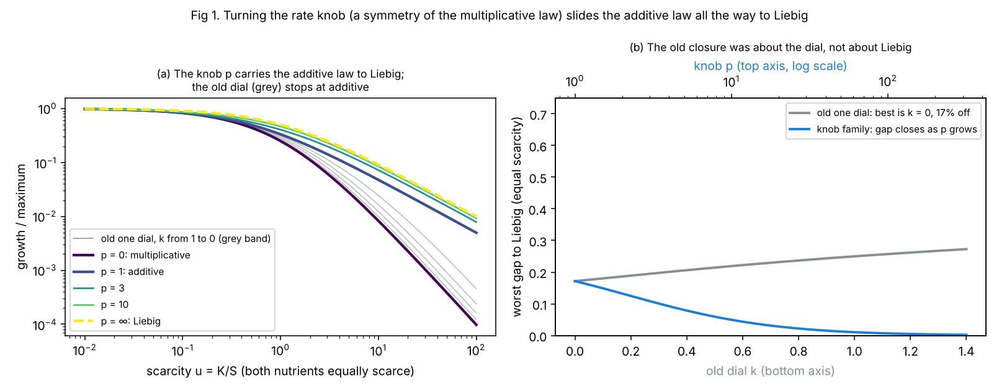
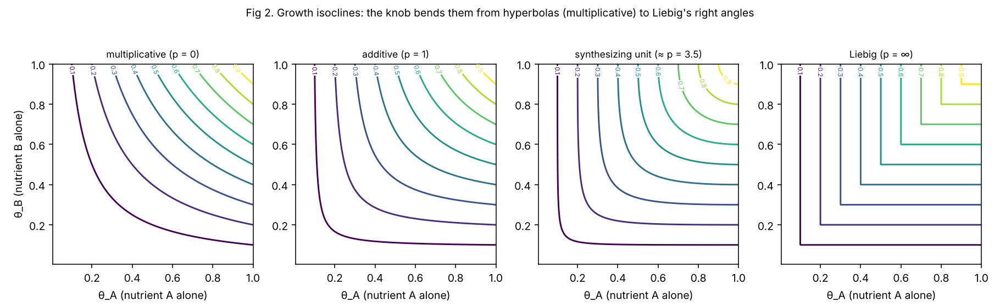
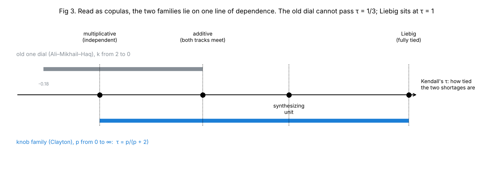
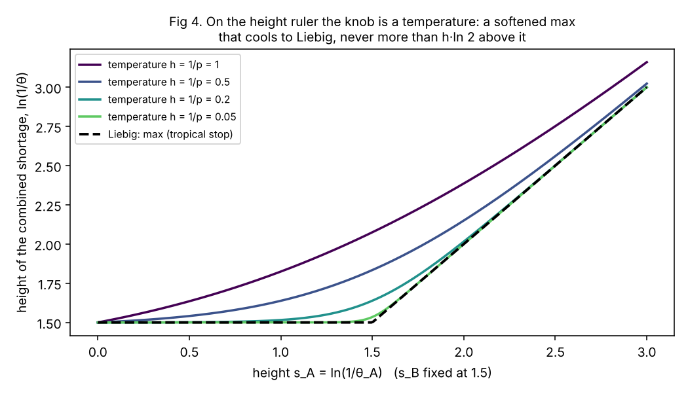

# Liebig's law of the minimum: a stop at the end of one knob (DRAFT)

**Result in one sentence:** yes, Liebig's minimum is a stop. Turn one knob we already have, the rate knob that
leaves the multiplicative law unchanged, and the additive growth law slides all the way to Liebig. The old closure
was right that the one dial can't reach Liebig, but that was a limit of the dial, not of the theory.

Status: DRAFT, not reviewed, not published. Follows lead R5 in `../closed-leads-revisit/README.md`. Reopens the
closure in `../biology/02-metabolism/` ("Liebig is provably off the dial; best k = 0 misses by 17%").

## The question in plain words

One nutrient on its own lets a cell grow at a fraction θ = 1/(1 + u) of its maximum, where u = K/S is the scarcity
(Monod). With two scarce nutrients there are three classic answers:

- **multiplicative:** θ = θ_A·θ_B (our ∘₁, old dial k = 1)
- **additive:** 1/θ = 1/θ_A + 1/θ_B − 1 (old dial k = 0)
- **Liebig:** θ = min(θ_A, θ_B), the scarcer nutrient alone sets the pace

The old page put the first two on the one dial 1/θ = 1 + u_A + u_B + k·u_A·u_B and showed no k gives Liebig. The lead
said Liebig belongs on the *paired-sum* side as a tropical (Maslov) limit. The test: build that side concretely and
see whether it really ends at Liebig.

## Fig 1. One knob carries the additive law to Liebig

- The **rate knob** G_p(u) = (1 + u)^p − 1 is a symmetry of the multiplicative law: G_p(x ∘₁ y) = G_p(x) ∘₁ G_p(y).
  It is the same kind of knob the bath page found ("turning a knob changes the clock's rate, it commutes with ∘").
- Use it to move the additive law: u = G_p⁻¹(G_p(u_A) + G_p(u_B)). That gives one family,
  θ = (θ_A^(−p) + θ_B^(−p) − 1)^(−1/p), and it holds all three classic laws: **p → 0 multiplicative, p = 1 additive,
  p → ∞ Liebig**.
- Panel (b): the old dial's best miss is the 17% at k = 0, exactly where the new family starts (p = 1). From there the
  gap closes: 11% at p = 3, 5% at p = 10, under 1% at p = 100.

## Fig 2. What it looks like to an ecologist

Growth isoclines: lines of equal growth over the two single-nutrient fractions. Multiplicative gives smooth
hyperbolas; Liebig gives right angles (more of the plentiful nutrient does nothing). The knob bends one into the other.
Kooijman's **synthesizing unit** (the co-limitation rule of Dynamic Energy Budget theory) sits between additive and
Liebig: the knob setting p ≈ 3.5 matches it to within 0.024, while the old dial gets no closer than 0.072.

## Fig 3. Read as copulas, both families lie on one line

Growth fractions live between 0 and 1 and combine like a joint probability, so each law is a **copula** (a standard
way to tie two chances together). Read that way, both families have existing names:

- the old one dial is exactly the **Ali–Mikhail–Haq** copula, with α = 1 − k;
- the knob family is exactly the **Clayton** copula, with parameter p.

Kendall's τ measures how tied the two shortages are. Multiplicative is independent (τ = 0) and Liebig is fully tied
(τ = 1). Ali–Mikhail–Haq is known to stop at τ = 1/3, which is the additive law, and that is the precise reason the
old dial could never reach Liebig. Clayton runs τ = p/(p + 2) from 0 to 1, and the two families meet at the additive law.

Cross-link to the last lead (`../where-k-moves/`): Clayton is the gamma-frailty law, and its p = 1 member, here the
additive law, is the exponential frailty that touches the parabola on the plane dial.

## Fig 4. On the height ruler the knob is a temperature

On the height ruler s = ln(1/θ), the family becomes h·ln(e^(s_A/h) + e^(s_B/h) − 1) with temperature h = 1/p: a
softened maximum, never more than h·ln 2 above max(s_A, s_B), that cools to it. That is Maslov dequantization, so
Liebig is the **tropical stop** of the knob, as the lead guessed. One correction to the lead: the paired sum taken
literally (a + b + 1/k, its unit at the wall) gives growth ½ when neither nutrient is short. The version that works
is the same construction built from the rate knob, whose unit is "no shortage".

## Is this a lead worth following?

Yes, as a measurement tool. One number, p (or equivalently τ), now places any two-nutrient experiment on a line from
independent through additive to Liebig, with Liebig as a reachable end instead of an outside case. The next test is
data: fit p to published co-limitation experiments (for example the nutrient-addition studies collected by Harpole
and co-authors, 2011) and see where real systems sit. That needs the data, which we do not have here.

## Known versus ours

| Piece | Status |
|---|---|
| Multiplicative, additive and Liebig co-limitation; the synthesizing unit | known (Liebig 1840; Kooijman's DEB theory; Saito et al. 2008 review) |
| Ali–Mikhail–Haq and Clayton copulas; AMH tops out at τ = 1/3; Clayton τ = p/(p + 2); Clayton tends to min | known (Ali–Mikhail–Haq 1978; Clayton 1978; Nelsen 2006) |
| Maslov dequantization of log-sum-exp | known (Maslov; Litvinov 2005) |
| The old one dial is AMH; the knob family is Clayton; the knob is a symmetry of ∘₁ that takes additive to Liebig | ours as a reading; each step is a short calculation |
| Reading co-limitation laws as copulas with Kendall's τ as "how Liebig-like" | ours as far as we found; needs a literature check, since copula ideas are spreading into ecology |

## Checks (10 of 10 pass)

`checks.py` → `checks_output.txt`, `checks.json` (sympy, numpy; under a minute).

- L1: the old closure reproduced (best k = 0, miss 0.1716).
- L2: the old dial is AMH with α = 1 − k (exact).
- L3: the rate knob commutes with ∘₁ (exact).
- L4: the knob-moved additive law is Clayton (exact).
- L5: one family gives multiplicative (p → 0), additive (p = 1) and Liebig (p → ∞); worst gap 0.17, 0.11, 0.05, 0.02,
  0.007, 0.002 at p = 1, 3, 10, 30, 100, 300.
- L6: Maslov bound: the height-ruler gap never exceeds h·ln 2.
- L7: Kendall's τ: dial −0.18 (k = 2), 0 (k = 1), 1/3 (k = 0); Clayton p/(p + 2) for p = 1, 2, 6.
- L8: the literal paired sum puts "no shortage" at growth ½; the knob version at 1.
- L9: synthesizing unit: closest knob p = 3.50 (miss 0.024), closest old dial miss 0.072, τ = 0.61.
- L10: on the old equal-scarcity test, the knob family's gap closes from 0.17 to 0.007.

## Files

- `checks.py`, `checks_output.txt`, `checks.json`.
- `figures.py` → `figures/fig1-one-knob.png`, `fig2-isoclines.png`, `fig3-dependence-line.png`, `fig4-maslov.png`.

## Sources (from memory; not re-read for this page)

- Liebig, J. von (1840). Die organische Chemie in ihrer Anwendung auf Agricultur und Physiologie.
- Kooijman, S. A. L. M. (2010). Dynamic Energy Budget Theory for Metabolic Organisation, 3rd ed. Cambridge.
- Saito, M. A., Goepfert, T. J. and Ritt, J. T. (2008). Some thoughts on the concept of colimitation. Limnol.
  Oceanogr. 53.
- Harpole, W. S. et al. (2011). Nutrient co-limitation of primary producer communities. Ecology Letters 14.
- Ali, M. M., Mikhail, N. N. and Haq, M. S. (1978). J. Multivariate Anal. 8. Clayton, D. G. (1978). Biometrika 65.
  Nelsen, R. B. (2006). An Introduction to Copulas. Springer.
- Litvinov, G. L. (2005). Maslov dequantization, idempotent and tropical mathematics.
