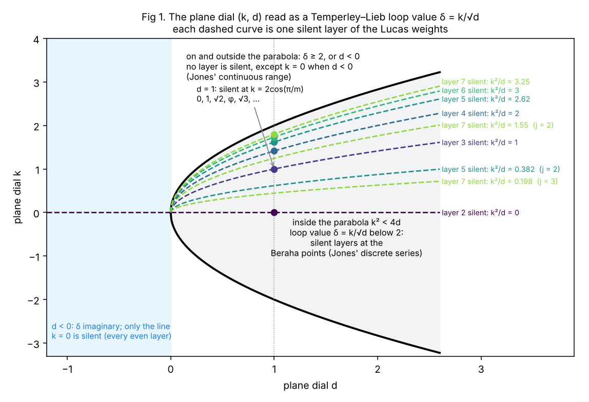
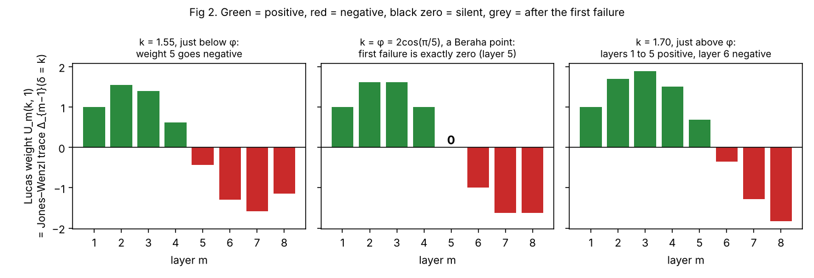
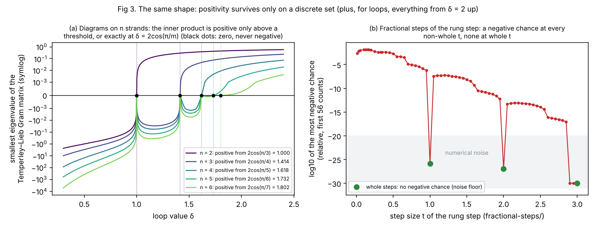
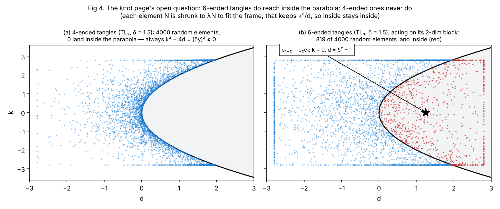

# The silent layers of the Lucas weights are the Temperley–Lieb points (DRAFT)

> **Names:** some words or symbols on this page (rung, wall) also mean something else in standard math, physics or computing, or inside this project. [NAMING-COLLISIONS.md](../../NAMING-COLLISIONS.md) says which meaning is in play.

**Result in one sentence:** yes, exactly: a Lucas weight goes silent at the same dial settings where the
Temperley–Lieb loop diagrams lose their positive inner product, the Beraha points k²/d = 4cos²(πj/m), and the
positivity threshold 2cos(π/(n+1)) is the same number on both sides.

Status: DRAFT, not reviewed, not published. Follows lead R3 in `../closed-leads-revisit/README.md`. Builds on
`../lucas-weights/HANDOFF.md` (the curvature dial and its weights) and answers the open question left in
`../knot-theory/README.md` (do 6-ended tangles reach a bend?).

## The question in plain words

The plane setting (k, d) has layer weights U_m(k, d): U₀ = 0, U₁ = 1, U_m = k·U_{m−1} − d·U_{m−2}. Inside the
parabola k² < 4d these oscillate, and a layer goes **silent** (U_m = 0) at special settings: at d = 1 they are
k = 0, 1, √2, φ, √3, ... The closed-leads review noticed this is the same recurrence that drives the
Temperley–Lieb algebra, the algebra of non-crossing strings where a closed loop counts as a number δ. The test
here: build that algebra from the string pictures alone, with no Chebyshev formulas put in, and see whether
its special points are exactly our silent layers.

**Known names used below.** Temperley–Lieb algebra TL_n(δ) (Temperley and Lieb 1971; Jones 1983):
n strands, generators e_i = "cap then cup" at positions i, i+1, with e_i² = δe_i and e_ie_{i±1}e_i = e_i.
Jones–Wenzl projector p_m: the piece of TL_m killed by every e_i. Gram matrix: the table of how two string
pictures pair up, counting δ per closed loop. Beraha numbers: 4cos²(π/m) = 0, 1, 2, 2.618, 3, ...

## Fig 1. The curvature dial (the plane dial) is the loop value δ = k/√d

- Rescaling the weights shows U_m(k, d) = d^((m−1)/2)·U_m(k/√d, 1), so a whole ray of the curvature dial carries
  one loop value **δ = k/√d**. Each silent layer is one curve k² = β·d with β a Beraha number.
- The three regions of the curvature dial line up with Jones' index theorem: inside the parabola is the
  **discrete series** (δ < 2, silent layers at the Beraha points), the parabola itself is **δ = 2** (index 4),
  outside is the **continuous range** δ > 2, where no layer is ever silent. (For d < 0, δ is imaginary; there
  only the line k = 0 is silent, every even layer.)

## Fig 2. Weights at and next to a Beraha point

- The Lucas weight U_m(k, 1) **is** the closed trace of the Jones–Wenzl projector p_{m−1} at δ = k. We built
  p₁ to p₅ only from "idempotent and killed by every e_i", closed them up, and got δ, δ² − 1, δ(δ² − 2),
  (δ² − δ − 1)(δ² + δ − 1), δ(δ² − 1)(δ² − 3): exactly U₂ to U₆.
- At k = φ the first weight that fails is **exactly zero** (layer 5). Nudge k down and that weight goes
  negative; nudge it up and the first failure moves to a later layer. The Beraha points are the only settings
  where the first failure is a clean zero instead of a negative.

## Fig 3. Positivity, and the same shape as fractional steps

- **(a)** The Gram matrix of TL_n is positive (a genuine inner product) exactly when δ ≥ 2cos(π/(n+1)), and the
  Lucas weights U₁ … U_{n+1} are all ≥ 0 exactly when k ≥ 2cos(π/(n+1)): **the same threshold** (checked for
  n = 2 to 6 on the Gram side and n = 2 to 8 on the Lucas side). Its determinant vanishes exactly at the silent
  layers. Below the threshold the matrix has a negative direction, except at δ = 2cos(π/m), where its smallest
  eigenvalue touches zero instead. Taking all n together leaves Jones' famous set: **δ ≥ 2, or exactly
  δ = 2cos(π/m)**.
- **(b)** The rung step's fractional steps (from `../fractional-steps/`): every non-whole step size has a negative
  chance, every whole one has none.
- **The same shape, our reading.** In both, asking for positivity throws away a continuum and keeps a discrete
  set. The loop algebra also keeps everything from δ = 2 up; the rung step keeps nothing between whole steps,
  as if it always lived "below 2". This is a likeness of shape, not a shared mechanism.

## Fig 4. The knot page's open question: 6-ended tangles do reach inside the parabola

A tangle with 4 ends is an element of TL₂ (bracket space spanned by "straight through" and "cap-cup"). A tangle
with 6 ends is an element of TL₃. Each element N obeys a square law N² = kN − d, the same law ε² = kε − d that
defines the curvature dial (`lucas-weights`, `plane_is_circ_eps`).

- **4 ends (a):** TL₂ is two-dimensional and splits into two idempotents, so every element has
  k² − 4d = (δy)² ≥ 0. It never gets inside the parabola. This is why the knot page only ever saw the dial line.
- **6 ends (b):** TL₃ acts on a 2-dimensional block as all 2 × 2 matrices (for any δ off the silent layers), which include rotations. The
  commutator e₁e₂ − e₂e₁ is the cleanest case: N³ = (1 − δ²)N, so on that block k = 0 and d = δ² − 1, inside the
  parabola for δ > 1. About a fifth of random 6-ended elements land inside. **So yes, 6-ended tangles reach a
  bend, and an elliptic one.** We tested the square law of single tangles; whether tangle *addition* of 6-ended
  tangles gives a two-parameter law is a separate question we did not test.
- **The crossing itself.** The Kauffman crossing σ = A + A⁻¹e obeys σ² = kσ − d with k = A − A⁻³, d = −A⁻² (the
  Hecke relation, known). For real A it sits outside the parabola (d < 0), and it touches the parabola only at
  A⁴ = −1, the same point where the knot page's walls merge.

## Known versus ours

| Piece | Status |
|---|---|
| Lucas U_m(k, 1) = Chebyshev U at k/2; homogeneity U_m(k, d) = d^((m−1)/2)U_m(k/√d, 1) | known (standard Lucas-sequence facts) |
| Jones–Wenzl traces are Chebyshev polynomials of δ | known (Wenzl 1987; Kauffman–Lins 1994) |
| Gram (meander) determinant is a product of Chebyshev polynomials, zero at the Beraha points | known (Ko–Smolinsky 1991; Di Francesco–Golinelli–Guitter 1997) |
| Positivity only for δ ≥ 2 or δ = 2cos(π/m) | known (Jones 1983, index rigidity) |
| Crossing obeys the Hecke relation | known |
| The plane setting (k, d) read as loop value δ = k/√d, with the three regions as Jones' three ranges | ours as a reading; the math under it is known |
| 4-ended tangles never elliptic, 6-ended ones can be (answer to the knot page) | ours as far as we found; a short check, not deep |
| Positivity rigidity as the same shape as "only whole steps" | ours, a likeness only |

**Verdict.** The lead holds and is exact, but the mathematics is known. What it gives us is an existing name for
the Lucas weights (Jones–Wenzl traces), a known reason for the silent layers (the Gram determinant), and an
answer to the knot page's open question. It does not give a new theorem. The old statistical Beraha test in
`../lee-yang/` (p = 0.099) stays closed as a statistics question; this is the structural version of the same
link, and it is exact.

## Checks (21 of 21 pass)

`checks.py` → `checks_output.txt`, `checks.json` (20 checks, about 4 minutes); `extra_checks.py` →
`extra_checks_output.txt` (1 check). The algebra is built from string pictures in `tl.py`: matchings, gluing
and loop counting, nothing else.

- Jones–Wenzl p₁ to p₅ solved from "idempotent, killed by every e_i"; their closed traces equal U₂ to U₆ exactly
  (5 checks).
- The rescaling identity for m = 1 to 11 (1 check).
- Gram determinant zero exactly at the silent layers: exact for n = 1 to 3; numeric for n = 4, 5, 6 (14 × 14,
  42 × 42, 132 × 132), smallest relative eigenvalue 7.5·10⁻¹⁵, 2.1·10⁻¹⁵, 1.5·10⁻¹⁵ at the layers against
  3.6·10⁻⁵, 1.2·10⁻⁶, 3.2·10⁻⁸ elsewhere (6 checks).
- Gram positive above 2cos(π/(n+1)) and not just below it, n = 2 to 6 (5 checks).
- Lucas positivity threshold equals the Gram threshold, n = 2 to 8 (1 check).
- 4-ended tangles never elliptic; the 6-ended commutator law N³ = (1 − δ²)N (2 checks).
- Kauffman crossing obeys the Hecke relation with k = A − A⁻³, d = −A⁻² (1 check).

## Files

- `tl.py`: Temperley–Lieb algebra from diagrams (matchings, composition with loop count, trace, Gram matrix).
- `checks.py`, `checks_output.txt`, `checks.json`; `extra_checks.py`, `extra_checks_output.txt`.
- `figures.py` → `figures/fig1-dial-plane.png`, `fig2-weights-at-beraha.png`, `fig3-same-shape.png`,
  `fig4-tangles.png` (Fig 3b reads `../fractional-steps/grid_output.json`).

## Sources

- Temperley, H. N. V. and Lieb, E. H. (1971). Relations between the "percolation" and "colouring" problem and
  other graph-theoretical problems associated with regular planar lattices. Proc. R. Soc. Lond. A 322.
- Jones, V. F. R. (1983). Index for subfactors. Invent. Math. 72.
- Wenzl, H. (1987). On sequences of projections. C. R. Math. Rep. Acad. Sci. Canada 9.
- Kauffman, L. H. (1987). State models and the Jones polynomial. Topology 26. Kauffman, L. H. and Lins, S. (1994).
  Temperley–Lieb recoupling theory and invariants of 3-manifolds. Princeton.
- Ko, K. H. and Smolinsky, L. (1991). A combinatorial matrix in 3-manifold theory. Pacific J. Math. 149.
- Di Francesco, P., Golinelli, O. and Guitter, E. (1997). Meanders and the Temperley–Lieb algebra. Commun. Math.
  Phys. 186.
- Beraha, S., Kahane, J. and Weiss, N. J. (1980). Limits of chromatic zeros of some families of maps. J. Combin.
  Theory B 28.
- Found by web search, on the Gram determinant as a product of Chebyshev polynomials:
  https://arxiv.org/abs/1006.1297 and https://arxiv.org/abs/0802.1083. None of the sources we found states the
  link to Lucas sequences or to a two-parameter dial; that absence is why the reading is marked ours, not new.
