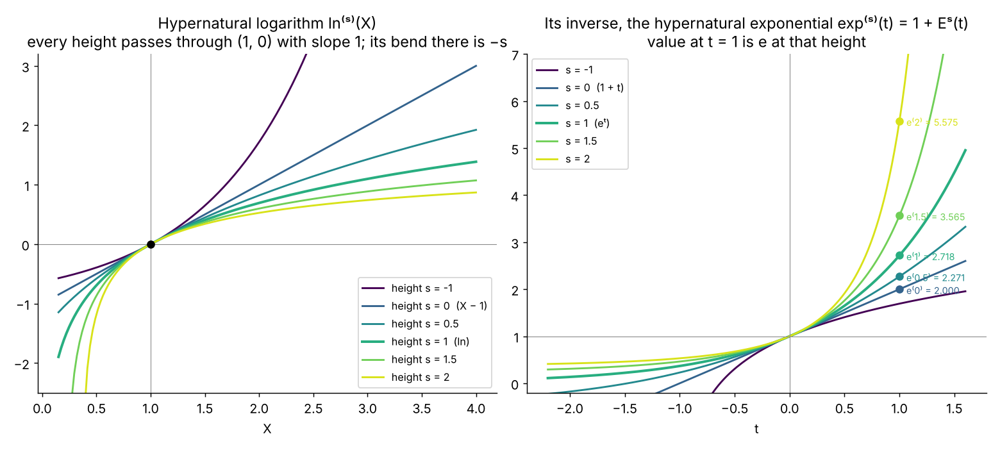
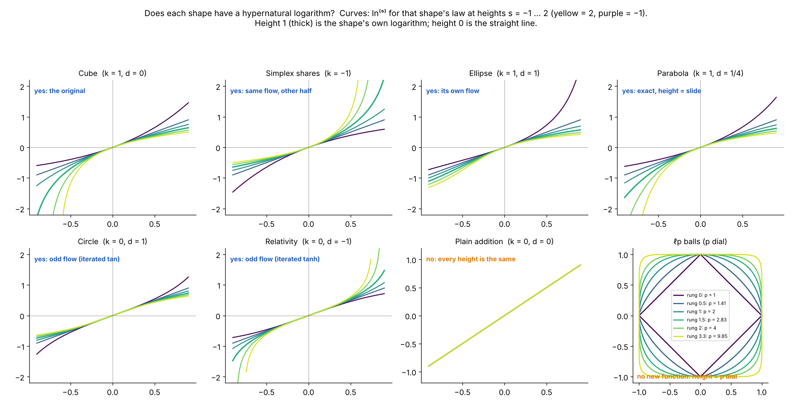
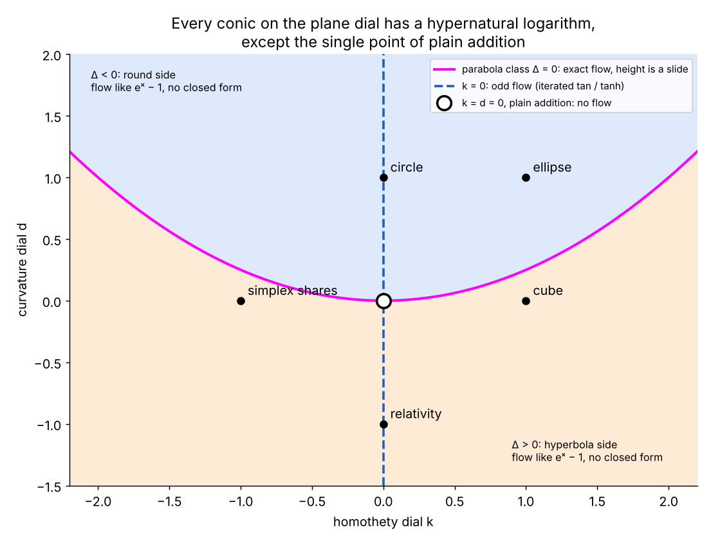
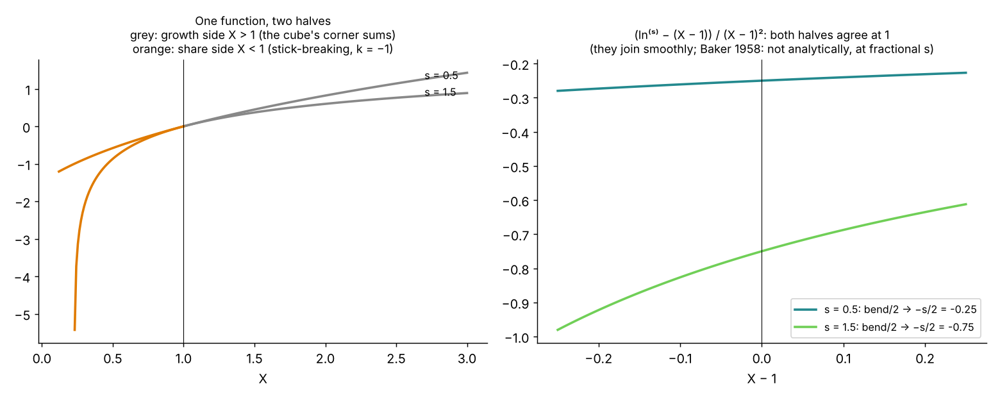
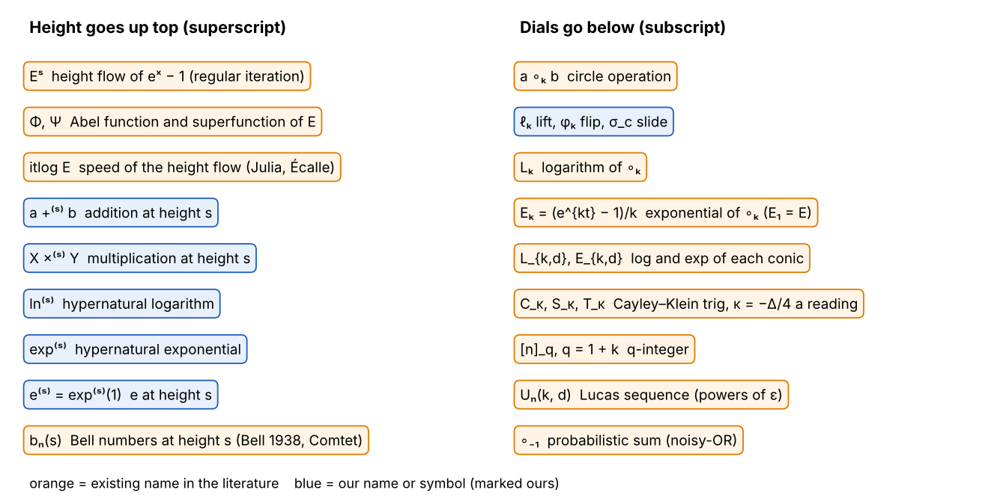
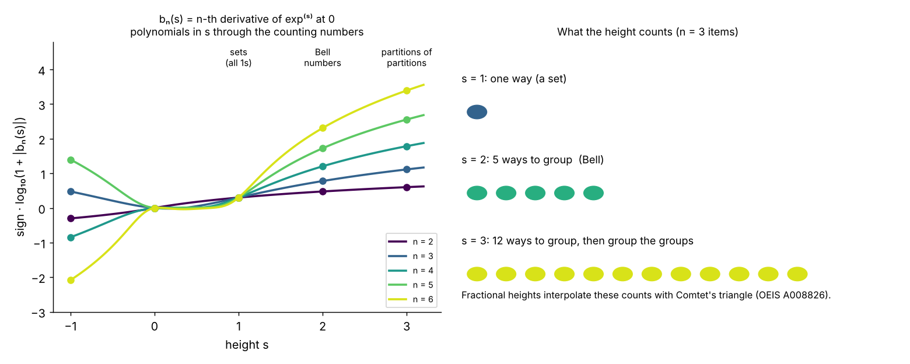
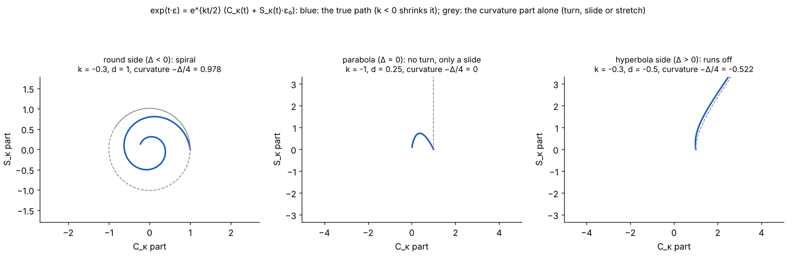

# DRAFT · Named functions: the hypernatural pair, what each shape carries, and the names that already exist

**DRAFT, Nov 26 2026.** Part of Affine Composition Theory (repo: fused-hyperoperation-algebra).
Asked for by Brennan (timeline, Nov 26): find "really useful functions like the supernatural logarithm", where "functions" is loose and "could be an operation with a generator", and see "if there's any other ones that could be identified and named"; "our system needs to be coherent and … probably will have some functions and operations that are unique"; "check the literature to see if there's already a name" for the inverse, and whether "natural exponent" is a real term. Then: the supernatural logarithm is renamed the **hypernatural logarithm**, and "is it also a concept that exists in the other shapes?"
Builds on `operations-catalog/` (23 moves, already named; not repeated here), `fractional-rungs/e-every-height/` (the log itself), `polar-recast/` section on the super log, `why-i/cayley-klein/`, `combinatorics/`, `affine-names/` (dial letters k, d, p, C; curvature is the reading −Δ/4).
Checks: `checks.py` → `checks_output.txt`, **33 of 33 pass** (mpmath, 40 digits; about 6 seconds). Generic height flows: `flows.py`. Pictures: `figures.py` → `figures/`. No Lean in this pass. Colour key: **blue = ours, orange = existing name, grey = the cube.**
Page: "Hypernatural functions", https://claude.ai/artifact/JxSAmZGBNP51C8j9ZKt3Ao (artifact 9168c670-c3b5-44ec-be53-382cb405c198, private until shared).

## The answers

**1. Does the hypernatural logarithm exist on other shapes? Yes, on every conic of the plane dial except one point, and not as a new function on the ℓp shapes.** The cube was where we found it, but nothing in it needs the cube. It needs one thing: a composition law with a generator that touches the identity at the law's zero. Every such law has its own rung ladder and its own hypernatural logarithm.

- **Cube (k = 1):** the original.
- **Simplex shares (k = −1, stick-breaking):** the same function, its other half (X < 1). The two halves meet at X = 1 with slope 1 and bend −s.
- **Any other k ≠ 0:** the same function in other units.
- **Ellipse, parabola, hyperbola, circle, relativity (every (k, d) but the origin):** each has its own. On the parabola line it is exact and elementary (height is a slide); on the k = 0 line it is the fractional iterates of tan or tanh; elsewhere it behaves like eˣ − 1, with no closed form.
- **Plain addition (k = d = 0):** no. Every height is the same straight line.
- **ℓp balls:** no new function. Climbing a rung of the sphere's Pythagoras raises p: rung s is the ℓ_(2^s) sum. Height and the p dial are the same dial there.

**2. The inverse: call it the hypernatural exponential, exp⁽ˢ⁾(t) = 1 + Eˢ(t).** "Natural exponential function" is a real textbook term for eˣ, the inverse of ln (Stewart's Calculus §6.3 is titled that way; Whitman's calculus text says "y = exp(x), called the natural exponential function"). It is less common than "the exponential function", which is why it sounds unusual. The closest family in print, Bagayoko and van der Hoeven's hyperlogarithms and hyperexponentials "of strength γ" on the surreal numbers, already pairs the two words the same way.

**3. Candidates.** Of nine combinations the library keeps reusing that the operations catalog did not cover, **seven already have names in the literature** (adopt them) and **two need ours** (×⁽ˢ⁾ and the hypernatural pair). Table in section 3.

*Figure 1. Left: ln⁽ˢ⁾ at six heights, all through (1, 0) with slope 1. Right: the inverse exp⁽ˢ⁾; its value at t = 1 is e at that height (2 at height 0, e at 1, e^(e−1) at 2).*

---

## 1. The hypernatural logarithm on every shape

### The rule that decides it

A law a ⋆ b with a generator G (Aczél 1948): a ⋆ b = G(G⁻¹a + G⁻¹b), with G(0) = 0. If G also touches the identity there (G(x) = x + c·x^m + …, m ≥ 2), then G can be iterated a real number of times by regular iteration at that parabolic point (Szekeres 1958, Écalle), and

- rung s of the law is (Gˢ)₊(+): rung 0 is +, rung 1 is the law itself, rung 2 is the next climb;
- the law's hypernatural logarithm at height s is G⁻ˢ (read through the lift for the cube: ln⁽ˢ⁾(X) = E⁻ˢ(X − 1)).

At height 1 it is always the law's own logarithm. So the cube's ln⁽ˢ⁾ is one instance: G = E = eˣ − 1, the exponential of ∘₁.

*Figure 2. Each panel is one shape's ln⁽ˢ⁾ at heights −1 to 2 (thick = height 1, that shape's own logarithm). Seven have a flow; plain addition does not; the ℓp panel shows the ℓp balls a rung apart.*

### Shape by shape

| Shape | Its law | Generator G | Hypernatural log? | Checks |
|---|---|---|---|---|
| Cube | ∘₁ | eˣ − 1 | **yes**, the original | C1–C4, H1–H7 |
| Any k ≠ 0 | ∘ₖ | Eₖ(x) = (e^(kx) − 1)/k | **same function in other units**: Eₖˢ(x) = Eˢ(kx)/k | S1 |
| Simplex shares (stick-breaking) | ∘₋₁ (a + b − ab) | 1 − e^(−x) | **same function, the X < 1 half**: E₋₁ˢ(x) = −Eˢ(−x) | S2, H7 |
| Plain addition | + | x | **no**: as k → 0 every height collapses to X − 1 | S3 |
| Ellipse, hyperbola (k ≠ 0, Δ ≠ 0) | (a + b + kab)/(1 − dab) | E_(k,d) = σ(T_κ(t)) | **yes, its own**, like eˣ − 1, no closed form | S4–S7, S9 |
| Parabola class (Δ = 0) | same | σ(t) = t/(1 − (k/2)t) | **yes, exact**: E^s(x) = x/(1 − s(k/2)x), height is a slide | S8 |
| Circle, relativity (k = 0) | tangent / velocity addition | tan, tanh | **yes**, odd flow: fractional iterates of tan, tanh | S7, S10 |
| ℓp balls | (aᵖ + bᵖ)^(1/p) | y^(1/p) | **no new function**: G does not touch the identity; rung s = ℓ_(p^s) sum | S11, S12 |

Here σ is the slide x ↦ x/(1 − (k/2)x), T_κ is the Cayley–Klein tangent (tan, identity or tanh), and κ = d − k²/4 = −Δ/4 is the curvature reading. The design rule holds: E_(k,d) takes the base dials k and d; the curvature only appears inside as a reading.

*Figure 3. Where each kind of flow lives on the plane dial. Only the origin (plain addition) has none.*

### Why the simplex half matters

*Figure 4. ln⁽ˢ⁾ on the growth side (X > 1, grey, the cube's corner sums) and on the share side (X < 1, orange, stick-breaking). Right: both halves give the same bend −s at X = 1.*

On probabilities the circle operation is a + b − ab (the simplex page's stick-breaking), and its climb map is the mirror of eˣ − 1. So the simplex's hypernatural log is the cube's, read on the other side of X = 1. The halves agree in slope (1) and bend (−s) at X = 1 (H7, checked), and in every higher derivative by construction, since both use the same formal series. At fractional heights they are still two different regular iterations glued at 1: by Baker (1958) and the polar-recast page's argument, no single power series covers both. At whole heights they are one analytic function. **Known:** the two-petal picture at a parabolic point. **Ours:** reading the petals as the cube side and the simplex side.

### ℓp: height is the p dial

The sphere's Pythagoras is (a² + b²)^(1/2), generator y^(1/2). Iterating it is exact, y^(2^(−s)), and rung s is the ℓ_(2^s) sum (S11): cross-polytope at rung 0, sphere at rung 1, ℓ4 at rung 2, the cube at infinite height (max). So the rung height and the roundness dial are one dial there, and no new transcendental function appears. This fills the gap polar-recast left open ("Not examined: the roundness dial"), and it matches its reading of the roundness dial as Maslov's temperature, which also ends at max.

### How this fits polar-recast

polar-recast found that **no shape carries the cube's ln⁽ˢ⁾**: the rung-s operation at fractional s is not any conic's law. That still holds. The answer here is a different question: every conic carries a ladder of its own. The cube's ladder runs through ∘₁; the ellipse's runs through its own law. They are siblings, not one function.

---

## 2. The inverse and the notation

**Adopted name (Brennan, Nov 26): hypernatural exponential, exp⁽ˢ⁾(t) = 1 + Eˢ(t).** Reasons it was recommended:

1. It mirrors a real pair. Textbooks call eˣ the natural exponential function, the inverse of the natural log (Stewart §6.3; Whitman calculus §9.3).
2. The nearest published family pairs the words the same way. Bagayoko and van der Hoeven ("Surreal numbers as hyperseries", arXiv 2310.14879, 2023) define the **hyperlogarithm of strength γ**, L_γ, and its inverse, the **hyperexponential of strength γ**, E_γ. For whole γ = n, L_n is log applied n times. Theirs differ from ours in two ways: strengths are ordinals only, and they are not fused (their L₂ is log log X; our ln⁽²⁾ is log(1 + log X), which keeps the curve through (1, 0) with slope 1). The word "natural" carries both differences: base e, and the fusing. Cite them as the nearest prior work.
3. The super-logarithm literature pairs differently. There the inverse of the super-logarithm is tetration, also called the super-exponential (sexp; Kouznetsov and Trappmann), and the super-logarithm is the Abel function of eˣ. That is the "which rung" direction (our Φ), not ours.

**Never shorten to "hyperlogarithm" or "hyperexponential".** A hyperlogarithm is also a Lappo-Danilevsky / Goncharov iterated integral, the standard tool for Feynman integrals (Panzer). A hyperexponential is a probability distribution (a mixture of exponentials) and, in differential algebra, a function with f′/f rational.

**Notation proposal (ours, for the 1.0 pass): height up top, dials below.** Write ln⁽ˢ⁾ and exp⁽ˢ⁾, like +⁽ˢ⁾ and Eˢ. The subscript form ln_s collides with Tsallis's q-logarithm ln_q, which is our closest cousin (same bend −s; the two part at third order). Then every height object carries a superscript and every dial object a subscript (Figure 6). One caution: f⁽ⁿ⁾ often means an n-th derivative, so the glossary should define ln⁽ˢ⁾ once.

---

## 3. Candidates, with existing names first

*Figure 6. The system on one sheet. Orange: existing names to adopt. Blue: ours.*

| # | Function or operation | Formula | Existing name | Recommendation | Where used |
|---|---|---|---|---|---|
| 1 | Hypernatural exponential | exp⁽ˢ⁾(t) = 1 + Eˢ(t) | none for this family; nearest: hyperexponential of strength γ (Bagayoko–van der Hoeven) | **hypernatural exponential, exp⁽ˢ⁾** (ours) | e-every-height, height-flow, fused-constants |
| 2 | Multiplication at height s | X ×⁽ˢ⁾ Y = exp⁽ˢ⁾(ln⁽ˢ⁾X + ln⁽ˢ⁾Y) = 1 + ((X−1) +⁽ˢ⁾ (Y−1)) | none (written ⊗_s in e-every-height) | **×⁽ˢ⁾** (ours). ⊗ is the tensor product everywhere else. ×⁽¹⁾ = ×, ×⁽⁰⁾ = X + Y − 1 (H4–H6) | e-every-height |
| 3 | Exponential of ∘ₖ | Eₖ(t) = (e^(kt) − 1)/k, inverse of Lₖ | exponential of the formal group law (exp_F) | **Eₖ**; note E = E₁, so the climb map is the exponential of ∘₁ (N1) | e-i-pi chain, fractional-rungs, rung pages |
| 4 | Log and exp of each conic | L_(k,d), E_(k,d)(t) = T_κ(t)/(1 − (k/2)T_κ(t)) | log and exp of the formal group law; T_κ is the Cayley–Klein tangent (Herranz–Ortega–Santander 2000) | **L_(k,d), E_(k,d)**; inputs k, d; κ = −Δ/4 only as a reading (S4–S6) | landscape, conics, shape-directions |
| 5 | Exponential of the plane number | exp(tε) = e^(kt/2)(C_κ(t) + S_κ(t)·ε₀), ε₀ = ε − k/2 | Cayley–Klein cosine and sine C_κ, S_κ (Herranz–Ortega–Santander) | adopt C_κ, S_κ, T_κ; k is the spiral's growth, −Δ/4 its turn (N2, N3; Figure 7) | why-i, affine-names, clifford |
| 6 | Abel function of E and its inverse | Φ(E(x)) = Φ(x) + 1; Ψ = Φ⁻¹ | Abel function; superfunction (Kouznetsov–Trappmann; Wikipedia calls the word nonstandard); Fatou coordinate | keep **Φ** "Abel function", call Ψ the **superfunction** of E. Then ln⁽ˢ⁾(X) = Ψ(Φ(X − 1) − s) | fractional-rungs, height-flow |
| 7 | Speed of the height flow | λ(g) = d/ds Eˢ at s = 0 = g²/2 − g³/12 + g⁴/48 − … | iterative logarithm itlog (Écalle); Julia's function | **itlog E**; avoid "Julia's logarithm" next to ln⁽ˢ⁾ (N6) | height-running-coupling, e-every-height |
| 8 | Derivatives of exp⁽ˢ⁾ at 0 | bₙ(s) = n![tⁿ]Eˢ(t) | Bell numbers of order s − 1 (E. T. Bell 1938) at whole s; Comtet's triangle (OEIS A008826) interpolates | **Bell numbers at height s**, bₙ(s) (B1–B4; Figure 5) | combinatorics, quantum-to-classical |
| 9 | ∘₋₁ on probabilities | a + b − ab = 1 − (1 − a)(1 − b) | probabilistic sum (algebraic sum) t-conorm; noisy-OR | say **probabilistic sum** beside ∘₋₁ (N5) | probability-entanglement, simplex, holographic cone |
| – | 1 ∘ₖ 1 ∘ₖ … (n times) | ((1 + k)ⁿ − 1)/k | q-integer [n]_q with q = 1 + k (Gauss) | already noted in exploration/; adopt [n]_q with q = ℓₖ(1) (N4) | qnum in Lean (54 uses) |
| – | Powers of the plane number | εⁿ = Uₙε − dUₙ₋₁ | Lucas sequence Uₙ(k, d) | already in lucas-weights/; keep | lucas in Lean (107 uses) |

### What earns a name, on its own merits

- **The hypernatural pair (rows 1, 2) is worth naming.** It is the one family here with no published name, it shows up wherever height does (entropy, running coupling, e at every height), and the shape test above shows it is a general construction, not a cube accident.
- **Bell numbers at height s (row 8) is a real lead worth following.** The height counts something: height 2 counts groupings of a set (Bell), height 3 groupings of groupings, height 1 one way, height −1 signed cyclic orders. Fractional heights give polynomials in s through those counts. The polynomials are known (Comtet); reading them as the derivatives of exp⁽ˢ⁾ at 0 is ours. Open question: is there a counting meaning at s = 1/2, for example a signed or weighted count of half-nested groupings? Not checked.
- **Row 5 explains a picture we keep drawing.** exp(tε) is a spiral whose growth is k/2 and whose turn is the curvature reading. That is the "homothety plus area-keeping turn" split from affine-names, as one formula with existing names.
- **Rows 3, 4, 6, 7, 9 are bookkeeping:** they have names; using them makes the pages readable to outsiders.

*Figure 5. bₙ(s) for n = 2 to 6 as smooth curves in s. The dots at whole heights are counting numbers: all ones at s = 1, Bell numbers at s = 2, partitions of partitions at s = 3.*

*Figure 7. exp(tε) on each side of the plane dial. Round side: a spiral. Parabola: no turn, only a slide. Hyperbola side: it runs off.*

---

## 4. Rename to "hypernatural logarithm": applied Nov 26

"Supernatural" was replaced by "hypernatural" in these twelve files (case kept; figure titles regenerated):

- `fractional-rungs/e-every-height/README.md` (7 mentions, plus a rename note under the title), `fractional-rungs/e-every-height/figures.py` (1)
- `height-flow/README.md` (1), `height-flow/figures.py` (1), `height-flow/height_entropy.py` (2)
- `operations-catalog/README.md` (1)
- `polar-recast/README.md` (3), `polar-recast/literature/superlog_shapes.py` (2)
- `bridge-survey/bridges.csv` (2), `bridge-survey/bridges.json` (5), `bridge-survey/raw/math.tsv` (1), `bridge-survey/raw/shapes-applied.tsv` (1)

Not changed here: published pages built from those folders (the e-every-height page and any other that names it), two task-notes files, project memory, and the repo copy until the push thread pushes.

## Polish

Every flow value is computed at n and 2n steps and the 2n value kept; the difference is the error estimate (C4: 0 at 40 digits for eˣ − 1; about 1e-22 on the k = 0 conics, where walking in is slower). Total cost about 6 seconds.

## Known vs ours

- **Known:** Aczél generators and quasi-sums; regular iteration at a parabolic point (Szekeres, Écalle, Lévy); Baker's divergence of fractional iterates of eˣ − 1; formal group exponentials; Cayley–Klein trig functions; Abel functions and superfunctions; the iterative logarithm; Bell numbers of higher order and Comtet's triangle; the probabilistic sum; q-integers; Lucas sequences; hyperlogarithms of strength γ on surreals.
- **Ours:** the names hypernatural exponential and ×⁽ˢ⁾; the rule "a shape has a hypernatural log when its generator touches the identity"; the shape-by-shape test (every conic but the origin; simplex = the other half; ℓp height = p dial with p = 2^s); the exact slide flow on the parabola line; reading bₙ(s) as derivatives of exp⁽ˢ⁾; the height-up, dials-down notation rule.
- **Not done:** no Lean; the counting meaning at fractional height; whether the left and right halves at X = 1 should be called one function or two in the 1.0 text.

## Sources

- J. Aczél, Bull. Soc. Math. France 76 (1948) (generators of associative laws).
- G. Szekeres, Acta Math. 100 (1958); I. N. Baker (1958), fractional iterates of eˣ − 1; J. Écalle (iterative logarithm, resurgence).
- V. Bagayoko and J. van der Hoeven, "Surreal numbers as hyperseries", arXiv:2310.14879 (2023).
- D. Kouznetsov and H. Trappmann, "Computation of the two regular super-exponentials to base exp(1/e)", arXiv:1105.4735; Wikipedia, "Superfunction" and "Super-logarithm".
- F. J. Herranz, R. Ortega and M. Santander, J. Phys. A 33 (2000) 4525, arXiv:math-ph/9910041.
- E. T. Bell (1938), iterated exponential integers; L. Comtet, Advanced Combinatorics (1974) p. 148; OEIS A008826, A000258; Skau and Kristensen, arXiv:1903.07979.
- E. Panzer, hyperlogarithms and Feynman integrals, arXiv:1403.3385.
- J. Stewart, Calculus, §6.3 "The natural exponential function"; Whitman College calculus text §9.3.
- M. Aschenbrenner and W. Bergweiler, Julia's equation and differential transcendence (iterative logarithm of eˣ − 1).
