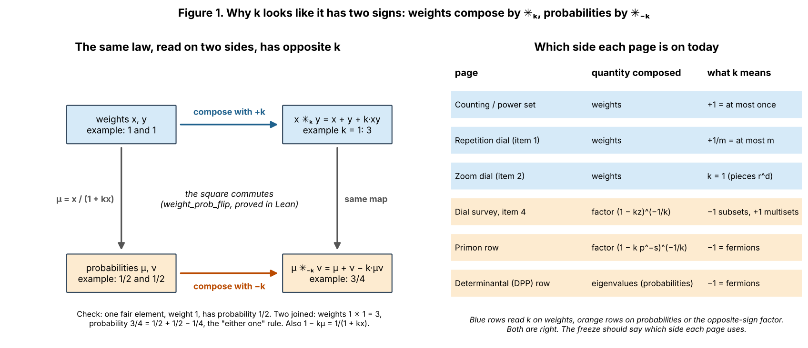
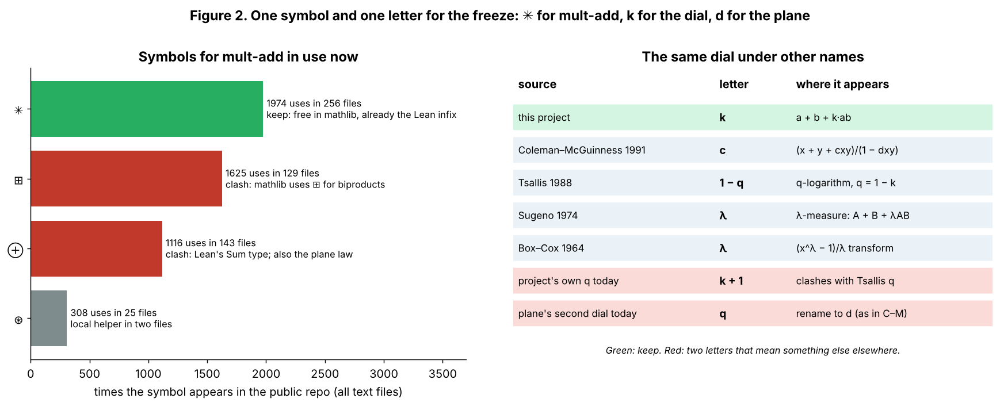

# Names and notation review before the 1.0 freeze (checklist item 4)

> **Update, 2026-11-25:** Brennan chose to follow the literature, and to call mult-add the circle operation. The
> symbol recommendation below (✳) is replaced by [RENAME-PLAN.md](RENAME-PLAN.md): ∘ₖ on the page, ◯[k] in Lean.

**Result.** The names are mostly fine. Four things should be settled before the freeze, and one of them looks like a sign
error but is not:

1. **One symbol for mult-add: ✳.** The repo uses three today: ✳ (1,974 uses in 256 files), ⊞ (1,625 in 129) and ⊕
   (1,116 in 143). ⊞ is mathlib's biproduct (37 mathlib files), ⊕ is Lean's `Sum` type and mathlib's direct sum
   (281 files), and ✳ appears nowhere in mathlib (checked by grep of a fresh mathlib4 clone, 2026-11-25). About 80 Lean files
   already declare ✳ locally for multAdd, though `Base.lean` declares ⊞ as the scoped notation. Recommend ✳ for mult-add and ✳ₖ for the weighted rule
   a + b + k·ab.
2. **k has one meaning, but each page must say what it composes.** The counting row, the repetition dial and the zoom
   dial compose *weights*, so k = +1 means "at most once". The dial-survey copies row, the primon row and the
   determinantal (DPP) row compose *probabilities* (or use the factor (1 − kz)^(−1/k)), so there k = −1 means
   "at most once" (fermions). Both are right. If weights compose by ✳ₖ, their probabilities μ = x/(1 + kx) compose
   by ✳₋ₖ. This is proved in Lean (`weight_prob_flip`, Figure 1). Recommend freezing the rule "k is defined by
   a + b + k·ab on the quantity being composed, and every page names that quantity", and adding one line to the
   dial-survey and primon pages saying they are on the probability side.
3. **Retire the project's q = k + 1.** Tsallis's q for the same family is 1 − k, so the project's q is 2 − q_Tsallis.
   Anyone from statistical physics will read q the other way. Keep k, and when citing Tsallis write "q_T = 1 − k".
4. **Rename the plane's second dial from q to d.** The landscape law (a + b + k·ab)/(1 − q·ab) is exactly the
   Coleman–McGuinness family (x + y + cxy)/(1 − dxy) (Pacific J. Math. 147, 1991). They proved these are *all* the
   rational formal group laws, and that the law is equivalent to plain addition when c² − 4d = 0 and to mult-add
   otherwise (over the field with √(c² − 4d)). Calling the second dial d matches their paper and frees q. Catch: the zoom dial uses d for dimension
   (x(d) = 1), so adopting d means writing the dimension another way there (s or δ are common).

Every clash, including the ones inside the project (⊞ and ⊛ each mean two things in the library), is listed in
[NAMING-COLLISIONS.md](NAMING-COLLISIONS.md), with what it means here, what it means elsewhere and since which version.

Also noted, no change proposed: the project name's "Fused" collides with the computer term fused multiply-add (FMA).

## Credit glossary (proposed NAMES.md for 1.0)

| Project term | Known name | First source |
|---|---|---|
| mult-add a ✳ b = a + b + ab | circle operation, quasi-regular product; the multiplicative formal group law | Perlis 1942, Jacobson 1945; mathlib `PreQuasiregular`, `IsQuasiregular` |
| weighted rule a + b + k·ab, and the (k, d) plane | rational formal group laws | Coleman & McGuinness 1991 |
| k-log (x^k − 1)/k | Box–Cox transform; Tsallis q-logarithm with q_T = 1 − k | Box & Cox 1964; Tsallis 1988 |
| k on a measure: A + B + k·AB | Sugeno λ-measure | Sugeno 1974 |
| the k ↔ −k flip | Tsallis additive duality q_T ↔ 2 − q_T | standard in the Tsallis literature (Naudts and others) |
| rungs | hyperoperations | Goodstein 1947 |
| fractional rungs | fractional iteration | Kneser 1950 |
| determinantal row at k = α | α-determinantal point processes | Shirai & Takahashi 2003 |
| primon row | primon gas | Julia 1990; Spector 1990 |
| copies allowed, crowding | Gentile statistics; Haldane–Wu exclusion statistics | Gentile 1940; Haldane 1991; Wu 1994 |
| zoom dial | Moran's equation; complex dimensions | Moran 1946; Lapidus & van Frankenhuijsen 2013 |

Plain words to map once in the glossary: wall = the point −1/k where 1 + kx = 0; way back = inverse (quasi-inverse);
rung = hyperoperation level; dial = parameter.

## An honest correction to item 1

While doing this review I found that the project's own dial-survey page (item 4) and `DialSurvey.lean` already had the
per-element copies count, with the opposite sign: factor (1 − kz)^(−1/k), k = −1 subsets, k = −1/m at most m copies,
k = 1 multisets, with Lean proofs (`kRise_fermi`, `kRise_bose`, `kRise_parafermi`, `fall_vanish`). The repetition-dial
page should have cited it. The two agree once the sign is read through the flip above. I have corrected the
repetition-dial README's "known vs new" section. What item 1 adds on top is the composition law for atoms, the
occupation and fluctuation in k form, the 1/n − 1/x = k gap, the negative-count check at k = 2/3 and the one-dial test
against Haldane's g. Its dial-survey page also already had the k = 1 case of the flip (`odds_union`, odds t ↦ t/(1 + t)).

## Lean

`lean/Conventions.lean` (core Lean 4.37, imports Base only, no `sorry`; axioms propext, Classical.choice, Quot.sound):

- `one_sub_prob`: 1 − k·μ = 1/(1 + kx) for μ = x/(1 + kx).
- `weight_prob_flip`: prob k (x ✳ₖ y) = (prob k x) ✳₋ₖ (prob k y).
- `prob_inverse`: the flip undone, prob (−k) (prob k x) = x.
- `fair_example`: at k = 1, weights 1 and 1 join to 3, and probabilities 1/2 and 1/2 join to 3/4 at k = −1.

Build line for build.sh, after ZoomDial: `FusedAlgebra/Topics/Conventions.lean`.

## What this does not change

No definition, theorem name or VERSION changes are made here. These are recommendations; adopting them is Brennan's
call, and once adopted they are what 1.0 freezes.
