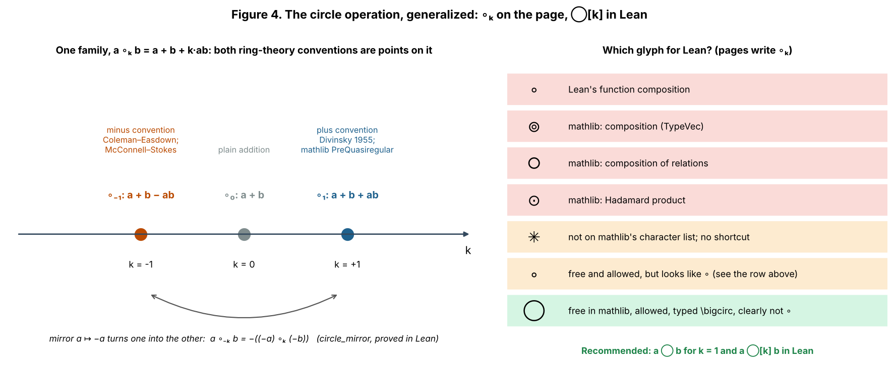

# Rename plan for 1.0: the circle operation

Status: plan only, nothing renamed yet. Written 2026-11-25 for Brennan's go-ahead.
Rule from Brennan: follow the existing literature as much as possible.

## The decision in one line

Mult-add is the **circle operation** of ring theory, and the project's dial makes it a family: write **a ∘ₖ b = a + b + k·ab**
on the page, always with its subscript, and **a ◯[k] b** in Lean (a ◯ b for k = 1).

## 1. Sign convention: both ring-theory conventions are on the dial

Ring theory writes the circle operation two ways.

- **Plus convention, a + b + ab:** Divinsky (Canad. J. Math., 1955, "Pseudoregularity"); mathlib's `PreQuasiregular`
  (operation y + x + x·y). This is ours, and it is **k = +1**.
- **Minus convention, a + b − ab:** Coleman and Easdown ("Aspects of the circle composition operation in rings",
  Bull. Austral. Math. Soc.); McConnell and Stokes. This is **k = −1**.

They are mirror images: a ∘₋ₖ b = −((−a) ∘ₖ (−b)). Lean: `circle_mirror`, `circle_conventions` (k = ±1 written out),
`circle_zero` (k = 0 is addition), all in `lean/Conventions.lean`, no `sorry`, standard axioms.

The subscript makes the convention explicit, so a reader from either school sees which one we mean. A bare ∘ in a ring
theory text can mean either, which is one more reason to always write the subscript.

## 2. Keeping clear of function composition

Bare ∘ means function composition in our own pages: the motion rule T_a ∘ T_b = T_(a ∘ₖ b), jet composition, and the
rung tower E ∘ E. It is also Lean's `Function.comp`, used in about 2,000 mathlib files.

- **On the page:** the circle operation always carries its subscript (∘₁, ∘ₖ, ∘₋₁). Bare ∘ is composition, nothing
  else. The motion rule then reads T_a ∘ T_b = T_(a ∘ₖ b), with no ambiguity.
- **In Lean:** ∘ cannot be reused. Every circle-shaped glyph mathlib allows was checked, against a fresh mathlib4
  copy, 2026-11-25:

| Glyph | Verdict |
|---|---|
| ∘ | Lean's function composition |
| ⊚ | mathlib: composition of TypeVec maps (scoped) |
| ○ | mathlib: composition of relations, and Finset disjSups (both scoped) |
| ⊙ | mathlib: Hadamard product of matrices |
| ✳ (the current majority) | not on mathlib's allowed-character list, and has no editor shortcut |
| ◦ | free and allowed, but looks the same as ∘ in most fonts (see Figure 4) |
| **◯** | **free in mathlib, allowed, typed \bigcirc, clearly not ∘** |

Recommended: `a ◯ b` for multAdd (k = 1) and `a ◯[k] b` for wAdd, both declared once in Base.lean. The one caveat
is that ◯ is a larger cousin of mathlib's scoped ○. That notation is only active where a file opens it.

Correction to the earlier names review: I recommended ✳ as "free in mathlib". That was true, but I had not checked
mathlib's character linter, which rejects ✳. That makes ✳ a poor choice for a mathlib edition.

## 3. The internal double meanings

- ⊞ is mult-add in Base.lean, but it is the shifted add a + b + 1 (`sadd`) in FusedPeano, Rungs, RungShape,
  LinearAlgebra and LogicSets, and `MARing.madd` in MultAddRing.
- ⊕ is mult-add in the README, Rungs and FusedPeano, and the whole two-dial law on the landscape pages.
- ⊛ is mult-add in FunctionalAnalysis, but rung 3 (`fexp`) in Rungs.

Fix: every use that means the circle operation becomes ∘ₖ on the page and ◯ in Lean. The rung operations are named
in words and function names (`sadd`, `fexp`, `ftet`), with no glyph, since the literature has no symbol for these
shifted hyperoperations. ⊞, ⊕ and ⊛ leave the project except where they mean what mathlib means.

Because the same glyph means different things in different files, this cannot be a blind find-and-replace. It has to
be done file by file, by meaning.

## 4. Letters

| Now | 1.0 | Why, from the literature |
|---|---|---|
| k | **k (kept)** | No single standard letter exists. Coleman–McGuinness 1991 use c, K-theory writes x + y − βxy (Bott element β, opposite sign), Sugeno 1974 uses λ, Tsallis 1988 uses 1 − q. c would also collide with the speed of light on the relativity pages, where the second dial is −1/c². The glossary maps k to each. |
| q, the plane's second dial | **d** | Coleman and McGuinness (Pacific J. Math. 147, 1991) write the plane law as (x + y + cxy)/(1 − dxy), same sign as ours. On the page: a ∘ₖ,d b. Relativity: d = −1/c². |
| d, the dimension in the zoom dial | **s for the exponent, D for the dimension** | This one moves, not the plane dial. The fractal literature uses s for the similarity exponent in Moran's equation Σ r_i^s = 1 (Moran 1946; Hutchinson 1981; Falconer) and D for the dimension, with ω for complex dimensions (Lapidus and van Frankenhuijsen). The zoom dial is also the newest page, added after v0.1.0 in one folder and one Lean file, so moving it costs least. |
| q = k + 1 | **retired** | It clashes with Tsallis's q = 1 − k. Where Tsallis is meant, write q_T = 1 − k. |

## 5. Words

- "mult-add" becomes "circle operation" in pages and write-ups (about 5,100 uses in 600 files). First use on each
  page: "the circle operation ∘ₖ (called mult-add before 1.0)".
- "weighted family" becomes "the circle operation with dial k".
- The project name "Fused Hyperoperation Algebra" is not touched by this plan.

## 6. Lean names

Theorem names freeze at 1.0, so the time to rename identifiers is now or never (before 2.0). Two options:

- **A (recommended): rename the definitions too.** `multAdd` becomes `circ` and `wAdd` becomes `circK`, so names say
  what they are. That covers about 1,290 `multAdd` and 1,310 `wAdd` occurrences in about 150 files, and 127 theorem
  names that contain multAdd, madd or wAdd. Old names stay as deprecated aliases for one minor release, so nothing
  downstream breaks.
- **B: keep the identifiers, change only the notation.** Cheaper, but the 1.0 names would say "mult-add" forever.

## 7. NAMING-COLLISIONS page

It keeps every old symbol and letter as a row, marked "v0.1.0", with its 1.0 replacement beside it.

## 8. How it gets done

The repo thread does it in one pass, on a branch, file by file by meaning. Then it rebuilds the whole Lean library
(about 3,000 theorems; theorem counts must match before and after), checks the axioms, reruns every checks.py, and
regenerates every figure whose labels change. VERSION is not changed. Pages already released in v0.1.0 keep their
history in git, and the collisions page records the old names.

Sources checked today: Coleman–McGuinness (msp.org, Pacific J. Math. 147, 1991); circle operation sign conventions
(Coleman–Easdown and Divinsky, via the Cambridge Core and CJM listings); K-theory β convention (arXiv 0809.0267,
1310.0895); Moran equation notation (arXiv 1510.06467, a survey of Lapidus–van Frankenhuijsen); mathlib4 source
(grep of a fresh clone, including its character linter).
