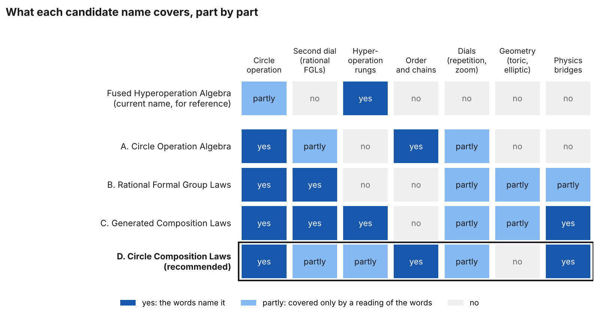

# An interim name for the whole theory (checked 2026-11-25)

## Decision (Nov 26, 2026): Affine Composition Theory

Brennan picked **Affine Composition Theory** on Nov 26 ("Affine composition theory."), after noting that "hypercube doesn't work anymore because we have hyper shapes now. Both c- round ones and pointy ones." Reasons and the other candidates (Conic, Affine Sphere, Unit Ball Composition Theory): `theory-name/README.md`. Every dial already has an affine-geometry name, and the core law composes stretches about one centre. Order isn't required, but a dial (q, or ħ over the star product) turns it on. Brennan then raised that the name "loses the fused aspect", and settled it the same day: **Fused Hyperoperation Algebra stays as its own layer, and Affine Composition Theory is built on it** ("Set it up that way"). The algebra holds the operation, its laws, the rungs and the Lean library. The theory holds the shapes, dials, readings, order dial and physics. The dependency runs one way. The repo keeps the algebra's name. Details: `theory-name/LAYERS.md`. The section below is the Nov 25 record and is kept as history.

## Earlier decision (Nov 25, 2026)

The interim name is **Hypercube Composition Theory**. Brennan first kept "Hypercube" with "Laws", then switched to
"Theory" because "laws don't sound like a body of work". It follows the usual pattern: group theory studies groups, and
this theory studies the composition laws on the hypercube. In mathematics "theory" means a body of results and claims
nothing about nature. The final name is still decided before 1.0 (ROADMAP item 8). The repo, the README title,
CITATION.cff and .zenodo.json are not renamed yet.

Clash check for the new name (web search, 2026-11-25): no established field, book or software is called "hypercube
composition theory", "hypercube theory" or "composition theory". Neighbours to know about, none a real clash:
Epstein's "Hypercubes, n-groupoids, and mixtures" (arXiv 2409.10730, hypercubes for mixtures of n constituents in
continuum mechanics); "composition" also means an integer composition in combinatorics and function composition
generally; Bhargava's cube composition laws (number theory); the Terwilliger algebra of the hypercube.

## Update: naming it after the shape

Brennan asked whether the theory could be named after its shape, coining a word only if the shape is new. The shape
is not new. It is the **n-cube**, which order theory calls the **Boolean lattice** (the tesseract at n = 4): every
term of a chain of circle operations sits on one corner, the dials weight its layers, and the orderings are its paths
(the permutohedron). Details, 92 checks, 9 Lean proofs and pictures: `boolean-lattice/README.md`. So no coined name is
needed, and the shape-led candidates are built from existing names.

**Recommendation (before the decision above): Hypercube Composition Laws.** "Hypercube" is the shape's everyday geometric name, the one a reader
who knows the tesseract will recognise, and "composition laws" is the literature's word for this family (Tempesta,
Biró, Kaniadakis; Bourbaki's "law of composition"). The deciding reason: it names the one shape that the circle
operation, both dials and order all live on. The phrase itself is not an established term (search 2026-11-25).

| Candidate | Built from | Covers | Misses | Collisions |
|---|---|---|---|---|
| **Hypercube Composition Laws** (recommended) | hypercube / n-cube (classical); composition law (as below) | the circle operation, both dials, probability, the shifted power, order | tetration, the toric and elliptic geometry, the zoom dial | "Terwilliger algebra of the hypercube" (algebraic combinatorics), Knuth's hypercube semigroup, hypercube networks, Latin hypercube sampling. None names this. Bhargava's cube composition laws are close in wording (see below). |
| **Boolean Lattice Composition Laws** | Boolean lattice (order theory; Rota 1964) | the same, and it points straight at Rota's Möbius theory, which is the closest existing work | the same | "Boolean algebra" is a large field (logic, circuits). "Lattice" also means a crystal or grid, which the project's own diamond-lattice and Lee–Yang pages use. |
| **Circle Composition Laws** (the earlier pick, below) | circle operation + composition law | the operation, chains, physics | geometry; says nothing about the shape | Bhargava's *Higher Composition Laws*; "circle" may suggest the circle group. |

Dropped: **Cube Composition Laws**, because Bhargava's "cubes" (2×2×2 boxes of integers) and their composition laws
are a well-known theory in number theory, so the phrase would read as his. A **coined name**, because the shape already
has two good names.

The analysis below was written before the shape steer and still holds for the non-shape candidates.

## Recommendation

Use **Circle Composition Laws** as the interim name. Both halves come from the literature. "Circle composition" is ring
theory's name for a ∘ b = a + b + ab (Chick's 1996 thesis is titled *Aspects of the circle composition operation in
rings*). "Composition law" is the word the physics and functional-equation papers use for exactly this family:
Tempesta's group entropies, Biró's composition rules and Kaniadakis's κ-sum all use it. The project already uses it too,
in its README row "Composition laws", its "map of one-parameter composition laws" and its Zenodo keywords. **The one
reason that decides it:** it is the only candidate whose words cover the order-and-chains work, which Brennan has called
the framework's big idea ("a chain of compositions keeps its whole landscape"). The closest rival, Generated Composition
Laws, covers one more cell in the grid below, but the word "generated" rules chains out by theorem: Aczél's generated
laws are always isomorphic to ordinary addition, so they always commute, and order is exactly what they lose. A second,
smaller point: the 1.0 rename plan already proposes "circle operation" for mult-add, so this name could become the final
name and spare the DOI history a third title. The phrase "circle composition laws" itself is not an established term. I
found no use of it (a search on 2026-11-25 found only Chick's "circle composition operation"). It is a compound of two
established terms, not a coined word.

## The candidates at a glance

| Candidate | Built from | Covers | Misses | Collisions |
|---|---|---|---|---|
| **A. Circle Operation Algebra** | "Circle operation": Perlis 1942, Jacobson 1945; Chick 1996; Coleman and Easdown 2002 (minus sign convention); mathlib `PreQuasiregular`. | The core operation. Chains, because ring theory's circle operation lives in noncommutative rings to begin with. | The second dial d, rungs, geometry, physics. The dial k only by reading. | Ring theory uses "circle operation" for the k = 1 point alone, so it reads as a radical-ring paper. Bare ∘ is function composition. In mathlib, `Circle` is the unit circle in ℂ. |
| **B. Rational Formal Group Laws** | Coleman and McGuinness, "Rational formal group laws", Pacific J. Math. 147 (1991); Hazewinkel, *Formal Groups and Applications*; mathlib `FormalGroup R` and `𝔾ₘ`. | The circle operation (it is the multiplicative formal group law) and the whole (k, d) plane, exactly. | Rungs (shifted power is not symmetric, so not a formal group law), noncommutative chains, most dials. | **It is the exact title of the 1991 paper**, so it claims their theorem as a project name. Formal groups are a large field in topology and number theory. mathlib now has a `FormalGroup` namespace. Their letters are c and d. |
| **C. Generated Composition Laws** | Aczél's associativity theorem (generator, formal logarithm); Pap's generated pseudo-operations and g-calculus; Biró's formal logarithm; the generator arithmetics of Grossman and Katz. | The circle operation (generator log(1 + kx)), the whole plane, every rung (each is the shift-generated copy of an ordinary rung), and the physics laws (velocity addition by rapidity, Tsallis, Sugeno). | Order and chains: generated laws always commute. Geometry only partly. | Reads as Pap's "pseudo-analysis", a fuzzy-measure field. Pap's letter g clashes with Haldane's g on the repetition page and the metric g on the gravity pages. "Composition laws" also names Bhargava's *Higher Composition Laws* (number theory). |
| **D. Circle Composition Laws** (recommended) | "Circle composition operation" (Chick 1996) plus "composition law" (Tempesta 2011; Biró 2008; Kaniadakis 2013; Bourbaki's "law of composition"). | The core operation, chains, physics bridges. The plane and the rungs partly. | Geometry. The rungs and the second dial only by reading. | Bhargava's *Higher Composition Laws*. "Circle" may suggest the circle group or circle maps (mathlib has `Circle` and a dynamics library of circle maps). Bare ∘ is function composition. |

Dropped after checking: **deformed arithmetic** (Tsallis, Kaniadakis), **signatures of chains** (Chen, Diehl,
Ebrahimi-Fard, Tapia), **pseudo-analysis** and **quasi-arithmetic**, plain **composition laws**, and anything with
**composition algebra**. Reasons are at the end.

## Each candidate in a few lines

**A. Circle Operation Algebra.** This is the smallest change from today's name and fits the 1.0 rename plan. It names
the core exactly, and since ring theory works in noncommutative rings, the chain result (a chain of circle operations
equals the sum of all ordered sub-chains) is native to it. It says nothing about the second dial, the rungs or the
physics. Ring theorists use the phrase for k = 1 (or k = −1) only, inside Jacobson radical theory, so a reader would
expect a paper on radical rings. "Algebra" could also be read as "an algebra" (a vector space with a product), which
this is not. No mathlib declaration is called "circle operation". The nearest are `PreQuasiregular` (the operation, written
y + x + xy) and `Circle` (the unit circle in ℂ), which matters only if a Lean namespace is named after the project.

**B. Rational Formal Group Laws.** Mathematically this is the most exact match for one part. Coleman and McGuinness
proved that the rational formal group laws over a field of characteristic zero are exactly (x + y + cxy)/(1 − dxy), which
is the project's (k, d) plane. That is also the problem. The name is the title of their paper, so the project would look
like it owns their theorem. It overclaims a large field (formal groups run through complex cobordism and number theory).
It underclaims the rest: the shifted power (a + 1)^(b + 1) − 1 is not symmetric, so it is not a formal group law at all,
and the order work needs noncommutative settings that one-dimensional formal group laws over commutative rings do not
cover. The geometry is only partly in: toric charts come from the multiplicative group, but elliptic formal groups are
not rational. mathlib added `FormalGroup R` (one-dimensional formal group laws, with `𝔾ₘ = X + Y + XY`) in
`Mathlib/RingTheory/FormalGroup/Basic.lean`, so a mathlib port would meet this name head on. Also note: Tempesta's
"group entropies" (2011) already uses formal group laws to tie Tsallis entropy to the Riemann zeta function. That is
the closest prior work to the project's physics and primes rows, and any formal-group name invites a direct comparison
with it. The project should cite it whatever name it picks.

**C. Generated Composition Laws.** This is the broadest literature frame for the scalar side. Aczél's theorem says a
continuous, strictly monotone, associative operation on an interval is f⁻¹(f(x) + f(y)) for some generator f, so it is
ordinary addition in disguise. The circle operation is the case f = log(1 + kx). Every rational formal group law has
such a logarithm over a large enough field. The rungs fit too: the fused rungs are the ordinary rungs carried over by
the shift x ↦ 1 + x, which is what Grossman and Katz, and later Pap and Czachor, call an arithmetic generated by a
bijection. The physics laws fit (rapidity for velocity addition, the q-logarithm for Tsallis, Sugeno's λ-measure as a
pseudo-additive measure). What it rules out is order. A law with a scalar generator is isomorphic to addition, so it
commutes, and the chain result needs steps that do not commute. The exact phrase "generated composition laws" did not turn
up in a search. The field names nearby are Pap's "pseudo-analysis" and "g-calculus", which belong to fuzzy measures,
and Grossman and Katz's "non-Newtonian calculus", a small literature that, by Czachor's own account, mainstream
mathematics has largely not taken up. Pap's letter g would clash with Haldane's g and the metric g.

**D. Circle Composition Laws.** It names the core by its ring-theory name and the family by the physics word for it.
"Composition" also covers the order work twice over: the order-dial page shows the circle operation is composition of stretch maps
with one centre, and chains of compositions are what keep order. The physics bridges are composition laws in exactly
the sense Tempesta, Biró and Kaniadakis use (the velocity, momentum and entropy composition laws). The second dial is
in only by reading. Coleman and McGuinness show every rational formal group law is a change of variables of x + y or
x + y + xy, so the whole plane is circle composition after a change of variables, but the name does not say so. The
rungs are "laws of composition" only in Bourbaki's loose sense of any binary operation, since the power and tetration
rungs are not associative. Geometry is not named. The collisions are mild: Bhargava's *Higher Composition Laws* is
number theory and is always qualified by "higher"; "circle" may suggest the circle group S¹ or circle maps.

## Letters and symbols

- k stays clear of every candidate except the dropped deformed-arithmetic name: Kaniadakis writes κ for his deformation,
  and his κ-sum x√(1 + κ²y²) + y√(1 + κ²x²) is a different law. It is not rational, so it is not on the (k, d) plane.
- B brings Coleman and McGuinness's c and d. The project keeps k (c would clash with the speed of light). d already
  needs the zoom dial to move to s and D, as the rename plan says.
- C brings Pap's g (Haldane's g, metric g) and Aczél's f.
- A and D share the ∘ problem, already handled in the rename plan: the circle operation always carries a subscript (∘ₖ),
  and bare ∘ means function composition.
- Any Tsallis-based name brings q, which already clashes inside the project (Tsallis q = 1 − k, and the plane's second
  dial was once q).

## The DOI and citation story

Every candidate keeps it workable. Nothing here depends on the name.

- The concept DOI 10.5281/zenodo.24539305 stays the same and always resolves to the latest version. Zenodo lets the
  title be edited without a new version.
- The repo has both `.zenodo.json` and `CITATION.cff`. Zenodo reads only `.zenodo.json` when both exist, so its
  `"title"` must change too, or new releases keep the old title.
- A GitHub repo rename redirects web, clone, fetch and push, but not GitHub Pages URLs or calls to actions, and the old
  name must never be reused or the redirect breaks.
- The README's "It was called Fused Mult-Add Algebra until Nov 25, 2026" line would grow to name both earlier titles.
  Each extra interim name adds one more line there and one more title in the Zenodo version list. That is the argument
  for an interim name that can survive to 1.0, and A and D fit the existing rename plan best.
- The Lean library is called `FusedAlgebra`, and theorem names freeze at 1.0. An interim rename need not touch Lean.
  The final name should decide that.

## Why the other families were dropped

- **Deformed arithmetic** (Tsallis q-algebra; Borges 2004; Kaniadakis κ). It overclaims nonextensive statistics and
  underclaims everything outside the k axis. κ and q both clash. "q-deformed" also names quantum-group q-analogs and the
  q-deformed reals of Morier-Genoud and Ovsienko.
- **Signatures of chains** (Chen 1957; Lyons; Diehl, Ebrahimi-Fard and Tapia's iterated-sums signature). It is right for
  the order piece and should be how that piece is described, but it covers nothing else. "Path" and "signature" names
  are already taken by rough path theory, as the path-theory check in NAMING-COLLISIONS.md found. One extra note:
  their *Generalized Iterated-Sums Signatures* paper deforms the quasi-shuffle by a power series f, with no k-like
  parameter. The project's k^(m − 1) weighting of sub-chains is likely a special case of that deformation. I did not
  check this.
- **Pseudo-analysis** (Pap) is the name of an existing field, so it overclaims. **Quasi-arithmetic** names means (an
  average f⁻¹ of the mean of f(xᵢ), after Kolmogorov and Nagumo), not sums.
- **Composition laws** alone is too generic (Bourbaki's "law of composition" is any binary operation) and collides
  with Bhargava. **Composition algebra** is Hurwitz's theorem (ℝ, ℂ, ℍ, 𝕆), which the order-dial page touches, so the
  clash would be real.

## Known literature vs the project's own

All the mathematics in the four candidates is known. The circle operation, its two sign conventions, the rational formal
group law classification, Aczél's theorem, the generator arithmetics, Tsallis and Kaniadakis algebras and iterated-sums
signatures are all established, with the sources below. What is the project's own is the grouping: putting these under
one name and the one geometric picture in the README. The coverage grid is my judgement of what each name's words
claim, not a measured quantity.

## Where I am unsure

- I did not read Bourbaki or Aczél's 1966 book directly. Their use of "law of composition" and "composition law" comes
  from secondary sources and search summaries.
- I found no prior use of "circle composition laws" or "generated composition laws" as phrases. That is a web search,
  not a guarantee.
- GitHub code search on mathlib4 skips some unicode and only searches the default branch. The mathlib facts here come
  from reading the three files named below on 2026-11-25.
- Whether the Zenodo record title follows `.zenodo.json` exactly on the next release is not stated in Zenodo's docs. A
  test release would settle it.

## Sources

Read for this review:

- Coleman and McGuinness, "Rational formal group laws", Pacific J. Math. 147 (1991), abstract and corollary:
  https://msp.org/pjm/1991/147-1/p02.xhtml and https://msp.org/pjm/1991/147-1/pjm-v147-n1-p02-p.pdf
- H. L. Chick, *Aspects of the circle composition operation in rings*, PhD thesis, University of Tasmania, 1996:
  https://eprints.utas.edu.au/19010/
- Associativity equation (Aczél's theorem, generators): https://en.wikipedia.org/wiki/Associativity_equation
- Štajner-Papuga, Grbić and Daňková, "Riemann-Stieltjes type integral based on generated pseudo-operations", Novi Sad
  J. Math. 36 (2006), with the g-calculus and Pap citations:
  https://sites.dmi.uns.ac.rs/nsjom/Papers/36_2/NSJOM_36_2_111_124.pdf
- P. Tempesta, "Group entropies, correlation laws and zeta functions": https://arxiv.org/pdf/1105.1935
- T. S. Biró, "Abstract composition rule for relativistic kinetic energy in the thermodynamical limit":
  https://arxiv.org/pdf/0809.4675
- G. Kaniadakis, "Theoretical foundations and mathematical formalism of the power-law tailed statistical
  distributions" (κ-sum): https://arxiv.org/pdf/1309.6536
- Diehl, Ebrahimi-Fard and Tapia, "Generalized iterated-sums signatures": https://arxiv.org/pdf/2012.04597v3.pdf
- mathlib4, `FormalGroup` and `𝔾ₘ`:
  https://raw.githubusercontent.com/leanprover-community/mathlib4/master/Mathlib/RingTheory/FormalGroup/Basic.lean
- mathlib4, `hyperoperation`:
  https://raw.githubusercontent.com/leanprover-community/mathlib4/master/Mathlib/Data/Nat/Hyperoperation.lean
- mathlib4, `PreQuasiregular`:
  https://raw.githubusercontent.com/leanprover-community/mathlib4/master/Mathlib/Algebra/Algebra/Spectrum/Quasispectrum.lean
- Zenodo, DOI versioning: https://zenodo.org/help/versioning
- Zenodo, `.zenodo.json` and `CITATION.cff` precedence: https://help.zenodo.org/docs/github/describe-software/zenodo-json
- GitHub Docs, renaming a repository:
  https://docs.github.com/en/repositories/creating-and-managing-repositories/renaming-a-repository

Seen in search results only (titles and abstracts, not read in full):

- Coleman and Easdown, "Decomposition of rings under the circle operation", Beiträge zur Algebra und Geometrie 43
  (2002): https://www.maths.tcd.ie/EMIS/journals/BAG/vol.43/no.1/7.html
- Hazewinkel, *Formal Groups and Applications* (AMS Chelsea 375): https://www.ams.org/books/chel/375
- Bhargava, *Higher Composition Laws II*, Annals 159 (2004):
  https://annals.math.princeton.edu/wp-content/uploads/annals-v159-n2-p09.pdf
- Czachor, "Unifying aspects of generalized calculus" (Grossman and Katz, Pap, Burgin): https://www.arxiv.org/pdf/2010.03366
- Borges, "A possible deformed algebra and calculus inspired in nonextensive thermostatistics":
  https://arxiv.org/pdf/cond-mat/0304545
- Morier-Genoud and Ovsienko, "On q-deformed real numbers": https://ar5iv.labs.arxiv.org/html/1908.04365
- Hurwitz's theorem (composition algebras): https://en.wikipedia.org/wiki/Hurwitz%27s_theorem_(composition_algebras)
- Pap (ed.), *Handbook of Measure Theory* (pseudo-additive measures):
  https://shop.elsevier.com/books/handbook-of-measure-theory/pap/978-0-444-50263-6
- Kolmogorov–Nagumo quasi-arithmetic means:
  https://impan.pl/en/publishing-house/journals-and-series/colloquium-mathematicum/all/133/1/87225/generalized-weighted-quasi-arithmetic-means-and-the-kolmogorov-8211-nagumo-theorem

Project files used: `README.md`, `.zenodo.json`, `CITATION.cff`, `topics/order-dial`, `topics/dial-survey`,
`topics/zoom-dial`, `topics/relativity`, `topics/repetition-dial`, `topics/names-review` (README, RENAME-PLAN.md,
NAMING-COLLISIONS.md).
